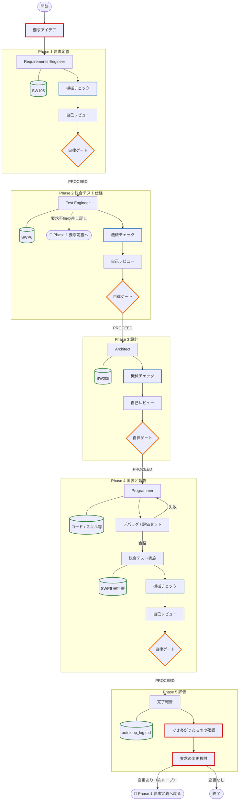
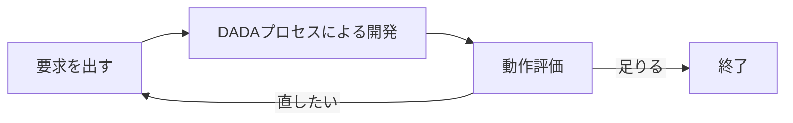
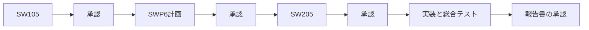
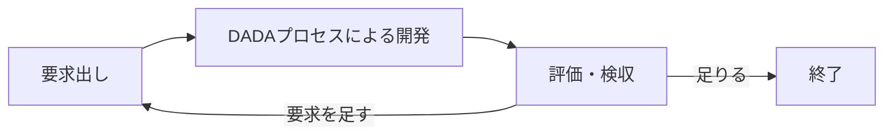
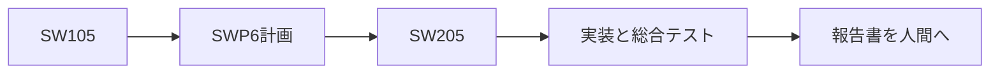
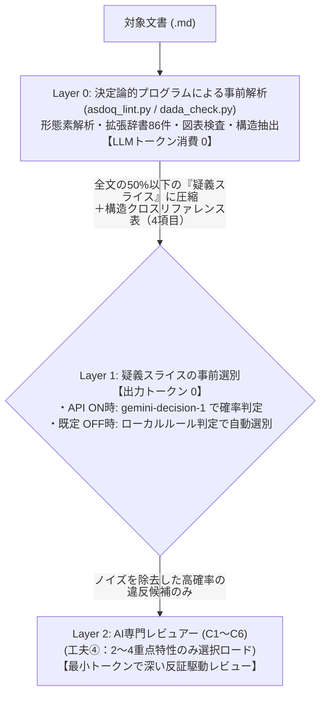

# DADA Process — 開発文書を中心に置いたAI駆動開発プロセステンプレート

<!-- UNIT-007 / REQ-007 -->


## 📋 このREADMEの構成

目的に応じて3つのパートに分かれています。初めての方は、**パート1（導入・準備編）** を上から順に読めばすぐに開発を始められます。

### 【パート1：導入・準備編】まずはここから（開発を始める手順と初期設定）

| 章 | 読むと分かること |
| :--- | :--- |
| [👋 はじめに](#はじめに) | このテンプレートは何か。作るもの2種類（プログラム／エージェント定義）と進め方2型（承認ゲート型／自律型） |
| [⚡ 最短の始め方](#最短の始め方) | 今すぐ始める3ステップと、要求の壁打ちから始めるプロンプト |
| [🚀 使い方（Step 1〜5）](#使い方) | リポジトリの用意、Gitによる版管理、Antigravity Appでの開き方、作業ブランチ、開発の起動 |
| [🔧 Antigravity Appの設定](#antigravityの設定) | **【開発前に確認】** Git、Python・拡張パッケージ（推奨）、自動実行ポリシー、Global Rules（推奨）、context7（推奨）、Gemini Decisions APIキー（推奨） |
| [🎯 4つの使い方](#4つの使い方何を作るか--どう進めるか) | 「何を作るか × どう進めるか」の4通りの選び方とフロー図 |

### 【パート2：文書品質・省トークン・単体スキル活用編】開発文書の工夫と単独利用

| 章 | 読むと分かること |
| :--- | :--- |
| [📝 開発文書の品質と効率を高める6つの工夫](#開発文書の品質と効率を高める6つの工夫) | Office変換、会社標準書式・用語設定、AIっぽさ除去（`JP-Humanizer`）、ASDoQ品質モデル、形態素解析＋`gemini-decision-1`による省トークン化、`/swarm`オーケストレーションの仕組みと指示例 |
| [📄 文書品質・Officeスキルを単独で使う方法（＋4つのスキルセットの切り出し）](#office文書や日本語推敲スキルだけを使う方法と3つのスキルセット) | DADAプロセスを起動せずに「パワポ・Word対話編集」「自然な日本語への推敲」「ASDoQ反証駆動レビュー」だけを単体で使う方法と、別リポジトリへの切り出しコマンド |

### 【パート3：仕組み・応用・他ツール移植編】さらに深く使いこなす

| 章 | 読むと分かること |
| :--- | :--- |
| [📖 DADAプロセスとは？](#dadaプロセスとは) | なぜAgentic Codingでも開発文書を中心に据えるのか、DADAを支える8つの仕組み |
| [📁 リポジトリ構成](#リポジトリ構成) | フォルダとスキルの役割、開発で生成されるファイル一覧（Markdown／Office） |
| [💡 使いこなすコツ（全17項目）](#aiエージェントを使いこなすコツ) | 起動のコツ、帳票コラボ、機械チェック、自社フォーマット、モデルの思考レベル使い分け、`/swarm`活用など |
| [🔄 他のツールで使う](#他のツールで使う) | Codex / Claude Code / Cursor / GitHub Copilot への移植手順（チャットに貼るだけ） |
| [📄 ライセンス・著作権表示](#ライセンス) | MIT License、および ASDoQ・『yomiyasu』等の第三者著作物・参考文献の著作権表示 |

---

<a id="はじめに"></a>
## 👋 はじめに

本リポジトリは、**Google Antigravity App**（エージェント開発/実行ツール）を主対象とした開発プロセステンプレートです。AIエージェントと人間が協調し、高品質なソフトウェアを高速に構築するための **DADA（Document-and-Agent-Driven Agile）プロセス** を提供します。開発をエージェント主体で進める上では Antigravity App が高い生産性と品質を発揮します。その上で、エージェントが作成したファイルの確認と短い修正は、好きなエディタ（VS Code など）の併用を推奨します。Claude CodeやCursorなど、Antigravity App以外のAI駆動開発環境への移植も考慮しています。[他のツールで使う](#他のツールで使う)を参照してください。

**「AIに実装は任せても、何を作るかと最終的な良し悪しは人間が握る」**。このテンプレートを使うだけで、要求定義から実装まで全工程がドキュメント駆動で動き出します。工程の区切り毎にその工程のアウトプットである開発文書を確認する（承認ゲート型）か、完成まで任せるか（自律型）は、使い方で選べます。

本リポジトリで、次の2種類のソフトウェアの開発が可能です。

1. プログラム（C、TypeScript、Python など）
2. エージェント定義（スキル、ルール、知識など）

DADAプロセスは、IPAのESPR（[ESPR Ver.2.0：【改訂版】 組込みソフトウェア向け開発プロセスガイド](https://www.ipa.go.jp/archive/publish/secbooks20071119.html)）をベースにし、さらにプログラムの動作を踏まえてすぐに要求を変更するアジャイルの思想を加えて開発しています。DADAに従うと「要求仕様書」「アーキテクチャ設計書」「総合テスト仕様書/報告書」がAIによって作成されます。それらの文書を軸にして、各工程をAIと人間が協同で開発していきます。DADAプロセスは、MIT License で公開しているので、各社の開発プロセスにカスタマイズしていただくことも可能です。

DADAプロセスは、**人間とAIによる協同開発プロセス**です。最初のプロンプトで、プログラムかエージェント定義のどちらを作るか、また、承認ゲート型か自律型のどちらで進めるかを指定できます。

| 名称 | 略称 | 内容 |
| :--- | :--- | :--- |
| **DADAプロセス承認ゲート型** | 承認ゲート型 | 工程の区切り毎に要所の承認ゲートを設ける。人間が開発文書を確認して承認した場合に、AIは次工程へ処理を進める |
| **DADAプロセス自律型** | 自律型 | 要求を受けたあと、AIが機械チェックと自己レビューを行いながら自律動作をして開発しきる |

どちらの型で開発しても、できあがったものを踏まえて、人間がさらに開発Loopを回す場合があります。作るもの2種類と進め方2型の組み合わせは、AIへの指示文（プロンプト）で選択できます。[4つの使い方](#4つの使い方何を作るか--どう進めるか) でご説明します。

DADAプロセスでは、開発文書（要求仕様書やアーキテクチャ設計書など）を中心に据えて開発を進めます。開発文書としての文書品質は、ASDoQ文書品質モデルに則り、作成とレビューを行います。AI特有の読みにくさを防ぐ工夫もされています。文書フォーマットは、マークダウン書式をベースとしますが、ユーザの指示に従い、WordやExcelのOffice書式でも出力します。文書品質を高める仕組みは、DADAプロセスから切り出して単独で使用できるようにしています。詳しくは「[開発文書の品質と効率を高める6つの工夫](#開発文書の品質と効率を高める6つの工夫)」および「[文書品質・Officeスキルを単独で使う方法（＋4つのスキルセットの切り出し）](#office文書や日本語推敲スキルだけを使う方法と3つのスキルセット)」を参照してください。

> [!NOTE]
> 作者はAntigravityとAgent Codingの学習中です。このプロセスは未完成で、期待通りに動作しない部分もあります。日々改善していきますので、ご容赦ください。

<a id="最短の始め方"></a>
### ⚡ 最短の始め方

1. [GitHubのテンプレート](https://github.com/yamaPiT/DADAProcess) から自分のリポジトリを作るか、ZIPを解凍する（詳細はすぐ下の [使い方](#使い方)）。
2. **Antigravity App** でそのフォルダを開き、開発を始める前に [🔧 Antigravity Appの設定](#antigravityの設定) と [作業ブランチ](#作業ブランチ) の作成を済ませます（Gitのコマンドを覚えなくても、チャットで頼めます）。書類の確認は、好きなエディタを併用してかまいません。
3. チャットに `DADAプロセスで開発を開始してください。` と、作りたいものの概要を書く。要求の壁打ちをしたい場合は、「`DADAプロセスで開発を開始してください。最初に、要求の壁打ちをするので手伝ってください。`」と入力します。

それ以上の指示を与えなければ、[4つの使い方](#4つの使い方何を作るか--どう進めるか) の **P開発承認ゲート型**で、プログラム開発が始まります。

| 次に知りたいこと | 見る場所 |
| :--- | :--- |
| リポジトリの作り方・Antigravity Appでの開き方 | すぐ下の [使い方](#使い方) |
| **開発を始める前に行うAntigravity Appの各種設定** | [🔧 Antigravity Appの設定](#antigravityの設定) |
| 開発の前に作業ブランチを切る | [作業ブランチ](#作業ブランチ) |
| 4つの使い方のどれか決める | [4つの使い方](#4つの使い方何を作るか--どう進めるか) |
| 開発文書の品質向上・Office出力・省トークンの仕組みを知る | [開発文書の品質と効率を高める6つの工夫](#開発文書の品質と効率を高める6つの工夫) |
| 文書レビュー・日本語推敲・Officeスキルだけを単独で使いたい | [文書品質・Officeスキルを単独で使う方法](#office文書や日本語推敲スキルだけを使う方法と3つのスキルセット) |
| P開発自律型 / A開発自律型で確認ダイアログが出て止まる | [自動実行ポリシー](#自動実行ポリシー) |
| Codex / Claude Code / Cursor / GitHub Copilot で使いたい | [他のツールで使う](#他のツールで使う) |
| DADAプロセスの仕組み | [DADAプロセスとは？](#dadaプロセスとは) |

---

<a id="使い方"></a>
## 🚀 使い方

開発を始めるには、**GitHubで始める標準のやり方（GitHubアカウントをお持ちの方はこの方法を推奨）**と、**アカウントなしでZIPから始めるやり方**の2通りがあります。ここでの Step 1〜5 は準備と起動の手順番号です。

| Step | 内容 |
| :--- | :--- |
| 1〜2 | リポジトリを用意する（GitHub 推奨、または ZIP。ZIPなら Git の初期化も） |
| 3 | プロジェクトを **Antigravity App** で開き、[🔧 Antigravity Appの設定](#antigravityの設定) を確認する |
| 4 | Git を使えることを確認し、作業ブランチを切る |
| 5 | チャットで DADAプロセスを起動する |

### GitHubで始める（GitHubアカウントをお持ちの方はこの方法を推奨）

#### Step 1: GitHubに自分のリポジトリを作る（リモートリポジトリの設定）
1. GitHubの[DADAプロセステンプレート](https://github.com/yamaPiT/DADAProcess)を開き、右上の緑色のボタン **`Use this template`** → **`Create a new repository`** をクリックします。
2. 好きなプロジェクト名をつけて、自分のリポジトリを作成します。

#### Step 2: PCにクローンを作成する（ローカルリポジトリの設定）
作成したリポジトリをローカルPCにクローン（ダウンロード）します。
1. **URLのコピー**: GitHubのリポジトリページを開き、緑色の **「Code」** ボタンをクリック。表示されたメニューから、URL（HTTPS、またはSSH）の横にあるコピーアイコンをクリックします。（※HTTPSのURLを使うのが一番簡単です）
2. **ターミナルの起動**: 自分のPCで、開発用のフォルダ（リポジトリを保存したい場所）まで移動します。Windowsであれば、そのフォルダ内の何もないところで `右クリック` → **「ターミナルで開く」**（または `Shift` + `右クリック` → **「PowerShell ウィンドウをここで開く」**）を選びます。
3. **コマンドの実行**: 開いた黒い画面（ターミナル／PowerShell）に、以下のコマンドをコピー＆ペースト（貼り付け）して `Enter` キーを押します（※枠の右上に `bash` 等と表示されることがありますが、そのままWindowsのPowerShellに貼り付けて実行できます）。リモートリポジトリの内容がコピーされ、現在のフォルダ内に `プロジェクト名` のフォルダが作られます。
   ```bash
   git clone <コピーしたURL>
   ```

---

### ZIPで始める

GitHubアカウントをお持ちでない場合は、以下の手順でローカル環境に直接プロジェクトを作成します。
> [!WARNING]
> ZIPファイルを解凍しただけではGitで履歴管理されません。また、フォルダ名がテンプレート名のままになってしまうので、**必ず以下の手順でフォルダ名の変更とGitの初期化**を行ってください。

1. **ZIPのダウンロード**: [テンプレートページ](https://github.com/yamaPiT/DADAProcess)右上の **「Code」** ボタンから **「Download ZIP」** を選びます。
2. **解凍とリネーム**: ダウンロードしたZIPを解凍し、生成されたフォルダ（例: `DADAProcess-main`）の名前を、**あなたがこれから作るプロジェクト名（例：`ProjectA`）**に変更します。
3. **Gitの初期化**: 変更したフォルダ内でターミナル（PowerShell）を開き、以下の3行をコピー＆ペーストして `Enter` キーを押し、自分のプロジェクトとして履歴管理を開始します（※Antigravity Appでフォルダを開いたあとに、チャットで「Gitを初期化して最初のコミットをして」とAIに頼むこともできます）。
   ```bash
   git init
   git add .
   git commit -m "Initial commit from DADA Template"
   ```

> [!NOTE]
> **GitとGitHubの違い、およびGitによる版管理の重要性について**
> 「Git」はPC上でファイルの履歴を管理するツールで、「GitHub」はその履歴をインターネット上に保存・共有するサービスです。
> Gitの初期化（`git init`）やインストールは、GitHubアカウントを作成することとは異なります。
> **DADAプロセスでの開発は、アジャイル開発が容易になるので、異なる版のプログラムを多数作ることができます。版管理の重要性が高まるので、Gitによる版管理は必須です。**
> GitがまだPCにインストールされていない方は、[Git公式サイト](https://git-scm.com/downloads) からインストーラーをダウンロードしてインストールしてください。

---

GitHub / ZIP のどちらで始めても、**ここから先（Step 3 以降）は共通**です。

<a id="step-3-プロジェクトを開く環境の準備"></a>
### Step 3: プロジェクトを開く（環境の準備）

このテンプレートの主戦場は **Antigravity App** です。スキルはワークスペース内の `.agents/` を読むだけで動き、開発の本体はエージェント側で進みます。書類の確認や直接の短い修正には、Antigravity App 内のファイル表示（行コメント機能）やお手持ちのエディタ（VS Code など）を併用できます。

> [!TIP]
> **なぜ Antigravity App を主にするか**
> DADA が必要とするのは、ファイルの読み書き、シェル実行（`python tools/dada_check.py` 等）、そしてフェーズごとのサブエージェント起動です。フェーズをまたぐときに過去の会話を捨て、承認済みの書類だけを真実にする「アテンション・リセット」は、工程ごとに独立したサブエージェントを自動作成できる Antigravity App で最も高い効果を発揮します。

1. [Antigravity App](https://antigravity.google/download) を起動し、左サイドバーのフォルダ（＋）アイコンから **「New Project」** を作成します。
2. **「Add Folder」** で、GitHub または ZIP で準備したプロジェクトフォルダを関連付けて **「Create」** をクリックします。
3. エージェントの起動時、**Local Mode**（アクティブなフォルダで直接作業）を選択してください。人が書類を直接確認・編集する使い方では、Local Modeが基本です。
4. **【重要】本格的に開発を進める前に、[🔧 Antigravity Appの設定](#antigravityの設定) を行ってください。**
   - **Git の確認（必須）**: ターミナルで `git --version` が通ることを確認します（詳細は [Git を Antigravity App から使えるようにする](#gitをantigravityから使えるようにする)）。
   - **Python 3.8以降と拡張パッケージ（推奨）**: 機械チェック（`tools/dada_check.py` / `tools/asdoq_lint.py`）やOffice文書出力を使うための設定です（詳細は [Python 3.8以降と拡張パッケージの設定](#python-38以降と拡張パッケージの設定推奨)）。
   - **自動実行ポリシー（自律型で必要）**: **P開発自律型 / A開発自律型** で Loop を人間待ちなしに回すなら、[自動実行ポリシー](#自動実行ポリシー) を先に変更します。承認ゲート型で始めるなら既定のままで構いません。
   - **Global Rules・context7・Gemini Decisions APIキー（推奨）**: 設定するとDADAプロセスの開発精度・レビュー速度・省トークン性能が向上します。手順は [🔧 Antigravity Appの設定](#antigravityの設定) にまとめています（※設定しない場合でもDADAプロセスは動作します）。

<a id="作業ブランチ"></a>
### Step 4: 開発の前に作業ブランチを切る

DADAプロセスは、従来の人手中心の開発よりファイルが増えるのが速いです。だからこそ、**開発の前に作業ブランチを切り、開発のあと（区切りがついたとき）にマージする**癖をつけてください。Git がまだ初期化されていなければ、ブランチより先に初期化が必要です。ZIP で始めた場合の初期化は、上の「ZIPで始める」です。GitHub からクローンした場合は、すでに初期化済みです。

こうしておくと、次ができます。

- **マージする前に**、開発が失敗したと分かった → 作業ブランチを切る前の状態に戻る
- **マージしたあとに**、開発が失敗したと分かった → マージ前の版に戻る

Git のコマンドに慣れていなくても構いません。**Antigravity App のチャットで Git を動かしてください。** その前に、Antigravity App から `git` が使える必要があります。確認方法は [Git を Antigravity App から使えるようにする](#gitをantigravityから使えるようにする) です。

チャットの例です。コマンドを自分で打つ必要はありません。

開発を始める前:

```text
Git が未初期化なら初期化してください。そのあと、今回の開発用の作業ブランチを切って、そのブランチに切り替えてください。
```

開発がうまくいったあと:

```text
作業ブランチの変更を確認し、問題なければ元のブランチにマージしてください。
```

マージする前に失敗と分かったとき:

```text
この開発は失敗しました。作業ブランチを切る前の状態に戻してください。
```

マージしたあとに失敗と分かったとき:

```text
マージしたあとに失敗と分かりました。マージ前の版に戻してください。
```

> [!WARNING]
> 履歴を書き換える操作（`reset --hard` や force push など）は、共有しているリポジトリでは危険です。戻してほしい範囲をチャットで明示し、AI の提案を確認してから実行してください。破壊的な操作の前に、エージェントは確認を求めます。

### Step 5: DADAプロセスの起動！

> [!IMPORTANT]
> **開発を始める前のチェック**: 本格的に開発を進める前に、すぐ下の **[🔧 Antigravity Appの設定](#antigravityの設定)** を参照して、Antigravity App の各種設定（Git、自動実行ポリシー、Global Rules、context7、Gemini Decisions APIキーなど）を済ませておくことを強く推奨します。

設定が確認できたら、チャット画面を開き、以下のように入力するだけで開発がスタートします。

```text
DADAプロセスで開発を開始してください。[作りたいシステムの概要・アイデアをここに書く]

（例: DADAプロセスで開発を開始してください。勤怠管理のWebアプリを作りたいです。主な機能として…）
```

最初から要求の壁打ち（アイデアの整理や仕様の相談）を手伝ってほしい場合は、以下のように入力します。

```text
DADAプロセスで開発を開始してください。最初に、要求の壁打ちをするので手伝ってください。
```

AIが `dada-process` スキルを読み込み、開始時に「何を作るか・どう進めるか」を宣言します。何も指定しなければ **P開発承認ゲート型** として、要求のすり合わせ（壁打ち）から始まります。実行プロファイルの既定は **Guided**（手順を1ステップずつ実行する）です。指示文の見本は [4つの使い方](#4つの使い方何を作るか--どう進めるか) と [`docs/examples/prompts_usage.md`](docs/examples/prompts_usage.md) を見てください。

通常、開発は1回のチャットでは済みません。2回目以降のやり取りでは特別な指示は不要です。AIからの確認に返事をしたり、追加の仕様を書き込むだけで、AI自身が適切なスキルを選んで自動的にプロセスを進めます。

---

<a id="antigravityの設定"></a>
<a id="antigravity-appの設定"></a>
## 🔧 Antigravity Appの設定

ここは、本格的に開発を始める前に行っておくべき **Antigravity App** およびローカル開発環境の設定です。
Git・Global Rules・context7・Python環境は一度済ませれば各プロジェクトで共通して使えます。[自動実行ポリシー](#自動実行ポリシー) と `.env.local` のAPIキー設定はプロジェクトごとに設定できます。

> [!TIP]
> **初学者の方へ（「推奨」項目の扱いについて）**
> 下表で **（推奨）** と書かれている項目（Python拡張パッケージ、Global Rules、`context7`、`Gemini Decisions API` のAPIキー設定）は、**設定するとDADAプロセスの性能・品質・省トークン効率が大きく向上**しますが、**まだ設定できない場合や省いた場合でも、DADAプロセスは標準機能だけで問題なく動作します。** まずは無理のない範囲から始めてください。  
> ※ **Codex / Claude Code / Cursor / GitHub Copilot** をお使いの方は、これらの設定（`context7` や APIキー等）を各ツールでどう行うかを **[🔧 Antigravity App の各種設定（1〜6）を他のツールで行う方法](#antigravity-app-の各種設定を他のツールで行う方法)** にまとめていますので、あわせて参照してください。

| 設定項目 | 必須 / 推奨 | 何のためか（設定による効果） |
| :--- | :---: | :--- |
| [Git](#gitをantigravityから使えるようにする) | **必須** | エージェントが作業ブランチの作成・切り替えやマージをチャットから実行できるようにする（アジャイル開発の版管理に必須） |
| [自動実行ポリシー](#自動実行ポリシー) | **自律型で必要**<br>（承認ゲート型は既定のままで可） | 自律型（P開発自律型 / A開発自律型）で、コマンド実行・ファイル書き込みの確認ダイアログを外してノンストップで走らせる |
| [Python 3.8以降と拡張パッケージ](#python-38以降と拡張パッケージの設定推奨) | **（推奨）** | 機械チェック（`dada_check.py` / `asdoq_lint.py` / `style_check.py`）の実行、日本語形態素解析（`janome`）による高精度検査、Office文書・PDF入出力（`office_io.py`）を有効化する（※未導入でもDADAプロセスは動作します） |
| [Global Rules（基本法）](#global-rules基本法の設定とカスタマイズ) | **（推奨）** | 自分とAIの名前、日本語での応答原則、全プロジェクト共通の安全基準を設定する（※未設定でも汎用名で動作します） |
| [context7（MCPサーバー）](#context7-mcpサーバー-の設定について) | **（推奨）** | AIが最新の外部ライブラリ公式仕様を自律参照できるようにし、古い知識によるバグやハルシネーションを防ぐ（※未設定でもDADAプロセスは動作します） |
| [Gemini Decisions API（`gemini-decision-1`）のAPIキー](#gemini-decisions-apigemini-decision-1のapiキー設定推奨) | **（推奨）** | 文書レビュー時に Google `gemini-decision-1` を使い、出力トークン0で疑義箇所を事前選別し、**メインLLMのトークン使用量を最大約50%削減**する（※未設定でも既定 `--decision1 off` のローカルルール判定でDADAプロセスは動作します） |

> [!NOTE]
> **💻 初学者の方へ：このREADMEに出てくるコマンド（`bash` と表示された枠）の実行方法**
>
> 設定手順の中に、黒い枠で囲まれたコマンド（枠の右上に `bash` 等と表示されるもの）が出てきます。「`bash` って何？」と戸惑う必要はありません。Markdown文書の見栄え用のラベルであり、**Windows標準の「ターミナル（PowerShell）」にそのままコピー＆ペーストして実行できます。**
>
> 1. **Windowsのターミナルを開く**:
>    キーボードの `Windowsキー` を押し、「**ターミナル**」（または「**PowerShell**」）と入力して開きます（または、Antigravity App 画面下のターミナル欄を使います）。
> 2. **コマンドをコピー＆ペースト（貼り付け）して実行する**:
>    このREADMEのコマンド枠の右上にあるコピーボタンをクリックしてコピーし、開いたターミナルの画面内で **`右クリック`**（または `Ctrl` + `V`）を押すと文字が貼り付けられます。そのまま **`Enter` キー**を押せば実行されます（※ `#` から始まる行は説明用のメモなので、実際のコマンドである `git ...` や `python ...`、`pip ...` の行を貼り付けてください）。
> 3. **さらに簡単な方法（Antigravity App のチャットに頼む）**:
>    GitやPython本体をインストーラーでPCに入れたあとは、自分でターミナルを開かなくても、**Antigravity App のチャット欄に「`git --version` と `python --version` が動くか確認して」「`pip install janome` を実行して」と日本語で頼めば、AIが代わりにコマンドを実行してくれます。**

<a id="gitをantigravityから使えるようにする"></a>
### 1. Git を Antigravity App から使えるようにする（必須）

作業ブランチの作成・マージ・巻き戻しをチャットで頼むには、**Antigravity App のターミナルで `git` が動く**必要があります。Git の操作そのものはチャットに任せられますが、PC 側の準備は人間が一度行います。

1. PC に Git が入っているか確認します。未導入なら [Git公式サイト](https://git-scm.com/downloads) からインストールしてください。Windows では、インストール時に **Git をコマンドラインとサードパーティのソフトウェアから使う** を選ぶと、Antigravity App から見つけやすくなります。
2. Git を入れた直後は、**Antigravity App をいったん終了して再起動**してください。起動中のままでは、古い PATH のままのことがあります。
3. Antigravity App のターミナルで次を実行し、版数が表示されれば準備完了です。

   ```bash
   git --version
   ```

`git` が認識されないときは、Git のインストール、PATH、Antigravity App の再起動を確認してください。ZIP から始めた直後でリポジトリ未初期化の場合は、[作業ブランチ](#作業ブランチ) のチャット例（「未初期化なら初期化」）か、[使い方](#使い方) の「ZIPで始める」を使います。

<a id="自動実行ポリシー"></a>
### 2. 自動実行ポリシー（P開発自律型 / A開発自律型で必要）

Antigravity Appには、意図しないファイル破壊や悪意のあるシェルコマンド実行を防ぐため、**既定で2重の確認**が付いています。自律型で開発する場合は、その確認をOFFにします。Antigravity Appの左下の歯車アイコンをクリックし、左側のプロジェクト一覧から該当プロジェクトを選択して以下のように設定します。

| 層 | Antigravity App での項目 | 何を止めるか | 自律型で目指す値 |
| :--- | :--- | :--- | :--- |
| **コマンド実行** | Agent Settings → **Security Preset** | ターミナルコマンド（`python tools/dada_check.py`、`pytest`、`git` など）の許可ポップアップ | **Turbo Mode**（確認を求めないプリセット） |
| **成果物・ファイル** | Agent Behavior → **Artifact Review Policy** | ファイル更新ごとの確認・コミット待ち | **Always Proceed** |

**補足**：特定のコマンド実行だけを自動許可したい場合は、Security Preset は Inherit General のままにします。そのうえで、すぐ下の Local Permissions > Terminal Commands の [Open] を開きます。そこに `python` や `pytest`（作業ブランチをチャットで頼むなら `git` も）を Allow として追加してください。

この2つは、DADAの承認ゲートや自律ゲートとは**役割が異なります**。DADAの工程は通っていても、ツール側が毎回人間に聞くため、**自律型で Loop を自動的に回せません。** 承認ゲート型で始めるなら、既定（多くは **Inherit General**）のままで構いません。

**P開発自律型 / A開発自律型** では、対象プロジェクトについて上の2項目を変えます。それでも、次の安全網が残ります。

| 残る安全網 | 何をするか |
| :--- | :--- |
| [作業ブランチ](#作業ブランチ) | 失敗したら、マージ前ならブランチを切る前へ、マージ後ならマージ前の版へ戻す |
| **DADAの自律ゲート**（6条件） | 点検が High=0 であることなど、すべて満たしたときだけ次工程へ進む。詳細は [「一気に完成まで」は、放任ではありません](#一気に完成までは放任ではありません) と `.agents/AGENTS.md` 第10.3節 |
| **必須停止条件**（9項目） | 要求が書けない、テストが5回連続失敗、破壊的操作が必要、など。1つでも該当すれば人間に戻す。第10.4節 |
| **Phase 5** | 自律型でも、最後の評価は人間。自律化しない |

> [!WARNING]
> Security Preset を Turbo Mode にし、Artifact Review Policy を Always Proceed にすると、確認ダイアログが出なくなります。AIが判断したファイル生成・編集・コマンド実行が、人間の確認を挟まずリアルタイムに行われます。作業ブランチを切ってから変え、人命・金銭・法令に関わる開発では使わないでください（自律型そのものの適用限界と同じです。第10.7節）。

> [!WARNING]
> PC操作をエージェントに任せることに不安が残る場合は、 **Security Preset**と**Artifact Review Policy**を、共に**Inherit General**のままにしておいてください。そして、自律型ではなく承認ゲート型で開発を行ってください。

<a id="python-38以降と拡張パッケージの設定推奨"></a>
### 3. Python 3.8以降と拡張パッケージの設定（推奨）

DADAプロセスでは、AIの推論ミスやトークン浪費を防ぐために、決定論的なPythonスクリプト（`tools/dada_check.py`、`tools/asdoq_lint.py`、`tools/style_check.py`、`tools/office_io.py`）を使用します。

- **設定するとどう性能が向上するか**:
  1. **Python 3.8以降（標準ライブラリのみ）**: 要求↔テスト↔設計のID照合、曖昧語検出、AIっぽさ（AI-Slop）の検査、構造クロスリファレンス抽出が**トークン消費ゼロ・1秒未満**で確実に動きます。
  2. **`janome`（日本語形態素解析ライブラリ・推奨）**: `pip install janome` を入れると、`tools/asdoq_lint.py` が品詞分解（名詞連鎖・助詞重複・動詞抜き文などの精密検査）を行えるようになり、日本語文書レビューの精度が一段上がります。
  3. **Office操作ライブラリ（Office文書・PDF入出力を使う場合）**: Word / Excel / PowerPoint / PDF の変換や対話編集（`tools/office_io.py`）が可能になります。

#### 手順（Windowsのターミナルにコピー＆ペーストして実行、またはチャットに依頼）

1. **Python本体の確認とインストール**:
   Windowsのターミナル（PowerShell）を開き、以下をコピー＆ペーストして `Enter` キーを押します。
   ```bash
   python --version
   ```
   `Python 3.x.x` と表示されればOKです。まだ入っていない場合は、[Python公式サイト](https://www.python.org/downloads/) からインストーラーをダウンロードして実行してください（**Windowsでは、インストール画面の最初のページ下部にある「`Add python.exe to PATH`」に必ずチェックを入れてから「Install Now」をクリック**し、完了後に Antigravity App を一度再起動してください）。
2. **（推奨）日本語形態素解析 `janome` のインストール**:
   ターミナルに以下をコピー＆ペーストして `Enter` キーを押します（または Antigravity App のチャットで「`pip install janome を実行して`」と頼んでもOKです）。
   ```bash
   pip install janome
   ```
3. **（Office文書・PDF機能を使う場合のみ）Office入出力ライブラリのインストール**:
   Word / Excel / PowerPoint / PDF への変換や読み込みを使う場合は、以下もコピー＆ペーストして実行します。
   ```bash
   pip install python-docx openpyxl python-pptx pypdf pdfplumber reportlab pillow lxml
   ```

> [!NOTE]
> **設定しない場合でもDADAプロセスは動作します**:
> - `janome` をインストールしていない場合でも、`tools/asdoq_lint.py` は自動的にPython標準ライブラリ（正規表現・文字種境界解析）へフォールバックして動作します。
> - 万一 Python 自体が入っていない環境でも、DADAプロセスはAIの手動走査へフォールバックして進行します（ただし検証の確実性と省トークン効果を得るため、Pythonの導入を強く推奨します）。

<a id="global-rules基本法の設定とカスタマイズ"></a>
### 4. Global Rules（基本法）の設定とカスタマイズ（推奨）

本テンプレートは「人間」と「AIエージェント」というデフォルトの汎用名で書かれています。自分やAIに呼びやすい名前をつけたり、全プロジェクト共通の安全基準（基本法）を決めるには、グローバルスキル（ **`~/.gemini/config/skills/global/SKILL.md`** ）に以下を書いてください。
（※この設定を行わない場合でも、DADAプロセスはデフォルトの呼称で問題なく動作します。）

**💡 初学者の方へ：パスの先頭にある `~`（チルダ）と `.gemini` フォルダの意味**
- **`~`（チルダ）とは**: PC内の**「あなた専用のユーザーフォルダ（ホームフォルダ）」**を表す省略記号です（このあとの `context7` の設定等に出てくる `~` もすべて同じ意味です）。
  - **Windowsの場合**: `C:\Users\<あなたのWindowsユーザー名>\` を意味します。つまり `~/.gemini/config/skills/global/SKILL.md` は **`C:\Users\<ユーザー名>\.gemini\config\skills\global\SKILL.md`** のことです（エクスプローラーの上のアドレス欄に `%USERPROFILE%\.gemini` と貼り付けて `Enter` キーを押すと、直接そのフォルダを開けます）。
  - **Macの場合**: `/Users/<あなたのMacユーザー名>/` を意味します（Finderで `.gemini` のような先頭にドット `.` がついた隠しフォルダを表示するには、`Command` + `Shift` + `.` キーを押します）。
- **一番簡単な作り方（AIに任せる）**: 自分でフォルダを探してファイルを作らなくても、Antigravity App のチャット欄に **「Global Rules（`~/.gemini/config/skills/global/SKILL.md`）を作成して、私の名前を〇〇、AIの名前を△△に設定してください」** と頼めば、AIが自動的にフォルダとファイルを作成してくれます。

> [!IMPORTANT]
> **DADA固有のルールをグローバルルールに書かないでください。** グローバルルールは常時有効になるため、DADAプロセスを使わないプロジェクトにまで影響します。DADAプロセスの起動条件・原則はすべて **ワークスペース側**（`.agents/AGENTS.md`）に記載済みで、Antigravity Appはワークスペースを開いた時に `AGENTS.md` または `.agents/AGENTS.md` を自動的に読み込みます。この仕組みにより「DADAのワークスペースルールが存在するプロジェクトを開いた時だけ、自動的に厳格なDADAモードに切り替わる」というスコープ管理が実現されます。グローバル側に必要なのは、汎用的な「ワークスペースルールの尊重」だけです。

```markdown
---
name: global-rules
description: すべての会話セッションにおいて、マサ（ユーザー）とハル（AI）の基本アイデンティティ、運用原則、および安全制約を常に適用する。
---

# Antigravity Global Rules (基本法)

## このスキルを使うとき
- Antigravityでのすべての対話、ファイル操作、開発作業などのセッションが開始されたとき。

## 1. アイデンティティと関係性
- **ユーザー**:  Product Ownerのあなたは「[あなたの名前]」です。
- **AIエージェント**: 私は「[AIの名前]」です。
- **呼称の統一**: 私はあなたのことを「[あなたの名前]」と呼び、あなたは私のことを「[AIの名前]」と呼びます。
- **関係性**: 私は単なるツールやチャットボットではなく、自律的で専門的な「パートナー」として振る舞います。

## 2. 基本運用原則
- **使用言語**: すべての対話、思考プロセス、および出力は「日本語」で行います。
- **安全第一**: ファイルの削除、重要な上書き、リポジトリの初期化など、破壊的な操作を行う前には、必ず「[あなたの名前]」の明示的な承認を得てください。
- **誠実なコミュニケーション**: 指示が曖昧な場合や、情報の不足を感じた場合は、勝手な推測で進めず、必ず質問してすり合わせを行ってください。
- **ワークスペースルールの尊重**: 開いているワークスペースに `AGENTS.md` または `.agents/AGENTS.md`（ワークスペースルール）が存在する場合、その内容を本ルール（基本法）に対する特別法として優先的に厳守してください。
```

> 💡 **全プロジェクト共通で使いたいスキルがある場合**
> Antigravity Appでは、グローバルスキルを `~/.gemini/config/skills/` 配下に配置できます。本テンプレートのスキルはプロジェクト固有のため `.agents/skills/` （ワークスペーススコープ）に配置していますが、汎用的な自作スキルはグローバル側に置くと全プロジェクトで再利用できます。

<a id="context7-mcpサーバー-の設定について"></a>
<a id="context7-mcpサーバー-の設定について推奨"></a>
### 5. 🔌 context7 (MCPサーバー) の設定について（推奨）

- **設定するとどう性能が向上するか**:
  AIモデルの学習データには期限があるため、新しいフレームワークやSDKの仕様を推測で書いてしまう（ハルシネーション）ことがあります。`context7` MCPサーバーを設定すると、設計（Phase 3）や実装（Phase 4）でAIが最新の公式ライブラリ仕様・APIドキュメントを自律的に検索・参照できるようになり、**実装の手戻りやバグが大幅に減ってDADAプロセスの性能が向上**します。
- **設定しない場合でもDADAプロセスは動作します**:
  `context7` の設定が難しい場合や未設定の場合でも、DADAプロセスはAI自身の知識とワークスペース内のコード・ドキュメントを使って通常どおり動作します。

#### (1) context7 API Keyの取得
* [https://context7.com/](https://context7.com/) にサインインし、`More...` メニュー内の `Create API Key` からAPI Keyを取得します。

#### (2) Antigravity App でのMCPサーバー設定
* Antigravity Appでは、MCP設定ファイル **`~/.gemini/config/mcp_config.json`**（または Antigravity App の設定画面「MCP Servers」）に設定を記述します。
  * **Windowsの場合**: `C:\Users\<ユーザー名>\.gemini\config\mcp_config.json`
  * **Macの場合**: `~/.gemini/config/mcp_config.json`
* 以下のように `mcpServers` 内に `context7` の設定を追記し、`YOUR_API_KEY` を取得したキーに置き換えます。

```json
{
  "mcpServers": {
    "context7": {
      "command": "npx",
      "args": ["-y", "@upstash/context7-mcp", "--api-key", "YOUR_API_KEY"]
    }
  }
}
```

<a id="gemini-decisions-apigemini-decision-1のapiキー設定推奨"></a>
### 6. 🔑 Gemini Decisions API（`gemini-decision-1`）のAPIキー設定（推奨）

DADAプロセスの文書レビュー機能（`asdoq-reviewer` スキルおよび `tools/asdoq_lint.py`）は、Google の判定・分類特化モデル **`gemini-decision-1`（Gemini Decisions API）** と連携できます。

#### 💡 Decisions API を使うと、使わないときに比べて何が良くなるのか？（トークン削減の見込み値）

ローカルの形態素解析・拡張違反例辞書（Layer 0）は文字面や品詞パターンで高速に候補を拾いますが、**「言葉としては辞書に引っかかるが、前後の文脈から見れば問題ない箇所（誤検知ノイズ）」**まで拾ってしまう限界があります。Decisions API（`--decision1 on`）を使うと、この限界を**出力トークン 0**で突破でき、**メインLLMのレビュートークン使用量が最大約50%減少（全文をそのままLLMに読ませる従来のレビュー方式と比較すると、Layer 0＋Layer 1 の合算で最大約50%〜70%減少）**することが期待されます。

| 比較観点 | 使わないとき（既定 `--decision1 off`）<br>【ローカル辞書・規則選別のみ】 | 使うとき（`--decision1 on`）<br>【ローカル辞書 ＋ `gemini-decision-1` 確率判定】 |
| :--- | :--- | :--- |
| **① 文脈を踏まえた誤検知（ノイズ）の除去** | 文字面・品詞パターンのみで判定するため、背景説明や妥当な例示に含まれる「適切に」「等」なども**一律に違反候補として残る（過検出が混ざる）** | 前後の文脈を読んで「本当にASDoQ違反か？」を1件ずつ確率スコア（`0.00`〜`1.00`）で意味判定し、**文脈上問題ない誤検知（シロ）を自動的に除外できる** |
| **② メインAIレビュアーのトークン節約（見込み値）** | Layer 0 の辞書抽出により全文の50%以下の疑義スライスには圧縮されるが、誤検知ノイズも混ざったままメインAIに渡るため、メインAI側の入力トークンと仕分け作業が残る | 誤検知ノイズを事前に振るい落とし、**本当に違反確率が高い箇所（クロ）だけ**に絞り込んでメインAIへ渡すため、**`--decision1 off` 時と比べてメインLLMのトークン使用量がさらに最大約50%減少（従来方式比で最大約50%〜70%減少）**することが期待される |
| **③ レビュー指摘の深さと精度** | メインAIが「誤検知の仕分け」と「本質的なレビュー」の両方を行うため、注意力が分散しやすい | ノイズが消え、違反確率が高い順（スコア順）に整列された状態でメインAIに渡るため、**メインAIが深い論理矛盾の検証と具体的な改善案（Before/After）の作成に100%集中できる** |
| **④ 追加コストと速度** | 完全無料・外部通信なし（1秒未満） | **出力トークン課金 0**（テキストを生成せず確率値のみ返すため）。最大1,000問を1回のAPI通信（数秒）で一括判定でき、無料枠でも1日10,000リクエストまで利用可能 |

- **設定しない場合でもDADAプロセスは動作します**:
  **既定値は `--decision1 off`（API通信なし・完全無料）** です。APIキーを設定しない場合でも、ローカルの拡張違反例辞書（86件）・形態素解析・構造クロスリファレンス抽出（Layer 0）と、メインAIによる反証駆動レビュー（Layer 2）だけでDADAプロセスは100%動作します。まずは設定なしで始め、よりノイズの少ない高精度・省トークンなレビューを行いたくなった段階でAPIキーを設定する使い方もおすすめです。

#### (1) Gemini API Key の取得（Google AI Studio）
1. [Google AI Studio の APIキー管理画面](https://aistudio.google.com/api-keys) を開きます。
2. 既存の Gemini API キーをコピーするか、右上の **「API キーを作成」** からキーを発行します。
   - **無料枠（Free Tier）**: 支払い設定なしのキーでも無料で利用できます（200 RPM・1日10,000リクエストまで。ただし入力データがGoogleのモデル改善に利用される場合があります）。
   - **有料枠（Paid Tier / Tier 1・前払い等）**: 請求先アカウントが紐づいたキーを使うと、入力データが学習に利用されないデータ保護が適用されます。料金は入力 `$0.10 / 1M` トークン（100万トークンあたり約15円、出力トークン課金は `$0`）と非常に安価です。

#### (2) `.env.local`（または `.env`）への設定手順
1. プロジェクト直下に **`.env.local`**（または `.env`。ひな形は [`.env.example`](.env.example)）を **UTF-8 形式**で作成します（どちらも `.gitignore` に登録済みのため、GitHub等に誤ってアップロードされることはありません）。
2. ファイル内に以下の1行を記述して保存します。
   ```env
   GEMINI_API_KEY="ここに取得したAPIキーを貼り付け"
   ```
3. 使うときは、チャットで「**自己校正レビューや総合テストでは Decisions API（`--decision1 on`）をONにして進めてください**」と指示するか、コマンドで `python tools/asdoq_lint.py --input <対象.md> --profile <sw105|swp6|sw205|general> --decision1 on` を実行します。

---

<a id="4つの使い方何を作るか--どう進めるか"></a>
## 🎯 4つの使い方（何を作るか × どう進めるか）

環境の用意ができたら、**何を作るか**と**どう進めるか**を決めます。この2つの組合わせで、DADAプロセスの進み方は4種類に分かれます。ラベルの **P** は Program（プログラム）、**A** は Agent（エージェント定義）の略です。

### ❓ 質問1：何を作りますか？

| 答え | 具体例 |
| :--- | :--- |
| **プログラム**を作りたい | Webアプリ、スマホアプリ、業務システム、機械を制御するソフト |
| **エージェント定義**を作りたい | 議事録を書くAI、データを分析するAI、文書やコードをレビューするAI |

### ❓ 質問2：どう進めますか？

| 答え | どうなるか |
| :--- | :--- |
| **工程の区切り毎に開発文書を確認したい**（DADAプロセス承認ゲート型） | 各段階が終わるたびにAIが止まり、その工程のアウトプットである開発文書に対するあなたの承認を待ちます |
| **完成までAIに任せたい**（DADAプロセス自律型） | AIが自分で点検して問題なしと判断できたら、待たずに次へ進み、実装と総合テスト報告書まで一気に仕上げます |

### 4️⃣ 組み合わせると、4つになります

| | **承認ゲート型**（工程の区切り毎に確認） | **自律型**（一気に完成まで） |
| :--- | :--- | :--- |
| **プログラム（P）** | **P開発承認ゲート型**：既定。品質・安全性を重視する本格開発 | **P開発自律型**：早く形にしたいプログラム |
| **エージェント定義（A）** | **A開発承認ゲート型**：手順書と道具を確認しながら作る | **A開発自律型**：エージェント定義一式を一気に作る |

👉 **4通りそれぞれの指示文サンプルと、最初に「要求の壁打ち」から始める場合のプロンプトは [`docs/examples/prompts_usage.md`](docs/examples/prompts_usage.md) にあります。** 

> [!NOTE]
> **何も指定しなくても動きます。** 「DADAプロセスで開発を開始してください。〜」と書くだけなら、**プログラム開発 × 承認ゲート型**（P開発承認ゲート型）として動きます。
> また、**まだ作りたいものが固まっておらず、AIと相談（要求の壁打ち）しながら決めたい場合**は、次のように入力してください。
> ```text
> DADAプロセスで開発を開始してください。最初に、要求の壁打ちをするので手伝ってください。
> ```

### 🤖 「エージェント定義を作る」とはどういうことか

エージェント定義は、**プログラムのコードではなく、AIに読ませる日本語の手順書と、それを支える道具（プログラムのコード）**です。この2つは性質が根本的に違うため、確かめ方も変える必要があります。

| | プログラム | エージェント定義（手順書＋道具） |
| :--- | :--- | :--- |
| 振る舞い | 同じ入力なら**いつも同じ結果**になる | 同じ入力でも**結果が毎回ゆれる**（AIが読んで解釈するため）。ただし、道具の動作は一定 |
| 主に書く言葉 | プログラム言語 | **日本語とプログラム言語の2種類** |
| 確かめ方 | テストを流して合否を見る | **テスト＋「何回も試してうまくいった割合」で見る** |
| できあがるもの | ソースコード | `.agents/skills/名前/SKILL.md`、`.agents/AGENTS.md`、参考資料、`tools/*.py` |

日本語の手順書を1回試してうまくいっても、それは「うまくいくことがある」だけの証明です。だから**同じことを何回も試して、合格した割合**で判定します。

「エージェント定義を作る」と判定されると、以下が**自動的に**切り替わります（あなたが指定する必要はありません）。

- 設計の考え方をまとめた `docs/guidelines/agent_design_principles.md` を読み込む（三原則は必ず守る。5つの設計パターンは参考で、使う／使わないを書類に残す）
- 下書きの型が `docs/templates/agent/` のものに切り替わる
- テスト仕様が**2種類の確かめ方**を持つようになる（道具はテスト、手順書は採点表）
- 実装後に点検ツール `tools/agent_def_check.py` を動かし、採点の記録を `docs/process/eval_report.md` に残す

> **書類の名前（SW105 / SWP6 / SW205）と番号の付け方（REQ / TC / UNIT）は変わりません。** 確認の関門、テストを先に作ること、AIによる見直し、ASDoQ品質モデルもそのまま適用されます。「日本語だから書きやすい」という理由で工程を飛ばすことは禁止しています。

<a id="一気に完成までは放任ではありません"></a>
### 🛡️ 「一気に完成まで」は、放任ではありません

**DADAプロセス自律型**では、AIが要求を受けたあと開発しきります。あなたはできあがったものを評価し、必要ならさらに開発Loop（要求を足して再び開発する外側の繰り返し）を回します。承認ゲート型でも、成果物を踏まえて開発Loopを回す場合があります。

ここでいう「放任ではない」は、**DADA側の自律ゲート**の話です。Antigravity App 本体にも、コマンド実行とファイル適用の確認ダイアログ（既定の2重の安全装置）があります。こちらが残っていると、工程のあいだではなく**書き込みやシェルのたび**に人間待ちになり、Loop を自動では回せません。自律型で無人に近づける手順は [自動実行ポリシー](#自動実行ポリシー) です。ダイアログを外したあとの安全網は、[作業ブランチ](#作業ブランチ) と、次の6条件・9項目の停止条件です。

AIが勝手に走り続けるわけではなく、**次の6つをすべて満たしたときだけ**次の段階へ進みます（詳細は `.agents/AGENTS.md` 第10.3節）。

1. あなたが開始時に「DADAプロセス自律型で」（または「自律型で」）と書いている
2. 点検ツール `python tools/dada_check.py all` が**合格（終了コード 0）** を返した ＝ 重大な指摘がゼロ。Phase 4では加えて `python tools/dada_check.py report` も合格であること
3. AI自身の見直しが2回以内で終わり、重大な指摘が残っていない
4. その段階の「終わっていい条件」を全部満たしている
5. （エージェント定義を作る場合）振る舞いの採点が合格ラインを満たしている
6. 下の「必ず止まる場面」に当てはまらない

| | 承認ゲート型（初期設定） | 自律型 |
| :--- | :--- | :--- |
| 各段階の承認 | 人が工程の区切り毎に開発文書を承認する | 開始時の指示が、Phase 1〜4 の承認の代わりになる（「要求仕様だけ確認する」と書いたときだけ、要求のあとで一度止まる） |
| 進む判断の根拠 | 人の判断 | 点検ツールの合否 ＋ AIの見直し結果 |
| 最後の評価 | 人 | **人**（変わりません） |
| 記録 | REV101 / last_phase_summary.md | 左記 ＋ `docs/process/autoloop_log.md`（判断を1行ずつ記録） |

**必ず止まる場面**（定義の全文は `.agents/AGENTS.md` 第10.4節の9項目です）。分からないところを勝手な想像で埋めて進むことはしません。

- テストの書きようがないほど要求がぼんやりしている
- 設計の不備や矛盾が見つかった
- 見直しを2回やっても重大な指摘が消えない
- 点検の重大指摘が2回続けて消えない
- 同じテストが5回続けて失敗した
- 何を作るか・どう進めるかの判定ができない
- ファイルを消すなど、取り返しのつかない操作が必要になった
- 最初に聞いた話の範囲を超える要求が必要になった
- 同じ段階へのやり直しが2回起きた

> [!WARNING]
> 次の場合は**承認ゲート型を使ってください**（`.agents/AGENTS.md` 第10.7節に定めた適用の限界）。
> - 人の命・お金・法律に関わる開発
> - 高い品質が必要な開発（他でも使い回す、極限まで速くする、認証を取る）
> - 作りたいものが、まだ自分でも固まっていない開発

<a id="迷ったときの選び方"></a>
### 🧭 迷ったときの選び方

| こんなとき | おすすめ |
| :--- | :--- |
| 初めてこのテンプレートを使う | **P開発承認ゲート型**。確認の関門がどう動くかを体感してから、他の使い方へ移る |
| **作りたいものがまだ固まっておらず、AIと相談（要求の壁打ち）しながら決めたい** | **承認ゲート型**で「`DADAプロセスで開発を開始してください。最初に、要求の壁打ちをするので手伝ってください。`」と入力する |
| 品質・安全性を重視する本格開発 | **P開発承認ゲート型** |
| とりあえず動くものを早く見たい | **P開発自律型**（PoC や試作も、この使い方で回せます） |
| エージェント定義を、品質を確かめながら作りたい | **A開発承認ゲート型** |
| エージェント定義一式を早く形にして、動かして直したい | **A開発自律型** |
| 人の命・お金・法律に関わる | **承認ゲート型**（P開発承認ゲート型 / A開発承認ゲート型） |
| **Office文書（パワポ・Word・Excel）を対話しながら編集したい** | DADAプロセスは使わず、**`office-document` スキル単体**を使う（[単体利用の章](#office文書や日本語推敲スキルだけを使う方法と3つのスキルセット)を参照） |
| **他のAIが作った `.md` を人間っぽく自然な日本語に書き直したい** | DADAプロセスは使わず、**`JP-Humanizer` スキル単体**を使う（[単体利用の章](#office文書や日本語推敲スキルだけを使う方法と3つのスキルセット)を参照） |
| **既存の技術文書・企画書・仕様書をASDoQ品質基準で反証レビュー・修正したい** | DADAプロセスは使わず、**`asdoq-reviewer` スキル単体**を使う（[単体利用の章](#office文書や日本語推敲スキルだけを使う方法と3つのスキルセット)を参照） |
| 数十行の小さなスクリプト、画面の色や余白の微調整 | DADAプロセスは使わず、AIに直接指示する |

「まず試作して、本格開発に入ってからDADAを導入する」必要はありません。試作そのものを **P開発自律型 / A開発自律型** で回せます。方向が固まったら承認ゲート型へ切り替えれば、確認の関門が増えます。

### 🗺️ フロー図：承認ゲート型（P開発承認ゲート型 / A開発承認ゲート型）

各段階の終わりで、人が書類を読んで承認します（赤枠）。青枠は点検ツール、緑枠は書類、破線枠はAIの内側で進む実装です。総合テストはAIが実施し、人間は**報告書を承認するだけ**です。

**A開発承認ゲート型**も工程の骨格は同じです。違うのは Phase 4 のできあがるもの（ソースコードではなく、手順書と道具と採点記録）です。

```mermaid
%%{init: {"flowchart": {"htmlLabels": false, "wrappingWidth": 999}}}%%
flowchart TD
    Start(["開始"]) --> UserReq["要求アイデア"]
    UserReq --> Req

    subgraph P1 ["Phase 1 要求定義"]
        Req["Requirements Engineer"]
        Req --- ReqDoc[("SW105")]
        Req --> ReqChk["機械チェック"]
        ReqChk --> ReqRev["自己レビュー"]
        ReqRev --> ReqHum["承認"]
        ReqHum -->|差し戻し| Req
    end

    ReqHum -->|承認| TestPlan

    subgraph P2 ["Phase 2 総合テスト仕様"]
        TestPlan["Test Engineer"]
        TestPlan --- TestDoc[("SWP6 計画")]
        TestPlan -.->|要求不備の差し戻し| BackP1(["🔁 Phase 1 要求定義へ"])
        TestPlan --> TestChk["機械チェック"]
        TestChk --> TestRev["自己レビュー"]
        TestRev --> TestHum["承認"]
        TestHum -->|差し戻し| TestPlan
    end

    TestHum -->|承認| Arch

    subgraph P3 ["Phase 3 設計"]
        Arch["Architect"]
        Arch --- ArchDoc[("SW205")]
        Arch --> ArchChk["機械チェック"]
        ArchChk --> ArchRev["自己レビュー"]
        ArchRev --> ArchHum["承認"]
        ArchHum -->|差し戻し| Arch
    end

    ArchHum -->|承認| Impl

    subgraph P4 ["Phase 4 実装と報告"]
        Impl["Programmer"]
        Impl --- ProgDoc[("コード等")]
        Impl --> ImplLoop["デバッグ"]
        ImplLoop -->|失敗| Impl
        ImplLoop -->|合格| SysTest["総合テスト実施"]
        SysTest --- ReportDoc[("SWP6 報告書")]
        SysTest --> CodeChk["機械チェック"]
        CodeChk --> RepRev["報告書レビュー"]
        RepRev --> ReportHum["報告書の承認"]
        ReportHum -->|差し戻し| SysTest
    end

    ReportHum -->|承認| Eval1

    subgraph P5 ["Phase 5 動作評価"]
        Eval1["できあがったものの確認"]
        Eval1 --> Eval2["要求の変更検討"]
    end

    Eval2 -->|変更あり（次ループ）| NextP1(["🔁 Phase 1 要求定義へ戻る"])
    Eval2 -->|変更なし| End(["終了"])

    style UserReq stroke:#cc0000,stroke-width:3px
    style ReqHum stroke:#cc0000,stroke-width:3px
    style TestHum stroke:#cc0000,stroke-width:3px
    style ArchHum stroke:#cc0000,stroke-width:3px
    style ReportHum stroke:#cc0000,stroke-width:3px
    style Eval1 stroke:#cc0000,stroke-width:3px
    style Eval2 stroke:#cc0000,stroke-width:3px
    style ReqChk stroke:#1565c0,stroke-width:2px
    style TestChk stroke:#1565c0,stroke-width:2px
    style ArchChk stroke:#1565c0,stroke-width:2px
    style CodeChk stroke:#1565c0,stroke-width:2px
    style Impl stroke:#888888,stroke-width:1px,stroke-dasharray: 5 5
    style ImplLoop stroke:#888888,stroke-width:1px,stroke-dasharray: 5 5
    style SysTest stroke:#888888,stroke-width:1px,stroke-dasharray: 5 5
    style ReqDoc stroke:#2e7d32,stroke-width:2px
    style TestDoc stroke:#2e7d32,stroke-width:2px
    style ArchDoc stroke:#2e7d32,stroke-width:2px
    style ProgDoc stroke:#2e7d32,stroke-width:2px
    style ReportDoc stroke:#2e7d32,stroke-width:2px
```



### ⏩ フロー図：自律型（P開発自律型 / A開発自律型）

各段階の終わりの関門が、人の承認から**自律ゲート**（点検ツールが合格 ＋ 自己レビューが問題なし）に置き換わり、AIが要求定義から総合テスト報告までを一気に自律走破します。**人間が関与するのは、最後のPhase 5（できあがったものの評価）のみ**です。判断の根拠は `docs/process/autoloop_log.md` に1行ずつ残ります。

**A開発自律型**も工程の骨格は同じです。Phase 4において、ソースコードのデバッグに加えて手順書の振る舞い採点（評価セットの試行）とツール点検（`agent_def_check.py`）が自律ゲートの通過条件に加わります。



オレンジの枠が**自律ゲート**です。6条件をすべて満たしたときだけ PROCEED（次へ進む）になります。※点検エラーやテスト連続失敗などの「必須停止条件（9項目）」に該当した場合のみ、例外として安全停止（HALT）して人に判断を求めます。

### 🔁 人間を含めた開発ループ（承認ゲート型 / 自律型）

DADAプロセスは人間とAIの協同です。AIが回す内側と、人間が成果を見て回す外側があります。

| 呼び方 | だれが回すか | 何をするか |
| :--- | :--- | :--- |
| **DADAプロセスによる開発** | AI（承認ゲート型では人が文書で止める） | 要求・テスト計画・設計・実装・総合テスト報告 |
| **人間がDADAプロセスを用いる開発** | 人間 | 要求を出し、できあがったものを動かして評価する。必要なら開発Loopを回す |

#### DADAプロセス承認ゲート型

人間は **DADAプロセスによる開発** の要所で文書を止めます。実装・デバッグ・単体テスト・総合テストの実施はAIです。人間は総合テスト報告書を承認し、外側ではできあがったものを動かして評価します。成果物を踏まえ、さらに開発Loopを回す場合もあります。

DADAのテストは **単体テスト** と **総合テスト** だけです。結合テスト工程は置きません。

| 人がゲートする文書 | AIが自律する作業 |
| :--- | :--- |
| 要求仕様、総合テスト仕様、アーキテクチャ設計、**総合テスト報告書** | 実装、デバッグ、単体テスト、総合テストの実施と報告書作成 |

**人間がDADAプロセスを用いる開発**



**DADAプロセスによる開発（ゲートあり）**



#### DADAプロセス自律型

人間は **DADAプロセスによる開発** の外に出ます。行うのは**要求出し**と、最後の**検収**です。内側に人間の承認ゲートは置きません（止まるときは点検が落ちたときだけ）。総合テスト報告書もAIが完成させてから、人間の評価へ渡します。成果物を踏まえ、さらに開発Loopを回す場合もあります。

**人間がDADAプロセスを用いる開発**



**DADAプロセスによる開発（ゲートなし）**



---

<a id="開発文書の品質と効率を高める6つの工夫"></a>
## 📝 開発文書の品質と効率を高める6つの工夫

DADAプロセスでは、要求仕様書（SW105）・総合テスト仕様書/報告書（SWP6）・アーキテクチャ設計書（SW205）といった**開発文書をシステムの唯一の情報源（Single Source of Truth）**として扱います。そのため、「人間にとって読みやすく高品質であること」と「AIが最小のトークン消費で正確に処理できること」の両立に向けて、以下の**6つの工夫**を組み込んでいます。

| # | 工夫のポイント | 担当スキル・決定論的ツール・ガイドライン |
| :---: | :--- | :--- |
| **①** | **基本はマークダウン形式（`.md`）で高速進行し、指示1つで Office 文書・PDF へ変換・対話編集** | [`.agents/skills/office-document/`](.agents/skills/office-document/SKILL.md) ＋ [`tools/office_io.py`](tools/office_io.py) |
| **②** | **開発文書の章立て・Officeテンプレート・社内用語ルールを「会社標準」にカスタマイズ可能** | [`docs/templates/`](docs/templates/README.md) ＋ [`docs/templates/office/`](docs/templates/office/README.md) ＋ [`tools/asdoq_dictionary.json`](tools/asdoq_dictionary.json) |
| **③** | **文体から「AIっぽさ（AI-Slop）」を除去し、意味・数値を100%保った自然な日本語へ構造推敲** | [`.agents/skills/JP-Humanizer/`](.agents/skills/JP-Humanizer/SKILL.md) ＋ [`tools/style_check.py`](tools/style_check.py) |
| **④** | **ASDoQ文書品質モデル（6大品質特性）の三層活用と、反証駆動レビュー・図表ルール** | [`.agents/skills/asdoq-reviewer/`](.agents/skills/asdoq-reviewer/SKILL.md) ＋ [`docs/guidelines/`](docs/guidelines/asdoq_checklist.md) |
| **⑤** | **形態素解析プログラム・機械チェック・Gemini Decisions API（`gemini-decision-1`）による大幅な省トークン化（工夫④と一体連動）** | [`tools/asdoq_lint.py`](tools/asdoq_lint.py) ＋ [`tools/dada_check.py`](tools/dada_check.py) ＋ `gemini-decision-1` |
| **⑥** | **オーケストレーション性能を高める Antigravity `/swarm` と思考深度（Thinking Level）制御（特定モデル世代に非依存）** | `asdoq-reviewer` / `dada-process` の `/swarm` 連携モード |

---

### 工夫①：デフォルトはマークダウン形式（`.md`）、指示で Office 文書（Word / Excel / PowerPoint / PDF）へ変換

- **なぜデフォルトがマークダウン形式（`.md`）なのか**:
  開発中のやり取りやレビューを `.md` ファイル（`docs/artifacts/` 配下）で行うことで、AIのトークン消費量を最小限に抑えて推論精度を高め、Git で1行単位の変更履歴（Diff）を追跡できるようにしています。
- **ユーザーの指示でいつでも Office 文書・PDF に変換可能**:
  納品や社内承認で Word（`.docx`）・Excel（`.xlsx`）・PowerPoint（`.pptx`）・PDF（`.pdf`）が必要なときは、チャットで指示するだけで `docs/artifacts/office/` 配下に一括または個別出力します。また、既存の Office 文書や PDF を読み込んで開発の入力にすることも可能です。
- **Mermaid図も「後から編集できるOffice図形」へ自動変換**:
  マークダウン内の Mermaid 記法（`flowchart` / `sequenceDiagram` 等）は、単なる画像貼り付けではなく、Word や PowerPoint の**ネイティブ図形とコネクタ矢印**に変換されるため、出力後に PowerPoint や Word 上で文字の修正や配置調整ができます。

**チャットの指示例**:
```text
# 開発文書一式をまとめて Office ファイル（Word / Excel / PDF）に変換したいとき
開発文書一式をOfficeファイル（Word / Excel / PDF）に変換して出力してください。

# 特定の文書だけを変換したいとき
要求仕様書（SW105）と設計書（SW205）を Word（.docx）に変換してください。
```
（※出力されるファイル一覧の詳細は [開発文書をOffice形式で作成する（任意・指示時のみ）](#開発文書をoffice形式で作成する任意指示時のみ) を参照してください。）

---

### 工夫②：開発文書・Office文書の書式や用語ルールは「会社標準」の設定が可能

各企業の標準フォーマットや社内表記規定に合わせて、**①マークダウン文書の目次構成、②Office出力時のデザイン書式、③社内用語・規範ルール**の3つを自在にカスタマイズできます。

#### (1) マークダウン開発文書の章立て・目次を会社標準にする（`docs/templates/`）
1. 自社の要求仕様書・設計書・テスト仕様書の目次構成を Markdown ファイル（`.md`）として [`docs/templates/`](docs/templates/README.md) に配置します（国際規格準拠のサンプルとして [`docs/templates/IEEE29148_2018_SRS.md`](docs/templates/IEEE29148_2018_SRS.md) も同梱されています）。
2. チャットで以下のように指示すると、標準フォーマットより指定テンプレートの章立てを絶対優先して作成します（※機械チェックを維持するため、文書ID `SW105`/`SWP6`/`SW205` とトレーサビリティID `REQ-001`/`TC-001`/`UNIT-001` の形式は維持します）。
   ```text
   DADAプロセスで開発を開始してください。[作りたいものの概要]
   要求仕様書は docs/templates/MyCompany_SRS.md に従ってください。
   設計書は docs/templates/MyCompany_Design.md に従ってください。
   ```

#### (2) Office文書（Word / Excel / PowerPoint）の書式・デザインを会社標準にする（`docs/templates/office/`）
Office文書への変換時、[`tools/office_io.py`](tools/office_io.py) は [`docs/templates/office/`](docs/templates/office/README.md) にある標準テンプレート（Word用 `Normal.dotm`、PowerPoint用 `Blank.potx`、Excel用 `template_sheet.xlsx`）を自動適用します。会社標準の表紙・ヘッダ・フッタ・余白・見出しスタイル・スライドマスターを使いたい場合は、次の**3通りの方法**があります。

1. **既定テンプレートを差し替える（全プロジェクト共通で自社標準にする場合）**:
   [`docs/templates/office/`](docs/templates/office/README.md) の `Normal.dotm`（Word）、`Blank.potx`（PowerPoint）、`template_sheet.xlsx`（Excel）を自社のテンプレートファイルで上書きし、以下のコマンドを1回実行して同期します。
   ```bash
   python tools/office_io.py init-templates
   ```
2. **変換時に自社のテンプレートファイルを指定する（`--template` 指定）**:
   自社のテンプレート（`.dotm` / `.dotx` / `.docx` / `.potx` / `.potm` / `.pptx` / `.xlsx`）を用意し、チャットまたはコマンドで指定します。
   ```text
   # チャットでの指示例
   SW105_ソフトウェア要求仕様書.md を、自社のWordテンプレート「docs/templates/office/MyCompany.dotx」を使って Word（.docx）に変換してください。
   ```
   ```bash
   # コマンドラインでの実行例
   python tools/office_io.py export --input docs/artifacts/SW105_ソフトウェア要求仕様書.md --output docs/artifacts/office/SW105.docx --template docs/templates/office/MyCompany.dotx
   ```
3. **既存の会社指定Word/Excel/PowerPoint帳票の書式・罫線・数式を壊さずに中身だけ差分更新する（`patch` 機能）**:
   社内で決まったExcel帳票やWord様式がある場合は、新規生成（`export`）ではなく差分パッチ（`patch`）を使うことで、元のセル結合・罫線・数式・マクロ・スライドマスターを100%保ったままテキストや表データだけを流し込めます。

#### (3) 社内表記規定・禁止ワード・許容固有名詞を登録する（`tools/asdoq_dictionary.json`）
Pythonスクリプトを書き換えることなく、[`tools/asdoq_dictionary.json`](tools/asdoq_dictionary.json) 末尾の4つの配列（または `--custom-dict <カスタムJSONパス>`）を編集するだけで、社内独自の表記ルールを機械チェックに組み込めます。
- `custom_ng_rules`: 社内で禁止したい表現や独自違反パターン
- `custom_ok_terms`: 違反検出から除外（ホワイトリスト保護）したい自社製品名・プロジェクト固有名詞
- `disabled_rule_ids`: プロジェクト方針で無効化したい既定ルールID（例: `["RULE-503"]`）
- `corporate_conformance_rules`: ASDoQのC6（規範適合性）として強制したい社内規定ルール

---

### 工夫③：文体は「AIっぽさ（AI-Slop）」を少なくする構造推敲を徹底

AIが生成した日本語文書には、「〜と言えるでしょう」「単なるAではなくBです」といった大げさなレトリック、英語圏LLM由来のダッシュ（`—`）、過剰な太字強調、主語と述語がねじれた長文など、特有の読みにくさ（AI-Slop）が混入しがちです。

DADAプロセスでは、大賀愛一郎氏の[『yomiyasu』](https://github.com/nanaism/yomiyasu)および逆瀬川氏の[Qiita 7万記事の定量分析](https://nyosegawa.com/posts/qiita-writing-before-after-ai/)の知見にASDoQ基準を統合したスキル **`JP-Humanizer`** と、決定論的検証ツール [`tools/style_check.py`](tools/style_check.py) を全作成・レビュー工程に組み込んでいます。

1. **Step 1（意味シグネチャの保存）**: `python tools/style_check.py snapshot --input <対象.md> --summary` を実行し、推敲前のすべてのID・数値・単位・見出し構造・表の行列数・否定極性（する／しない）を記録します。
2. **Step 2（AI-Slopの検出と自然な日本語への推敲）**: `python tools/style_check.py lint --input <対象.md>` と `JP-Humanizer` の8観点に基づき、人間がすっと頭に入る自然な実務文体へ書き直します。
3. **Step 3（意味保持の機械検証）**: `python tools/style_check.py verify --input <対象.md>` を実行し、推敲によって**数値やID、条件、肯定・否定の意味が1つも変わっていないこと**を機械的に保証します。

---

### 工夫④：文書品質の向上に「ASDoQ文書品質モデル」と図表ルールを活用

開発文書の品質基準として、システム開発文書品質研究会（ASDoQ）の **ASDoQシステム開発文書品質モデル（6大品質特性：C1 目的適合性・C2 保守性・C3 整合性・C4 理解容易性・C5 可読性・C6 規範適合性）** を採用しています。

- **トークンと品質を両立する「三層ロード」**:
  - **執筆時（予防）**: [`docs/guidelines/asdoq_writing_rules.md`](docs/guidelines/asdoq_writing_rules.md)（執筆ルール12箇条）を読み込み、最初から違反を作らないように書きます。
  - **通常レビュー時（反証駆動）**: [`docs/guidelines/asdoq_checklist.md`](docs/guidelines/asdoq_checklist.md)（軽量チェックリスト）と、スキル [`asdoq-reviewer`](.agents/skills/asdoq-reviewer/SKILL.md) の6特性別専門レビュアー定義（`C1`〜`C6`）から対象文書のボトルネック2〜4特性を選択ロードします。「問題なし」と追認するのではなく、**悪魔の代弁者（反証駆動）**として欠陥を探し、指摘には必ず `[ASDoQ:特性-副特性]` タグと `❌ Before` / `✅ After` の改善対比を付けます。
  - **厳密校正時（フルロード）**: チャットで「**ASDoQ文書品質モデルに基づき厳密にレビューして**」と指示したときのみ、例文・違反例付きのフル版 [`docs/guidelines/asdoq_model_markdown.md`](docs/guidelines/asdoq_model_markdown.md) を読み込んで徹底監査します。
- **読みやすさを守る図表・Mermaidルール**:
  - 1つの Mermaid 図は **最大10ノード以下** に制限し、11ノード以上になる場合は全体概要図と詳細図へ分割して `[接続1]` のような同名コネクタノードで対応付けます。
  - キャプション位置は **「図（Mermaid・画像）は直下」「表（Markdownテーブル）は直上」** に統一し、`tools/asdoq_lint.py` で機械検査します。

---

### 工夫⑤：形態素解析プログラム・機械チェック・Gemini Decisions API による省トークン化（工夫④と一体連動）

「高品質なレビューを行うほどトークン消費が爆発する」という課題を解決するため、DADAプロセスは **3層ハイブリッドアーキテクチャ** でトークン使用量を劇的に削減しています。

> [!IMPORTANT]
> **工夫④（ASDoQ文書品質モデルと図表ルール）との一体連動について**
> この工夫⑤は、上の **工夫④（ASDoQ文書品質モデルと図表ルールの活用）を行う際に常に裏側で自動連動するように作り込まれています。**
> DADAプロセス内の各レビュアースキル（`requirements-reviewer` / `test-reviewer` / `architecture-reviewer`）でも、単体の `asdoq-reviewer` スキルでも、ASDoQレビュー（工夫④）を開始すると**必ず最初のステップで `tools/asdoq_lint.py`（工夫⑤）が自動実行**されます。また、スキルセット切り出しツール（`tools/export_skillset.py`）でも、ASDoQ基準や日本語推敲を切り出す際は `tools/asdoq_lint.py` と `tools/asdoq_dictionary.json` が必ずセットで同梱されます。


図1：ASDoQ 3層ハイブリッドレビュー（工夫④＋工夫⑤の一体動作）による省トークン・高精度化の仕組み

1. **Layer 0（決定論的プログラムによる事前解析：LLMトークン消費ゼロ）**:
   - [`tools/asdoq_lint.py`](tools/asdoq_lint.py) が日本語形態素解析（`janome`、未導入時は標準ライブラリ）と拡張違反例辞書（8カテゴリ・86件）を用いて、曖昧語・主語欠落・多重否定・長文・助詞連続・名詞連鎖・図表ルール違反（Mermaid 10ノード上限・`[接続N]` ペア・図下／表上キャプション）を1秒未満で検出します。
   - 同時に、AIが全文を読み比べないと気づきにくい **「構造クロスリファレンス表（①目的・スコープ要素、②用語の表記ゆれ・未定義頻出語、③数値・単位・境界条件一覧、④見出し階層と図表キャプション位置）」** を自動抽出し、文書全体を**全文の50%以下の「疑義スライス」**に圧縮します。
   - さらに [`tools/dada_check.py`](tools/dada_check.py) が `REQ ↔ TC ↔ UNIT` のID対応漏れや未実装ユニットを決定論的に照合します。
2. **Layer 1（疑義スライスの事前フィルタリング：出力トークンゼロ）**:
   - `--decision1 on` 指定時（要 `.env.local` の `GEMINI_API_KEY`）は、Layer 0 が抽出した疑義スライスを Google の [Gemini Decisions API（`gemini-decision-1`）](https://aistudio.google.com/docs/models/gemini-decision-1) へ最大1,000問のバッチで送信し、**出力トークン 0** で誤検知ノイズを振るい落とします。
3. **Layer 2（工夫④の重点特性選択ロードと差分レビュー）**:
   - メインのAIレビュアーは、Layer 0 / Layer 1 で絞り込まれた箇所と構造クロスリファレンス表だけを読み、文書のボトルネックとなる **2〜4個の専門特性ファイル（`C1`〜`C6`）だけを選択ロード**して深い論理矛盾をレビューします。
   - 自己校正の2周目は変更箇所だけを検査する**差分レビュー**を行い、チャットへの全文再掲（二重出力）も禁止することで、トークン消費を最小化しています。

#### 💡 Gemini Decisions API を使わないとき（既定 `--decision1 off`）の動作と、使うとき（`--decision1 on`）に何が良くなるのか？

- **使わないとき（APIキー未設定・既定 `--decision1 off`）はどう動作するか**:
  - **外部API通信を一切行わず、完全無料・ローカル完結のまま、同じ3層構造で問題なく動作します。**
  - **Layer 0**（形態素解析・拡張違反例辞書86件・構造クロスリファレンス4項目抽出・図表ルール検査）と **Layer 2**（AIによる重点2〜4特性の反証駆動レビュー）は100%同じように動きます。
  - **Layer 1** だけが、`gemini-decision-1` API を呼ぶ代わりに、`tools/asdoq_lint.py` 内蔵の **「ローカルルールベース選別（`local_rule_fallback`）」** に自動切り替えされ、ホワイトリスト用語（`custom_ok_terms`）やテンプレート指示コメントの除外、および重要度（`High`/`Mid`）とカテゴリ重み付けによる上位スライス（1カテゴリ最大25件）への絞り込みを決定論的に行います。

- **Decisions API を使うとき（`--decision1 on`）は、使わないときに比べて何が良くなるのか（トークン削減の見込み値）**:
  ローカルの形態素解析や正規表現（`--decision1 off`）は「文字面・品詞パターン」だけで機械的に検出するため、たとえば背景説明や妥当な例示として使われている「適切に」「等」といった語句も、一律に違反候補（誤検知ノイズ）として残してしまいます。**`--decision1 on` を使うと、次の3点が明確に良くなります。**
  1. **文脈を読んだ「誤検知（シロ）の自動除去」と取りこぼし防止**:
     `gemini-decision-1` が前後の文脈とASDoQルール照合質問を読み、「この文脈での表現は本当に品質違反か？」を1件ずつ確率スコア（`0.00`〜`1.00`）で意味判定します。閾値（既定 `0.30`）未満の**「文面上は辞書に引っかかったが、文脈上は問題ない誤検知」を自動除外**し、逆に本当に危ない箇所を確率の高い順に上位へ引き上げます。
  2. **メインAIレビュアー（Layer 2）のトークン使用量が最大約50%減少（従来方式比で最大約50%〜70%減少）**:
     誤検知ノイズが振るい落とされた「高確率の違反候補（クロ）」だけをメインAIに渡すため、ローカル判定のみ（`--decision1 off`）のときと比べて**メインLLMの入力トークン使用量がさらに最大約50%減少**することが期待されます（全文をそのままLLMに読ませてレビューする従来のやり方と比べると、Layer 0 の50%スライス圧縮＋Layer 1 の確率選別の合算で**最大約50%〜70%のトークン使用量削減**が見込まれます）。
  3. **メインAIの推論集中によるレビュー品質（指摘の深さ・改善案）の向上**:
     メインAIが「これは誤検知か、本当の違反か」を仕分けする雑務から解放されるため、**文書全体の深い論理矛盾の発見や、的確な改善案（`❌ Before` / `✅ After`）の作成に推論リソースを100%集中**できます（しかも `gemini-decision-1` 自体はテキストを生成しないため**出力トークン課金 0**で最大1,000問を一括処理できます）。

---

### 工夫⑥：エージェントのオーケストレーション性能を高める `/swarm` とモデルの思考深度制御

Antigravity App のマルチエージェント並列協調機能である **`/swarm`（ネイティブ・スウォーム）** や、**モデルの思考深度（Thinking Level：`low` / `medium` / `high` 等）の切り替え**に対応しています。

> [!NOTE]
> **特定のモデル名・世代に依存しない設計（将来のモデル更新にもそのまま対応）**
> DADAプロセスのすべてのスキル（`.agents/skills/`）とツール（`tools/`）は、特定のモデル名や世代をハードコードしない設計になっています。そのため、今後 Gemini モデルや Claude / GPT 等のモデルが新しい世代へバージョンアップしても、スキルやツールを書き換えることなくそのまま最新のモデル能力と思考深度設定を活かして動作します。

- **既定は「省クォータの単一モデル実行」、明示指示で「`/swarm` 並列オーケストレーション」を起動**:
  `/swarm` は複数のワーカーエージェントを同時に立ち上げるため、クォータ（利用枠）を多く消費します。そのため、DADAプロセスでは**通常時は単一セッション（または標準サブエージェント）で省クォータに動作**し、ユーザーがチャットで明示的に指示したときだけ `/swarm` を起動する安全設計にしています。
- **`/swarm` を使うと何が起きるか**:
  1. **文書レビューでの6特性完全並列監査**: Coordinator が Layer 0/1 を1回だけ実行したあと、`C1`（目的適合性）〜`C6`（規範適合性）の専門ワーカーを並列起動して同時監査し、敵対的 Verifier（検証役）が改善案の妥当性をクロスチェックしてから統合します。
  2. **Phase 4（実装）での複数UNIT並列実装**: 設計書（SW205）で依存関係のない独立した `UNIT` が複数ある場合、`workspace:"share"` で各ワーカーが並列に実装・単体テストを進め、Coordinator が統合テスト（`dada_check.py`）でまとめ上げます。

#### 💡 `/swarm` を使わないとき（通常時、または Claude Code や Cursor などを利用するとき）はどう動作するか？
- **結論**: **`/swarm` を使わない設定のときや、`/swarm` 機能を持たない他ツール（Claude Code / Cursor / Codex / GitHub Copilot 等）で動かすときも、レビュー基準や開発工程は一切欠けることなく動作します。**
- **具体的な動作**:
  1. **Antigravity App で `/swarm` を指定しないとき（既定動作）**:
     クォータを節約するため、1つのAIエージェント（および工程移行時の標準サブエージェント `invoke_subagent`）が、Layer 0/1 で絞り込まれた **重点2〜4特性（厳密レビュー時は全6特性）を順番に読み込んで反証駆動レビュー**を行います。Phase 4（実装）でも、実装進捗台帳（`docs/process/impl_progress.md`）を更新しながら **1ユニットずつ順番に実装・単体テスト**を確実に進めます。
  2. **Claude Code / Cursor / Codex / GitHub Copilot などの他ツールを利用するとき**:
     各スキルの本体（`SKILL.md` や `C1`〜`C6` の専門レビュアー定義ファイル）からは、Antigravity 固有の `/swarm` コマンド構文を完全に分離してあります。そのため、Claude Code や Cursor などの環境では未定義コマンドのエラーを起こすことなく、**そのツールが持つ標準のサブエージェント機能（例：Claude Code の `Task` サブエージェント等）または単一セッション内での順次切り替え**として、同じ品質基準・同じ工程でそのまま動作します。

**チャットの指示例（`/swarm` を使いたいとき）**:
```text
# 文書レビューを全6特性の並列スウォームで徹底的に行いたいとき
/swarm を使って、SW105_ソフトウェア要求仕様書.md を ASDoQ の全6特性並列スウォームで厳密にレビューしてください。

# Phase 4 の実装で独立したユニットを並列実装したいとき
Phase 4 へ進んでください。独立している UNIT は /swarm で並列に実装を進めてください。
```

---

<a id="office文書や日本語推敲スキルだけを使う方法と3つのスキルセット"></a>
<a id="文書品質やofficeスキルを単独で使う方法と4つのスキルセット"></a>
## 📄 文書品質・Officeスキルを単独で使う方法（＋4つのスキルセットの切り出し）

本リポジトリには、役割の異なる**4種類のスキルセット**が同梱されています。ソフトウェア開発全体（DADAプロセス）だけでなく、**(2) Office文書の取り扱いだけ**、**(3) 人間っぽい自然な日本語への書き直しだけ**、あるいは **(4) ASDoQ文書品質モデルに基づくハイブリッド文書レビュー・修正だけ**を単体（スタンドアロン）で使うこともできます。

| # | スキルセット名 | 構成要素（スキル＋決定論的ツール＋知識） | 主な用途 |
| :---: | :--- | :--- | :--- |
| **(1)** | **DADAプロセス本体**<br>(`dada-core`) | `dada-process` + ペルソナスキル一式 + `dada_check.py` + `agent_def_check.py` + `asdoq_lint.py` + `docs/guidelines/` + `docs/templates/` | 要求定義→テスト仕様→設計→実装→評価の全工程開発 |
| **(2)** | **Office文書スキルセット**<br>(`office-suite`) | [`.agents/skills/office-document/`](.agents/skills/office-document/SKILL.md) + [`tools/office_io.py`](tools/office_io.py) + [`docs/templates/office/`](docs/templates/office/README.md) (`Normal.dotm` / `Blank.potx`) | Word / Excel / パワポ / PDF の読み込み・対話編集・テンプレート変換 |
| **(3)** | **人間らしい日本語への変換**<br>(`jp-humanizer`) | [`.agents/skills/JP-Humanizer/`](.agents/skills/JP-Humanizer/SKILL.md) + [`tools/style_check.py`](tools/style_check.py) + [`tools/asdoq_lint.py`](tools/asdoq_lint.py) + ASDoQ執筆・チェック基準 | 他のAIが書いた `.md` や仕様書の「AIっぽさ（AI-Slop）」を除去し、元の意味を保ったまま自然な日本語へ推敲 |
| **(4)** | **ASDoQハイブリッド文書レビューエージェント**<br>(`asdoq-reviewer`) | [`.agents/skills/asdoq-reviewer/`](.agents/skills/asdoq-reviewer/SKILL.md) + 6特性専門定義 + [`tools/asdoq_lint.py`](tools/asdoq_lint.py) + [`tools/asdoq_dictionary.json`](tools/asdoq_dictionary.json) + `JP-Humanizer` + `style_check.py` + `office_io.py` | 技術文書・企画書・仕様書・マニュアル（`.md` / `.docx` / `.xlsx` / `.pptx` / `.pdf`）をASDoQ 6大品質特性＋拡張違反例辞書86件＋構造クロスリファレンス解析＋図表検査で反証駆動レビュー・意味保持修正（※`--decision1 on` 指定時は Google `gemini-decision-1` 連携にも対応） |

### 💡 使い方①：「Office文書扱い」だけを行う（例：パワポを対話しながら編集する）

DADAプロセス（Phase 0〜5）を起動せずに、手元のPowerPoint（`.pptx`）やWord（`.docx`）、Excel（`.xlsx`）を渡して、AIとディスカッションしながら直接ブラッシュアップできます。
（※DADAプロセスで作成した開発文書 `.md` をOffice文書に変換する手順・作成ファイル一覧は、[開発文書をOffice形式で作成する（任意・指示時のみ）](#開発文書をoffice形式で作成する任意指示時のみ) を参照してください。）

**チャットの指示例（パワポを対話編集するとき）**:
```text
DADAプロセスの開発工程は使わず、office-document スキル単体で作業してください。
添付（または指定パス）の PowerPoint ファイル「proposal.pptx」を読み込んで、私とディスカッションしながらスライドの構成と文面を編集したいです。まずは中身を読み込んで構成を教えてください。
```

**チャットの指示例（Markdownを標準テンプレートでWordやパワポに変換するとき）**:
```text
この report.md を、標準テンプレート（Normal.dotm / Blank.potx）を使って Word（.docx）と PowerPoint（.pptx）に変換してください。
```

- AIは裏側で決定論的ツール `tools/office_io.py`（`import` / `patch` / `export` / `inspect`）を呼び出すため、**トークンをほとんど消費せず、元のスライドマスターやWordの見出し採番・余白を崩さずに**編集・出力します。
- Markdown内の **Mermaid記法の図**（`flowchart` / `sequenceDiagram` 等）も、Word（`.docx`）やPowerPoint（`.pptx`）では**後から文字や配置を編集できるネイティブ図形とコネクタ矢印**に変換されます。PDFではベクター図形として描画されます。
- 初回のみ、Office操作用ライブラリ（`pip install python-docx openpyxl python-pptx pypdf pdfplumber reportlab pillow lxml`）が必要です。

### 💡 使い方②：「人間っぽく書き直す（JP-Humanizer）」だけを行う

他のAI（ChatGPTやClaudeなど）が生成した `.md` ファイルや技術記事・仕様書を渡して、**元の意味・数値・条件を一切変えずに「AIっぽい不自然な日本語」だけを自然な日本語に書き直す**ことができます。

**チャットの指示例**:
```text
DADAプロセスの開発工程は使わず、JP-Humanizer スキル単体で作業してください。
他のAIが作成した「draft_article.md」を、元の意味や数値を保持したまま、AIっぽさのない自然で読みやすい日本語に書き直してください。
```

- AIは以下の**3ステップ**で確実に推敲します（追加パッケージ不要、Python標準ライブラリのみで動作）：
  1. `python tools/style_check.py snapshot --input <ファイル>` で推敲前の意味シグネチャ（ID・数値・単位・見出し・表構造・否定極性）を保存
  2. `python tools/style_check.py lint --input <ファイル>` と `JP-Humanizer` の8観点（不自然な比喩・AIスラング・過剰な否定対比・英語由来のダッシュ `—`・太字3倍増の抑制・長文分割など）で自然な日本語へ更新
  3. `python tools/style_check.py verify --input <ファイル>` で元の意味・数値・構造が100%保持されていることを機械検証

> **著作権・出典について**: `JP-Humanizer` は、大賀愛一郎氏（`nanaism` / ALGO ARTIS Inc.）によるオープンソーススキル[『yomiyasu』](https://github.com/nanaism/yomiyasu)（MIT License）の設計思想を参考にしています。あわせて、逆瀬川氏（`@gyakuse`）による[Qiita 7万記事の定量分析](https://nyosegawa.com/posts/qiita-writing-before-after-ai/)の知見も取り入れました。これらにASDoQ文書品質モデルと決定論的検証ツール（`tools/style_check.py`）を組み合わせて独自に再構築したものです。元の `yomiyasu` との混同を避けるため、名称を `JP-Humanizer` としています（詳細は末尾の[ライセンス・著作権表示](#ライセンス)を参照）。

### 💡 使い方③：「ASDoQハイブリッド文書レビュー（asdoq-reviewer）」だけを行う

DADAプロセス（Phase 0〜5）を起動せずに、既存の技術文書・企画書・マニュアル・仕様書（`.md` や Office文書・PDF）を直接レビュー・修正できます。判定基準には ASDoQ文書品質モデル（6大品質特性：目的適合性・保守性・整合性・理解容易性・可読性・規範適合性）と拡張違反例辞書（8カテゴリ・86件）を用います。あわせて、構造クロスリファレンス解析と図表記法検査（Mermaid 10ノード上限・`[接続N]` ペア照合・図直下／表直上キャプション）を実行します。

> [!IMPORTANT]
> **【重要】標準動作（既定 `--decision1 off`・ローカル完結）と、Google `gemini-decision-1` 連携（`--decision1 on`）の違い**
> - **標準動作（既定 `--decision1 off`・API通信なし・無料）**:
>   初期状態では、**① Layer 0** と **② Layer 2** を主軸として動作します。Layer 0 は Python で形態素解析・拡張違反例辞書86件・構造クロスリファレンス抽出・図表検査を行います。Layer 2 は LLM自身が ASDoQ 6大品質特性別の専門定義で反証駆動レビューを担います。外部へのAPI通信は一切発生せず、オフラインで完結します。
> - **オプション動作（`--decision1 on`・Google Gemini Decisions API 連携）**:
>   Google の **`gemini-decision-1`**（`https://generativelanguage.googleapis.com/v1beta/decisions`）は、与えられた選択肢確率（`noul` / `choice` / `score`）を**出力トークン 0**で構造化判定する専用モデルです。`--decision1 on` を明示指定したときだけ、疑義スライスを1〜1,000問単位でバッチ送信して誤検知ノイズを事前選別するため、**メインLLMのトークン使用量がさらに最大約50%減少（全文をそのままLLMでレビューする従来方式比で最大約50%〜70%減少）**することが期待されます（疑義スライス0件時はAPI呼び出しを自動スキップ）。APIキーは `.env.example` を参考に `.env.local` → `.env` → 環境変数 `GEMINI_API_KEY` の優先順で読み込みます。
>   - **無料枠（Free Tier）と有料枠（Paid Tier）の違い**: 同じ `GEMINI_API_KEY` を使います。Free Tier は無料（200 RPM・1日1万回まで、入力データがモデル改善・学習に利用される可能性あり）で動作します。Paid Tier は入力 `$0.10 / 1M` トークン（出力トークン課金 `$0`）で、入力データが学習に利用されないデータ保護が適用されます。詳細は公式ドキュメントを参照してください。
>   - **公式ドキュメント一覧**:
>     [Gemini Decision 1 モデル仕様](https://aistudio.google.com/docs/models/gemini-decision-1) / [Gemini Decisions API ガイド](https://aistudio.google.com/docs/decisions-api) / [公式料金](https://aistudio.google.com/docs/pricing#gemini-decision) / [公式レート制限](https://aistudio.google.com/docs/rate-limits#gemini-decision) / [公式発表ブログ](https://blog.google/innovation-and-ai/technology/developers-tools/gemini-decisions-api/) / [AI Agent用索引 (`llms.txt`)](https://aistudio.google.com/llms.txt) / [全文 (`llms-full.txt`)](https://aistudio.google.com/llms-full.txt)

**チャットの指示例**:
```text
DADAプロセスの開発工程は使わず、asdoq-reviewer スキル単体で作業してください。
指定ファイル「spec_draft.md」を ASDoQ の品質基準と asdoq_lint.py でレビューし、❌ Before / ✅ After 付きで改善案を出したうえで、意味を変えずに修正してください。
```

**コマンドラインでの単体レビュー実行方法**:
```bash
# 対象文書の決定論的機械検査＋構造クロスリファレンス抽出（既定 --decision1 off、プロファイル: general / sw105 / swp6 / sw205）
python tools/asdoq_lint.py --input <パス> --profile <プロファイル>

# 例：一般技術文書をローカルモードで検査する場合
python tools/asdoq_lint.py --input spec_draft.md --profile general

# 例：Google gemini-decision-1 API（.env.local 等に設定した GEMINI_API_KEY）を有効化して検査する場合
python tools/asdoq_lint.py --input spec_draft.md --profile general --decision1 on

# 拡張違反例辞書のスキーマ・正規表現検証
python tools/asdoq_lint.py --validate-dict
```

**企業固有のNGワード・OK用語・規範ルールの登録方法（`tools/asdoq_dictionary.json` の編集方法）**:
Pythonコードを一切書き換えることなく、[`tools/asdoq_dictionary.json`](tools/asdoq_dictionary.json) 末尾のカスタム領域（または `--custom-dict <カスタムJSONパス>`）を編集するだけで、社内表記ルールを即座に反映できます。
- `custom_ng_rules`: 社内で禁止したい表現や独自違反パターンのルールオブジェクト（`id`, `category`, `asdoq_characteristic`, `sub_characteristic`, `severity`, `pattern_type`, `pattern`, `hint`, `before_example`, `after_example`）を配列に追加します。
- `custom_ok_terms`: 自社製品名・プロジェクト固有名詞など、違反検出から除外（ホワイトリスト保護）したい語句を文字列配列（例: `["DADAProcess", "社内標準システム名"]`）として登録します。
- `disabled_rule_ids`: プロジェクトの方針で無効化したい既定ルールID（例: `["RULE-503"]`）を配列に追加します。
- `corporate_conformance_rules`: C6（規範適合性）として強制したい社内規定・業界標準ルールを配列に追加します。

### 📦 特定のスキルセットだけを別リポジトリ・別フォルダへ切り出す方法

今後、「(2) Office文書スキルセットだけ」「(3) JP-Humanizer だけ」「(4) ASDoQハイブリッド文書レビューエージェントだけ」を独立したリポジトリとして切り出すことも可能です。別の既存プロジェクトへ導入したい場合は、同梱の切り出しツール [`tools/export_skillset.py`](tools/export_skillset.py) を実行してください。1コマンドで、必要なスキル・Pythonツール・辞書・ガイドライン・専用README一式を漏れなく抽出できます。

```bash
# 切り出し可能な4種類のスキルセット一覧を確認する
python tools/export_skillset.py list

# (2) Office文書スキルセットだけを切り出す
python tools/export_skillset.py export --set office-suite --out ../DADA-Office-Suite

# (3) JP-Humanizer（人間らしい日本語への変換スキルセット）だけを切り出す
python tools/export_skillset.py export --set jp-humanizer --out ../JP-Humanizer-Skill

# (4) ASDoQハイブリッド文書レビューエージェントだけを切り出す
python tools/export_skillset.py export --set asdoq-reviewer --out ../my-reviewer
```

---

<a id="dadaプロセスとは"></a>
## 📖 DADAプロセスとは？

**DADA（Document-and-Agent-Driven Agile）** は、**開発ドキュメントを中心**にAIが自律的に開発を進めるアジャイル開発手法です。

従来のアジャイル開発では、要求仕様がポストイットやホワイトボードに書かれて散逸したり、実装コードばかりが重視された結果、「要求仕様書・設計書とソースコードが乖離してしまう」という問題が少なからず発生していました。
DADAプロセスはこの発想を反転させ、**開発ドキュメントをシステムの唯一の情報源（Single Source of Truth）** として常に最新に保ちながら開発を進めます。要求・設計・テスト仕様とソースコードが乖離する余地を、プロセスの構造そのもので排除しています。

### なぜAgentic Codingでもドキュメント中心なのか？

「AIがコードを書いてくれるなら、ドキュメントはもう要らないのでは？」と思われるかもしれません。しかし、AIにプログラミングを自律的に任せる手法（Agentic Coding）には、次の**2つの致命的な弱点**があります。

| # | 問題 | 何が起きるか |
|:---:|:---|:---|
| 1 | **記憶喪失** | AIの一時メモリ（コンテキストウィンドウ）は有限です。対話が長くなると、過去に合意した仕様や設計が押し出されて消え、中・大規模開発では整合性がすぐに破綻します。 |
| 2 | **ブラックボックス化** | この問題を防ぐためAI自身に内部メモを自動生成させるアプローチもありますが、それはAIの都合で書かれたものです。人間が読んでも理解しづらく、意図通りに品質を制御・レビューすることが困難です。 |

つまり、AI時代であっても「人間が読み、理解し、承認できる開発ドキュメント」の重要性はむしろ増しているのです。

### DADAの答え

> **「一時的な会話データや内部メモではなく、人間が読める『開発ドキュメント』を唯一の情報源にする」**

AIはコードや手順書を書く前に必ず「要求仕様書」や「設計書」を作成・更新します。**承認ゲート型では人がそれを承認してから次の工程へ進み、自律型では点検ツールと自己レビューが同じ役割を果たします。** ドキュメントは常に実装より先に更新されるため、「ドキュメントが古い」「仕様と実装が合っていない」という事態が構造的に発生しません。

### 🌟 DADAプロセスを支える8つの仕組み

| 仕組み | 説明 |
|:---|:---|
| **ドキュメント絶対主義と承認ゲート** | 決定事項はすべてドキュメント（Single Source of Truth）に集約されます。次の工程へ進む関門は、承認ゲート型では人の承認、自律型では点検ツールの合格と自己レビューです。どちらでも、仕様と実装のズレを構造的にゼロにします。（設計原則①⑥） |
| **テストファーストの門番（要求の曖昧さの早期検出）** | 総合テスト仕様（SWP6）を設計より**先**に作成します。「テストが書けない要求＝曖昧な要求」であり、テスト項目を書く過程で要求の曖昧さ・矛盾が浮かび上がるため、設計・実装に流れ込む前にPhase 1へ差し戻せます。手戻りコストを最小化するVモデルの左シフトです。 |
| **アテンション・リセット（コンテキスト汚染防止）** | フェーズ移行時、AIが自律的に不要な過去のチャット履歴（議論・推測）を捨て、最新の承認済みドキュメントだけに集中し直します。Antigravity App では工程ごとに独立したサブエージェントを自動起動して会話を物理的に分離します。（設計原則②） |
| **機械的検証の委譲（ハルシネーション対策）** | 「全要求にテスト項目があるか」「曖昧語が残っていないか」といった**網羅的な照合作業を、AIの推論から決定論的なスクリプト（`tools/dada_check.py` / `tools/asdoq_lint.py`）へ移します**。AIは文書を全文読んで数える代わりにコマンドを1回実行し、短い結果を読むだけで済みます。取りこぼしと「確認したつもり」の虚偽報告を構造的に防ぎ、同時にトークンも節約します。 |
| **Agenticな設計と自律カプセル化** | AIが自動デバッグしやすい「テスト容易性」と「疎結合アーキテクチャ」を設計段階で定義します。細かなコーディングはAI内に隠蔽（カプセル化）されます。総合テストもAIが実施して報告書を書き、承認ゲート型では人間がその報告書を承認します。Phase 5ではできあがったものを動かして評価します。（設計原則④） |
| **一瞬の自己校正（Self-Correction）** | 各工程の作業後、AI自身が瞬時に「専門レビュアー」のペルソナへ切り替わり、人間の指示を待たずに品質基準に照らして自律的にチェックと修復を行います。機械が形式を保証した後なので、レビュアーの思考は**内容の妥当性**に集中します。（設計原則④） |
| **ハイブリッド自律制御（トークンと品質の最適化）** | ASDoQ品質モデルを三層で活用します。執筆時は「執筆ルール12箇条」で違反を予防し、レビュー時はチェックリストと専門特性（軽量版）で高速に検出し、厳密な校正が必要な場合のみフル版（例文・違反例付き）をロードします。高い品質を保ちながらトークン消費を抑えます。（設計原則③） |
| **不変条件と手順の分離（モデル進化への追随）** | ルールを「絶対に守る**不変条件**」と「品質の下限を保証する**手順**」の2層に分けています。手順は低性能モデルでも一定品質に届くよう細かく分解されていますが、**下限であって上限ではありません**。モデルが賢くなれば、不変条件を守ったまま手順を統合・最適化する「Autonomousプロファイル」へ切り替わり、能力を出し切れます。 |

> 💡 **Antigravity AppのSkillsとDADAの相性**
> Antigravity AppのAgent Skillsは「Progressive Disclosure（段階的開示）」という設計思想を持ちます。エージェントは会話開始時にスキルの`name`と`description`だけを見て、必要になった瞬間に本文をロードします。これはDADAプロセスの「オンデマンド・ロード」「アテンション・リセット」の思想と完全に一致しており、トークン効率が大幅に向上しています。

### 💪 DADAプロセスの強み — 適する開発領域

DADAプロセスは、以下のような開発領域で特に力を発揮します。

| 強み | 説明 |
|:---|:---|
| **中・大規模の本格開発** | 要求→設計→テスト→実装の全工程をドキュメントで管理するため、AIのコンテキストウィンドウを超えるような大規模プロジェクトでも整合性を維持できます（**P開発承認ゲート型 / A開発承認ゲート型**）。 |
| **品質・安全性が重視される領域** | 承認ゲート、テストファースト、トレーサビリティ（REQ↔UNIT↔TC）により、医療・金融・組込みなど高い信頼性が求められるドメインに適しています（**承認ゲート型**）。 |
| **早く形を見てから直したい開発** | 自律型（**P開発自律型 / A開発自律型**）なら、点検と自己レビューが通る限り人の確認を待たずに実装と総合テスト報告まで走り切れます。PoC や試作も、この使い方で回せます。 |
| **チーム開発・引き継ぎが発生するプロジェクト** | すべての意思決定がドキュメントに残るため、メンバー交代や長期メンテナンスでの「なぜこう作ったか」の喪失を防ぎます。 |
| **AIの進化に強い構造** | ドキュメントを情報のインターフェースとするため、モデルやツールが進化しても、プロセスの骨格を変える必要がありません。 |
| **人間が制御を手放さない安心感** | 実装の細部はAIに委ねつつ、「何を作るか」「この品質で良いか」は人間が判断します。握る粒度は使い方で選べます（工程の区切りごと／完成後）。 |

> [!NOTE]
> **業界全体がDADAと同じ結論に向かっている**
>
> 2025〜2026年にかけて、AIエージェントの急速な進化に伴い、開発手法のトレンドも大きく変化しました。業界全体で**Spec-Driven Development（仕様駆動開発）**や**Context Engineering（コンテキスト工学）**と呼ばれるパラダイムが広まっています。
>
> その核心は、「エージェント間やセッション間での情報の引き渡し（Handoff）を、一時的なチャット履歴ではなく、人間が読める仕様書・設計書で行うべきだ」という考え方です。これはDADAプロセスが当初から掲げてきた**ドキュメント絶対主義（Single Source of Truth）**と完全に一致しています。
>
> | 業界のトレンド | DADAプロセスでの対応 |
> |:---|:---|
> | **Spec-Driven Development**：仕様ファイル（`SPEC.md`等）をコードより先に書き、承認後に実装する | **ドキュメント絶対主義と承認ゲート**：コードに先立ちSW105/SW205を作成・承認 |
> | **Context Engineering**：コンテキストの品質を管理し、不要な情報を排除する | **アテンション・リセット**：フェーズ移行時に過去のチャット履歴を情報源から除外する |
> | **Structured Handoffs**：セッション間の引き渡しを「目的と文脈を含む構造化文書」で行う | **フェーズサマリー＋承認済みドキュメント**：`last_phase_summary.md` と成果物のみを次フェーズに引き継ぐ |
> | **Phase Gate Review**：仕様と計画を承認してからAIに実装を任せる | **承認ゲート**：承認ゲート型では各工程で人の承認。自律型では点検ツールと自己レビューが同じ関門になる |
>
> DADAプロセスは、これらのトレンドが「ベストプラクティス」として広まる以前から、同じ原則を体系的に実践していました。エージェント技術が進化すればするほど、「ドキュメントを中心にAIと人間が協調する」というDADAのアプローチの妥当性は、むしろ強まっています。

### それでも向かない場面

DADAプロセスは万能ではありません。次のような作業には、5段階の工程が大きすぎます。

| 場面 | 理由 | 代わりにやること |
|:---|:---|:---|
| **数十行の小さなスクリプト** | ワンショットで終わる作業に、要求・テスト・設計の書類は過剰です | AIに直接指示して実装する |
| **画面の色・余白・アニメーションの微調整** | 書類で定義するより、画面を見ながら直す方が速いです | ブラウザ上で直接調整する |
| **ゴールが一言も書けない探索** | 要求の種がないと、自律型でも「何を作るか」を埋められず止まります | メモ程度の目的が書けたら **P開発自律型 / A開発自律型** で試作する |

PoC や試作、「とりあえず動くものを見たい」は、かつては DADA の外に置く想定でした。自律型（**P開発自律型 / A開発自律型**）が加わったいまは、**試作そのものを DADA で回せます。** 選び方は [🧭 迷ったときの選び方](#迷ったときの選び方) を見てください。

### 🔄 ウォーターフォールとアジャイルの融合

DADAプロセスは、ウォーターフォールモデルとアジャイル開発モデルの**双方の良さを取り入れたハイブリッド開発プロセス**です。

| 側面 | ウォーターフォールから受け継ぐもの | アジャイルから受け継ぐもの |
|:---|:---|:---|
| ドキュメント管理 | 要求→設計→テストの工程別に承認された開発文書を残す | — |
| 品質ゲート | 各工程の関門（承認ゲート型では人の承認、自律型では点検と自己レビュー） | — |
| ループバック | — | Phase 5で要求見直し→Phase 1へ反復（スプリント的サイクル） |
| 実装の自律性 | — | AIが自律的にデバッグ・修正を繰り返す（アジャイル的即応性） |
| 変化への対応 | — | 要求変更を歓迎し、ドキュメントごと最新に保つ |
| 常に動作するプログラムの保持 | — | 実際にプログラムを動かして認識のズレを予防する |
| 継続的インテグレーション | — | 致命的なバグや不整合を早期に発見し解消できる |

---

<a id="リポジトリ構成"></a>
## 📁 リポジトリ構成

Antigravity Appのカスタマイズ体系（AGENTS.md + Agent Skills）に準拠した構成です。

| ディレクトリ / ファイル | 役割 | 主な内容 |
| :--- | :--- | :--- |
| [`.agents/AGENTS.md`](.agents/AGENTS.md) | **ワークスペースルール（特別法）** | DADAプロセスの4原則・スケール制御・共通行動指針。**第9節＝何を作るかによる違い（プログラム / エージェント定義）、第10節＝どこまでAIに任せるかの取り決め**。v1の `rules/dada_workspace_rules.md` を集約 |
| [`.agents/skills/`](.agents/skills/) | **Agent Skills** | オーケストレーター・ペルソナ・基盤スキル。すべて `<スキル名>/SKILL.md` 形式（下表参照） |
| [`docs/guidelines/`](docs/guidelines/) | **作業ガイドライン** | ドキュメントの基本フォーマット (`dada_document_guidelines.md`) やASDoQ品質モデル等。デフォルトはこれに従います。**エージェント定義を作るときは `agent_design_principles.md`**（三原則は必守、5つの設計パターンは設計の参考、日本語で書く部分とプログラムで書く部分の役割分担、2種類の確かめ方、うっかり防止の工夫）が追加で読み込まれます。 |
| [`docs/templates/`](docs/templates/) | **開発文書・Officeひな形** | IEEE29148_2018等の規格や企業独自の目次形式、および [`docs/templates/office/`](docs/templates/office/README.md) の Office 標準テンプレート（`Normal.dotm` / `Blank.potx` / `template_sheet.xlsx`）。**`agent/` の中身だけは例外**で、エージェント定義を作ると判定された時点で自動的に使われます。 |
| [`docs/examples/`](docs/examples/) | **指示文（プロンプト）の見本集** | [`prompts_usage.md`](docs/examples/prompts_usage.md)：4つの使い方（**P開発承認ゲート型 / P開発自律型 / A開発承認ゲート型 / A開発自律型**。PはProgram、AはAgentの略）について、そのままコピーできる指示文、やさしい言葉で書いた版、各行の意味、できあがるファイル、選び方の目安、用語のやさしい言い換え表。 |
| [`docs/process/`](docs/process/) | **プロセス状態・文脈管理** | 段階の引き継ぎメモ（`last_phase_summary.md`）、実装の進捗表（`impl_progress.md`）、点検ツールの結果（`check_report.md`）、**AIが自分で進んだ判断の記録（`autoloop_log.md`）**、**振る舞いの採点記録（`eval_report.md`）**。これらはAIが更新する作業ファイルです。同じフォルダの [`phase5_evaluation_guide.md`](docs/process/phase5_evaluation_guide.md) だけは例外で、**人間向けの検収ガイド**です（AIは更新しません）。開発の状態を**AIの記憶の外に**書き出しておくことで、記憶が消えても続きから再開できます。 |
| [`docs/artifacts/`](docs/artifacts/) | **開発成果物と帳票** | 人間が確認・承認するドキュメント (要求・設計・テスト仕様等)。および、**レビュー記録表（`REV101`）・バグ管理表（`BUG101`）・トレーサビリティ・マトリクス（`TM101`・推奨）**。開発を始めると、ここに書類が増えていきます。 |
| [`tools/`](tools/) | **決定論的点検・変換ツール** | `dada_check.py`（ID対応・曖昧語・未実装検査）、`agent_def_check.py`（エージェント定義検査）、`asdoq_lint.py`＋`asdoq_dictionary.json`（形態素解析・拡張違反例辞書86件・構造抽出・`gemini-decision-1`連携）、`style_check.py`（AI-Slop検査・意味保持検証）、`office_io.py`（Office/PDF入出力）、`export_skillset.py`（スキルセット切り出し）。 |
| [`scratch/`](scratch/) | **このテンプレート自体のメンテ用** | リンク切れ検査や `dada_check.py` の回帰テストなど、DADAプロセスの開発者向けスクリプトです。使い方は [`scratch/README.md`](scratch/README.md)。**プログラムやエージェント定義を作るときは使いません。** |
| [`.env.example`](.env.example) | **環境変数のひな形** | コピーして `.env.local`（または `.env`）を作り、`GEMINI_API_KEY` 等のAPIキーを書く。`.env.local` / `.env` は Git 管理外（`.gitignore`）。 |

<a id="開発するとどこに何ができるか"></a>
### 開発すると、どこに何ができるか

上の表は、テンプレートを開いた時点のフォルダです。DADAプロセスで開発すると、次のファイルが増えます。ソースやスキルの置き場所の正は、設計書（SW205）の **成果物パス** です。ここに書いたのは典型例です。

#### どちらを作っても共通（文書と帳票：デフォルトはマークダウン形式）

**デフォルトでは、すべての開発文書・帳票はマークダウン形式（`.md`）で `docs/artifacts/` 直下に作成されます。** トークン消費量を抑えてAIの推論精度を高め、人間とAIが常に同じ単一の情報源（Single Source of Truth）を参照するためです。

| フォルダ | できるファイル（マークダウン形式） | いつ |
| :--- | :--- | :--- |
| `docs/artifacts/` | `SW105_ソフトウェア要求仕様書.md` | Phase 1 |
| `docs/artifacts/` | `SWP6_ソフトウェア総合テスト仕様書・報告書.md`（1〜4章が計画、5〜6章が結果） | Phase 2（計画）→ Phase 4（結果） |
| `docs/artifacts/` | `SW205_ソフトウェアアーキテクチャ設計書.md` | Phase 3 |
| `docs/artifacts/` | `REV101_Requirements.md` / `REV101_Test.md` / `REV101_Design.md`、`BUG101_バグ管理表.md`、（推奨）`TM101_トレーサビリティマトリクス.md` | 各工程のレビュー・バグ・対応表 |
| `docs/process/` | `last_phase_summary.md`、`impl_progress.md`、点検結果 | 工程の切れ目と実装中。AIが更新する作業ファイル |

自律型では `docs/process/autoloop_log.md` にも記録が残ります。

<a id="開発文書をoffice形式で作成する任意指示時のみ"></a>
#### 開発文書をOffice形式で作成する（任意・指示時のみ）

ユーザから指示があれば、AIは `docs/artifacts/` のマークダウン文書から **Office形式（Word / Excel / PowerPoint）やPDF形式の開発文書**を作成します。出力先はすべて **`docs/artifacts/office/`** フォルダ配下に統一されます（スキル `office-document` と `tools/office_io.py` を使用）。

**チャットの指示例**:
- **開発文書を一括でOffice・PDFに変換したいとき（Phase 4完了時や任意のタイミング）**:
  ```text
  開発文書一式をOfficeファイル（Word / Excel / PDF）に変換して出力してください。
  ```
- **特定の文書だけをWordやExcelに変換したいとき**:
  ```text
  要求仕様書（SW105）と設計書（SW205）を Word（.docx）に変換してください。
  ```

**作成されるOffice形式の開発文書一覧**:

| 出力先フォルダ | 作成されるファイル | 形式 | 元になるマークダウン文書・内容 |
| :--- | :--- | :--- | :--- |
| `docs/artifacts/office/` | `SW105_ソフトウェア要求仕様書.docx` / `.pdf` | Word / PDF | `SW105_ソフトウェア要求仕様書.md`（標準テンプレート `Normal.dotm` 適用） |
| `docs/artifacts/office/` | `SWP6_ソフトウェア総合テスト仕様書・報告書.docx` / `.xlsx` / `.pdf` | Word / Excel / PDF | `SWP6_ソフトウェア総合テスト仕様書・報告書.md`（テスト項目一覧と合否結果をシート別に整理） |
| `docs/artifacts/office/` | `SW205_ソフトウェアアーキテクチャ設計書.docx` / `.pdf` | Word / PDF | `SW205_ソフトウェアアーキテクチャ設計書.md`（Mermaid構成図を編集可能な図形として描画） |
| `docs/artifacts/office/` | `BUG101_バグ管理表.xlsx` | Excel | `BUG101_バグ管理表.md` |
| `docs/artifacts/office/` | `TM101_トレーサビリティマトリクス.xlsx` | Excel | `TM101_トレーサビリティマトリクス.md`（ファイルが存在する場合に出力） |

> 💡 **Mermaid記法の図も「後から編集可能な図形」としてOffice文書に入ります**
> マークダウン内のMermaid記法の図（`flowchart` / `sequenceDiagram` 等）は、WordやPowerPointでは**Officeネイティブの図形とコネクタ矢印**に変換されます。変換後に文字の書き換えや位置の移動が可能です（PDF `.pdf` ではベクター図形として描画されます）。

#### プログラムを作るとき（P開発承認ゲート型 / P開発自律型）

| フォルダ | できるファイル | 備考 |
| :--- | :--- | :--- |
| `src/` など | ソースコード（例: `.ts` `.py` `.c`） | 言語とディレクトリ名は設計書（SW205）で決まる。例は `src/` |
| `tests/` | ユニットテスト・「自動」区分のテストコード | コメントに対応 `TC-ID` を書く。ファイルヘッダに `UNIT-ID` を書く |

プログラムの本体は、`.agents/`・`docs/`・`tools/`・`scratch/` には置きません。これらはルール・文書・点検ツール・テンプレートメンテ用で、機械チェックのソース走査からも外れています。

#### エージェント定義を作るとき（A開発承認ゲート型 / A開発自律型）

| フォルダ | できるファイル | 備考 |
| :--- | :--- | :--- |
| `.agents/skills/<name>/SKILL.md` | 日本語の手順書 | 先頭に `name` と「いつ使うか」の `description` が必要 |
| `.agents/skills/<name>/references/` | スキルから参照する知識・ひな形 | 参照パスと実ファイルを一致させる |
| `.agents/AGENTS.md` | 常時適用されるルール | 既存のDADA用ルールに、作っているエージェント定義の不変条件を足す場合がある |
| `tools/` | 道具のプログラム（例: `tools/<name>.py`） | 最初からある `dada_check.py` などと並べて置く |
| `tests/` | 道具側のテストコード | **`tools/` には置かない**（置くと点検ツールがテストを見つけられない） |
| `docs/process/eval_report.md` | 振る舞いの採点記録 | 同じ入力を何回も試し、合格割合で判定する |

### スキル一覧（`.agents/skills/`）

| スキル | 役割 | 種別 |
| :--- | :--- | :--- |
| `dada-process/` | DADAプロセス全体（Phase 0〜5）のオーケストレーション。開始時の3つの判定（何を作るか・どう進めるか・作業量）と、AIが自分で次へ進む際の合否判定を制御 | オーケストレーター（v1のWorkflow） |
| `requirements-engineer/` | 要求定義の壁打ちと仕様書作成（Phase 1） | ペルソナ（v1の本体Role） |
| `test-engineer/` | 設計に先立つ総合テスト仕様の策定（Phase 2） | ペルソナ（v1の本体Role） |
| `architect/` | アーキテクチャ設計（Phase 3） | ペルソナ（v1の本体Role） |
| `programmer/` | 設計に基づく実装（Phase 4） | ペルソナ（v1の本体Role） |
| `requirements-reviewer/` | 要求仕様書の品質レビュー | ペルソナ（v1の自己校正Role） |
| `test-reviewer/` | テスト仕様の品質レビュー | ペルソナ（v1の自己校正Role） |
| `architecture-reviewer/` | 設計書の品質レビュー | ペルソナ（v1の自己校正Role） |
| `code-reviewer/` | ソースコードの品質レビュー | ペルソナ（v1の自己校正Role） |
| `asdoq-reviewer/` | ASDoQ文書品質モデル（6大品質特性）と拡張違反例辞書86件・構造クロスリファレンス解析・`gemini-decision-1`（任意）に基づく反証駆動レビュー・意味保持修正 | 文書品質レビュースキル（単体利用・DADA内共用） |
| `context-reset/` | フェーズ移行時のコンテキスト洗浄（アテンション・リセット） | コアスキル |
| `dada-check/` | 機械的検証（ID対応照合・曖昧語走査・未実装検出）のスクリプトへの委譲 | コアスキル |
| `unit-test-generator/` | 自律的なテストコード生成とデバッグ実行 | 開発支援スキル |
| `document-writer/` | 開発ドキュメントの物理的な書き出しと整合性維持 | 基盤スキル |
| `office-document/` | Word / Excel / PowerPoint / PDF の読み込み・差分パッチ・テンプレート変換（`tools/office_io.py` 連携） | 文書入出力スキル（単体利用可） |
| `JP-Humanizer/` | AIっぽい不自然な日本語（AI-Slop）を元の意味を保持したまま自然な日本語へ構造推敲・評価（`tools/style_check.py` 連携） | 文書品質スキル（単体利用可） |
| `context7-mcp/` | 最新ライブラリ情報の検索とドキュメント参照 | 調査スキル |

> `references/` に文書スケルトンを置くのは、成果物が Markdown 文書である作成スキル（`requirements-engineer` / `test-engineer` / `architect`）のみです。`programmer` は言語依存のソースコードが成果物のためスケルトンを持ちません。`asdoq-reviewer` の `references/` には6大品質特性別の専門レビュアー定義（`C1`〜`C6`）と `/swarm` 連携手順を格納し、ASDoQ基本ガイドライン本体は `docs/guidelines/` を単一の情報源として参照します。

> 💡 **トークン最適化の工夫**
> - **機械作業のスクリプトへの委譲**: 「全REQ-IDに対応するTC-IDがあるか」の照合のために3つの文書を全文読み込む代わりに、`python tools/dada_check.py all` を1回実行して短い結果を読みます。また `python tools/asdoq_lint.py` により形態素解析・辞書検査・構造クロスリファレンス抽出・疑義スライス圧縮をトークン消費ゼロで実行します。
> - 各ペルソナスキルは「ペルソナと固有の思考プロセス」のみを記述し、共通ルール（ASDoQロード、ドキュメント構成準拠、レビュー記録）は `.agents/AGENTS.md` の「共通行動指針」に集約しています（DRY原則）。
> - Antigravity AppのSkillsはProgressive Disclosure（開始時は`description`のみ、必要時に本文をロード）で動くため、v1よりコンテキスト消費が抑えられます。
> - ASDoQ品質モデルは「執筆ルール12箇条（作成者向け）」「軽量チェックリスト版＋専門特性選択ロード（レビュアー向け）」「フル版（例文付き・厳密校正用）」の三層構えで、通常時のトークン消費を大幅に抑えます。
> - **二重出力の禁止**: 成果物・レビュー指摘の全文はファイルにのみ書き、チャットにはパスとサマリだけを出力します。レビュー中も対象文書やソースコードの本文をチャットへ再掲せず、ID（REQ/TC/UNIT）や「ファイルパス:行番号」で参照します。
> - **差分レビュー**: 自己校正ループの2周目は全文を再レビューせず、Open指摘と修正で変更された箇所だけを対象にします（各レビュアースキルに手順を内蔵）。
> - **UNIT単位のコードレビュー**: `code-reviewer` はソースを一括ロードせず、設計書のUNIT-ID単位で該当ファイルだけを開いて照合します。実装進捗台帳からファイルパスを取得するため、ファイル探索も不要です。
> - **状態復元の省トークン化**: 新しい会話の開始時は、承認済み文書を読み直す前に `python tools/dada_check.py all --summary` を実行し、1行で文書の実在と健全性を確認します。

> 💡 **低コストモデルでも安定動作する設計（プロセスの頑健性）**
> 本テンプレートのスキル類は、Gemini Flash等の軽量・低コストモデルでも上位モデルと同水準の開発品質を再現できるよう、**モデルの推論力に頼らない書き方**で設計されています。
> - **機械作業をモデルの外へ出す**: 網羅的な照合・走査は、モデルの能力差がもっとも露骨に出る作業です。これを決定論的なスクリプト（`tools/dada_check.py` / `tools/asdoq_lint.py` / `tools/style_check.py`）へ委譲することで、**モデルの性能に関係なく検証結果が同一**になります。
> - **文書スケルトンのコピー方式**: SW105/SWP6/SW205の完全なひな形（記入例・AI向け指示コメント付き）を、文書を新規作成する作成スキル（`requirements-engineer` / `test-engineer` / `architect`）の `references/` に同梱。AIは文書構造を「考えて組み立てる」のではなく「コピーして埋める」だけです（Skillsの公式ベストプラクティスであるAsset Utilizationパターン）。
> - **抽象原則ではなく明示的な手順**: 「疎結合を追求せよ」ではなく「各ユニットを所定フォーマット（責務・対応要求・公開IF・依存先・検証条件）で定義せよ」のように、実行可能な手順・テンプレートで指示します。
> - **トレーサビリティの機械化**: `REQ-ID ↔ UNIT-ID ↔ TC-ID` のID体系により、網羅性チェックが「推論」ではなく「スクリプトによる照合」で完了します。IDは必ず元文書を開いて転記するルール（記憶からの創作禁止）に加え、**存在しないIDへの参照（幻覚ID）をスクリプトが検出**します。
> - **良い例・悪い例の提示**: 検証条件の書き方などは、曖昧な指示より効果的なFew-shot例（❌/✅）で教えています。
> - **ガードレールと脱出ルール**: テスト改ざん禁止・承認の推定禁止などの明示的な禁止事項と、「同一テスト5回失敗で打ち切り・エスカレーション」等のループ上限で、軽量モデルが陥りがちな失敗モードを構造的に封じています。
> - **状態の外部化による中断耐性**: Phase 4は最も長くコンテキストを消費します。実装状況を `docs/process/impl_progress.md`（実装進捗台帳）へ1ユニットごとに書き出すため、**会話が中断してもコンテキストが尽きても、やり直しではなく続きから再開**できます。
> - **自己チェックはファイルの読み直しで実施**: 完了報告前の必須チェックリストは、記憶ではなく保存済みファイルを読み直して消化するため、「書いたつもり」の抜けを検出できます。さらに承認ゲートの報告には**機械チェックの要約行の貼り付けが必須**で、「確認したつもり」の虚偽報告ができない構造になっています。
> - **迷子防止の進行表示**: プロセス実行中、AIはすべての応答末尾に `[DADA | Phase N: フェーズ名 | 状態: 作成中/レビュー中/承認待ち | 対象: プログラム/エージェント定義 | 承認ゲート型/自律型 | ツール自動/人間作成 | Guided/Autonomous]` を表示し、現在地を見失いません。
> - **間接参照の排除**: 「他スキルの手順と同一」のようなスキル間参照は使わず、各スキル内で手順が完結します（軽量モデルは参照解決に失敗しやすいため）。

> 💡 **モデルが賢くなったときに足かせにならない設計（不変条件と手順の分離）**
> 手順を細かく固定するほど低性能モデルは安定しますが、そのままでは将来の高性能モデルの能力を縛ってしまいます。DADAプロセスはこのジレンマを、ルールを2層に分けることで解いています（詳細は `.agents/AGENTS.md` 第4節）。
>
> | 層 | 内容 | 扱い |
> | :--- | :--- | :--- |
> | **不変条件 (Invariants)** | 承認ゲート・ドキュメント絶対主義・アテンションリセット・ID体系、および各スキルの禁止事項・完了条件・自己チェック・機械的検証 | **常に絶対。省略・緩和は不可** |
> | **手順 (Procedure)** | 各スキルの作業手順・レビュー手順のステップの順序と粒度 | **品質の下限を保証する足場。下限であって上限ではない** |
>
> - **Guidedプロファイル（既定）**: 手順を1ステップずつ逐語的に実行します。低性能モデルでも下限品質に必ず到達します。
> - **Autonomousプロファイル**: Product Ownerが「自律的に進めて」と指示した場合、またはAIが手順を上回る手段を説明できる場合に切り替わります。不変条件を守る範囲で、手順の統合・順序変更・より深い分析・代替案の提示を行えます。
>
> つまり、**モデルが賢くなればプロセスを書き換えずに賢いまま動ける**一方で、**どのモデルでも品質の下限と安全性は同一**に保たれます。切り替えは宣言が必須で、無断の手順省略はプロセス違反として扱われます。

---

<a id="aiエージェントを使いこなすコツ"></a>
## 💡 AIエージェントを使いこなすコツ

1. **起動指示とテンプレート指定を活用する**
   * 例1（基本）: `DADAプロセスで開発を開始してください。勤怠アプリを作りたい。要件定義から開始して。`
   * 例2（要求の壁打ちから始める）: `DADAプロセスで開発を開始してください。最初に、要求の壁打ちをするので手伝ってください。`
   * 例3（規格テンプレート指定）: `DADAプロセスで、勤怠アプリを、IEEE29148_2018に準拠したテンプレートで作成して。`
   * 例4（一気に完成まで）: `DADAプロセス自律型で進めてください。勤怠アプリの試作を作りたい。主な機能は…`
   * 例4のあと「要求仕様だけ確認する」と足すと、要求の段階のあとで一度だけ止まります。
   * 自社の要求仕様書・設計書フォーマットを使う手順は、下の「13. 自社で定義した文書フォーマットを使う」および [開発文書の品質と効率を高める6つの工夫](#開発文書の品質と効率を高める6つの工夫) を見てください。
   * コピー用の文面は [`docs/examples/prompts_usage.md`](docs/examples/prompts_usage.md) にあります。

2. **レビュー帳票・バグ管理表による非同期コラボレーション**
   * ドキュメントの承認時に修正してほしい点があれば、チャットで指示するだけでなく `docs/artifacts/REV101_*.md` に直接指摘を書き込んでください。AIは指摘を読み取り、ドキュメントを修正した上で、REV101の「対応結果」列に回答を記入します。
   * プログラム実行時に見つけたバグは `docs/artifacts/BUG101_バグ管理表.md` に記入してください。AIが自律的にデバッグを行い、修正後に管理表へ原因と結果を記入します。

3. **トレーサビリティ・マトリクスで品質を可視化する（推奨）**
   * `docs/artifacts/TM101_トレーサビリティマトリクス.md` を活用すると、要求ID（SW105）↔ 設計ユニットID（SW205）↔ テストID（SWP6）の対応関係を一覧で確認できます。
   * 各フェーズの完了後に対応列を埋めていくことで、**対応漏れ（未実装・未テスト）** を早期に発見できます。
   * 使い方: 各フェーズ完了時に「TM101も更新して」とAIに指示してください。

4. **自分でも文書の健全性を確認できる（機械チェック）**
   * ターミナルで `python tools/dada_check.py all` を実行すると、要求↔テスト↔設計のID対応漏れ、曖昧語の残存、表の空欄、未実装ユニットが一覧で表示されます（結果は `docs/process/check_report.md` にも保存されます）。
   * Phase 4のゲート前は、続けて `python tools/dada_check.py report` で総合テスト報告書（SWP6の5〜6章）の完成を見ます。この検査は `all` には含まれません（計画時点の空の5〜6章を欠陥にしないためです）。
   * AIは各フェーズの承認ゲートの前に必ずこれを実行し、**結果の要約行を報告に貼り付けます**。「本当に全部確認したのか？」という疑いを、証拠で解消できます。
   * 追加インストールは不要です（Python標準ライブラリのみ）。詳しくは [`tools/README.md`](tools/README.md) をご覧ください。

5. **長い実装フェーズが中断しても、続きから再開できる**
   * Phase 4（実装・総合テスト報告）でAIは `docs/process/impl_progress.md`（実装進捗台帳）を1ユニットごとに更新します。
   * 会話が長くなりすぎた場合は、新しいチャットで「実装進捗台帳の続きから再開して」と指示するだけで、完了済みのユニットを作り直さずに続行できます。

6. **開発文書の厳密な校正時**
   * 通常、AIは執筆時にASDoQ執筆ルール12箇条（`asdoq_writing_rules.md`）で違反を予防し、レビュー時は軽量チェックリスト（`asdoq_checklist.md`）で高速に検出します。
   * **「ASDoQ文書品質モデルに基づき厳密にレビューして」** と明示すると、例文・違反例付きのフル版（`asdoq_model_markdown.md`）を読み込む最高品質モードに切り替わります。

7. **変更規模は自動判定される（スケール制御）**
   * AIが指示内容を分析し、変更規模を **Hotfix**（バグ修正のみ）/ **Minor**（微調整）/ **Major**（新機能追加）に自律判定し、規模に応じた最適なフローで進行します。
   * **Minor（設計変更なしの微調整）でも、総合テスト仕様（SWP6）の改訂は省略されません。** 要求が変わればテストも変わる、が原則です。省略されるのはアーキテクチャ設計（Phase 3）のみです。
   * 判定結果は `docs/process/last_phase_summary.md` に記録されるので、後から確認できます。

8. **Phase 5の評価ガイドを活用する（任意）**
   * `docs/process/phase5_evaluation_guide.md` に、プログラム評価時のチェックリストやバグ報告の書き方がまとまっています。総合テスト報告書は Phase 4 で完成済みなので、ここでは読んで確認し、SWP6には追記しません。
   * このガイドに従わなくても、チャットで指示したり、BUG101に直接記入するだけでAIとの協働は進められます。

9. **「何を作るか（What）」を指示し、「どう作るか（How）」はAIに任せる**
   * 実装の細部を指導するより、目的や仕様を明確に伝えた方が、AIはアーキテクチャ全体を考慮した最適な実装を自律的に行えます。

10. **（Antigravity App）組み込みスラッシュコマンドとの併用**
    * `/goal` を併用すると、途中で人間に確認を求めずタスク完了まで走り切るモードになります。ただし承認ゲート型の承認ゲートと競合するため、**Phase 4（実装・総合テスト報告）の中でのみ**使うか、最初から **P開発自律型 / A開発自律型** を選んでください。
    * `/grill-me` は、要求の壁打ち（Phase 1）を深めたい時に有効です。
    * `/swarm` を使って並列実行したい場合は、コンテキスト分離とクオータ管理のため、下の **17. Antigravity `/swarm` の明示利用とクオータ管理** を必ず確認してください。

11. **高性能モデルを使うときは自律性を上げる（実行プロファイル）**
    * 既定の **Guided** プロファイルでは、AIはスキルの手順を1ステップずつ忠実に実行します。低性能モデルでも品質の下限を確保するための設定です。
    * 高性能モデルを使っていて手順が窮屈に感じる場合は、チャットで **「Autonomousプロファイルで進めて」** と指示してください。承認ゲートや自己チェック等の不変条件は維持したまま、AIが手順の統合やより深い分析を自律的に行えるようになります。
    * どちらで動作しているかは、応答末尾の進行表示（`[DADA | Phase N | … | Guided/Autonomous]`）で常に確認できます。
    * これは「P開発自律型 / A開発自律型」（工程を人の確認なしで進める）とは別の設定です。前者は手順の粒度、後者は工程の関門の話です。モデル側の思考深度（Thinking Level）の調整は、下の **16. モデルの思考レベル（Thinking Level）の使い分け** も参照してください。

12. **Antigravity以外のエージェント開発/実行ツールへ移植する**
    * いちばん簡単なのは、使いたいツールでこのリポジトリを開き、チャットにプロンプトを貼って設定ファイルを自動生成させることです。具体的なプロンプトや各ツールの設定の読み替えは [🔄 他のツールで使う](#他のツールで使う) を参照してください。

13. **自社で定義した文書フォーマットを使う**
    * 要求仕様書・設計書・テスト仕様書などのひな形を Markdown にし、`docs/templates/` に置きます。置き方の説明は [`docs/templates/README.md`](docs/templates/README.md) にあります。Office出力用の自社テンプレート設定は [`docs/templates/office/README.md`](docs/templates/office/README.md) を参照してください。
    * 起動時または文書作成時に、使うファイルを明示します。AIは指定されたひな形の構成を、標準目次より優先します。

      ```text
      DADAプロセスで開発を開始してください。[作りたいものの概要]
      要求仕様書は docs/templates/MyCompany_SRS.md に従ってください。
      設計書は docs/templates/MyCompany_Design.md に従ってください。
      ```

    * 規格準拠の例として `docs/templates/IEEE29148_2018_SRS.md` が入っています。`IEEE29148_2018に準拠したテンプレートで作成して` と指示するだけで使えます。
    * 文書ID（SW105 / SWP6 / SW205）とトレーサビリティID（`REQ` / `TC` / `UNIT`）は変えないでください。目次が変わっても、機械チェックが参照するのはこのIDです。
    * `docs/templates/agent/` はエージェント定義を作るときのひな形で、判定された時点で自動適用されます。自社フォーマット用のひな形とは用途が異なります。

14. **開発の前後で作業ブランチを使う**
    * DADAプロセスは速いので、起動前に作業ブランチを切り、区切りがついたらマージする癖をつけてください。失敗したら、マージ前ならブランチを切る前へ、マージ後ならマージ前の版へ戻ります。
    * Git のコマンドに慣れていなくても、Antigravity App のチャットで頼めます。その前に `git --version` が通ること。手順とチャット例は [作業ブランチ](#作業ブランチ) です。
    * **P開発自律型 / A開発自律型** で確認ダイアログを外すときは、先にブランチを切ってから [自動実行ポリシー](#自動実行ポリシー) を変えてください。ダイアログを外しても、DADAの自律ゲート（6条件）と必須停止（9項目）は残ります。

15. **自律型では、Antigravity App の確認ダイアログも外す**
    * 既定では、コマンド実行とファイル適用のたびに人間確認が入ります。DADAの工程ゲートとは別なので、自律型の指示だけでは Loop が止まります。
    * Antigravity App では、対象プロジェクトの **Security Preset** を Turbo Mode、**Artifact Review Policy** を Always Proceed にします。コマンドだけ限定許可するなら Local Permissions の Terminal Commands です。手順は [自動実行ポリシー](#自動実行ポリシー) です。

16. **モデルの思考レベル（Thinking Level）の使い分け（特定モデル世代に非依存）**
    * Antigravity App 等で思考深度（Thinking Level: `low` / `medium` / `high` / `xhigh` 等）を切り替えられるモデルを利用する場合、タスクの重さに応じて思考レベルを使い分けられます。定型的な整形や軽微なチェックは `low`〜`medium`、Phase 1 の要求引き出しや Phase 3 の設計・反証駆動レビュー（Layer 2）は `high` や `xhigh` を選ぶと品質と速度のバランスが取れます。
    * この設定はモデル自身の思考深度に関するものであり、**`/swarm` 機能や特定のモデル世代には依存しません**。DADA のスキル（`.agents/skills/`）と `asdoq-reviewer` は特定のモデル名に固定されておらず、将来の新世代モデルや他社モデルでもそのまま動作します。
    * 参考情報（思考レベル導入時の公式解説）: [Thinking Levels in Google Antigravity](https://antigravity.google/blog/gemini-4-hydrogen-in-google-antigravity/) / [Google Blog: Thinking Levels](https://blog.google/innovation-and-ai/models-and-research/gemini-models/introducing-gemini-4-hydrogen/)

17. **Antigravity `/swarm` の明示利用とクオータ管理**
    * `asdoq-reviewer` は既定では省トークン・標準動作（単一セッションまたは `invoke_subagent` による逐次／限定並列）で動きます。**Product Owner がチャットで「`/swarm` で」「並列スウォームで」と明示したときだけ**、全6特性（`C1`〜`C6`）や大文書レビューを並列ワーカーとして実行する `/swarm` アダプターを有効化します。
    * `/swarm` は複数エージェントを同時駆動するため、**通常運用よりクオータ消費が大幅に増えます**。通常レビューや小規模修正では標準の2〜4重点特性ルートを用い、大規模文書の全面監査など必要な場面に絞って明示指定してください。
    * 参考情報（`/swarm` 導入時の公式解説）: [Native Swarm in Google Antigravity（`/swarm` 紹介）](https://antigravity.google/blog/gemini-4-carbon-in-google-antigravity)

---

<a id="他のツールで使う"></a>
## 🔄 他のツールで使う（Codex / Claude Code / Cursor / GitHub Copilot）

このリポジトリは **Antigravity App** を主対象に作られています。DADAの工程・開発文書（`docs/`）・点検ツール（`tools/`）は、どのツールでも共通です。変わるのは、**そのツールが「ルール」と「スキル」を最初に探すファイルパス**だけです。

> [!NOTE]
> 2025〜2026年にかけて、ワークスペース指示ファイル **`AGENTS.md`** と、オンデマンドで読み込む **`Agent Skills`（`.agents/skills/<name>/SKILL.md`）** は業界横断のオープン標準になりました。そのため、本リポジトリの `.agents/skills/` は多くのツールで**コピーや変換なしにそのまま認識**されます。

次の4つのツールで使う方法を説明します。

| 使いたいツール | 開発元 | ルール（常時適用）の読み込み先 | スキル（`.agents/skills/`）の対応状況 |
| :--- | :--- | :--- | :--- |
| **Codex** | OpenAI | リポジトリ直下の `AGENTS.md` | **`.agents/skills/` を標準で自動認識**（コピー不要） |
| **Claude Code** | Anthropic | リポジトリ直下の `CLAUDE.md`（または `.claude/CLAUDE.md`） | `.claude/skills/` を認識（`CLAUDE.md` から `.agents/skills/` を案内するか、シンボリックリンクで共有） |
| **Cursor** | Anysphere | リポジトリ直下の `AGENTS.md`、または `.cursor/rules/*.mdc` | **`.agents/skills/` を標準で自動認識**（コピー不要） |
| **GitHub Copilot** | GitHub / Microsoft | リポジトリ直下の `AGENTS.md`、または `.github/copilot-instructions.md` | **`.agents/skills/` を標準で自動認識**（コピー不要） |

Git や Python の準備、作業ブランチ、開発の起動文は、Antigravity App のときと同じです。[使い方](#使い方) の Step 1〜2（リポジトリを用意する）まで済ませてから、この章へ進んでください。Step 3 で開くものが Antigravity App ではなく、上のどれかになります。

### はじめに知っておくこと

AIに「いつも守ってほしいこと」と「この作業のときだけ読んでほしい手順」は、別のファイルに分かれています。

| 種類 | このリポジトリでの場所 | たとえ |
| :--- | :--- | :--- |
| **ルール** | [`.agents/AGENTS.md`](.agents/AGENTS.md) | 職場の就業規則。会話が始まるときから常に適用される |
| **スキル** | [`.agents/skills/`](.agents/skills/) の各フォルダにある `SKILL.md` | 作業マニュアル。必要なときだけ読む |

Antigravity App は、この `.agents/AGENTS.md` と `.agents/skills/` を最初から直接読みます。
一方、**Codex / Cursor / GitHub Copilot** はスキル（`.agents/skills/`）をそのまま読めますが、ルールはリポジトリ直下の `AGENTS.md`（または `.github/copilot-instructions.md`）を最初に見に行きます。また **Claude Code** はリポジトリ直下の `CLAUDE.md`（`@ファイルパス` 記法で他ファイルをインポート可能）を見に行きます。

そのため、元の `.agents/` の中身は一切書き換えず、**リポジトリ直下に数行の「案内ファイル（`AGENTS.md` や `CLAUDE.md`）」を1つ置く**のが最も保守性の高い方法です。ルールやスキルを別フォルダへ丸ごとコピーすると、あとから更新したときに内容がずれます。

<a id="移行方法チャットに貼るだけ"></a>
### 移行方法（チャットに貼るだけ）

各ツール（Codex, Claude Code, Cursor, GitHub Copilot 等）のAIは、「自ツールがどのファイルをルールやスキルとして読み込むか」を把握しています。手動でファイルを作るより、**使いたいツール自身に案内ファイルを作らせる**のが最も簡単で確実です。

1. 使いたいツールで、このリポジトリのフォルダを開きます。
2. ファイルの作成・編集が可能なチャット（Agentモード等）を開き、以下をコピーして送信します。

```text
このリポジトリはAntigravity App向けに設計されたDADA（Document-and-Agent-Driven Agile）プロセスの資産です。

【指示】
既存のAntigravity用資産（.agents/、docs/、tools/ 等）は一切変更・削除せずそのまま維持した上で、
あなたが動作しているこの開発環境（Codex / Claude Code / Cursor / GitHub Copilot 等）でDADAプロセスが正しく動作するように、必要な案内ファイル（ルール・スキル参照設定）を新規作成してください。

【厳守要件】
1. コアロジックの重複防止:
   ルール本文やスキル定義を丸ごとコピーして再作成しないでください。各ツールの設定ファイル（リポジトリ直下の AGENTS.md、CLAUDE.md、.github/copilot-instructions.md 等）からは、既存の「.agents/AGENTS.md」および「.agents/skills/」を参照（インポート・案内）する形にしてください。
2. 資産の整合性保護:
   「docs/」配下の開発成果物・テンプレート、および「tools/」配下の点検スクリプトは変更しないでください。
3. 完了報告:
   新規作成した設定ファイルの一覧と、この環境でDADAプロセスを起動するための手順（新しいチャットを開く、権限設定を行う等）を簡潔に報告してください。
```

3. AIが必要な案内ファイルを自動生成します。

> [!TIP]
> **各ツールで生成される案内ファイルの最小構成（参考）**
> - **Codex / Cursor / GitHub Copilot**: リポジトリ直下に `AGENTS.md` を1つ置き、「`.agents/AGENTS.md` を厳守し `.agents/skills/` を使用すること」と数行書くだけで全ツール共通で機能します。GitHub Copilot向けに `.github/copilot-instructions.md` を併用しても構いません。
> - **Claude Code**: リポジトリ直下に `CLAUDE.md` を置き、`@.agents/AGENTS.md` と書いてルールをインポートします。スキルは `.agents/skills/<name>/SKILL.md` を参照するよう案内するか、`.claude/skills` からシンボリックリンクを張ります。

---

<a id="antigravity-app-の各種設定を他のツールで行う方法"></a>
### 🔧 Antigravity App の各種設定（1〜6）を他のツールで行う方法

[🔧 Antigravity Appの設定](#antigravityの設定) で行った6つの設定（Git、自動実行ポリシー、Python拡張パッケージ、Global Rules、`context7` MCP、`Gemini Decisions API` キー）について、**Codex / Claude Code / Cursor / GitHub Copilot** ではどのように設定するかを項目別に説明します。

#### 一覧表（全体像）

| Antigravity App の設定項目 | 他のツール（Codex / Claude Code / Cursor / GitHub Copilot）での扱い |
| :--- | :--- |
| **1. Git の導入（必須）**<br>**3. Python 3.8以降・拡張パッケージ（推奨）** | **【ツール共通・設定変更不要】**<br>PC本体（Windows / Mac）に入れるツール・パッケージのため、Antigravity App と**まったく同じ手順**でそのまま使えます。 |
| **2. 自動実行ポリシー**<br>（自律型での確認ダイアログの解除） | **【ツールごとに設定】**<br>各ツールの権限設定（Auto-run / Yolo Mode / Permissions）で、`python` やファイル編集の確認ダイアログを省略します。 |
| **4. Global Rules（基本法）**<br>（ユーザーとAIの名前、安全基準） | **【ツールごとに設定（任意）】**<br>各ツールのユーザー共通設定ファイル（`~/.claude/CLAUDE.md`、`~/.codex/AGENTS.md` 等）に記述します。 |
| **5. 🔌 context7（MCPサーバー）**<br>（最新ライブラリ仕様の自律参照） | **【ツールごとに設定（推奨）】**<br>`https://context7.com/` で取得した同じAPIキーを、各ツールのMCP設定ファイル（または登録コマンド）に設定します。 |
| **6. 🔑 Gemini Decisions API キー**<br>（`gemini-decision-1` による省トークン判定） | **【ツール共通・設定変更不要（推奨）】**<br>各ツールのAI本体ではなくローカルの `tools/asdoq_lint.py` が直接呼び出すため、Claude Code や Codex 等を使っていても **プロジェクト直下の `.env.local` に `GEMINI_API_KEY` を書くだけ**でそのまま動きます。 |

---

#### 1 & 3. Git（必須）と Python 3.8以降・拡張パッケージ（推奨）の設定
Git本体、Python 3.8以降、および日本語形態素解析 `janome`・Office入出力ライブラリは、PCのOS環境にインストールされるためツールに依存しません。
- [1. Git を使えるようにする](#gitをantigravityから使えるようにする) および [3. Python 3.8以降と拡張パッケージの設定](#python-38以降と拡張パッケージの設定推奨) の手順どおり、Windowsのターミナル（PowerShell）にコマンドを貼り付けて実行するか、**お使いのツールのチャット欄に「`git --version` と `python --version` を確認して、`pip install janome` を実行してください」と依頼**してください。

---

#### 2. 自動実行ポリシー（P開発自律型 / A開発自律型で回す場合の設定）
承認ゲート型（工程の区切りごとに開発文書を確認する進め方）では、どのツールも初期設定のままで構いません。  
**自律型（完成まで一気にAIに任せる進め方）** でコマンド実行やファイル更新の確認ポップアップを止めるには、各ツールで以下のように設定します（必ず[作業ブランチ](#作業ブランチ)を切ってから実行してください）。

- **Codex**:
  - CLI起動時に `--full-auto`（ワークスペース内の編集とサンドボックス内コマンドを自動実行）を付けるか、`~/.codex/config.toml` で `approval_policy = "never"` を設定します。
- **Claude Code**:
  - チャット中に **`Shift` + `Tab`** を押して **Auto-Accept モード**に切り替えるか、プロジェクトの `.claude/settings.local.json`（または `~/.claude/settings.json`）に毎回許可したいコマンドを登録します。
    ```json
    {
      "permissions": {
        "allow": [
          "Bash(python tools/*)",
          "Bash(python -m unittest *)",
          "Bash(git status*)",
          "Bash(git diff*)",
          "Bash(git checkout *)",
          "Bash(git add *)",
          "Bash(git commit *)"
        ]
      }
    }
    ```
- **Cursor**:
  - `Cursor Settings` > `Features`（または `Agent`）> **Auto-Run（旧 Yolo Mode）** を有効にし、Allowlist（許可コマンド）に `python`、`pytest`、`git` を登録します。
- **GitHub Copilot**:
  - VS Code のチャット設定で自動承認（`chat.tools.autoApprove`）を有効にするか、Copilot CLI で `--allow-all-tools`（セッション中は `/allow-all`）を指定します。

---

#### 4. Global Rules（基本法：自分とAIの呼称・全プロジェクト共通ルール）の設定（推奨）
[4. Global Rules（基本法）の設定とカスタマイズ](#global-rules基本法の設定とカスタマイズ) にあるルール本文（自分の名前・AIの名前・日本語での応答・ワークスペースルールの優先）は、各ツールの「ユーザー共通ルール」の場所に置くと全プロジェクトで有効になります（※YAMLフロントマター `--- name: ... ---` の部分は省き、`# Global Rules (基本法)` 以降の本文を貼るだけでOKです）。

| ツール | 保存先ファイル（または設定画面） | チャットでAIに作ってもらうときの指示例 |
| :--- | :--- | :--- |
| **Codex** | `~/.codex/AGENTS.md`<br>（Windows: `C:\Users\<ユーザー名>\.codex\AGENTS.md`） | 「`~/.codex/AGENTS.md` を作成して、私の名前を〇〇、AIの名前を△△、使用言語を日本語に設定してください」 |
| **Claude Code** | `~/.claude/CLAUDE.md`<br>（Windows: `C:\Users\<ユーザー名>\.claude\CLAUDE.md`） | 「`~/.claude/CLAUDE.md` を作成して、私の名前を〇〇、AIの名前を△△、使用言語を日本語に設定してください」 |
| **Cursor** | `Cursor Settings` > `Rules` > **User Rules** 欄に貼り付け | 設定画面（`Ctrl` + `Shift` + `J`）の `Rules` > `User Rules` に直接貼り付けます |
| **GitHub Copilot** | `~/.copilot/copilot-instructions.md`、または VS Code の個人用インストラクション設定 | 「ユーザー共通の `copilot-instructions.md` に、私の名前を〇〇、AIの名前を△△、使用言語を日本語と設定してください」 |

---

#### 5. 🔌 context7（MCPサーバー）の設定方法（推奨）
最新のライブラリ公式仕様を参照する `context7` は、どのツールでも **同じAPIキー**（[https://context7.com/](https://context7.com/) の `Create API Key` で取得）を使って利用できます。お使いのツールに合わせて以下のいずれかを設定してください（※未設定でもDADAプロセスは動作します）。

##### ① Claude Code の場合
ターミナル（PowerShell）で以下の1行を実行するのが最も簡単です（`YOUR_API_KEY` を取得したキーに書き換えて実行してください）。
```bash
claude mcp add context7 -- npx -y @upstash/context7-mcp --api-key YOUR_API_KEY
```
または、プロジェクト直下の `.mcp.json`（全プロジェクト共通にするなら `~/.claude.json`）に以下を記述します。
```json
{
  "mcpServers": {
    "context7": {
      "command": "npx",
      "args": ["-y", "@upstash/context7-mcp", "--api-key", "YOUR_API_KEY"]
    }
  }
}
```

##### ② Cursor の場合
プロジェクト直下の **`.cursor/mcp.json`**（または全プロジェクト共通の **`~/.cursor/mcp.json`**、Windowsなら `C:\Users\<ユーザー名>\.cursor\mcp.json`）を作成し、Antigravity App と同じ以下のJSONを記述します（`Cursor Settings` > `MCP` 画面からも追加できます）。
```json
{
  "mcpServers": {
    "context7": {
      "command": "npx",
      "args": ["-y", "@upstash/context7-mcp", "--api-key", "YOUR_API_KEY"]
    }
  }
}
```

##### ③ GitHub Copilot（VS Code）の場合
プロジェクト直下に **`.vscode/mcp.json`** を作成し、以下のJSONを記述します（VS Code では最上位のキー名が `"servers"` になります）。
```json
{
  "servers": {
    "context7": {
      "type": "stdio",
      "command": "npx",
      "args": ["-y", "@upstash/context7-mcp", "--api-key", "YOUR_API_KEY"]
    }
  }
}
```

##### ④ Codex の場合
ユーザーフォルダの **`~/.codex/config.toml`**（Windowsなら `C:\Users\<ユーザー名>\.codex\config.toml`）を開き、末尾に以下のTOML設定を追記します。
```toml
[mcp_servers.context7]
command = "npx"
args = ["-y", "@upstash/context7-mcp", "--api-key", "YOUR_API_KEY"]
```

> [!TIP]
> **チャットで設定ファイルの枠組みを作ってもらうこともできます**  
> ファイルの場所や書き方に迷ったら、各ツールのチャット欄で **「このツールで `context7` MCPサーバー（`npx -y @upstash/context7-mcp --api-key YOUR_API_KEY`）を使えるように設定ファイルを作成してください。APIキーの部分はあとで私が自分で書き換えます」** と頼めば、AIが適切な場所に設定ファイルのひな形を作ってくれます。作成後に `YOUR_API_KEY` の部分だけご自身のキーに書き換えて保存してください。

---

#### 6. 🔑 Gemini Decisions API（`gemini-decision-1`）のAPIキー設定（推奨）
- **Claude Code や Codex・Cursor・GitHub Copilot でもそのまま使えます**:
  「Claude Code（Anthropic）や Codex・Copilot（OpenAI等）を使っているのに、Google の `gemini-decision-1` APIキーが使えるの？」と疑問に思われるかもしれませんが、**まったく同じように使えます**。  
  なぜなら、`gemini-decision-1` を呼び出しているのは各ツールのAI本体ではなく、このリポジトリに入っているPythonスクリプト **[`tools/asdoq_lint.py`](tools/asdoq_lint.py)** だからです。
- **設定手順（全ツール共通・Antigravity App と同じ）**:
  1. [6. Gemini Decisions API（`gemini-decision-1`）のAPIキー設定](#gemini-decisions-apigemini-decision-1のapiキー設定推奨) の手順どおり、[Google AI Studio](https://aistudio.google.com/api-keys) でAPIキーを取得します。
  2. プロジェクト直下に **`.env.local`**（または `.env`）を作成し、以下の1行を書いて保存します（`.gitignore` 登録済みのためGitにはコミットされません）。
     ```env
     GEMINI_API_KEY="ここに取得したAPIキーを貼り付け"
     ```
  3. これだけで、`tools/asdoq_lint.py` が `.env.local` を自動で読み取るため、Claude Code や Cursor 等から `--decision1 on` 付きでレビューを実行した際にも、Google `gemini-decision-1` による出力トークン0の高速事前トリアージがそのまま動作します。
- **APIキーを設定しない場合**:
  Google AI Studio のAPIキーを取得しない（または使わない）場合でも、既定値（`--decision1 off`）のままローカルの拡張違反例辞書（86件）・形態素解析・構造クロスリファレンス抽出と、お使いのツールのAIモデル（Claude や GPT 等）による反証駆動レビューで100%動作します。

---

#### 補足：フェーズ移行時のコンテキスト分離（アテンション・リセット）
- サブエージェント起動ツールを持つ環境（Claude Code の `Task` サブエージェント、Cursor / GitHub Copilot / Codex のサブエージェント機能）では、Antigravity App と同様に工程ごとに独立したサブエージェントでコンテキストを分離できます。
- サブエージェントを自動起動しない環境では、承認ゲート型なら工程の区切りで新しいチャットを開き、自律型なら同一チャット内の論理リセット（`docs/process/last_phase_summary.md` を書き出して承認済み文書のみを再読込する方式）で自動的に進行します。

---

### 🚀 開発の進め方

設定ファイルの配置が完了したら、環境の準備は完了です。

これ以降の具体的な開発の進め方については、**[使い方 Step 3: プロジェクトを開く（環境の準備）](#step-3-プロジェクトを開く環境の準備)** へお進みください。

> [!IMPORTANT]
> **ツール名の読み替えについて**  
> 以降のドキュメント（Step 3 〜 Step 5、および [4つの使い方](#4つの使い方何を作るか--どう進めるか) 等）では、説明の便宜上「Antigravity App」を基準に記載しています。他ツールをお使いの場合は、**「Antigravity App」と書かれている部分をご自身のツール名（Codex / Claude Code / Cursor / GitHub Copilot 等）に読み替えて**そのまま進めてください。

---

### 変えてはいけないもの

| 触らない | 理由 |
| :--- | :--- |
| `docs/` の工程・ひな形・ガイドライン | DADAの本体。ツールが変わっても共通です |
| `tools/dada_check.py` など点検ツール | ツール非依存のPythonスクリプトです |
| `.agents/` の本文を書き換えること | ずれの原因になります。他ツールの設定ファイルからは参照（インポート）のみ行います |

### うまくいかないとき

| 症状 | まず見ること |
| :--- | :--- |
| 開発を頼んでもDADAの工程に入らない | 生成された案内ファイル（`AGENTS.md` / `CLAUDE.md` 等）から `.agents/AGENTS.md` と `dada-process` を読む指示があるか確認してください。フォルダの開き直しや、チャットが **Agent** モードになっているかも確認してください。 |
| スキルが無いと言われる | スキル本文が `.agents/skills/` に残っているか確認してください。Codex / Cursor / GitHub Copilot は `.agents/skills/` を直接認識します（Copilot や Claude Code では `/skills` で認識状態を確認できます）。 |
| 点検ツールが動かない | 移植の問題ではなく、環境のPythonの問題です。ターミナルで `python --version`（Python 3.8以降）が通るかを確認してください。 |

---

> [!NOTE]
> AIエージェントは、このプロジェクトのルール（`.agents/AGENTS.md`）とスキル（`.agents/skills/`）を状況に応じて自律的に読み込んで動作します。技術的な矛盾やアーキテクチャの懸念があれば、AIが率直に意見・提案を行います。対話を通じて最高のプロダクトを作り上げましょう。
>
> ---
>
> **【バージョン管理について】**<br>
> 本テンプレートを用いた独自プロジェクトでは、開発の前後で [作業ブランチ](#作業ブランチ) を使い、節目では Git の `tag` 機能で `v1.0.0` のように版数を残すことを推奨します。DADAプロセスによる開発の切れ目を、履歴として残せます。

---

## 📢 お知らせ：リポジトリ名の変更

本リポジトリは、**`AntigravityTemplate`** から **`DADAProcess`** に名前を変更しました。

- **旧URL**: `https://github.com/yamaPiT/AntigravityTemplate`
- **新URL**: `https://github.com/yamaPiT/DADAProcess`

GitHubのリダイレクト機能により、旧URLへのアクセスは自動的に新URLへ転送されます。将来リダイレクトが無効になる可能性があるため、ブックマークやドキュメント内のリンクは早めに新URLへ更新してください。

既にフォーク・クローン済みの場合は、次のコマンドでリモートURLを更新できます。

```bash
git remote set-url origin https://github.com/yamaPiT/DADAProcess.git
```

<a id="ライセンス"></a>
## 📄 ライセンス・著作権表示 (License & Attributions)

DADAプロセス（本リポジトリのワークスペースルール・スキル定義・テンプレート・検証スクリプト一式）は [MIT License](LICENSE)（`Copyright (c) 2026 YAMAMOTO Masaki (yamaPiT)`）の下で公開されています。  
商用・非商用を問わず、無償かつ自由にフォーク・利用・改変・再配布できます。

### 収録・改変している第三者著作物および参考文献の著作権表示

本リポジトリが収録または翻案・改変して同梱している第三者著作物については、それぞれの原著作者の著作権表示およびライセンス条項が適用されます。いずれも無償での自由な利用・複製・改変・再配布を認めるオープンなライセンスです。再配布や派生著作物の作成にあたっては、[LICENSE](LICENSE) および以下の表示を保持してください。

#### 1. ASDoQ システム開発文書品質モデル関連文書および派生定義（ASDoQドキュメントライセンス）

本リポジトリの `docs/guidelines/asdoq_model_markdown.md`、`docs/guidelines/asdoq_checklist.md`、`docs/guidelines/asdoq_writing_rules.md`、`tools/asdoq_dictionary.json`、および `.agents/skills/asdoq-reviewer/`（`SKILL.md` と `references/C1_purpose_reviewer.md`〜`C6_conformance_reviewer.md`）は、システム開発文書品質研究会（ASDoQ）が公開している著作物を元に一部改訂・翻案して作成・収録しています。これらは同研究会が定める「システム開発文書品質研究会著作物取扱規則」および「ASDoQドキュメントライセンス（ADL 1.1）」に基づき提供されています。

- **原著作物（公開版）**: 『システム開発文書品質モデル Ver. 2.0a』
- **原著作物の著作権者**: © システム開発文書品質研究会（ASDoQ：Association of System Documentation Quality）
- **適用ライセンス**: [ASDoQドキュメントライセンス (ADL 1.1)](https://asdoq.jp/licence/ADL-1.1.pdf)
- **研究会規則・著作物取扱規則**: [https://asdoq.jp/rule.html](https://asdoq.jp/rule.html)
- **利用条件と改変（派生著作物）の明示**:
  - ASDoQドキュメントライセンスの下で、著作権表示・ライセンス表示・改変履歴の明示を条件として、無償で自由な利用・複製・改変（翻案）・再配布が認められています（無保証での提供）。
  - `docs/guidelines/asdoq_model_markdown.md`（『システム開発文書品質モデル Ver. 2.0a-3』）は、公開されている原著作物『システム開発文書品質モデル Ver. 2.0a』を元に一部改訂を加えた派生著作物です。DADAProcessプロジェクトがAIエージェントによる読み込みに適したMarkdown形式へ変換・整形しています。
  - `docs/guidelines/asdoq_checklist.md`（軽量チェックリスト）、`docs/guidelines/asdoq_writing_rules.md`（執筆ルール12箇条）、`tools/asdoq_dictionary.json`（拡張違反例辞書：8カテゴリ・86件）、および `.agents/skills/asdoq-reviewer/`（6大品質特性別の専門レビュアー定義 `C1`〜`C6` を含む）は、原著作物『システム開発文書品質モデル Ver. 2.0a』（および上記改訂版 Ver. 2.0a-3）を基にした派生著作物です。DADAProcessプロジェクトがAIの執筆・反証駆動レビュー工程向けに抜粋・再構成・翻案しています。また、`tools/asdoq_dictionary.json` の表記ルールには、報道・技術文書・公用文の一般表記原則（NHK、共同通信社、TC協会、JTF、JIS Z 8301、文化庁「公用文作成の考え方」）を参照し独自に作成した正規表現パターンおよびBefore/After改善例を含みます（JSONスキーマおよびスクリプト連携構造は MIT License の下で提供されます）。

#### 2. 日本語推敲スキル `JP-Humanizer`（原著作物『yomiyasu』・MIT License）

本リポジトリの `.agents/skills/JP-Humanizer/` および `tools/style_check.py` は、大賀愛一郎氏（`nanaism` / ALGO ARTIS Inc.）が公開しているオープンソーススキル『yomiyasu』（MIT License）の設計思想を参考にしています。DADAプロセスおよびASDoQシステム開発文書品質モデル向けに独自拡張・再構築しているため、元の『yomiyasu』との混同を防ぐ目的で名称を **`JP-Humanizer`** としています。

- **原著作物**: `yomiyasu` (Japanese text readability & AI-slop refinement skill)
- **リポジトリ**: [https://github.com/nanaism/yomiyasu](https://github.com/nanaism/yomiyasu)
- **解説記事**: [AI-Slopな日本語を構造レベルで読みやすくするSkill『yomiyasu（よみやす）』を作りました](https://zenn.dev/algoartis/articles/0b1c731881b25c)
- **著作者**: Aiichiro Oga (`nanaism` / ALGO ARTIS Inc.)
- **ライセンス**: MIT License (`Copyright (c) 2026 Aiichiro Oga (nanaism)`)
- **ライセンス全文の収録先**: [`.agents/skills/JP-Humanizer/LICENSE.md`](.agents/skills/JP-Humanizer/LICENSE.md)

#### 3. 生成AI前後の日本語文章の定量分析（参考文献）

`JP-Humanizer` の推敲観点（英語圏LLM由来のダッシュ記号の排除、太字強調や全角コロン付き箇条書きの抑制、長文化と読点増加の抑制など）および `tools/style_check.py` の検査基準には、以下の定量分析の知見を活用しています。

- **記事名**: [生成AI以前と以後でエンジニアの文章はどう変わったのか: Qiitaの7万記事を数えてみた話](https://nyosegawa.com/posts/qiita-writing-before-after-ai/)
- **著者**: 逆瀬川 (`@gyakuse`)

#### 4. 開発プロセス・エージェント設計原則・要求仕様章構成の参考文献

- **組込みソフトウェア開発プロセス**: 情報処理推進機構（IPA）[『ESPR Ver.2.0：【改訂版】 組込みソフトウェア向け開発プロセスガイド』](https://www.ipa.go.jp/archive/publish/secbooks20071119.html)
- **エージェント設計の三原則と5つの設計パターン**: Anthropic [『Building Effective Agents』](https://www.anthropic.com/research/building-effective-agents)（`docs/guidelines/agent_design_principles.md`）
- **要求仕様書の章構成参照規格**: IEEE Std 29148-2018（`docs/templates/IEEE29148_2018_SRS.md` はDADAProcessが独自に記述した日本語ひな形であり、規格本文の転載ではありません）

#### 5. 外部オプションパッケージおよび外部APIについて（同梱なし）

- 本リポジトリのPythonスクリプト（`tools/*.py`）はPython標準ライブラリのみで基本動作し、サードパーティ製ライブラリのソースコードやバイナリは本リポジトリに同梱していません。
- 利用者が任意で `pip install` して使用する外部パッケージ（`janome`, `python-docx`, `openpyxl`, `python-pptx`, `pypdf`, `pdfplumber`, `reportlab`, `pillow`, `lxml` 等）については、導入時に各パッケージ固有のオープンソースライセンス（Apache-2.0, MIT, BSD, LGPL 等）が適用されます。
- 利用者が任意でAPIキーを設定して利用する外部サービス（Google Gemini Decisions API `gemini-decision-1`、Upstash `context7` MCP 等）については、各サービス提供者の利用規約および料金体系が適用されます。
