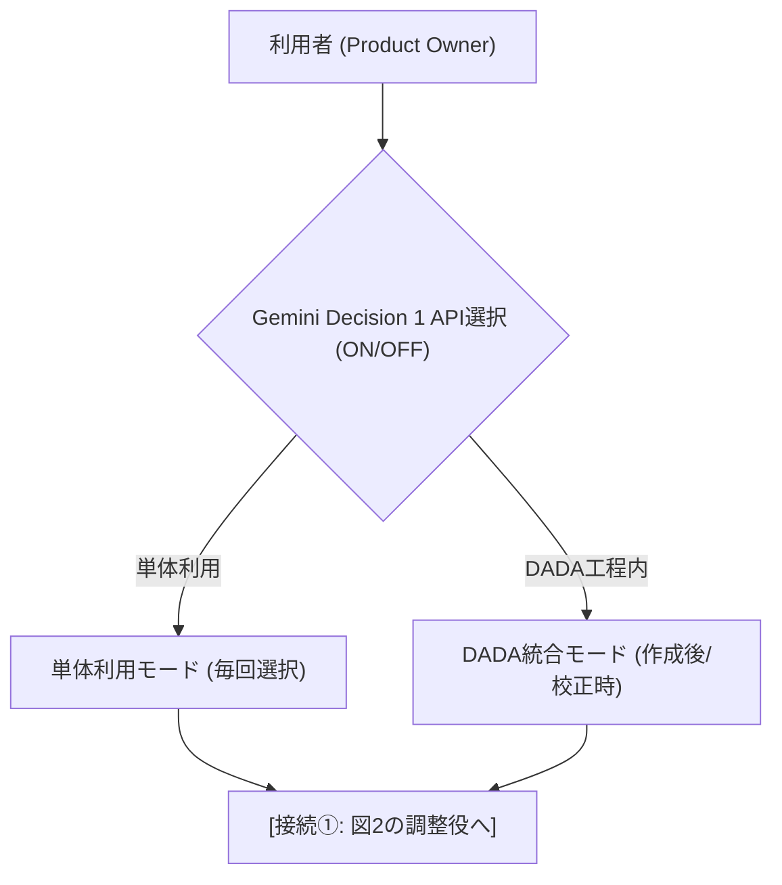
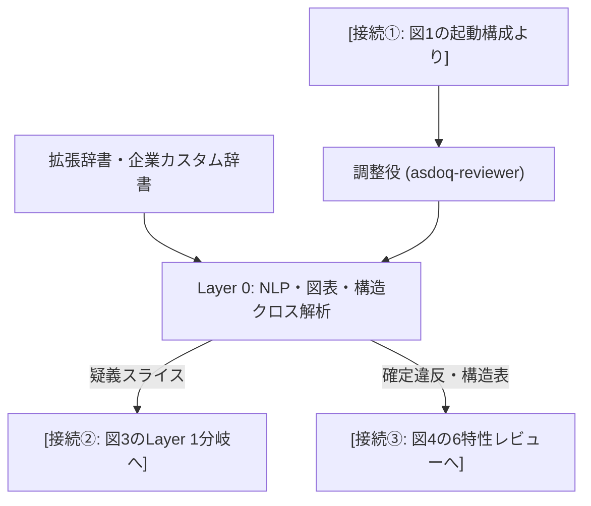
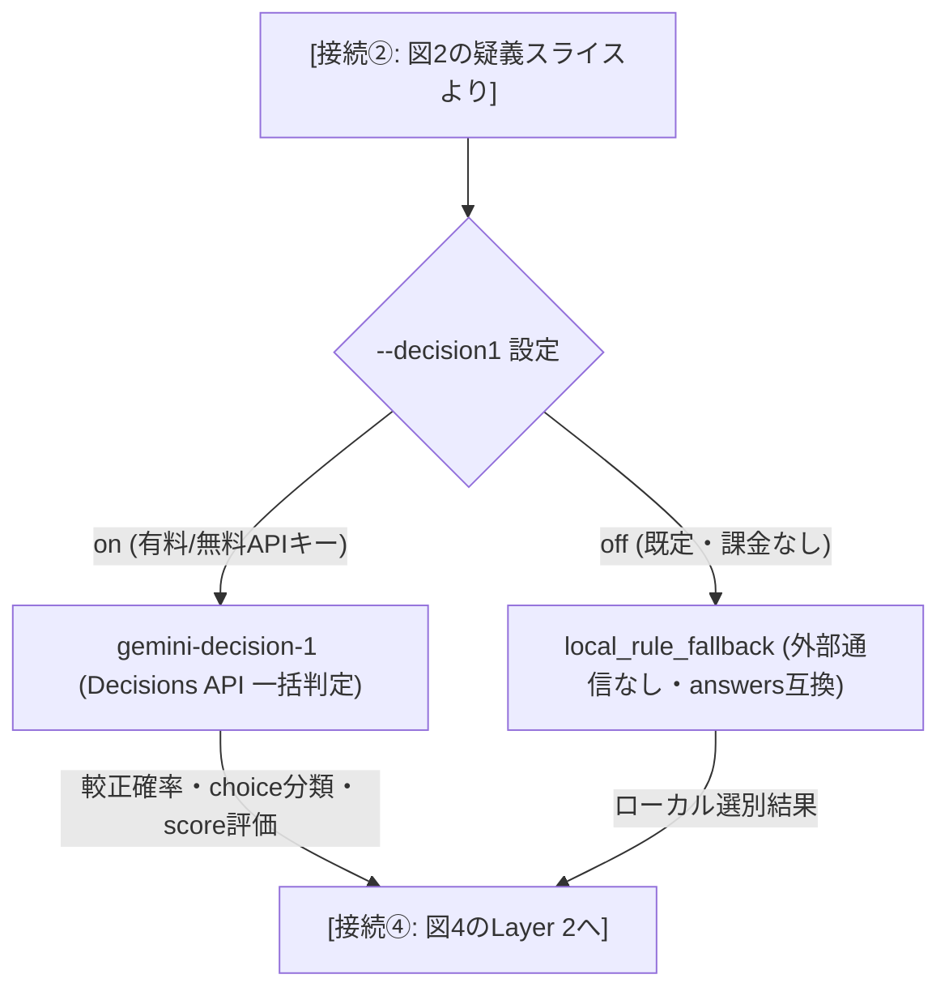
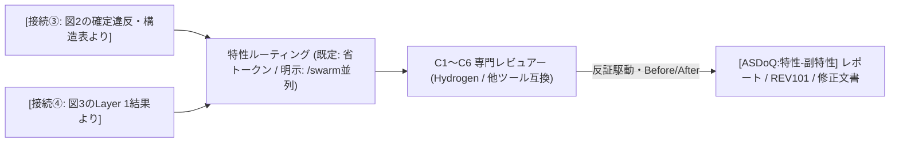

# SW105 ソフトウェア要求仕様書（エージェント定義版）

- **文書ID**: SW105
- **開発対象**: エージェント定義
- **プロジェクト名**: ASDoQハイブリッド文書レビューエージェント（asdoq-reviewer）開発およびDADAレビュアー統合
- **版数**: 1.3
- **最終更新日**: 2026-11-13
- **承認状態**: 承認済

## 1. 概要

### 1.1 目的と位置づけ
本要求仕様書は、ASDoQ文書品質モデルと日本語技術文書基準に基づき、本質的な文書レビューと修正を低トークン消費で遂行するエージェント定義一式（スキル名: `asdoq-reviewer`）とDADAプロセス統合仕様を定める。
2025年以前のAI単体レビューには、(1) 全文走査によるトークン浪費、(2) 作成者の意図を好意的に推測して合格にする「忖度（追認バイアス）」という課題があった。さらに、(3) 「目的適合性・保守性」の素通り、(4) 「理解容易性・可読性」でのAI臭い文体、(5) 企業固有の「規範適合性」ルールへの未対応、(6) 図の過大化や分類表記の揺れも課題であった。
本プロジェクトはレビューの質とDADAプロセス全体の文書品質とを引き上げるため、新たに「4つの柱」を導入する。システム全体はLayer 0（NLP・図表・構造解析）、Layer 1（Google `gemini-decision-1` 判定またはローカルルール選別）、Layer 2（ASDoQ 6特性別専門レビュアー群）の3層で構成する。

- **第1の柱（6特性別エージェント分割と表記完全統一）**: ASDoQの6大品質特性ごとに専門レビュアー定義を分割する。指摘分類の表記を `[ASDoQ:特性-副特性]` の組へ完全統一し、責任境界と検査観点を明確にする。
- **第2の柱（拡張違反例辞書・企業カスタム辞書と図表ルールの恒久化）**: ASDoQ違反例に加え、NHK・共同通信、TC協会・JTF・JIS Z 8301、文化庁の知見を統合する。さらに「過大なMermaid図の分割」「図下・表上キャプション」「分割図間の接続番号明記」をDADA全作成スキルとひな形へ恒久組み込みする。
- **第3の柱（NLP＋Gemini Decision 1＋構造クロスリファレンス抽出による客観的証拠化）**: 形態素解析と構造クロスリファレンス抽出で客観的証拠を生成する。利用者が明示的にAPI有効化（ON）を選んだ場合のみ、`gemini-decision-1`（Decisions API）で出力トークン0の一括確率判定を実行する。OFF設定のまま実行する場合は外部通信せず、透過的なローカルルール選別へ切り替える。
- **第4の柱（反証駆動レビュー・Before/After提示・クォータ保護付き並列連携）**: 反証駆動（悪魔の代弁者）プロトコルと合格時の証拠引用義務を徹底する。既定は単一モデル省トークン動作とし、Product Ownerの明示指示があるときだけ Antigravity `/swarm` と `Gemini 4 Hydrogen` / `Argon`（Carbon非依存）による並列処理を起動する。

### 1.2 適用範囲
- **対象（スコープ内）**:
  - 単体およびDADAプロセス内で動作する調整スキル（`asdoq-reviewer`）と、ASDoQ 6大品質特性別の専門レビュアー定義（6モジュール）の構築
  - 拡張違反例辞書および企業カスタムルール編集機構（`tools/asdoq_dictionary.json`）の構築（`[ASDoQ:特性-副特性]` 表記統一を含む）
  - Layer 0 NLP解析・構造クロスリファレンス抽出・過大図および分割図接続番号検証を行う `tools/asdoq_lint.py` の構築
  - Layer 1 Google `gemini-decision-1`（`v1beta/decisions`）一括判定モジュール、APIキー安全読込（`.env.local` / `.env` / `.env.example`）、実行時ON/OFF選択制御、および透過的ローカルルールフォールバックの構築
  - DADA全作成スキル・ひな形・ガイドラインへの図分割・図下および表上キャプション・接続番号・自己点検ルール組み込み（対象: `requirements-engineer`・`test-engineer`・`architect`・`document-writer`・各 `*_skeleton.md`・`docs/templates/agent/phase1〜3_*.md`・`docs/guidelines/`）
  - 既存レビュアーおよび運用定義への `[ASDoQ:特性-副特性]` 統一と環境別アダプタ統合（対象: `requirements-reviewer`・`test-reviewer`・`architecture-reviewer`・`code-reviewer`・`JP-Humanizer`・`dada-process`・`.agents/AGENTS.md`・`REV101_*.md`）
  - スキルセット切り出しツール（`tools/export_skillset.py`）の拡張および `README.md` の整備（料金比較・API設定・思考レベル・`/swarm`・他ツール利用手順）
- **対象外（スコープ外）**:
  - DADAプロセスの承認ゲート型における最終的なドキュメント承認判断（Product Ownerである人間が実施する）
  - ソースコードのアルゴリズム欠陥や単体テストコード自体の論理検証（`code-reviewer` と `dada_check.py code` が担当する）
  - Google Cloud Billing や Google AI Studio 上でのAPIキー発行・課金上限設定・請求支払い運用（利用者自身が管理する）
  - `Gemini 4 Carbon` モデルへの依存（Google AI Pro 契約範囲の `Gemini 4 Hydrogen` / `Argon` のみで全工程を完結させる）

### 1.3 用語定義
本要求仕様書で使用する用語の定義を表1に示す。

**表1：用語定義**

| 用語 | 定義 |
| :--- | :--- |
| ASDoQ文書品質モデル | システム開発文書品質研究会（ASDoQ）が策定した品質基準。6大品質特性は、目的適合性（旧称: 合目的性）、保守性、整合性（旧称: 一貫性）、理解容易性、可読性、規範適合性である。 |
| 指摘分類ラベル | レビュー指摘の分類を `[ASDoQ:特性-副特性]`（例: `[ASDoQ:目的適合性-目的合致性]`）の組で一意に表す統一書式。 |
| 拡張違反例辞書・企業カスタム辞書 | ASDoQの違反例へ技術文書基準（TC協会・JTF・JIS Z 8301）と報道・公用文基準（NHK・共同通信・文化庁）を統合し、企業カスタムルールを追加できる辞書データ。 |
| 構造クロスリファレンス表 | Layer 0が自動抽出する「目的・範囲の有無」「用語集と本文の対照」「数値・単位・条件一覧」「見出し・図表サイズ・接続番号整合・本文参照対照」の4項目データ。 |
| 分割図と接続番号 | 大きな図を複数図へ分割する際、図同士で繋がるノードや境界へ `[接続①: 図2の〇〇へ]` と `[接続①: 図1の〇〇より]` の対になる番号を記すルール。 |
| Layer 0（NLP・構造解析器） | 形態素解析、拡張辞書照合、構造クロスリファレンス抽出、疑義スライス抽出をトークン消費ゼロで実行するPythonプログラム。 |
| Layer 1（Gemini Decision 1 判定器） | Google Decisions API（`gemini-decision-1` / `v1beta/decisions`）を呼び出し、疑義スライスや構造検証項目を最大1,000問一括で確率判定するモジュール。OFF設定の場合は外部通信を行わない。 |
| 透過的ローカルルールフォールバック | `--decision1 off` 指定の場合に外部APIへ送信せず、ローカル規則だけで `gemini-decision-1` の `answers` 形式と互換な出力構造を生成する仕組み。 |
| Layer 2（6特性別LLMレビュアー） | オーケストレーター（`asdoq-reviewer`）と6特性別の専門レビュアー定義で構成され、反証駆動による深層検証とBefore/After修正案提示を担う自然言語レイヤー。 |
| 反証駆動レビュー | 作成者の意図を忖度せず、「悪意ある実装者や半年後の保守担当者が誤解・破綻する箇所」について能動的なシミュレーションを行い、記述漏れや矛盾を暴く検証手法。 |
| 文書種別プロファイル | 対象文書（`sw105` 要求、`swp6` テスト、`sw205` 設計、`general` 一般技術文書）に応じて品質特性の重みと検査対象を切り替える設定。 |
| 疑義スライス | Layer 0が文脈判定を必要と診断した1文または1段落のテキスト断片（行番号・前後文脈・疑われる特性タグ付き）。 |
| 単体利用モード | DADA工程を起動せず、技術文書・論理文書・開発文書へ `asdoq-reviewer` スキルで直接レビューと修正を行う動作形態。 |
| DADA統合モード | DADAプロセスのPhase 1〜4において、作成者の完了前自己点検と工程別レビュアースキルから共通品質エンジンを呼び出す動作形態。 |
| 環境別アダプタ | `/swarm` 並列起動（Coordinator / Worker / 敵対的Verifier）や `Gemini 4 Hydrogen` 思考レベル指定をスキル定義本体から分離する。Antigravity・Codex・Claude Code・Cursor・GitHub Copilot へ接続する連携層。 |

## 2. システム全体構成

### 2.1 システム構成概要
本システムは、自然言語レイヤーとプログラムレイヤーの二重構造で構成される。大きな全体構成図の縮小を防ぐため、論理単位ごとに図1〜図4へ分割する。分割した図同士の繋がりは接続番号（`[接続①]` 〜 `[接続④]`）の対で明示する。図タイトルは各図の直下に、表タイトルは各表の直上に配置する。利用モードとAPI利用選択を図1に、3層パイプライン入口を図2に、Layer 1のON/OFF分岐を図3に、Layer 2の6特性レビュー構成を図4に示す。

**図1：利用モードと実行時API利用選択の起動構成**

**図2：3層ハイブリッド解析パイプライン（調整役とLayer 0）**

**図3：Layer 1 判定分岐（Gemini Decision 1 ON/OFF 透過切替）**

**図4：Layer 2（ASDoQ 6特性別専門レビュアーと統合出力）**

### 2.2 ソフトウェアの構成要素
レイヤー分担の方針と6大品質特性の攻略戦略を表2に示す。

**表2：レイヤー分担と6大品質特性の攻略戦略**

| レイヤー / 対象特性 | 攻略戦略と担当する仕事 | 本プロジェクトでの構成要素 |
| :--- | :--- | :--- |
| プログラムレイヤー（Layer 0: NLP・図表・構造解析） | 形態素解析による文分解、辞書による確定検出、構造クロスリファレンス表の抽出を実行する。さらに過大なMermaid図（10ノード超）、図下・表上キャプション、分割図の接続番号整合を検査する。 | `tools/asdoq_lint.py`、`tools/asdoq_dictionary.json`、`tools/export_skillset.py` |
| プログラムレイヤー（Layer 1: Gemini Decision 1 判定） | `--decision1 on` 設定のときだけ Google `gemini-decision-1`（`v1beta/decisions`）へ1〜1,000問を一括送信し、出力トークン0で `noul`・`choice`・`score` を取得する。既定 `off` では外部通信せず、`answers` 互換形式でローカル選別結果を返す。 | `tools/asdoq_lint.py`（Decisions REST/SDK連携部および `local_rule_fallback`）、`.env.example` |
| 自然言語レイヤー（Layer 2: 6特性別専門レビュアーとDADA文書群） | **目的適合性・保守性**: 反証駆動で欠落・越権・将来変更困難を暴く。 **整合性**: 構造クロス表と分割図接続を突合する。 **理解容易性・可読性**: 悪意ある解釈を防ぎ、`JP-Humanizer` 連携で脱AI自然文へ導く。 **規範適合性**: 企業辞書と事実・意見分離、図表配置を検査する。 | `.agents/skills/asdoq-reviewer/SKILL.md`、同 `references/`（6特性定義）、DADA作成・審査スキル群、ひな形・ガイドライン、`.agents/AGENTS.md` |

**振り分けの根拠**: `agent_design_principles.md` 第3.2節に基づき、語彙照合・数値抽出・図ノード数計測・接続番号ペア検査はプログラムレイヤー（Layer 0）へ配置する。大量の1文単位確率判定は、API利用が承認された場合のみ `gemini-decision-1`（Layer 1）で低コスト処理する。文脈反証や人間らしい修正案生成は自然言語レイヤー（Layer 2）へ配置する。

### 2.3 役割分割方針（三原則 Simplicity）
三原則のSimplicityに基づく役割分割方針を表3に示す。

**表3：役割分割方針（三原則 Simplicity）**

| 役割 | 責務（何をするか） | 別スキル（または独立定義）にするか | 判断の理由 |
| :--- | :--- | :--- | :--- |
| レビュー調整・修正役（`asdoq-reviewer`） | API利用有無（ON/OFF）を確認し、文書種別プロファイル判定、`tools/asdoq_lint.py` 実行、必要特性へのルーティング（既定省トークン／任意 `/swarm` アダプタ）、統合レポートと修正文書生成を担う | する（メインスキル） | 単体切り出し単位を一本化し、API利用選択とルーティングを一箇所で制御するため（問2・問3・問5がYes） |
| 6大品質特性別専門レビュアー群（C1〜C6の6定義） | 担当1特性の基準・反証質問・出力形式のみを保持し、`[ASDoQ:特性-副特性]` 形式で深掘り評価する（特定ツール専用構文は含めない） | する（`references/` 配下に6ファイル分割） | 全特性を1ファイルへ集約するとトークン浪費と検証品質低下を招くため。かつ他ツールへの100%移植性を保つため（問3・問4がYes） |
| DADA工程作成・レビュー役群 | 作成スキル（`requirements-engineer`・`test-engineer`・`architect`・`document-writer`）は図表規則と自己点検を担う。レビュー3スキルは工程固有検証と共通解析結果に基づき `REV101_*.md` へ指摘を記録する | する（既存スキル構成のまま維持） | 作成者と審査者とについて役割を分離し、工程ごとの合格基準を維持するため（問3がYes） |

**分割しない場合の記録**: 6大品質特性別の専門定義ファイルは `.agents/skills/` 直下に6個並べるのではなく、`asdoq-reviewer/references/` 配下に配置する。入口を `asdoq-reviewer` に一本化すると、利用者や他ツール利用時の起動ルーティング衝突を防げる。

### 2.4 三原則の適用（必守）
本プロジェクトにおけるエージェント設計三原則の適用方針を表4に示す。

**表4：エージェント設計三原則の適用**

| 原則 | 本プロジェクトでの適用 | 紐づくREQ-ID |
| :--- | :--- | :--- |
| Simplicity | 6特性を1定義1責務へ分割し、工程別レビュアーの重複を排除する。さらに `/swarm` の環境別アダプタを `C1〜C6` 定義本文から分離する。 | REQ-004, REQ-005, REQ-006, REQ-007 |
| Transparency | 思考過程（1. 現在地、2. 判断の根拠、3. 次の一手）、Decision 1 の実行モード宣言（`DECISION1_MODE`）、反証仮説と合格根拠箇所を明示する。 | REQ-003, REQ-004, REQ-005, REQ-006 |
| ACI | スキル発動条件、`tools/asdoq_lint.py` 引数（`--decision1` 値 `off` / `on` / `mock`、`--threshold 0.30`）、Decisions API質問JSON、および `[ASDoQ:特性-副特性]` 書式を一字一句固定する。 | REQ-001, REQ-002, REQ-003, REQ-004, REQ-005 |

### 2.5 設計パターンの吟味
エージェント設計パターンの採否と理由を表5に示す。

**表5：設計パターンの採否と理由**

| パターン | 採用 / 不採用 | 理由 |
| :--- | :--- | :--- |
| Prompt Chaining | 採用 | Layer 0（NLP＋構造＋図表検証）→ Layer 1（Decision 1 または透過フォールバック）→ Layer 2（特性別反証レビュー）→ 意味保持検証付き修正の固定順で実行するため。 |
| Routing | 採用 | 文書種別プロファイルと `asdoq_lint.py` の診断結果に基づき、既定では要重点2〜4特性のみをオンデマンドでロードするため。 |
| Parallelization | 採用 | (1) Layer 1 `gemini-decision-1` での1リクエスト内最大1,000問一括並列評価、(2) 明示指示により `/swarm` での6特性並列検証またはPhase 4独立UNIT並列実装に適用するため。 |
| Orchestrator-Workers | 採用 | 単体レビュー調整役、および明示指示がある場合の Antigravity `/swarm` Coordinator/Worker/敵対的Verifier（`Gemini 4 Hydrogen` 中心、Carbon非依存）を構成するため。 |
| Evaluator-Optimizer | 採用 | 作成者スキル完了前の `asdoq_lint.py` 事前点検、作成者とレビュアーによる最大2周自己校正、および修正後の `style_check.py verify` で品質を収束させるため。 |

## 3. 制約条件と前提事項

### 3.1 実行環境制約
本システムの実行環境制約を表6に示す。

**表6：実行環境制約**

| 項目 | 内容 |
| :--- | :--- |
| 対象AIエージェント製品 | Google Antigravity App / CLI / IDE、ならびに Codex / Claude Code / Cursor / GitHub Copilot（`.agents/skills/` 互換で100%移植性を維持） |
| 想定モデルとクォータ制約 | 既定は単一モデル省トークン動作とする。Antigravityを利用するときは `Gemini 4 Hydrogen`（思考レベル `low`/`medium`/`high`/`xhigh`）および `Gemini 4 Argon` を前提とし、`Gemini 4 Carbon` に依存しない構成とする。 |
| 並列実行ツール制約 | サブエージェント自動作成・並列起動（`invoke_subagent` または `/swarm`）は Antigravity App / CLI で明示指示があるときだけ起動し、非対応ツールや既定設定では単一セッション手順で完走できること。 |
| 実行言語ランタイム | Python 3.8以降。標準ライブラリのみで全基本機能が動作し（Decisions REST API も標準ライブラリ `urllib.request` で呼出し可能）、任意パッケージとして `janome` と `google-genai`（3.2以降、`v1beta`）を利用できる。 |
| コンテキスト制約 | 通常レビューでは対象プロファイルの重点特性と要レビュー特性（最大4特性）のみを読み込み、残りの特性定義はスキップする。 |

### 3.2 ソフトウェア環境
- **OS**: Windows / macOS / Linux のクロスプラットフォームで動作する。ファイルパスは `pathlib.Path` によりOS非依存で扱う。
- **文字コード**: 入出力ファイルはすべて UTF-8（BOMなし）とする。
- **機密ファイル除外**: `.gitignore` に `.env` と `.env.*` を含め、`!.env.example` のみを追跡対象として維持する。
- **ライセンス制約**: 本リポジトリおよび切り出しスキルセットは MIT License で配布する。辞書とライブラリは MIT / BSD / Apache-2.0 に限定し、ASDoQ派生部分には ASDoQドキュメントライセンス（ADL）の著作権表示を明記する。

### 3.3 準拠規格・参照仕様
- システム開発文書品質モデル Ver. 2.0a / Ver. 2.0a-3（ASDoQ）
- JTF日本語標準スタイルガイド、TC協会 日本語スタイルガイド、JIS Z 8301、文化庁「公用文作成の考え方」、報道用字用語原則
- DADAプロセス ワークスペースルール（`.agents/AGENTS.md`）およびエージェント設計原則（`docs/guidelines/agent_design_principles.md`）
- Google Gemini Decisions API（`gemini-decision-1` / `v1beta/decisions`）・Gemini 4 Hydrogen・Antigravity `/swarm` 公式仕様（7章 表9に一次情報URLを記録）

## 4. 機能要求

### 4.1 ユースケースとシナリオ
1. **ユースケース1：単体利用モードによるレビューと修正（API選択＋任意 `/swarm` 厳密モード）**
   - **シナリオ**: 利用者が `asdoq-reviewer` で対象文書のレビューを指示する。オーケストレーターは最初に `gemini-decision-1` APIの使用可否（ON/OFF）を利用者へ確認する。ON設定の運用では `tools/asdoq_lint.py --decision1 on` を、OFF設定（既定）では `--decision1 off` を実行する。通常は省トークンで重点特性のみを検証し、利用者が「`/swarm` を使って」「全6特性厳密に」と指示した場合のみ `/swarm` 並列検証を起動する。最後に `[ASDoQ:特性-副特性]` ラベル付きのBefore/Afterレポートと検証済み修正文書を返す。
2. **ユースケース2：DADAプロセスでの作成時自己点検・フェーズ別API制御・工程レビュー**
   - **シナリオ**: 承認ゲート型では各Phase開始時に、自律型ではPhase 0/1の開始前に、利用者が Decision 1 APIのON/OFFを選択する。要件・テスト・設計・文書記述の4作成スキルは規定の「大図分割」「図下・表上」「分割図の接続番号」規則で文書を作成し、完了前に `asdoq_lint.py` で事前点検する。続く自己校正で工程別レビュアーが共通エンジンと専門定義を参照し、`REV101_*.md` へ `[ASDoQ:特性-副特性]` 形式で指摘を記録する。
3. **ユースケース3：企業カスタム辞書・秘密情報隔離環境での運用と他ツール切り出し**
   - **シナリオ**: 利用者がカスタム辞書に企業固有NG/OK表現を追加する。有料または無料API連携を使う運用では `.env.local` または `.env` に `GEMINI_API_KEY` を設定する。さらに `tools/export_skillset.py` でスキル一式を切り出し、Antigravity以外の環境（Codex / Claude Code / Cursor / GitHub Copilot）でも設定ファイル互換で運用する。

### 4.2 機能詳細

#### REQ-001: 拡張違反例辞書・企業カスタム辞書機構と表記基準統一
- **概要**: ASDoQ 6大品質特性、TC協会・JTF・JIS Z 8301、NHK・共同通信・文化庁の知見を統合した拡張違反例辞書と企業カスタム辞書機構を提供する。全ルールの品質特性名と指摘ラベル表記を `[ASDoQ:特性-副特性]` 形式に統一する。
- **レイヤー**: プログラム
- **入力 / 処理 / 出力**:
  - 入力は標準辞書JSON（`tools/asdoq_dictionary.json`）および任意のカスタム辞書JSON（`--custom-dict <path>`）とする。
  - 処理ではカテゴリ1〜8の標準ルールと企業カスタム領域を検証し統合する。併せて品質特性名を正準6特性名（`目的適合性`・`保守性`・`整合性`・`理解容易性`・`可読性`・`規範適合性`）および `[ASDoQ:特性-副特性]` 書式へ統一する。
  - 出力として検証済みルールセットオブジェクトを返す。辞書検証コマンドの実行際は、登録件数・カスタム件数・ライセンス表示を標準出力へ出して終了コード0で終了する。
  - **カテゴリ1（非曖昧性・一意性 / `[ASDoQ:理解容易性-非曖昧性（一意性）]`）**: 曖昧語・相対日時表現・全体否定・部分否定の曖昧表現・状態とイベントとの混同・中止法連鎖を検査する。
  - **カテゴリ2（非曖昧性・識別性 / `[ASDoQ:理解容易性-非曖昧性（識別性）]`）**: 必須補語を欠いた単独動詞記述、起点「より」と終点「へ」・方向「に」の誤用を検査する。
  - **カテゴリ3（表現適切性・AI-Slop排除 / `[ASDoQ:可読性-表現適切性]`）**: 動作主のない受動態連続、視点不統一、AI特有の比喩・誇張・過剰対比・英語由来ダッシュ繋ぎを検査する。
  - **カテゴリ4（簡潔性・冗長表現 / `[ASDoQ:可読性-簡潔性]`）**: 二重否定、多重入れ子文、冗長な複合動詞・官庁表現、4語以上の名詞連続を検査する。
  - **カテゴリ5（表記適切性・用字用語 / `[ASDoQ:可読性-表記適切性]`）**: 敬体と常体の混在、括弧不統一、数値単位欠落、ひらがな推奨語の漢字表記を検査する。
  - **カテゴリ6（文法適合性 / `[ASDoQ:規範適合性-文法適合性]`）**: 主語と述語のねじれ、同一助詞の1文内3回以上連続、ら抜き・さ入れ・い抜き言葉、順接「が」の長文化を検査する。
  - **カテゴリ7（整合性・保守性・目的適合性シグナル / `[ASDoQ:整合性-無矛盾性]` ほか）**: 理由なき省略記述、解消時期のない未決定記述、検証手段のない抽象目標語、図表番号と参照の不整合を検査する。
  - **カテゴリ8（規範適合性・図表配置とラベル規則 / `[ASDoQ:規範適合性-記法適合性]` ほか）**: 推測・意見ラベル欠落、図表番号位置違反（図は直下・表は直上）、過大な図（10ノード超）や分割図の接続番号欠落、旧分類表記の残存を検査する。
  - **企業カスタム編集機能**: `custom_ng_rules`・`custom_ok_terms`・`disabled_rule_ids`・`corporate_conformance_rules` をコード変更なしで編集・反映できる。
- **異常系**: 辞書ファイル不在またはJSON構文不正が発生した場合、もしくは必須キー（`id`, `category`, `asdoq_characteristic`, `severity`, `pattern_type`, `hint`）が欠落した場合は、標準エラー出力へ原因を表示して終了コード2で終了する。
- **検証条件 (Acceptance Criteria)**:
  - カテゴリ1〜8を網羅する合計80件以上の標準ルールが `tools/asdoq_dictionary.json` に定義されていること。
  - 全ルールの特性名と出力ラベルが `[ASDoQ:特性-副特性]` 書式かつ正準6特性名（`目的適合性`・`保守性`・`整合性`・`理解容易性`・`可読性`・`規範適合性`）へ統一されていること（旧称 `合目的性` を特性ID・ラベル名に使わないこと）。
  - カスタム辞書へ追加したNG表現・規範ルールをシステムが検出し、同時にホワイトリスト語を違反対象から除外すること。
  - MIT LicenseおよびASDoQドキュメントライセンス（ADL）表記を満たすこと。
  - 不正JSONや欠損パスを指定した場合、終了コード2を返すこと。
- **優先度**: Must

#### REQ-002: Layer 0（形態素解析・拡張辞書・構造クロス・図表分割/接続検査）ツール
- **概要**: 形態素解析と拡張辞書で文書を走査し、確定違反一覧と4種類の構造クロスリファレンス表を抽出する。併せて過大Mermaid図・図下および表上の位置・分割図接続番号を検査し、Layer 1向け疑義スライス抽出機能付きCLIツール（`tools/asdoq_lint.py`）を提供する。
- **レイヤー**: プログラム
- **入力 / 処理 / 出力**:
  - 入力は検査対象Markdownパス（`--input <path>`）およびCLI引数（`--dict`・`--custom-dict`・`--profile`・`--characteristic`・`--format`・`--summary`・`--max-items` 既定25）とする。
  - 処理では以下のステップ1〜6を実行する。
  - 出力として確定指摘・構造クロス表・疑義スライス・6特性スコア・推奨ロード特性を返す。判定結果に応じ、終了コード（`0`=Highなし、`1`=Highあり、`2`=エラー）で終了する。
  - **ステップ1（文書構造分解）**: 通常コードブロックを検査対象から除外する。そのうえで文書を見出し・段落・表・Mermaid図ブロック・一文単位へ分解する。
  - **ステップ2（形態素・構文解析）**: `janome` が導入済みの場合は形態素解析を実行する。未導入の場合は、Python標準ライブラリの正規表現と文字種境界解析とへ自動フォールバックする。
  - **ステップ3（辞書照合）**: REQ-001の統合ルールで確定違反を検出する。
  - **ステップ4（構造クロスリファレンス表と図表ルールの自動抽出）**:
    1. **目的・スコープ要素チェック**: 文書内の「読み手」「目的」「適用範囲（対象内・対象外）」およびプロファイル別必須章の有無を抽出する。
    2. **用語集 vs 本文クロス突合**: 用語定義表の登録語の本文出現数、本文に3回以上出現し用語定義表に未定義の複合名詞・専門用語候補、および類似表記ゆれペアを抽出する。
    3. **数値・単位・条件クロス一覧**: 文書内のすべての「数値＋単位」と条件閾値を行番号・章名付きで一覧化する。
    4. **見出し・図表クロス突合（図分割・接続番号ペア・位置検査強化）**: 以下5点を検査する。
       - 過大なMermaid図検出: 1つのMermaid図ブロック内のノード数が推奨上限（**10ノード**）を超える場合（11ノード以上）、分割推奨の警告を出力する。
       - 分割図間の接続番号整合検査: 各Mermaid図から `[接続①: ...]` 形式（丸数字または半角数字）の接続番号トークンを抽出する。同一番号が2つ以上の異なるMermaid図ブロックに出現すれば対成立と判定し、1ブロックのみに出現した番号を孤立接続番号として警告する。
       - 図下・表上キャプション位置検証: 図タイトルがMermaid図より上にある違反、表タイトルが表ブロックより下にある違反を検出する。
       - 図表参照突合: 本文中の図番号・表番号参照と定義済みキャプションとの一致状況、さらに図内ラベルと本文用語との一致を抽出する。
       - 希薄見出し検出: 中身が1文以下しかない見出し節を抽出する。
  - **ステップ5（疑義スライス抽出）**: 文脈判定が必要なグレーゾーン文・段落に対し、行番号・見出し名・疑われる特性コードを付与して抽出する。
  - **ステップ6（スコア・推奨特性算出）**: プロファイル重み付けを反映した6特性別健全度スコアと要重点レビュー特性を算出する。
- **異常系**: 対象ファイル不在または空ファイル（0バイト）の場合は標準エラー出力へ原因を表示し、終了コード2で終了する。`janome` 未導入でも例外停止せず標準ライブラリモードで完走する。
- **検証条件 (Acceptance Criteria)**:
  - REQ-001のカテゴリ1〜8違反を含むテスト文書に対して、全8カテゴリの指摘を行番号および `[ASDoQ:特性-副特性]` 付きで検出すること。
  - 構造クロスリファレンス表の4項目すべてが出力に含まれること。さらに `heading_figure_table_check` が「11ノード以上の過大Mermaid図」「1ブロックのみ出現の孤立接続番号 `[接続N]`」「図上・表下の位置違反」を機械検出すること。
  - 正常文が70%以上を占める2,000文字以上の基準Markdown文書を入力したとき、正常文除外後の疑義スライス文字数が原文書の50%以下へ圧縮されること。
  - `--format json` 実行後に確定指摘・構造クロス表・疑義スライス・6特性集計から成る有効JSON文字列を標準出力へ返すこと。
  - `janome` 有無の双方で例外なく完走すること。
- **優先度**: Must

#### REQ-003: Layer 1（Google `gemini-decision-1` Decisions API）一括判定と透過的フォールバック
- **概要**: TypeSafe AI（Jev）を完全に廃止し、Layer 1を Google の `gemini-decision-1`（Decisions API / `v1beta/decisions`）へ全面刷新する。1回のprefillリクエストで最大1,000問の確率判定を出力トークン0で実行する。API未使用（既定 `off`）設定では外部通信を行わず、同一の `answers` 互換出力構造で後段へ引き渡す。
- **レイヤー**: プログラム
- **入力 / 処理 / 出力**:
  - 入力はLayer 0の疑義スライスと構造検証項目、およびCLIオプション（`--decision1 <off|on|mock>` 既定 `off`、`--threshold <0.0-1.0>` 既定 `0.30`）とする。
  - 処理ではステップ1〜6を実行し、外部APIの呼び出し可否を制御する。
  - 出力として `gemini-decision-1` の `answers` 構造と互換な判定結果（`noul`・`choice`・`score`・採否ステータス・`DECISION1_MODE`）を返す。
  - **ステップ1（APIキー読込と利用モード判定）**: `GEMINI_API_KEY` を「OS環境変数 > `.env.local` > `.env`」の順で読み込む。ファイル読込では前後の引用符（`"`・`'`）を除去し、空文字 `""` は未設定とみなす。`--decision1 off`（既定）ではAPIキー有無に関わらず外部通信をせずステップ5へ進む。
  - **ステップ2（バッチ構成と肯定表現制約）**: 質問数0件ではHTTP送信はせず、`DECISION1_MODE: on_skipped (no_questions)` と空の `answers` を返す。コンテキストキャッシュとBatch APIは非対応である。1件以上ある場合、文書抜粋（262,144入力トークン以内）と質問群 `questions`（1〜1,000問単位）から1リクエストを構成する。`Question key` は `[A-Za-z0-9_-]+`（最大64文字）形式に従う。キー文字列はモデルへ伝わらないため、質問文 `instructions` へスライスID・行番号・見出しを必ず明記し、否定形ではなく肯定表現で記述する。
  - **ステップ3（3種質問プリミティブの送信）**: エンドポイント `POST https://generativelanguage.googleapis.com/v1beta/decisions`（`x-goog-api-key` ヘッダ）または `google-genai` SDK v3.2以上（`api_version="v1beta"`）で呼び出す。SDK未導入の場合は標準ライブラリ `urllib.request` でREST呼出しを実行する。
    - `noul`: 真偽判定確率（0.01〜0.99）と `confidence` を取得し、曖昧性・主体欠落・理由欠落・事実意見混同・検証困難を評価する。
    - `choice`: `criteria` の選択肢キーには前後の空白や非ASCII文字を含まないASCII識別子（例: `C1_1`, `C4_1`, `other`）のみを使用し、受信後にPython側で `[ASDoQ:特性-副特性]` ラベルへ変換する。
    - `score`: `criteria` 配列を低度から高度の順（例: `[レベル0問題なし, レベル1中程度, レベル2重大]`）で指定し、期待値 `score`、`legend`、段階確率 `probabilities` を取得する。
  - **ステップ4（見逃し防止閾値判定）**: 見逃し防止のため閾値既定値を安全側の `0.30` とする。`noul >= 0.30` または重度 `score` / 重大 `choice` 判定のスライスをLayer 2へ昇格させ、`0.29` 以下の明確な正常スライスのみを棄却する。
  - **ステップ5（`--decision1 off` 設定の透過的ローカルルールフォールバック）**: 外部API通信を行わず、ローカルルール判定により `noul`・`choice`・`score` から成る同一 `answers` 互換辞書を生成して後段へ渡す。ただしレポート上の表示は偽らず、必ず `DECISION1_MODE: off (local_rule_fallback)` と明記し、文脈判定をLayer 2へ委ねる。
  - **ステップ6（`--decision1 mock` 単体テスト支援）**: 決定論的モック応答（`DECISION1_MODE: mock`）を返し、ネットワーク不要で `noul`/`choice`/`score`・ASCIIキー変換・閾値 `0.30` 分岐を検証できるようにする。
- **異常系**:
  - `--decision1 on` 指定時に `GEMINI_API_KEY` が環境変数・`.env.local`・`.env` のいずれにも未設定であれば、設定ファイルパス（`.env.local` / `.env`）と書式（`GEMINI_API_KEY="..."`）を標準エラー出力へ案内して終了コード2で終了する。
  - 廃止オプション `--jev` が指定された場合は引数エラーとし、`--decision1` への移行案内とともに終了コード2で終了する。
  - `--decision1 on` 実行でのタイムアウトやHTTP 429/5xx には最大2回リトライし、2回失敗した場合は警告を出してローカルフォールバックへ切り替える。
- **検証条件 (Acceptance Criteria)**:
  - `--decision1 mock --format json` 実行後に `noul`・`choice`・`score`・`total_output_tokens: 0` 互換フィールドが出力されること。また `choice` のASCIIキーは `[ASDoQ:特性-副特性]` へ変換され、システムが閾値 `0.30` 以上についてのみ昇格処理を行い、`0.29` 以下は棄却すること。
  - `--decision1 off`（既定）実行ではAPIキー未設定でも外部ネットワーク呼出しが0回で完走すること。またレポートへ `DECISION1_MODE: off (local_rule_fallback)` を明記したうえで後段互換 `answers` 構造データを返すこと。
  - `--decision1 on` かつAPIキー未設定（`GEMINI_API_KEY=""` の空文字を含む）の場合、終了コード2と設定ファイル案内を返すこと。
  - `--decision1 on` のREST呼出しペイロードにおいて、`Question key` が `[A-Za-z0-9_-]{1,64}` を満たし、`instructions` に対象IDが含まれること。併せて1リクエストあたり質問数上限1,000問でのチャンク分割をモック検証すること。
  - 抽出質問数が0件の文書へ `--decision1 on` で実行した場合、外部HTTP送信は0回とし、`DECISION1_MODE: on_skipped (no_questions)` と空 `answers` を返すこと。
  - リポジトリ内のコード・テスト・設定に `Jev` / `typesafe` / `TYPESAFE_API_KEY` が0件であること。
- **優先度**: Must

#### REQ-004: ASDoQ 6大品質特性別の専門レビュアー定義群（表記統一・図表検査・他ツール移植性）
- **概要**: Simplicityに基づき、ASDoQ 6大品質特性ごとに特化した6つの専門レビュアー定義（`.agents/skills/asdoq-reviewer/references/C1_purpose_reviewer.md` 〜 `C6_conformance_reviewer.md`）を構築する。全指摘タグを `[ASDoQ:特性-副特性]` へ統一し、特定エージェント製品構文に依存しない構成で他ツールへの100%移植性を維持する。
- **レイヤー**: 自然言語
- **入力 / 処理 / 出力**: 入力は対象文書、文書種別プロファイル、`tools/asdoq_lint.py` の構造クロスリファレンス表とLayer 1（またはローカル選別）結果とする。処理として担当1特性の反証テスト、根拠確認、Before/After案作成を実行し、出力として構造化指摘（`[ASDoQ:特性-副特性]`・重要度・箇所・理由・❌Before/✅After）と合格根拠を返す。
  - **`C1_purpose_reviewer.md`（目的適合性）**: 1.1 目的明示性、1.2 目的合致性を担当。初見の読み手・次工程担当者視点で反証し、欠落と越権を摘出する。出力分類例: `[ASDoQ:目的適合性-目的合致性]`。
  - **`C2_maintainability_reviewer.md`（保守性）**: 2.1 再利用性、2.2 持続可能性を担当。半年後の保守担当者視点で反証し、重複・用語不統一・検証不能記述を摘出する。出力分類例: `[ASDoQ:保守性-持続可能性]`。
  - **`C3_consistency_reviewer.md`（整合性）**: 3.1 無矛盾性、3.2 一貫性、3.3 構造性を担当。数値・条件一覧、見出し、図表サイズと分割図 `[接続N]` ペアの本文整合を突合する。出力分類例: `[ASDoQ:整合性-無矛盾性]`。
  - **`C4_understandability_reviewer.md`（理解容易性）**: 4.1 非曖昧性（一意性）、4.2 非曖昧性（識別性）、4.3 関係性を担当。悪意ある実装者視点で別解釈と補語欠落、図間接続の分かりにくさを摘出する。出力分類例: `[ASDoQ:理解容易性-非曖昧性（一意性）]`。
  - **`C5_readability_reviewer.md`（可読性）**: 5.1 簡潔性、5.2 表記適切性、5.3 表現適切性を担当。`JP-Humanizer` 8観点でAI文体を排除し、自然で簡潔なBefore/Afterへ導く。出力分類例: `[ASDoQ:可読性-簡潔性]`。
  - **`C6_conformance_reviewer.md`（規範適合性）**: 6.1〜6.4を担当。企業カスタム辞書違反、文法、事実と意見の分離、図下・表上キャプションと記法違反を検査する。出力分類例: `[ASDoQ:規範適合性-記法適合性]`。
- **異常系**: 担当外の品質特性へ指摘を広げる責務逸脱、根拠引用なしの無条件合格判定、および Antigravity固有構文（`/swarm` コマンド）のハードコードを禁止する。
- **検証条件 (Acceptance Criteria)**:
  - `C1`〜`C6` の6定義がすべて存在し、1ファイル200行以内で「担当副特性」「反証駆動チェックリスト」「証拠引用ルール」「`[ASDoQ:特性-副特性]` と ❌Before/✅After出力形式」「思考過程出力指示」「禁止事項」を備えること（必須要素）。
  - 旧称（`合目的性`・`一貫性` の特性名誤用）、旧タグ形式（`【ASDoQ: ...】`）、および `/swarm` ハードコードが6定義内に0件であること。
  - 担当外指摘および無根拠合格判定を含まないこと（禁止要素）。
  - 5回試行のうち4回以上（合格率80%以上）で全条件を満たし、`python tools/agent_def_check.py` が終了コード0を返すこと。
- **優先度**: Must

#### REQ-005: オーケストレータースキル（`asdoq-reviewer`）のAPI確認・ルーティング・任意 `/swarm` 連携
- **概要**: 単体スキル `.agents/skills/asdoq-reviewer/SKILL.md` で、開始時の `gemini-decision-1` API利用可否（ON/OFF）確認と文書種別プロファイル判定を実行する。続いて `asdoq_lint.py` 実行、既定の省トークン評価、明示指示時の `/swarm` 並列レビューアダプタ、および文書修正を完遂する。
- **レイヤー**: 自然言語
- **入力 / 処理 / 出力**:
  - 入力は対象文書パスおよび利用者指示（通常／厳密 `/swarm`・レビューのみ／修正まで・カスタム辞書）とする。
  - 処理ではステップ1〜6を実行し、結果統合と修正検証を進める。
  - 出力として `[ASDoQ:特性-副特性]` タグ付きレポートおよび検証済み修正文書を生成する。
  - **ステップ1（思考過程・API選択確認・プロファイル宣言）**: 思考過程と対象プロファイルを宣言する。単体利用の開始時には毎回 `gemini-decision-1` APIの使用可否（ON/OFF）について利用者から選択を得る（ONは有料枠で入力$0.10/1Mトークン課金・無料枠で外部送信、OFFは外部送信なし）。利用者が明示的にONを選んだ場合のみ `--decision1 on` モードへ切り替える。
  - **ステップ2（Office文書前処理）**: `.docx`/`.xlsx`/`.pptx`/`.pdf` 入力の場合は `tools/office_io.py` でテキスト・構造を抽出する。
  - **ステップ3（Layer 0 / Layer 1 実行）**: 選択された設定で `tools/asdoq_lint.py`（既定 `--decision1 off`）と `tools/style_check.py lint` を実行する。
  - **ステップ4（既定省トークン／明示 `/swarm` アダプタ選択）**:
    - 既定は省トークンモード（2〜4特性の専門定義のみをオンデマンド読込）で実行する。
    - 利用者が「`/swarm` を使って」「厳密モード（全6特性並列）で」と明示指示した場合は並列レビューへ切り替える。Antigravity環境では `/swarm` アダプタ（Coordinator・6特性Worker・敵対的Verifier、`Gemini 4 Hydrogen` `high`/`xhigh` または `Argon` 構成、Carbon非依存）を起動する。他環境（Codex・Claude Code・Cursor・GitHub Copilot）では標準サブエージェントまたは順次実行アダプタで同じ6特性定義を適用する。
  - **ステップ5（レポート出力）**: すべての指摘分類を `[ASDoQ:特性-副特性]` 形式で出力し、合格根拠と ❌Before/✅After を示す。
  - **ステップ6（修正完遂）**: 修正指示の場合は `style_check.py snapshot` 保存後に図分割・図下・表上・接続番号・脱AI文体の修正を実行する。その後、`style_check.py verify` と `asdoq_lint.py` により意味保持と違反解消を確認する。
- **異常系**: 対象文書に存在しないID・数値の捏造、`asdoq_lint.py` 未実行での推測報告、および確認なしの無断API課金実行（`--decision1 on` 強制）を禁止する。対象ファイル不在時は停止して確認を求める。
- **検証条件 (Acceptance Criteria)**:
  - 開始時に `gemini-decision-1` のON/OFF選択確認とプロファイル・思考過程の出力を含むこと（必須要素）。
  - `asdoq_lint.py` 実行結果に基づき特性を選択し、全指摘を `[ASDoQ:特性-副特性]` 形式で出力すること（必須要素）。
  - 既定では省トークン（4特性以下）で動作し、明示指示がある場合のみ `/swarm` 連携アダプタが起動すること。さらに Codex・Claude Code・Cursor・GitHub Copilot 向けの他環境手順を壊さないこと。
  - 修正指示の場合は `style_check.py snapshot` / `verify` で意味保持を確認したうえで、修正文書の図表配置と接続番号整合を保つこと。
  - 5回試行のうち4回以上（合格率80%以上）で全条件を満たすこと。
- **優先度**: Must

#### REQ-006: DADAプロセス全体への恒久統合（図表ルール・作成点検・API制御・`/swarm`＆移植性）
- **概要**: DADAプロセスの全作成スキル・ひな形・ガイドラインへ図表ルールと作成者自己チェックを恒久組み込みする。併せてレビュー系スキル・`REV101`・`JP-Humanizer` の `[ASDoQ:特性-副特性]` 統一、フェーズ型別のAPI利用確認、および任意 `/swarm` + `Gemini 4 Hydrogen`/`Argon` アダプタを `.agents/AGENTS.md` と `dada-process/SKILL.md` へ定義する。
- **レイヤー**: 自然言語
- **入力 / 処理 / 出力**: 入力はDADAプロセス定義ファイル群および各Phase成果文書とする。処理として統合1〜4を実行し、更新されたDADAスキル群・ガイドライン・憲法・ひな形・`REV101_*.md` を出力する。
  - **統合1（図分割・図下および表上・接続番号ルールの恒久化）**:
    - 対象は `requirements-engineer`・`test-engineer`・`architect`・`document-writer` の各 `SKILL.md` と `references/*_skeleton.md` である。さらに `docs/templates/agent/phase1〜3_*.md`・`docs/guidelines/asdoq_writing_rules.md`・`docs/guidelines/dada_document_guidelines.md` も対象とする。
    - 全対象へ「10ノード超の図分割」「図タイトルは直下・表タイトルは直上」「分割図間の `[接続①: ...]` ペア明記」を必須規則として組み込む。
  - **統合2（`[ASDoQ:特性-副特性]` 完全統一）**: `requirements-reviewer`・`test-reviewer`・`architecture-reviewer`・`code-reviewer`・`.agents/AGENTS.md`・`JP-Humanizer`・`REV101_*.md`・`docs/guidelines/asdoq_checklist.md` の分類ラベルをすべて `[ASDoQ:特性-副特性]` 形式へ統一し、旧称 `合目的性` を排除する。
  - **統合3（DADA内API利用選択と自己チェック拡張）**: 承認ゲート型ではPhase 1（要求定義）・Phase 2（総合テスト仕様）・Phase 3（アーキテクチャ設計）・Phase 4（実装・総合テスト報告）の開始前に `gemini-decision-1` のON/OFFを確認する。自律型ではPhase 0/1開始前に1回選択し、`docs/process/last_phase_summary.md` で引き継ぐ。作成3スキル（`requirements-engineer` / `test-engineer` / `architect`）の自己チェックへ `tools/asdoq_lint.py` を追加し、開始前に選んだON/OFF設定（既定 `off`）を適用する。
  - **統合4（`/swarm`・Hydrogen/Argon アダプタと他ツール100%移植性）**: `.agents/AGENTS.md` と `dada-process/SKILL.md` に環境別アダプタを定義し、既定は省トークン動作とする。明示指示があるときだけ Antigravity `/swarm`（Phase 1〜3の敵対的検証、Phase 4の独立UNIT並列実装、Carbon非依存で `Hydrogen` `high`/`xhigh` または `Argon` 使用）を起動する。他ツール互換性のため各スキル本体の手順へ `/swarm` 専用コマンドを埋め込まない。
- **異常系**: DADA統合モードでレビュアーが成果文書を直接書き換える役割逸脱、レビュー全文をチャットへ重複出力する二重出力、および承認なしでの有料API常時ON化を禁止する。
- **検証条件 (Acceptance Criteria)**:
  - 統合1の対象全ファイル（作成4スキル、スケルトン、`phase1〜3_*.md` テンプレート、ガイドライン2文書）に図分割・図下および表上・接続番号規則が含まれること（必須要素）。
  - 作成3スキル（`requirements-engineer`・`test-engineer`・`architect`）の完了前自己チェックへ `asdoq_lint.py` 実行が組み込まれること。併せて承認ゲート型・自律型ごとの Decision 1 ON/OFF選択手順が `dada-process/SKILL.md` と `.agents/AGENTS.md` に明記されていること（必須要素）。
  - レビュアー4スキル・`JP-Humanizer`・`.agents/AGENTS.md`・`REV101`・`docs/guidelines/asdoq_checklist.md` の分類タグがすべて `[ASDoQ:特性-副特性]` 形式に統一されていること（必須要素）。
  - `/swarm`・`Hydrogen` 思考レベル指定が `.agents/AGENTS.md` とオーケストレーターのアダプタ層のみに分離され、他ツール移行手順が壊れず、`python tools/agent_def_check.py` が終了コード0を返すこと。
- **優先度**: Must

#### REQ-007: スキルセット切り出し拡張・APIキー雛形・README全面整備
- **概要**: `tools/export_skillset.py` による `asdoq-reviewer` / `dada-core` 切り出し対象を最新化し、秘密情報保護用の `.env.example` と利用ガイド `README.md`（切り出し用自動生成READMEも対象）を整備する。
- **レイヤー**: 両方（プログラム: `tools/export_skillset.py` / 設定・文書: `.env.example`, `README.md`）
- **入力 / 処理 / 出力**:
  - 入力は `python tools/export_skillset.py export --set <asdoq-reviewer|dada-core> --out <dir>` コマンドとする。
  - 処理では最新辞書・解析スクリプト・6特性定義・`JP-Humanizer`・ガイドライン一式をコピーし、専用 `README.md` と `.env.example` を整備する。
  - 出力として展開先ディレクトリへ全ファイルを生成し、終了コード0で終了する。
  - **`.env.example` 整備**: `GEMINI_API_KEY=""` の記入欄と、`.env.local` または `.env` にコピーして使う手順（GitHub共有禁止）を記載する。
  - **`README.md` 整備内容**:
    1. 標準動作（`--decision1 off` 既定）は外部Decision APIへ送信せず課金が発生しないこと、API連携は実行時ON選択によるオプションである旨を明記する。
    2. Google AI Studioでの `GEMINI_API_KEY` 取得手順および `.env.local`/`.env` のパスと書式を記載する。併せて Free Tier（無料・200 RPM・1日1万回・データ学習利用の可能性あり）と Paid Tier（入力$0.10/1Mトークン・出力$0・機密保持向け）の違い、ON/OFF課金事故防止手順を明記する。
    3. 「💡 使いこなすコツ 10.」（`Gemini 4 Hydrogen` の思考レベル `low`/`medium`/`high`/`xhigh` 活用とCarbon非依存）と「💡 使いこなすコツ 11.」（`/swarm` のクォータ消費特性と明示指示時のみ使う指針）を追記する。
    4. 「💻 サブエージェントの作り方」「🔄 他のツールで使う」へ Codex / Claude Code / Cursor / GitHub Copilot 向けの環境アダプタ設定方法と公式参照URLを記載する。
- **異常系**: 切り出し対象ファイルが1つでも欠損している場合、欠損パスを表示し終了コード1または2で終了する。
- **検証条件 (Acceptance Criteria)**:
  - `python tools/export_skillset.py list` で `asdoq-reviewer` と `dada-core` が表示され、切り出し実行後に欠損0件かつ終了コード0で終了すること。
  - `.env.example` に `GEMINI_API_KEY=""` と設定手順が記載され、`.gitignore` により `.env` および `.env.local` がGit管理から除外されていること。
  - `README.md` と自動生成READMEの双方へ Free Tier / Paid Tier の料金・機密性差異、`.env.local` / `.env` 書式、ON/OFF切替を明記すること。併せて使いこなすコツ10・11、他ツール利用手順、7章表9の公式URLを記載し、`Jev` / `TYPESAFE_API_KEY` を0件にすること。
- **優先度**: Should

## 5. 外部インタフェース要求

### 5.1 ユーザインタフェース (UI)
- **API利用選択プロンプト**:
  - 単体利用の開始段階: `gemini-decision-1` API（ON: 外部送信・有料キー時は入力課金 / OFF: ローカル判定）の選択を求める。
  - DADA承認ゲート型: Phase 1（要求定義）・Phase 2（総合テスト仕様）・Phase 3（アーキテクチャ設計）・Phase 4（実装・総合テスト報告）の開始前に選択する。同一フェーズ内の作成者自己点検も選んだ設定（既定 `off`）を引き継ぐ。
  - DADA自律型: Phase 0/1の開始前に1回確認し、`docs/process/last_phase_summary.md` に記録して全フェーズへ引き継ぐ。
- **起動方法と並列指示**: 既定は単一モデル省トークン動作とする。利用者が「`/swarm` を使って」「全6特性並列で」「複数UNIT並列実装で」と明示したときだけ `/swarm` 並列起動を行う。
- **思考過程と二重出力禁止**: 開始・完了報告で「(1) 現在地 (2) 判断の根拠 (3) 次の一手」を出力する。DADA統合時は全文を `REV101_*.md` にのみ書き、チャットへ再掲しない。

### 5.2 ハードウェアインタフェース
該当なし。本エージェントは特定ハードウェアへ直接依存せず、標準PC環境上のOSネットワーク機能およびファイル入出力のみを利用する。

### 5.3 ソフトウェアインタフェース
- **CLIツールインタフェース（`tools/asdoq_lint.py`）**:
  - コマンド形式: `python tools/asdoq_lint.py --input <path> [--dict <path>] [--custom-dict <path>] [--profile <sw105|swp6|sw205|general>] [--characteristic <all|C1..C6>] [--format <markdown|json>] [--decision1 <off|on|mock>] [--threshold <float>] [--summary]`（既定 `--decision1 off`、`--threshold 0.30`）
  - 終了コード: `0`（High指摘なし）、`1`（High指摘あり）、`2`（引数エラー・廃止オプション指定・キー未設定時の`on`指定・ファイル不在の実行エラー）。
- **外部API / SDK連携（Google Gemini Decisions API）**:
  - エンドポイント: `POST https://generativelanguage.googleapis.com/v1beta/decisions`（モデル: `gemini-decision-1`、ヘッダ `x-goog-api-key`、`Content-Type: application/json`）。
  - Python SDK: `google-genai` 3.2以降を利用し、`v1beta` 設定で `client.decisions.create` を呼び出す。未導入のときは標準ライブラリ `urllib.request` で同一エンドポイントを呼び出す。
  - 認証情報読み込み順: OS環境変数 `GEMINI_API_KEY` > リポジトリルート `.env.local` > 同 `.env`。
- **形態素解析および既存DADAツール連携**:
  - `janome`（未導入のときは標準ライブラリ自動フォールバック）。
  - `tools/dada_check.py`、`tools/style_check.py`、`tools/agent_def_check.py`、`tools/office_io.py` と競合せず協調動作する。

## 6. 非機能要求（性能・品質等）

### 6.1 性能・効率性
- **ローカル解析性能（Layer 0 + 透過フォールバック）**: 10,000文字規模のMarkdown文書に対する `python tools/asdoq_lint.py --decision1 off` の実行時間が、標準的なPC環境で **3秒以内** であること（測定区間はCLI起動から終了コード返却までとする）。
- **Decisions API 一括効率**: `--decision1 on` 設定では、コンテキストキャッシュとBatch非対応を補うため、1リクエスト（最大262,144入力トークン・最大1,000問）へ質問を束ねて送信する。1リクエスト内での一括評価により、出力トークン 0（エンドツーエンド約150〜250ms/リクエスト）で判定を完了する。
- **クォータ・トークン消費抑制**: 疑義スライス抽出文字数は原文書の **50%以下** に圧縮し、1カテゴリ出力上限を既定 **25件** とする。通常レビューのロード対象は **最大4特性以内** に抑え、`/swarm` は明示指示があるときだけ起動する。

### 6.2 信頼性・安全性
信頼性および安全性に関する非機能要求を表7に示す。

**表7：信頼性・安全性要求**

| 項目 | 要求 |
| :--- | :--- |
| 確率的振る舞いの許容範囲 | 自然言語レイヤー評価セットにおいて、Must要求は5回試行で4回以上（合格率80%以上）、Should要求は3回試行で3回合格を満たすこと。プログラムレイヤーの単体テストは合格率100%であること。 |
| 課金・外部通信の安全側既定 | `--decision1` の既定値を `off` とし、利用者が明示的にONを選択しない限り外部Decision APIへの課金や送信を発生させないこと。 |
| 透過モードの表示誠実性 | `--decision1 off` 設定では同じ `answers` 互換形式で後段へ渡しつつ、レポート表示に `DECISION1_MODE: off (local_rule_fallback)` を明記し、API実行と誤認させないこと。 |
| 幻覚・忖度・逸脱への対策 | 指摘箇所・IDは実ファイルから転記し創作しない。DADA統合時はレビュアーによる成果文書直接編集を禁止し、修正後は `style_check.py snapshot` / `verify` で意味保持を確認する。 |
| 停止条件 | 単体修正ループおよびDADA自己校正ループは最大2周を上限とし、未解消のHigh指摘はProduct Ownerへ報告する。 |

### 6.3 保守性・拡張性
- **Simplicityと100%移植性**: 6特性定義と `tools/asdoq_lint.py` へロジックを集約する。`/swarm` や推論深さの設定は `.agents/AGENTS.md`・オーケストレーター・`README.md` のアダプタ層に分離し、Codex・Claude Code・Cursor・GitHub Copilot での動作互換を維持する。
- **辞書駆動拡張と整合検証**: JSON編集のみで企業ルール・カスタム語彙を追加できる。変更後は `python tools/agent_def_check.py` により整合性を検証し、終了コード0で終了する状態を維持する。

### 6.4 セキュリティ
- **APIキーの厳格隔離**: `GEMINI_API_KEY` は環境変数または `.gitignore` で除外済みの `.env.local` / `.env` のみから読み込む。ソースコード・スキル文書・ログ・コミット対象ファイル（`.env.example` は空テンプレートのみ）へAPIキーを絶対に出力・保存しない。
- **外部送信制御とデータ保護案内**: `--decision1 off` 設定では外部ネットワーク通信を0回に抑える。`--decision1 on` を利用する場合は、Free Tier（学習利用の可能性あり）と Paid Tier（データ保護・従量課金）の差異を `README.md` と開始確認で明示し、機密文書ではPaid Tier推奨またはOFF選択を促す。

## 7. その他・特記事項
本プロジェクトの特記事項・引き継ぎ事項を表8に、参照元公式一次情報URL一覧を表9に示す。

**表8：特記事項・引き継ぎ事項**

| # | TBD項目 / 引き継ぎ事項 | 状態 |
| :--- | :--- | :--- |
| 1 | **Phase 5完了後のGitマージ運用（引き継ぎ事項）**: 開発完了後、本開発で作成した開発文書一式はアーカイブブランチへ保存し、`main` へマージする際には `docs/artifacts/` と `docs/process/` を初期状態へ整えてから統合する（方法B）。 | 合意済 |
| 2 | **Phase別 `gemini-decision-1` 運用（引き継ぎ事項）**: Phase 1は安全側の `OFF` で実施した。次フェーズ開始前には承認ゲートに従って利用者に ON/OFF を確認し、設定結果を `docs/process/last_phase_summary.md` に記録して引き継ぐ。 | 運用中 |
| 3 | **公式一次情報URLのADR・README記載（引き継ぎ事項）**: 表9の参照元公式URL群を、Phase 3の `SW205` アーキテクチャ決定記録（ADR）および Phase 4の `README.md` へ正確に記載する。 | 確定（Phase 3・4で転記） |

**表9：参照元公式ドキュメント一覧（ADR・README記載対象）**

| 対象技術 | 区分 | 公式URL |
| :--- | :--- | :--- |
| Gemini Decision 1 | モデル公式ページ | https://aistudio.google.com/docs/models/gemini-decision-1 |
| Gemini Decisions API | API公式ガイド | https://aistudio.google.com/docs/decisions-api |
| Gemini Decision 1 | 公式料金 | https://aistudio.google.com/docs/pricing#gemini-decision |
| Gemini Decision 1 | 公式レート制限 | https://aistudio.google.com/docs/rate-limits#gemini-decision |
| Gemini Decisions API | 公式発表ブログ | https://blog.google/innovation-and-ai/technology/developers-tools/gemini-decisions-api/ |
| AI Studio Docs | AI Agent用索引・全文 | https://aistudio.google.com/llms.txt / https://aistudio.google.com/llms-full.txt |
| Gemini 4 Hydrogen | Antigravity 公式ブログ | https://antigravity.google/blog/gemini-4-hydrogen-in-google-antigravity/ |
| Gemini 4 Hydrogen | Google 公式発表記事 | https://blog.google/innovation-and-ai/models-and-research/gemini-models/introducing-gemini-4-hydrogen/ |
| Antigravity `/swarm` | Antigravity 公式ブログ | https://antigravity.google/blog/gemini-4-carbon-in-google-antigravity |
| DADAProcess | 基準リポジトリ | https://github.com/yamaPiT/DADAProcess |
