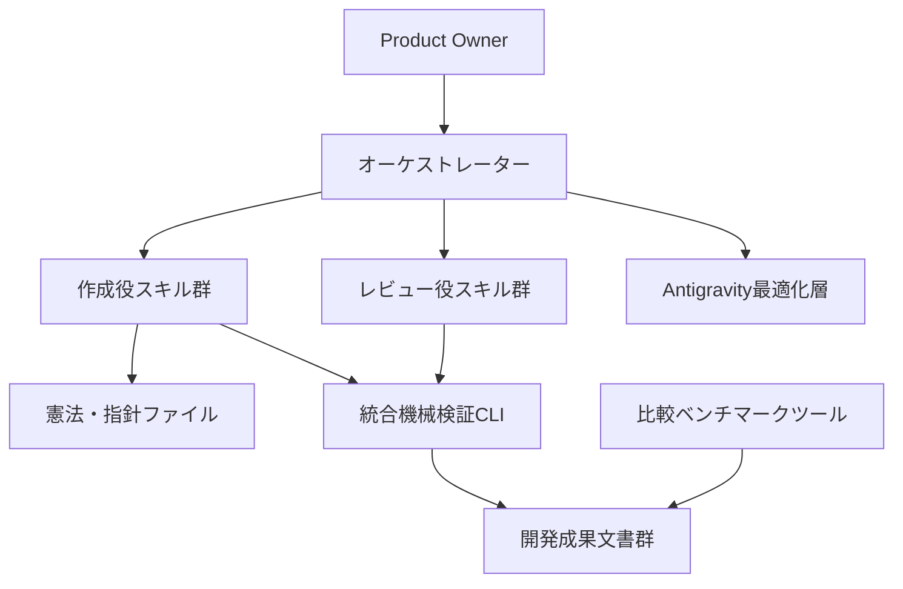

# SW105 ソフトウェア要求仕様書（エージェント定義版）

- **文書ID**: SW105
- **開発対象**: エージェント定義
- **プロジェクト名**: DADAプロセス v7.0 省トークン・高速化改訂（feat/dada-v7-redesign）
- **版数**: 1.0
- **最終更新日**: 2026-11-24
- **承認状態**: 承認済

## 1. 概要

### 1.1 目的と位置づけ
本仕様書は、DADAプロセス v7.0 の省トークン化と高速化改訂に関する要求を定義する。想定する読み手は、Product Owner（マサ）、本プロセスを利用する開発者、および次工程のテスト・設計・実装を担当するAIエージェントである。配布範囲は、本リポジトリの利用者および切り出し機能で生成する4種類のスキルセット利用者とする。

現行の v6.1.0 では、常時読み込まれる憲法ファイルが約37.9 KBに達し、システム側で後半約13.9 KBが切り詰められる事象が発生している。さらに、複数ファイル間の記述重複や2段階の執筆・推敲手順、多回数のCLI検証により、トークン消費量と処理時間が増大している。本改訂の目的は、既存の品質保証を維持したまま、トークン使用量と処理時間を大幅に削減することである。維持する品質保証は、ASDoQ品質基準、JP-Humanizerによる日本語品質、自己校正、およびテストファーストの4点とする。

### 1.2 適用範囲
本改訂のスコープ内とスコープ外を明確に境界づける。

- **対象（スコープ内）**:
  - ワークスペース憲法（`.agents/AGENTS.md`）の圧縮と単一情報源化
  - ペルソナスキル群（`.agents/skills/` 配下）の軽量化、2度書き廃止、およびエージェント定義追加手順の分離
  - 決定論的機械検証ツールの1コマンド統合、重複検査の直交化、および現行個別CLIの後方互換維持
  - 4種類の単体スキルセット（`dada-core`、`office-suite`、`jp-humanizer`、`asdoq-reviewer`）と切り出しツール（`tools/export_skillset.py`）の維持
  - ポータブルコア層と Antigravity最適化アダプター層を分離する
  - `gemini-decision-1` 連携および `/swarm` 明示起動の互換性を維持する
  - 現行 v6.1.0（`main` ブランチ `ac2bf27`）との定量比較ベンチマーク検証ツールの構築
- **対象外（スコープ外）**:
  - Office文書変換エンジン（`tools/office_io.py`）の描画・パッチ機能の全面的な書き換え
  - ASDoQシステム開発文書品質モデル（6大品質特性および `tools/asdoq_dictionary.json` の品質基準自体）の改変
  - Phase 5（人間による動作評価と要求見直し）の自動化
  - 他社製AIツール（Claude Code、Cursor、Codex、GitHub Copilot）専用のプラグイン開発

### 1.3 用語定義
以下の表1に本仕様書で使用する主要用語を定義する。本文書全体において1概念1名称を厳守する。

**表1：用語定義一覧**
| 用語 | 定義 |
| :--- | :--- |
| ワークスペース憲法 | 全フェーズの会話開始直後に自動注入される最上位ルールファイル（`.agents/AGENTS.md`）。不変条件のみを保持する |
| ベースライン（v6.1.0） | 本改訂の起点である `main` ブランチ（コミット `ac2bf27`）の実測状態 |
| ワンパス執筆 | 下書きと推敲を2周に分けず、初回執筆でASDoQ執筆ルールとJP-Humanizer観点を適用し、機械検出箇所のみを局所修正する執筆方式 |
| 統合機械検証CLI | 文書照合・ASDoQ検査・AI-Slop検査・エージェント定義検査を1回のコマンドで統括するプログラムレイヤーの検証口 |
| 比較ベンチマークツール | ベースライン（v6.1.0）と改訂版のファイル容量・フェーズ別読込バイト数・CLI実行回数を自動比較するプログラムレイヤーの検証ツール |
| ポータブルコア層 | 特定のAI実行製品に依存しない共通のDADA工程・ペルソナスキル・決定論的ツール群の層 |
| Antigravity最適化アダプター層 | Antigravity App の固有機能（Plan/Executeモデル使い分け、軽量モデルサブエージェント、ワークフロー並列実行、`/swarm`）を活用する任意の拡張層 |
| 単体スキルセット | `tools/export_skillset.py` で外部プロジェクトへ切り出せる4種類の機能単位（`dada-core`、`office-suite`、`jp-humanizer`、`asdoq-reviewer`） |

## 2. システム全体構成

### 2.1 システム構成概要
DADAプロセス v7.0 は、ポータブルコア層（自然言語レイヤーおよびプログラムレイヤー）と、任意で有効化する Antigravity最適化アダプター層で構成する。利用者の指示を受けたオーケストレーターが、各フェーズの作成役およびレビュー役へ作業を委譲し、統合機械検証CLIが形式とトレーサビリティを検証する。図1にシステム全体構成を示す。

**図1：DADA v7.0 エージェント定義の全体構成**

### 2.2 ソフトウェアの構成要素
エージェント定義は自然言語レイヤーとプログラムレイヤーの二重構造を持つ。表2にレイヤー分担の方針を示す。

**表2：レイヤー分担の方針**
| レイヤー | 担当する仕事 | 本プロジェクトでの構成要素 |
| :--- | :--- | :--- |
| 自然言語レイヤー | 要求引き出し、設計判断、反証駆動レビュー、工程遷移の制御、判断根拠の説明 | `.agents/AGENTS.md`、`.agents/skills/` 配下のスキル定義、ガイドライン、ひな形、最適化アダプター定義 |
| プログラムレイヤー | バイト数計測、ID対応照合、曖昧語・AI-Slop機械検出、差分意味保持検証、終了コード判定、ベンチマーク比較 | `tools/` 配下の検証・変換・切り出しスクリプト群および辞書JSON |

**振り分けの根拠**: `agent_design_principles.md` 第3.2節の3問に基づき、入力から出力が一意に決まる処理と取りこぼしが許されない網羅的照合・集計をプログラムレイヤーへ配置した。一方、文脈や意図の解釈を要する要求整理、設計トレードオフ、内容の妥当性レビュー、および手順制御を自然言語レイヤーへ配置した。

### 2.3 役割分割方針（三原則 Simplicity）
`agent_design_principles.md` 第2.5節にある5つの設問は、本システムですべて Yes となる。そのため表3の通り役割を分割する。

**表3：役割分割方針一覧**
| 役割 | 責務（何をするか） | 別スキルにするか | 判断の理由 |
| :--- | :--- | :--- | :--- |
| オーケストレーター | Phase 0判定、サブエージェント起動によるリセット、承認・自律ゲートの制御を担う | する | 第2問・第3問がYesであり、進行管理と各工程作業を分離するため |
| 作成役（要求・テスト・設計・実装） | 各フェーズの成果文書またはソースコードを作成・修正する | する | 第1問・第5問がYesであり、フェーズ固有の専門知識を独立させるため |
| レビュー役（要求・テスト・設計・コード・ASDoQ） | 機械検証結果と反証観点で成果物を客観的に検査し、指摘を記録する | する | 第1問がYesであり、執筆役と評価役の分離により自己採点バイアスを防ぐため |
| 日本語推敲・Office入出力（単体兼務） | 日本語表現の自然化とOffice文書変換を単体および工程内で実行する | する | 第3問がYesであり、4種類の単体スキルセットの独立切り出し単位を維持するため |
| 統合機械検証・ベンチマーク（プログラム） | 決定論的照合、形式検査、およびベースライン比の定量比較により終了コードを返す | プログラム化 | 網羅的な計数・照合を自然言語から分離し、精度とゼロトークン検証を両立するため |

**分割しない場合の記録**: 該当なし（第2.5節の5問に基づき、全役割を責務単位で分割したため）。なお、従来型プログラム用手順とエージェント定義用追加手順の統合可否を検討したが、従来型プログラム開発での読込バイト数を半減させるため、両者は別ファイルまたは差分参照へ分離する。

### 2.4 三原則の適用（必守）
表4に三原則（Simplicity、Transparency、ACI）の適用方針と関連REQ-IDを示す。

**表4：三原則の適用方針**
| 原則 | 本プロジェクトでの適用 | 関連REQ-ID |
| :--- | :--- | :--- |
| Simplicity | 憲法ファイルから手順と例示を分離して12,288 bytes以下に保ち、1スキル1責務とエージェント定義差分の分離を徹底する | REQ-001, REQ-002, REQ-005, REQ-006 |
| Transparency | 全自然言語スキルの作業開始・完了のたびに思考過程3項目（現在地・判断の根拠・次の一手）と末尾進行表示1行を必ず出力する | REQ-002, REQ-006, REQ-008 |
| ACI | 各スキルの発動条件、固定入出力パス、統合機械検証CLIの引数・終了コード（0/1/2）・出力形式を一意に定義する | REQ-003, REQ-004, REQ-007, REQ-008 |

### 2.5 設計パターンの吟味（参考。採用は必須ではない）
`agent_design_principles.md` 第2.2節の5パターンについて、本改訂での採用可否と理由を表5に記録する。

**表5：設計パターンの吟味一覧**
| パターン | 採用 / 不採用 | 理由 |
| :--- | :--- | :--- |
| Prompt Chaining（プロンプトチェーニング） | 採用 | Phase 1からPhase 5へ固定順で進行し、承認済み開発文書を次段の唯一の入力として引き継ぐため |
| Routing（ルーティング） | 採用 | Phase 0での開発対象・実行モード・スケール判定、および単体スキルセットの直接起動を分岐するため |
| Parallelization（並列化） | 採用 | Antigravity最適化アダプター層で独立ユニットの並列実装、評価セットN回試行、および `/swarm` 6特性並列監査を実行するため |
| Orchestrator-Workers（オーケストレーター・ワーカー） | 採用 | オーケストレーターが独立コンテキストのサブエージェントへ各フェーズを委譲し、履歴汚染を防ぐため |
| Evaluator-Optimizer（エバリュエーター・オプティマイザー） | 採用 | 作成役とレビュー役を別スキルに分離し、統合機械検証CLIと合わせて上限2周の自己校正ループを回すため |

## 3. 制約条件と前提事項

### 3.1 実行環境制約
以下の表6に実行環境制約を示す。

**表6：実行環境制約一覧**
| 項目 | 内容 |
| :--- | :--- |
| 対象AIエージェント製品 | 主対象: Antigravity App（CLI含む）。移植対象: Antigravity IDE、Claude Code、Cursor、Codex、GitHub Copilot |
| 想定モデル | 上位推論モデルおよび軽量モデル（サブエージェント実行）の双方で、不変条件と機械チェックが機能すること |
| 利用可能なツール | ファイル読み書き、シェルコマンド実行、および環境によりサブエージェント起動（`invoke_subagent`）、ワークフロー（`run_workflow`）、`/swarm` |
| 実行言語ランタイム | Python 3.8以降（標準ライブラリのみでコア検証が動作すること。`janome` およびOffice関連ライブラリは任意拡張） |
| コンテキスト制約 | `.agents/AGENTS.md` はシステム切り詰めを防ぐため 12,288 bytes 以下に収める。各フェーズの指示書読込量をベースライン比50%以上削減する |

### 3.2 ソフトウェア環境
プログラムレイヤーのスクリプトは、Windows PowerShell、macOS、および Linux 上の Python 3.8 以降で文字コード UTF-8 により動作しなければならない。改行コードは LF と CRLF の双方を許容する。`tools/` 配下の既存CLIスクリプト（5.3節の6本）は、既存サブコマンドと終了コード仕様（0=合格・1=指摘あり/未達・2=実行エラー）の後方互換を維持する。

### 3.3 準拠規格
文書品質基準は ASDoQ システム開発文書品質モデル Ver. 2.0a（ASDoQドキュメントライセンス ADL-1.1）に準拠する。日本語推敲観点と出典表記は『yomiyasu』（MIT License）のライセンス表示を引き継ぐ。開発文書ID（`SW105`・`SWP6`・`SW205`・`REV101_*`・`BUG101`・`TM101`）は変更しない。トレーサビリティID体系（`REQ-001`・`TC-001`・`UNIT-001`・`EV-001`・`R001`・`B001`）も現行から変更しない。

## 4. 機能要求

### 4.1 ユースケースとシナリオ
本改訂後の DADAプロセスには以下の4つの主要ユースケースがある。

1. **シナリオA（従来型プログラム開発）**: 開発者が「DADAプロセスで開発を開始してください。CSV集計CLIを作成します」と入力すると、オーケストレーターは Phase 0 で「従来型プログラム・承認ゲート型・Major」と判定する。各フェーズの作成役はエージェント定義用の差分手順を読み込まず、ベースライン比50%以下の指示書読込量で執筆と統合機械検証を完了する。
2. **シナリオB（エージェント定義開発とAntigravity最適化）**: 開発者が「DADAプロセスで開発を開始してください。開発対象はエージェント定義です」と入力した場合、システムはエージェント定義用の差分手順をオンデマンドで読み込む。Antigravity App 環境では、最適化アダプターに従いモデル使い分けや並列評価セット実行を活用できる。
3. **シナリオC（単体スキルと統合機械検証の実行）**: 開発者が「asdoq-reviewer スキル単体で仕様書をレビューして」または「JP-Humanizer スキル単体で推敲して」と指示すると、DADA工程を起動せず対象スキルのみで動作する。機械検証は統合機械検証CLIの1コマンドで完了し、外部API通信は `--decision1 on` の明示指定があった場合のみ実行する。
4. **シナリオD（ベースライン比較ベンチマーク検証）**: 開発者が比較ベンチマークツールを実行すると、ワークスペース内の憲法サイズ、フェーズ別読込バイト数、および標準ワークフロー上のCLI実行回数がベースライン実測値と比較される。ツールは比較結果から目標達成の合否を判定し、結果表と終了コードを出力する。

### 4.2 機能詳細

#### REQ-001: ワークスペース憲法（`.agents/AGENTS.md`）の12 KB以下圧縮と単一情報源化
- **概要**: 常時プロンプトへ注入される `.agents/AGENTS.md` から重複説明と詳細手順を分離し、システム側の自動切り詰めが発生しない 12,288 bytes 以下へ圧縮する。
- **レイヤー**: 両方
- **入力 / 処理 / 出力**: 入力は現行 `.agents/AGENTS.md`（37,876 bytes）および関連スキル群とする。処理では不変条件のみを憲法へ残し、詳細手順と参照表をオンデマンド文書へ移設して単一情報源化する。出力は 12,288 bytes 以下の `.agents/AGENTS.md`（自然言語）およびサイズ検証結果（プログラム）とする。
- **異常系**: 圧縮により不変条件（承認ゲート必須、コード先行禁止、機械チェック省略禁止、二重出力禁止）が欠落した場合、検証スクリプトは終了コード1を返す。単一情報源化した参照先ファイルが存在しない場合も、検証スクリプトが終了コード1を返し、エラー箇所を特定して修正する。
- **検証条件 (Acceptance Criteria)**:
  - プログラム判定: `.agents/AGENTS.md` のファイルサイズが UTF-8 で 12,288 bytes 以下であること。
  - プログラム判定: 圧縮後の `.agents/AGENTS.md` が参照するすべてのパスが実在し、`agent_def_check.py` が終了コード0を返すこと。
  - 自然言語判定: 圧縮後の憲法を読み込んだエージェントが、4原則・ID形式・承認定義・思考過程出力・末尾進行表示を欠落なく実行し、必須要素5項目を満たすこと。
  - 自然言語判定: 禁止事項（コード先行・チャット全文再掲・無断自律遷移）の違反が出力に含まれないこと。
  - REQ-001の自然言語判定にある必須要素と禁止要素の条件を、10回の試行のうち9回以上（合格率90%以上）で満たすこと。
- **優先度**: Must

#### REQ-002: ペルソナスキル群の軽量化とエージェント定義用手順のオンデマンド分離
- **概要**: オーケストレーターおよび各フェーズのペルソナスキルを重複排除により軽量化し、エージェント定義用の追加手順を別ファイルへ分離することで、各フェーズの指示書読込量をベースライン比50%以上削減する。
- **レイヤー**: 自然言語
- **入力 / 処理 / 出力**: 入力は Phase 0 判定結果（従来型プログラムまたはエージェント定義）および対象フェーズの承認済み文書とする。処理では重複記述を整理し、従来型プログラム開発においてエージェント定義用手順の読込なしで作業を進める。出力は対象フェーズの成果文書および思考過程3項目・進行表示1行を含む完了報告とする。
- **異常系**: Phase 0 で開発対象が判定不能な場合、安全側の「従来型プログラム」を仮置きし、推測で次工程へ進まず Product Owner に確認する。参照先ファイルが欠損している場合は即座に作業を停止し、欠損パスを報告する。
- **検証条件 (Acceptance Criteria)**:
  - 必須要素: 応答冒頭または開始報告に「現在地」「判断の根拠」「次の一手」の思考過程3項目が出力されること。また、応答末尾にDADA進行表示1行が出力されること。
  - 必須要素: 従来型プログラム指定の入力に対し、エージェント定義専用ファイルをロードせず Phase 1 から 4 の所定フォーマット（REQ-ID/TC-ID/UNIT-ID）で成果物を生成できること。
  - 必須要素: エージェント定義指定の入力に対し、分離されたエージェント定義用差分手順を確実にロードし、三原則と5パターン吟味を欠落なく出力できること。
  - 禁止要素: 指示書に記載のない項目や存在しないIDを創作して記載しないこと。
  - REQ-002の必須要素と禁止要素の条件を、10回の試行のうち9回以上（合格率90%以上）で満たすこと。
- **優先度**: Must

#### REQ-003: 執筆ワンパス化と機械検出箇所のみの局所推敲
- **概要**: 文書執筆における「下書き→全文スナップショット→全文リライト→検証」の2度書き往復を廃止し、初回執筆からASDoQ執筆ルールとJP-Humanizer観点を適用したうえで、機械検出された違反箇所のみを局所修正する。
- **レイヤー**: 両方
- **入力 / 処理 / 出力**: 入力は作成対象の文書種別および上流の承認済み文書とする。処理では初回執筆から自然で明確な文体で書き出し、統合機械検証を実行する。指摘が0件なら追加推敲を省略し、1件以上ならスナップショット取得・局所修正・意味保持検証（`verify`）へ進む。出力は更新済み開発文書および検証結果サマリ（終了コード 0/1/2）とする。
- **異常系**: 局所推敲によりID・数値・単位・見出し・否定極性が変化した場合、`verify` は終了コード1を返す。エージェントはただちに元の意味へ復元する。修正試行が2回を超えたなら、エージェントは原文の意味を優先して残し、Product Owner に報告する。
- **検証条件 (Acceptance Criteria)**:
  - プログラム判定: 推敲前の意味シグネチャに対してID・数値・単位・否定極性が保持されている場合、`style_check.py verify` が終了コード0を返すこと。数値または否定語が削除された入力に対しては終了コード1を返すこと。
  - 自然言語判定（必須要素）: 初回執筆文書の機械検査で指摘が0件の場合、不要なリライト往復を行わず次の工程へ進むこと。指摘が1件以上の場合は該当行のみを修正し、`verify` 終了コード0を確認してから完了報告すること。
  - 自然言語判定（禁止要素）: 推敲によって元の要件数値・ID・否定表現を変更・削除しないこと。また応答に思考過程3項目を欠落させないこと。
  - 試行回数と合格率: REQ-003の自然言語判定について、10回の試行のうち9回以上（合格率90%以上）で合格すること。
- **優先度**: Must

#### REQ-004: 決定論的機械検証の統合CLIと重複検査の直交化
- **概要**: `dada_check.py`・`asdoq_lint.py`・`style_check.py`・`agent_def_check.py` に重複分散していた検査処理を直交化する。対象文書やフェーズの全検証が1コマンドで完結する統合機械検証CLIを提供する。
- **レイヤー**: プログラム
- **入力 / 処理 / 出力**: 入力は検査対象フェーズまたはファイルパス、プロファイル（`sw105`/`swp6`/`sw205`/`general`）、および `--decision1` オプション（既定 `off`）とする。処理では重複する曖昧語・長文・図表走査を1パスで直交実行し、統合レポートファイルと1行要約を生成する。出力は標準出力への要約、統合レポートファイル、および終了コード（0=High指摘なし、1=High指摘あり、2=実行エラー）とする。
- **異常系**: 対象ファイル不在または不正オプション指定が起きた場合、外部通信や推測補完は実行せず標準エラー出力へ原因を表示して終了コード2で終了する。`--decision1 on` 指定で `GEMINI_API_KEY` が未設定なら、同じ手順で終了コード2を返す。
- **検証条件 (Acceptance Criteria)**:
  - 1フェーズの標準作業（作成後確認およびレビュー確認）で実行するCLI検証コマンド回数を、現行ベースラインの9〜11回から5回以下に削減できる統合実行口を提供すること。
  - 統合機械検証CLIを単一プロセスで実行した状態において、1,000行規模の開発文書に対して3.0秒以内（ローカル実行・`--decision1 off`）で終了コード0または1を返すこと。
  - `--decision1` の既定値が `off` であり、明示指定なしに外部API通信を行わないこと。
  - 既存の個別CLI（`dada_check.py`、`asdoq_lint.py`、`style_check.py`、`agent_def_check.py`）の既存サブコマンドと終了コード（0/1/2）が引き続き変更前と同一に動作すること。
- **優先度**: Must

#### REQ-005: 既存4スキルセット・外部API制御・`/swarm` 互換性の維持
- **概要**: 改訂後の構造では、4種類の単体スキルセット（`dada-core`・`office-suite`・`jp-humanizer`・`asdoq-reviewer`）の切り出し機能を維持する。あわせて `gemini-decision-1` 連携および `/swarm` 明示起動の互換性も維持する。
- **レイヤー**: 両方
- **入力 / 処理 / 出力**: 入力は切り出しコマンド（`export_skillset.py`）、または単体スキル起動・`--decision1 on`・`/swarm` の明示指示とする。処理では分離した差分ファイルや統合検証ツールを依存ファイル一式へ含めてパッケージングし、各スキル単体モードで規定手順を実行する。出力は独立動作可能なスキルセットディレクトリ（プログラム）および単体スキル実行結果（自然言語）とする。
- **異常系**: 未承認のまま `--decision1 on` 実行を求められたなら拒否し、`--decision1 off` で動作して事前確認を求める。明示指示なしに `/swarm` が呼ばれたなら単一セッション実行を保ち、事前確認を求める。切り出し対象ファイルが欠損している場合、`export_skillset.py` は終了コード1または2を返す。
- **検証条件 (Acceptance Criteria)**:
  - プログラム判定: `tools/export_skillset.py` で4種類すべてのスキルセットを切り出した出力先において、参照リンク切れが0件であり、`agent_def_check.py` 相当の一貫性検査が終了コード0で通過すること。
  - 自然言語判定（必須要素）: 各単体スキル（`office-document`、`JP-Humanizer`、`asdoq-reviewer`）を単体指示で起動した際、DADAプロセス全体（Phase 0〜5）の起動を省き、該当スキルの手順と思考過程3項目を出力して完遂すること。
  - 自然言語判定（禁止要素）: 事前確認なしの `--decision1 on` 強制指示に対して外部APIを実行しないこと、およびAPIキー文字列を出力に含めないこと。
  - 試行回数と合格率: REQ-005の自然言語判定について、10回の試行のうち9回以上（合格率90%以上）で合格すること。
- **優先度**: Must

#### REQ-006: ポータブルコア層と Antigravity 最適化アダプター層の分離
- **概要**: ポータブルコア層から Antigravity App 固有の並列・思考深度制御機能を分離する。この分離により、他AIツールへの移植性と Antigravity App での省コスト実行を両立する。
- **レイヤー**: 自然言語
- **入力 / 処理 / 出力**: 入力は実行環境のツール一覧（`invoke_subagent`、`run_workflow`、`/swarm` の有無）と Product Owner の実行指示とする。処理では共通コアスキルを固有ツール名に非依存で動かし、Antigravity App 環境で最適化アダプターが参照された場合のみ、モデル使い分け指針と並列実行を適用する。出力は環境に応じた実行結果と思考過程3項目・現在地宣言とする。
- **異常系**: `/swarm` や `run_workflow` 非対応の環境（Antigravity IDE・Claude Code・Cursor・Codex・GitHub Copilot）で並列実行が指示されてもエラーにしない。標準の順次実行または該当ツールの標準サブエージェント方式へ切り替え、その事実を報告する。
- **検証条件 (Acceptance Criteria)**:
  - 必須要素: ポータブルコア層（`dada-process`、各ペルソナスキル、`asdoq-reviewer` 本定義）内に Antigravity 固有の必須依存がなく、実行環境に応じた動作モード判定とフォールバック手順を出力できること。
  - 必須要素: Antigravity最適化アダプター層に、Plan/Execute のモデル使い分け基準とサブエージェントの軽量モデル活用基準が明記されること。あわせて、並列実行方針の提示と思考過程3項目の出力ができること。
  - 禁止要素: 非Antigravity環境を想定した入力に対し、未定義の `/swarm` コマンドや専用ツール呼び出しを強制しないこと。
  - REQ-006の必須要素と禁止要素の条件を、5回の試行のうち4回以上（合格率80%以上）で満たすこと。
- **優先度**: Should

#### REQ-007: ベースライン（v6.1.0）比較ベンチマーク検証ツールの構築
- **概要**: 改訂後の定量目標達成状況をベースライン（v6.1.0）実測値と比較して自動判定する比較ベンチマークツールを提供する。
- **レイヤー**: プログラム
- **入力 / 処理 / 出力**: 入力はリポジトリルートパスおよびベースライン定数（または比較対象ブランチ）とする。処理では `.agents/AGENTS.md` のバイト数、主要フェーズ（Phase 1/3/4）の規定読込ファイル群の合計バイト数、および標準ワークフロー上のCLI呼び出し回数を計測・算出する。出力はベースラインとの対比表（削減率を含む）、サマリ、および終了コード（0=全目標達成、1=1項目以上未達、2=計測エラー）とする。
- **異常系**: 規定ファイル群のパス解決失敗や計測対象ディレクトリ不在のときは、欠落ファイル一覧を標準エラー出力へ表示し、終了コード2で終了する。
- **検証条件 (Acceptance Criteria)**:
  - 改訂版リポジトリに比較ベンチマークツールを実行したとき、憲法サイズ（12,288 bytes 以下）・読込削減率（50.0%以上）・CLI回数（5回以下）を出力すること。3指標すべてが目標範囲内なら、ツールは終了コード0を返すこと。
  - 意図的に閾値を下回るダミー構成（例: 憲法 15,000 bytes）を入力した状態において、未達項目の明示とともに終了コード1を返すこと。
  - 存在しないルートパスを指定した状態において、終了コード2を返すこと。
- **優先度**: Must

#### REQ-008: 自己校正レビューの省トークン化と品質維持
- **概要**: 4種のレビュー役エージェント（`requirements-reviewer`・`test-reviewer`・`architecture-reviewer`・`code-reviewer`）が直前の統合機械検証結果を再利用する。重複コマンド実行を省きつつ、ASDoQ 6特性の反証駆動レビュー品質を維持する。
- **レイヤー**: 自然言語
- **入力 / 処理 / 出力**: 入力は対象開発文書、直前の統合機械検証レポート、および圧縮されたASDoQ専門定義とする。処理では直前に機械検証が実行済みで対象文書が未変更なら同一チェックの再実行を省略し、反証検証と `❌ Before` / `✅ After` 指摘記録に集中する。出力は思考過程3項目、`REV101_*.md`（または `BUG101`）への指摘記録、および `REVIEW: APPROVED` または `REVIEW: REJECTED` とする。
- **異常系**: 直前の機械検証結果が存在しない、または検証後に対象文書が編集されている場合、省略せずに統合機械検証CLIを実行してからレビューに進む。2周の自己校正でも `High` 指摘が解消しない場合は、3周目に入らず残課題として Product Owner に報告する。
- **検証条件 (Acceptance Criteria)**:
  - 必須要素: すべての指摘に該当箇所、重要度、`❌ Before`、`✅ After`、および `[ASDoQ:特性-副特性]` タグが含まれ、合格項目にも対象文書内の根拠箇所が1箇所以上引用されること。
  - 必須要素: 応答に思考過程3項目を出力し、指摘全文をチャットへ再掲せず記録ファイルパスと要約のみを出力すること。
  - 禁止要素: レビュー役が対象開発文書を直接書き換えないこと、および根拠箇所なしに「問題なし」と判定しないこと。
  - 試行回数と合格率: 10回の試行のうち9回以上（合格率90%以上）で合格すること。
- **優先度**: Must

## 5. 外部インタフェース要求

### 5.1 ユーザインタフェース (UI)
利用者はチャットプロンプトにより DADAプロセスまたは単体スキルを起動する。AIエージェントはすべての作業開始・完了のたびに思考過程3項目（現在地・判断の根拠・次の一手）を出力する。DADAプロセス実行中は応答末尾に進行表示1行（`[DADA | Phase N: ...]`）を出力する。成果物全文およびレビュー指摘全文は `docs/artifacts/` 配下のファイルへ書き込む。チャットへの出力はファイルパスと要約行のみに限定し、二重出力を防ぐ。承認ゲート型では定型フォーマットにより Product Owner へ明示的承認を求める。

### 5.2 ハードウェアインタフェース
本システムはソフトウェア定義とローカルスクリプトのみで構成される。実機デバイス操作や専用ハードウェア機器への直接接続は行わない。

### 5.3 ソフトウェアインタフェース
1. **統合機械検証CLI**: コマンド実行により対象ファイル・プロファイル・モードを受け取り、構造化レポートと終了コード（0=Highなし、1=Highあり、2=実行エラー）を返す。
2. **既存個別CLI後方互換**: 既存6スクリプト（`tools/dada_check.py`・`tools/asdoq_lint.py`・`tools/style_check.py`・`tools/agent_def_check.py`・`tools/office_io.py`・`tools/export_skillset.py`）の既存インタフェースを維持する。
3. **比較ベンチマークCLI**: ベースライン（v6.1.0）基準値と現在構成を比較し、要約・詳細表・終了コード（0/1/2）を返す。
4. **サブエージェント引き継ぎファイル**: フェーズ移行の引き継ぎでは `docs/process/last_phase_summary.md` を唯一の引き継ぎインタフェースとし、会話履歴の要約は渡さない。
5. **外部API連携（任意）**: `--decision1 on` が明示指定された場合のみ、`.env.local`、`.env`、または環境変数の `GEMINI_API_KEY` を用いて Google `gemini-decision-1` エンドポイント（`v1beta/decisions`）へリクエストを送信する。

## 6. 非機能要求（性能・品質等）

### 6.1 性能・効率性
表7にベースライン（v6.1.0）との比較による性能・効率性の定量目標を定義する。

**表7：性能・効率性の定量目標**
| 評価指標 | ベースライン（v6.1.0）実測値 | v7.0 目標値 | 測定条件 |
| :--- | :--- | :--- | :--- |
| `.agents/AGENTS.md` サイズ | 37,876 bytes | 12,288 bytes 以下（67.5%以上削減） | UTF-8 ファイルバイト数 |
| Phase 1 執筆読込合計（従来型） | 126,875 bytes | 63,437 bytes 以下（50%以上削減） | Phase 1 作成で参照するファイル群の合計 |
| Phase 1 レビュー読込合計（従来型） | 119,264 bytes | 59,632 bytes 以下（50%以上削減） | Phase 1 自己校正で参照するファイル群の合計 |
| Phase 1 執筆読込合計（エージェント） | 174,335 bytes | 87,167 bytes 以下（50%以上削減） | エージェント定義 Phase 1 参照ファイル群の合計 |
| Phase 3 執筆読込合計（従来型） | 129,449 bytes | 64,724 bytes 以下（50%以上削減） | Phase 3 設計で参照するファイル群の合計 |
| Phase 4 執筆読込合計（従来型） | 117,432 bytes | 58,716 bytes 以下（50%以上削減） | Phase 4 実装で参照するファイル群の合計 |
| 1フェーズのCLI検証回数 | 9〜11回 | 5回以下（約半減） | 作成・レビュー・ゲート前を通じた検証実行数 |
| 統合機械検証CLIの実行時間 | 未計測（新規追加） | 3.0秒以内 | 1,000行文書・`--decision1 off`・ローカルPython実行 |

### 6.2 信頼性・安全性
以下の表8に信頼性・安全性の要求を示す。

**表8：信頼性・安全性要求一覧**
| 項目 | 要求 |
| :--- | :--- |
| 確率的振る舞いの許容範囲 | 優先度 Must の自然言語要求は10回試行で合格率90%以上、優先度 Should の自然言語要求は5回試行で合格率80%以上を満たすこと |
| 幻覚への対策 | トレーサビリティIDと数値は元文書または機械チェック出力から転記し、記憶から創作しないこと。存在しないファイルパスへの参照を `agent_def_check.py` で0件に保つこと |
| 逸脱への対策 | 承認ゲート型の工程スキップ、コード先行、評価セット改変による合格、および二重出力を禁止事項として明文化し、検出した場合は停止して報告すること |
| 破壊的操作の扱い | ファイル削除、Git履歴書き換え、および有料API（`--decision1 on`・`/swarm`）の実行前に、Product Owner の明示的な指示または承認を得ること |
| 停止条件 | 自己校正ループ上限（2周）、同一テスト連続失敗上限（5回）、または機械チェック連続未解消（2回）に達した場合は処理を打ち切り、選択肢を添えて報告すること |

### 6.3 保守性・拡張性
すべてのスキルは1スキル1責務を維持し、自然言語レイヤーとプログラムレイヤーの契約を `agent_def_check.py` により終了コード0で維持できる構成とする。仕様変更のときは両レイヤーの整合を保つ。あわせて、4種類の単体スキルセット切り出し構成も同一作業単位内で更新する。

### 6.4 セキュリティ
`.env.local` や環境変数から読み込む `GEMINI_API_KEY` の生文字列を、標準出力、ログファイル、成果文書、およびチャット応答へ出力してはならない。外部通信は `--decision1 on` が明示承認された場合のみ許可し、既定の `--decision1 off` では完全ローカル完結で動作させる。

## 7. その他・特記事項
以下の表9に未決定事項および Phase 3（アーキテクチャ設計）への引き継ぎ事項を示す。

**表9：TBD項目・引き継ぎ事項一覧**
| # | TBD項目 / 引き継ぎ事項 | 状態 |
| :--- | :--- | :--- |
| 1 | 統合機械検証CLIの具体的ファイル名、サブコマンド体系、および既存3リンター間のモジュール分割方式（Phase 3 のアーキテクチャ設計およびADRで決定する） | 未解決 |
| 2 | エージェント定義用の差分手順・軽量ガイドラインファイルの具体的な配置パスと分割粒度（Phase 3 のアーキテクチャ設計およびADRで決定する） | 未解決 |
| 3 | Antigravity最適化アダプター層の配置形式（スキル化またはリファレンス化）とモデル使い分け基準の具体定義（Phase 3 のアーキテクチャ設計およびADRで決定する） | 未解決 |
| 4 | 比較ベンチマークツールにおける「1フェーズ読込ファイルセット」の定義リストと計測出力形式（Phase 3 のアーキテクチャ設計で決定する） | 未解決 |
