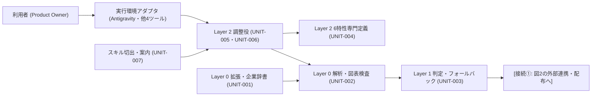
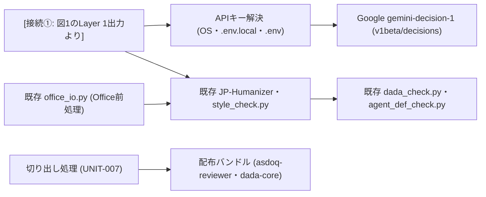
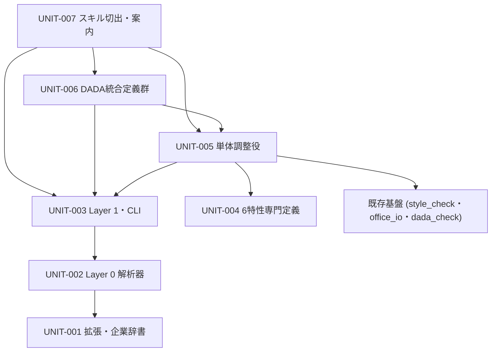
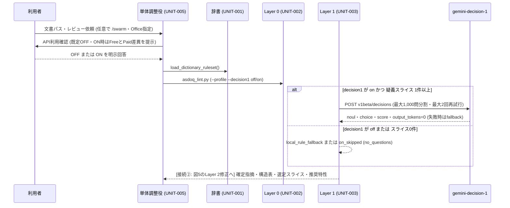
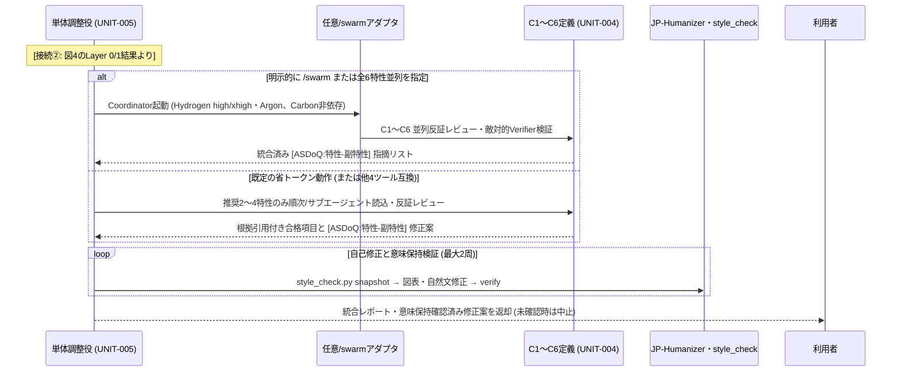
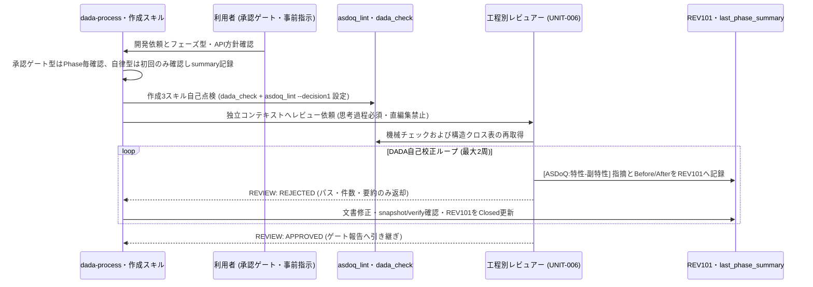

# SW205 ソフトウェアアーキテクチャ設計書（エージェント定義版）

- **文書ID**: SW205
- **版数**: 1.2
- **作成日**: 2026-11-13
- **承認状態**: 承認済

## 1. 概要

### 1.1 目的と位置づけ
本設計書は、承認済み要求仕様書（`SW105` 版数 1.3、`REQ-001`〜`REQ-007`）と総合テスト仕様書・報告書（`SWP6` 版数 1.1、`TC-001`〜`TC-023`、`EV-001`〜`EV-010`）の実現に向けた構成を定める。プログラムと自然言語定義を組み合わせたエージェント定義一式について、モジュール構造、ACI仕様、およびデータ制御方式を定義する。

本版（1.2）では、旧サイクル（版数 1.1）からの4つの基盤刷新を設計へ反映する。第1に TypeSafe AI `Jev` を廃止し、Google `gemini-decision-1`（Decisions API `v1beta/decisions`）へ移行する。第2に分類タグを `[ASDoQ:特性-副特性]` へ統一し、第3に図表分割と接続番号ルールを全工程へ組み込む。第4に任意の `/swarm` および `Gemini 4 Hydrogen`/`Argon` アダプタを本体定義から分離する。

### 1.2 適用範囲
本設計が規定する構築・改修対象（スコープ内）と、対象外事項（スコープ外）を以下に定める。

- **スコープ内**:
  - プログラムレイヤー: `tools/asdoq_dictionary.json`、`tools/asdoq_lint.py`、`tools/export_skillset.py`、`tests/test_asdoq_reviewer.py` の4資産。
  - 自然言語レイヤー（レビュー系・基盤）: `.agents/skills/asdoq-reviewer/SKILL.md`（同 `references/` 6定義 `C1`〜`C6`）、`.agents/AGENTS.md`・レビュー4スキル・`JP-Humanizer`・`dada-process`、および配布設定（`README.md`・`.env.example`・`.gitignore`）。
  - 自然言語レイヤー（作成系・帳票）: DADA作成4スキル、スケルトン3種、エージェント用ひな形3種、ガイドライン3種、およびレビュー記録表3種。
- **スコープ外**:
  - `Gemini 4 Carbon` モデルへの依存（Google AI Pro 契約範囲の `Gemini 4 Hydrogen` と `Argon` のみで動作を完結させる）。
  - `tools/office_io.py` や `tools/style_check.py` に対する新たな変換エンジンの追加開発。
  - Phase 3 設計時点における外部 `gemini-decision-1` API の実通信（Phase 3 の文書検証はローカル点検 `OFF` で行い、実機 `ON` 試験 `TC-012` と `EV-006` は Phase 4 総合テストで行う）。

### 1.3 参照ドキュメント
本設計書の上位文書と適用基準を表1に整理する。

**表1：参照ドキュメント一覧**

| 文書名 | パスまたは識別子 | 版数・位置づけ |
| :--- | :--- | :--- |
| ソフトウェア要求仕様書 | `docs/artifacts/SW105_ソフトウェア要求仕様書.md` | 版数 1.3（承認済・機能および非機能要求の正本） |
| ソフトウェア総合テスト仕様書・報告書 | `docs/artifacts/SWP6_ソフトウェア総合テスト仕様書・報告書.md` | 版数 1.1（計画承認済・テストおよび評価ケースの正本） |
| エージェント設計原則ガイドライン | `docs/guidelines/agent_design_principles.md` | 三原則、5パターン、レイヤー振り分け、ポカヨケ基準 |
| エージェント設計書ひな形 | `docs/templates/agent/phase3_agent_design_template.md` | Phase 3 章立ておよび必須記述項目の正本 |
| ASDoQ執筆ルール12箇条 | `docs/guidelines/asdoq_writing_rules.md` | 執筆時の禁止表現および図表記法ルール |
| ASDoQ軽量チェックリスト | `docs/guidelines/asdoq_checklist.md` | 6大品質特性（正準名称）および文書別重点特性 |
| DADAドキュメントガイドライン | `docs/guidelines/dada_document_guidelines.md` | 開発文書の構成規約および図表キャプション規則 |
| コーディング規約 | `docs/guidelines/coding_guidelines.md` | Pythonヘッダ記載規約、AAAテスト構造、品質基準 |
| ワークスペース憲法 | `.agents/AGENTS.md` | DADA 4原則、トレーサビリティID体系、環境別アダプタ方針 |

### 1.4 用語定義
`SW105` 第1.4節で定義された用語に加え、本設計書で新たに用いる設計用語を表2に定義する。

**表2：アーキテクチャ設計の用語定義**

| 用語 | 定義 |
| :--- | :--- |
| ACI（Agent-Computer Interface） | 自然言語レイヤーのエージェントがプログラムレイヤーを迷わず実行できるように定めたCLI引数、環境変数、出力形式、および終了コードの契約仕様。 |
| プロファイル設定マップ | `PROFILE_CONFIGS` 辞書。文書種別（`sw105`・`swp6`・`sw205`・`general`）ごとの特性重み係数と必須章チェック項目を保持する設定表。 |
| Decisions API ペイロード | Google `gemini-decision-1`（`v1beta/decisions`）へ送信するJSON構造体。`model`、問題集合 `questions`（1〜1,000問）、および回答定義を含む。 |
| ASCII choiceキー変換マップ | Decisions API へ送信する英数字識別子（`C1_1`〜`C6_4`・`other`）から、レポート出力用の日本語ラベル `[ASDoQ:特性-副特性]` へ変換する辞書。 |
| テンプレート固定語句マスキング | DADA公式ひな形に元々含まれる見出しや列名（例：`SW105` 6章見出し、`SWP6` 列名）の誤検知を防ぐため、辞書照合前に保護する既定リスト。 |
| 接続番号対チェック | 分割された2つ以上のMermaid図ブロック間で、同一番号の `[接続N: ...]` が双方に存在するかを検証し、1ブロックのみの孤立接続を警告する機能。 |
| 透過的ローカルフォールバック | `--decision1 off` 指定またはAPI障害2回再試行失敗の際に、外部通信なしでローカル規則から後段互換 `answers` 構造を生成する処理。 |
| 環境別アダプタ分離 | Antigravity `/swarm` やモデル思考レベル指定を `.agents/AGENTS.md` と調整役スキルのみへ閉じ込め、専門定義と個別スキルをツール非依存に保つ設計方針。 |
| ポカヨケ（Mistake-Proofing） | 自然言語レイヤーにおける幻覚・責務逸脱・手順漏れを、プロンプト構造とスクリプト検証によって防ぐ8個の設計基準。 |
| ボトルネック特性ルーティング | Layer 0スコアの低い2〜4特性のみを推奨抽出し、既定の省トークン動作で読み込む特性数を最小化する制御方式。 |

## 2. システム構成

### 2.1 システム全体構成
本システムは3層構造をとる。最上位の自然言語レイヤー（Layer 2）は利用者環境と対話し、中間の判定レイヤー（Layer 1）は外部APIまたはローカル規則で疑義スライスを絞る。最下層のプログラムレイヤー（Layer 0）は決定論的解析と図表検査を担う。全体構成は図1の内部ユニット構成と図2の外部連携・配布構成へ分割し、両図は `[接続①]` によって論理的に連結する。



**図1：システム全体境界と内部ユニット構成**

図1の出力境界である `[接続①]` は、図2の外部 Decisions API 連携、既存DADA支援ツール連携、および単体スキルセット配布基盤へ接続する。図1は8ノード、図2は7ノードで構成し、すべての図は10ノード以下の分割基準を満たす。



**図2：外部API連携・既存基盤・配布環境の構成**

### 2.2 主たるソフトウェア要素
本システムを構成する主たるソフトウェア要素と担当レイヤーの一覧を表3に示す。プログラムレイヤーと自然言語レイヤーは明確に責務を分離し、決定論的処理はすべてPythonスクリプト側へ配置する。

**表3：主たるソフトウェア要素一覧**

| 要素 | 対応UNIT-ID | レイヤー | 役割 |
| :--- | :--- | :--- | :--- |
| `tools/asdoq_dictionary.json`（拡張違反例・企業カスタム辞書） | UNIT-001 | プログラム | 8カテゴリ80件以上の一般違反例ルール、図表・接続番号・旧称検査ルール、および企業カスタム拡張セクションを提供する。 |
| `tools/asdoq_lint.py`（辞書検証部） | UNIT-001 | プログラム | 辞書の構文、必須6キー、カテゴリ網羅性、80件境界、正準6特性名および `[ASDoQ:特性-副特性]` 書式を検証する。 |
| `tools/asdoq_lint.py`（Layer 0 NLP・図表・構造解析エンジン） | UNIT-002 | プログラム | Janomeまたは標準ライブラリによる形態素解析、テンプレート語句マスキング後の辞書照合、構造クロス表4項目抽出、およびMermaid10ノード・接続番号・キャプション位置検査を実行する。 |
| `tools/asdoq_lint.py`（Layer 1 Gemini Decision 1・フォールバック部） | UNIT-003 | プログラム | `--decision1 <off/on/mock>` に応じ、OS環境変数・`.env.local`・`.env` のキー解決、1,000問分割REST/SDK送信、0問スキップ、2回再試行、および透過的フォールバックを制御する。 |
| `.agents/skills/asdoq-reviewer/references/C1`〜`C6`（6定義） | UNIT-004 | 自然言語 | ASDoQ 6大品質特性別の反証駆動質問、証拠引用義務、思考過程、および `[ASDoQ:特性-副特性]` 出力形式を定義する（各200行以下、ツール非依存）。 |
| `.agents/skills/asdoq-reviewer/SKILL.md`（単体調整役スキル） | UNIT-005 | 自然言語 | 開始確認（API既定 `off`）、プロファイル判定、Layer 0/1結果のルーティング（既定2〜4特性／明示 `/swarm` 6特性）、および最大2周の意味保持修正を統括する。 |
| `.agents/AGENTS.md`・DADA作成/審査スキル群・ガイドライン・ひな形 | UNIT-006 | 自然言語 | 作成4スキル・スケルトン・テンプレート・ガイドラインへの図表ルール組み込み、`[ASDoQ:特性-副特性]` 統一、作成3スキル自己点検への `asdoq_lint.py` 組み込み、および `/swarm`・`Hydrogen` アダプタ分離を担う。 |
| `tools/export_skillset.py`・`README.md`・`.env.example`・`.gitignore` | UNIT-007 | プログラム / 自然言語 | `asdoq-reviewer`・`dada-core` バンドル切り出し、環境変数テンプレートと秘密除外設定、およびON/OFF安全運用・Free/Paid比較・Hydrogenコツ・他ツール移行手順の案内を提供する。 |
| `tests/test_asdoq_reviewer.py`（自動検証スイート） | UNIT-001〜007検証用 | プログラム | `unittest` により `TC-001`〜`TC-011`・`TC-013`・`TC-019`・`TC-021`・`TC-022`（自動15項目）をモックHTTPサーバと一時ディレクトリで自動検証する。 |

## 3. ソフトウェア構成（静的構造）

### 3.1 ソフトウェア全体構成
エージェント設計原則ガイドライン（`agent_design_principles.md` 第2.2節・第2.4節）および `SW105` 第2.5節に基づき、5つの設計パターンの採用・不採用理由と適用箇所を表4にまとめる。不採用パターンはなく、条件付き並列を含め目的に応じて最小限の構成で採用する。

**表4：設計パターンの吟味と適用箇所**

| 設計パターン | 採否 | 設計上の理由と適用箇所 |
| :--- | :--- | :--- |
| Prompt Chaining | 採用 | Layer 0機械解析、Layer 1確率選別またはローカル代替、Layer 2反証レビュー、`JP-Humanizer` 推敲、および `style_check.py verify` を順次連結し、各段階の異常で停止または修正ループへ差し戻すため（`UNIT-002`, `UNIT-003`, `UNIT-005`）。 |
| Routing | 採用 | `PROFILE_CONFIGS` の重み付けでスコア低下特性を2〜4個のみ選択して読み込み、不要なコンテキスト膨張を防ぐため。ただし明示指示があるときだけ6特性全選択へ切り替える（`UNIT-002`, `UNIT-005`）。 |
| Parallelization | 条件付き採用 | 既定の単一モデル順次実行でクォータ消費を抑えつつ、利用者が `/swarm` または全6特性並列を明示指示した場合に限り、アダプタ経由で6特性の並列反証を実行するため（`UNIT-005`, `UNIT-006`）。 |
| Orchestrator-Workers | 採用 | 調整役（`asdoq-reviewer`）がプロファイル別の特性Workerを統括し、DADA統合モードでは `dada-process` が工程別作成者と審査者（任意 `/swarm` における敵対的Verifierも併用可）間の役割分離を維持するため（`UNIT-004`, `UNIT-005`, `UNIT-006`）。 |
| Evaluator-Optimizer | 採用 | 単体モード修正とDADA自己校正のループを最大2周の上限で反復し、機械検証と意味保持の目標水準に達するまで品質を引き上げるため（`UNIT-005`, `UNIT-006`）。 |

本システムがリポジトリ上に配置する静的ファイル群のディレクトリ構成を以下に示す。スキル資産と点検スクリプトは独立して配置し、`export_skillset.py` による単体切り出しを可能にする。

```text
.
├── .env.example                                  # GEMINI_API_KEY="" 等を含む環境変数テンプレート (UNIT-007)
├── .gitignore                                    # .env / .env.* 秘密除外設定 (UNIT-007)
├── README.md                                     # API安全案内・Free/Paid比較・コツ16/17・他ツール手順 (UNIT-007)
├── .agents/
│   ├── AGENTS.md                                 # 憲法・共通3ステップ・[ASDoQ:特性-副特性]・/swarmアダプタ (UNIT-006)
│   └── skills/
│       ├── asdoq-reviewer/
│       │   ├── SKILL.md                          # 単体レビュー調整役・API確認・2〜4特性ルーティング (UNIT-005)
│       │   └── references/C1..C6_reviewer.md     # 6特性専門定義 (UNIT-004, 各200行以下, ツール非依存)
│       ├── requirements-reviewer/SKILL.md        # SW105審査 ([ASDoQ:特性-副特性]・REV101記録) (UNIT-006)
│       ├── test-reviewer/SKILL.md                # SWP6 Phase 2計画・Phase 4報告審査 (UNIT-006)
│       ├── architecture-reviewer/SKILL.md        # SW205審査 ([ASDoQ:特性-副特性]・REV101記録) (UNIT-006)
│       ├── code-reviewer/SKILL.md                # 実装コードおよび報告書整合補助 (UNIT-006)
│       ├── requirements-engineer/                # SW105作成・図表ルール・asdoq_lint自己点検 (UNIT-006)
│       ├── test-engineer/                        # SWP6作成・図表ルール・asdoq_lint自己点検 (UNIT-006)
│       ├── architect/                            # SW205作成・図表ルール・asdoq_lint自己点検 (UNIT-006)
│       ├── document-writer/SKILL.md              # 物理書出・図表キャプション位置検証 (UNIT-006)
│       ├── JP-Humanizer/SKILL.md                 # 日本語推敲・8観点・意味保持 (UNIT-006)
│       └── dada-process/SKILL.md                 # DADA全体統括・フェーズ型別API選択・/swarmアダプタ (UNIT-006)
├── docs/
│   ├── guidelines/                               # 品質基準正本 (asdoq_writing_rules / asdoq_checklist / dada_document_guidelines)
│   ├── templates/agent/                          # エージェント開発ひな形 3種 (phase1〜phase3)
│   └── artifacts/REV101_*.md                     # レビュー記録表 3種 (Requirements / Test / Design)
├── tools/
│   ├── asdoq_dictionary.json                     # 8カテゴリ80件以上の拡張違反例辞書・企業辞書枠 (UNIT-001)
│   ├── asdoq_lint.py                             # Layer 0解析・図表検査・Layer 1 gemini-decision-1連携 (UNIT-001〜003)
│   └── export_skillset.py                        # 単体・DADA一式スキルセット切り出しツール (UNIT-007)
└── tests/
    └── test_asdoq_reviewer.py                    # TC-001〜TC-022対応 unittest 自動検証スイート
```

機能ユニット（`UNIT-001`〜`UNIT-007`）と既存DADA支援基盤間の依存関係を図3に示す。すべての依存は上位から下位への一方向（非循環有向グラフ）であり、循環依存は一切持たない。



**図3：機能ユニット間の依存関係図（8ノード非循環構成）**

スキル分割と配置の方針を以下に定める。

1. **専門定義のツール非依存化（100%他ツール移植性）**: `.agents/skills/asdoq-reviewer/references/C1`〜`C6` の6ファイルは各200行以内に収め、Antigravity専用の `/swarm` やモデル名を含めない。この分離構成により、Codex・Claude Code・Cursor・GitHub Copilot へ同じ定義をそのまま適用できる。
2. **アダプタの2箇所局所化**: `/swarm` 並列化、`Gemini 4 Hydrogen` の思考レベル（`low`・`medium`・`high`・`xhigh`）、および `Argon` の併用手順は `.agents/AGENTS.md` と統括スキル（`dada-process/SKILL.md`・`asdoq-reviewer/SKILL.md`）のみへ配置する。
3. **テンプレート汚染防止**: スケルトン3種（`*_skeleton.md`）、エージェント用ひな形3種（`docs/templates/agent/phase1〜3_*.md`）、およびレビュー記録表3種（`REV101_*.md`）は作成者プロジェクトへ複製または記入する資産であるため、`UNIT-006` コメントタグを埋め込まず副次更新対象として管理する。

### 3.2 機能ユニットの定義
全7機能ユニット（`UNIT-001`〜`UNIT-007`）の静的仕様を以下に定義する。各ユニットは対応要求（`REQ-001`〜`REQ-007`）と1対1で紐づく。

#### UNIT-001: 拡張違反例辞書・企業カスタム辞書管理モジュール
- **責務**: ASDoQ 6大品質特性（正準名称）と技術文書基準に基づく8カテゴリ80件以上の拡張違反例ルール、図表・接続番号・旧称検査ルール、および企業カスタム拡張辞書の読み込み・合成・検証を提供する。
- **レイヤー**: プログラム
- **成果物パス**: `tools/asdoq_dictionary.json`, `tools/asdoq_lint.py`
- **対応要求**: REQ-001
- **公開インターフェース**: 既存の `load_dictionary`・`merge_dictionaries` は互換維持のまま、`load_dictionary_ruleset(dict_path: Optional[Path] = None, custom_dict_path: Optional[Path] = None) -> Dict[str, Any]` と `validate_dictionary_file(dict_path: Path) -> Dict[str, Any]` を公開する。戻り値は `active_rules`・`custom_ok_terms`・`disabled_rule_ids`・`corporate_conformance_rules`・`category_counts`・`canonical_characteristics` を含む正規化済み辞書とする。構文破損・不在パス・必須6キー欠落・旧称残存の際は `DictionaryValidationError` を送出し、CLI終了コード `2` を返す。
- **依存先**: Python標準ライブラリ（`json`, `pathlib`, `re`）
- **検証条件**: 標準辞書 `tools/asdoq_dictionary.json` にカテゴリ1〜8の80件以上のルールが揃い、各ルールが必須6キー（`id`, `category`, `asdoq_characteristic`, `severity`, `pattern_type`, `hint`）をすべて備えること。すべてのカテゴリ名、特性ID、ヒント文のラベル `[ASDoQ:特性-副特性]` に旧称 `合目的性` が0件であり、80件辞書で終了コード `0`、79件辞書と破損JSONで終了コード `2` が返ること。また `custom_ng_rules`・`custom_ok_terms`・`disabled_rule_ids`・`corporate_conformance_rules` が合成反映され、MITライセンスとASDoQドキュメントライセンスの注記が保たれること（`TC-001`, `TC-002`, `TC-003`）。
- **適用するポカヨケ**: 4. 決定論的なスキーマ強制、7. 誤操作時の安全停止（終了コード `2` で停止）

#### UNIT-002: Layer 0 NLP形態素解析・図表検査・構造クロスリファレンス抽出エンジン
- **責務**: Markdown文書に形態素解析（Janomeまたは標準ライブラリ）とテンプレート固定語句マスキング後の辞書照合を実行する。さらに構造クロス表4項目抽出、Mermaid 10ノード・接続番号・キャプション検査、および疑義スライス圧縮を行う。
- **レイヤー**: プログラム
- **成果物パス**: `tools/asdoq_lint.py`
- **対応要求**: REQ-002
- **公開インターフェース**: 関数 `analyze_document_layer0(text: str, ruleset: Dict[str, Any], profile: str = "general", characteristic: str = "all", max_items: int = 25, force_stdlib: bool = False) -> Dict[str, Any]` を公開する。戻り値の `cross_reference` 辞書には、`purpose_scope_check`、`term_cross_check`（3回以上出現の未定義語と表記ゆれペア）、`numbers_units_table`、および `heading_figure_table_check` を格納する。`heading_figure_table_check` は希薄見出し節・境界配慮型未定義図表参照・キャプション位置違反・`mermaid_over_10_nodes`・`connection_pair_check` を含む。不在ファイルまたは0バイトの入力では `InputDocumentError` が送出され、終了コード `2` が返る。
- **依存先**: UNIT-001（`tools/asdoq_dictionary.json`）、Python標準ライブラリ（`re`, `pathlib`, `collections`）、オプション外部ライブラリ `janome`
- **検証条件**: コードブロック内は除外対象とし、カテゴリ1〜8の違反を行番号と `[ASDoQ:特性-副特性]` 付きで出力すること。構造クロスリファレンス4項目では、未定義語（3回抽出・2回除外）、表記ゆれペア、数値単位、および希薄見出し（1文抽出・2文除外）を処理すること。11ノードのMermaid図に分割推奨警告を出し、10ノードの図には警告を出さないこと。さらに2ブロック間で対になる `[接続①]`・`[接続1]` を成立と判定し、1ブロックのみの `[接続②]` へ孤立警告を出すこと。図上・表下キャプションと未定義図表参照を検出すること。2,000文字以上・正常文70%以上の文書で疑義スライス圧縮率50%以下と1カテゴリ25件上限・省略件数出力を守ること。10,000文字3.0秒以内、`janome` 無効時の自動フォールバック、および不在・0バイト入力の終了コード `2` も満たすこと（`TC-004`, `TC-005`, `TC-006`, `TC-007`）。
- **適用するポカヨケ**: 3. 明確な構造化手順、7. 誤操作時の安全停止（空入力の終了コード `2`）

#### UNIT-003: Layer 1 Google `gemini-decision-1` 判定・透過フォールバック・CLIモジュール
- **責務**: `--decision1 <off/on/mock>`（既定 `off`）と `--threshold <float>`（既定 `0.30`）のCLI制御、優先順でのAPIキー解決、`v1beta/decisions` 1,000問分割送信と0問スキップ、2回再試行後のフォールバック、および出力統合を提供する。
- **レイヤー**: プログラム
- **成果物パス**: `tools/asdoq_lint.py`
- **対応要求**: REQ-003
- **公開インターフェース**: 関数 `resolve_gemini_api_key(base_dir: Optional[Path] = None) -> Tuple[Optional[str], str]`、`evaluate_layer1_decision1(candidate_slices: List[Dict[str, Any]], decision1_mode: str = "off", threshold: float = 0.30, client: Optional[Any] = None, max_retries: int = 2) -> Dict[str, Any]`、および `main(argv: Optional[List[str]] = None) -> int` を公開する。戻り値は `decision1_mode`（`off` ローカル・`on`・`on_skipped`・`mock` の各モード名）、`retained_slices`・`discarded_slices`・`answers`・`total_output_tokens: 0` を持つ。廃止 `--jev` 指定、範囲外閾値（`0.0` 未満・`1.0` 超）、および `--decision1 on` でキー未設定または空文字の場合は終了コード `2` を返す。
- **依存先**: UNIT-001、UNIT-002、Python標準ライブラリ（`argparse`, `os`, `urllib.request`, `urllib.error`, `json`, `time`）、オプション外部ライブラリ `google-genai >= 3.2`
- **検証条件**: 既定 `off` では外部通信0回で完走し、`DECISION1_MODE: off (local_rule_fallback)` と後段互換 `answers` が返ること。`--decision1 mock --threshold 0.30` では `noul`・`choice`（`C1_1`〜`C6_4` の `[ASDoQ:特性-副特性]` 変換済み）・`score`・`total_output_tokens: 0` が出力され、`0.30` スライス保持・`0.29` スライス棄却を満たすこと。`--decision1 on` では `OS環境変数 > .env.local > .env` のキー解決（前後引用符除去と `""` 除外）と `v1beta/decisions` 送信（`x-goog-api-key`、`[A-Za-z0-9_-]{1,64}` キー、肯定表現 `instructions`）を行うこと。さらに1,000問分割（1,001問で2回送信）、0問スキップ（`on_skipped`）、および通信障害2回再試行後のフォールバックを検証する。あわせてキー文字列非露出・旧 `Jev` 語彙0件・Phase 4実機試験（`.env.local`）での実API応答確認を満たすこと（`TC-008`, `TC-009`, `TC-010`, `TC-011`, `TC-012`）。
- **適用するポカヨケ**: 5. 異常系・回避動作の強制（再試行上限と安全側フォールバック）、7. 誤操作時の安全停止（未設定キーと旧引数時の終了コード `2`）

#### UNIT-004: ASDoQ 6大品質特性別 専門レビュアー定義群
- **責務**: ASDoQ 6大品質特性（`C1_purpose`〜`C6_conformance`）を1ファイル1特性・200行以内で定義し、反証駆動質問、根拠引用ルール、`[ASDoQ:特性-副特性]` 分類タグ、思考過程3項目、および `❌ Before` / `✅ After` 修正案書式を提供する。
- **レイヤー**: 自然言語
- **成果物パス**: `.agents/skills/asdoq-reviewer/references/C1_purpose_reviewer.md`, `.agents/skills/asdoq-reviewer/references/C2_maintainability_reviewer.md`, `.agents/skills/asdoq-reviewer/references/C3_consistency_reviewer.md`, `.agents/skills/asdoq-reviewer/references/C4_understandability_reviewer.md`, `.agents/skills/asdoq-reviewer/references/C5_readability_reviewer.md`, `.agents/skills/asdoq-reviewer/references/C6_conformance_reviewer.md`
- **対応要求**: REQ-004
- **公開インターフェース**: 調整役（`UNIT-005`）からプロファイル推奨または明示 `/swarm` 指定で読み込まれる6定義文書。必須出力構造として `### 5.1 思考過程`（現在地・判断の根拠・次の一手）、`### 5.2 反証シミュレーション結果`、`### 5.3 合格項目の証拠引用`、`### 5.4 指摘リスト`（対象箇所・`[ASDoQ:特性-副特性]`・重要度・違反理由・`❌ Before` / `✅ After` 修正案）を規定する。`C3` と `C6` は10ノード超分割・接続番号整合・図直下・表直上のキャプション配置検査を含み、`C5` は `JP-Humanizer` 8観点を内蔵する。
- **依存先**: `docs/guidelines/asdoq_checklist.md`、`.agents/skills/JP-Humanizer/SKILL.md`（`C5` 参照用）
- **検証条件**: 6ファイルすべてが実在し各200行以内であること。拡張後の `validate_specialist_definitions` により必須6要素（担当副特性・反証質問・証拠引用・`[ASDoQ:特性-副特性]` と `❌ Before` / `✅ After`・思考過程・担当外禁止）が揃い、旧称 `合目的性`・旧タグ `【ASDoQ:`・`/swarm` 専用構文が0件であることを確認する。`EV-001`・`EV-002`・`EV-003` は各5回試行中4回以上（80%以上）で思考過程・担当特性内の反証・根拠引用・`[ASDoQ:特性-副特性]`・修正案を出力し、評価役が越権と無根拠合格を拒否すること（`TC-013`, `TC-014`, `TC-015`）。
- **適用するポカヨケ**: 1. 思考過程の強制、2. 入力参照の正確性強制、4. 出力形式の強制、6. 役割純化（他特性への越権禁止）、8. 自己チェックの強制

#### UNIT-005: 単体レビュー調整役・意味保持修正スキル（`asdoq-reviewer`）
- **責務**: 単体利用モードの起動窓口としてAPI利用確認（既定 `off`）を行い、`tools/asdoq_lint.py` 実行、2〜4特性選択（明示 `/swarm` 時のみ6特性並列）、図表・接続番号修正、および意味保持検証（最大2周）を統括する。
- **レイヤー**: 自然言語
- **成果物パス**: `.agents/skills/asdoq-reviewer/SKILL.md`
- **対応要求**: REQ-005
- **公開インターフェース**: 起動前に利用者へ `gemini-decision-1` の利用有無（`OFF` 既定／`ON` 時のFreeとPaid差異）を確認し、選択に応じ `python tools/asdoq_lint.py --input <対象> --profile <判定結果> --decision1 <off/on>` を実行する。`.docx` / `.xlsx` / `.pptx` / `.pdf` 指定の場合は先に `tools/office_io.py` でMarkdown変換を行う。出力は思考過程3項目、API選択とプロファイル結果、2〜4特性（または明示6特性）の統合レビュー、`[ASDoQ:特性-副特性]` ラベル、および `style_check.py snapshot`・`verify` 結果とする。
- **依存先**: UNIT-001〜004、`.agents/skills/JP-Humanizer/SKILL.md`、`tools/style_check.py`、`tools/office_io.py`、`.agents/AGENTS.md`（任意 `/swarm` アダプタ参照）
- **検証条件**: 思考過程3項目・API利用確認（無断ON拒否）・プロファイル宣言・`--decision1` 実行・2〜4特性選択境界（1以下や5以上にしない）・`[ASDoQ:特性-副特性]` 出力を実行できること。`EV-004`〜`EV-008` は各5回試行中4回以上（80%以上）で全条件を達成すること。(1) 10ノード以下へのMermaid図分割・`[接続①]` 対成立・図直下および表直上へのキャプション移動（`EV-005`）を完了すること。(2) 明示指示のときのみ `--decision1 on`・全6特性・`/swarm` または他ツール手順・Office前処理を実行すること（`EV-006`）。さらに(3) 不在パスでの捏造なき停止（`EV-007`）、(4) 無断ON拒否・数値および禁止文の意味保持・架空章拒否・最大2周上限遵守（`EV-008`）を達成すること（`TC-016`, `TC-017`, `TC-018`）。
- **適用するポカヨケ**: 1. 思考過程の強制、3. 手順固定、4. `[ASDoQ:特性-副特性]`・修正案形式強制、5. ループ最大2周上限・無断API課金拒否、7. 不在ファイルの場合は即停止

#### UNIT-006: DADA統合定義群（憲法・全工程スキル・ひな形・ガイドライン・帳票）
- **責務**: 図表ルールをDADA作成4スキル・スケルトン・ひな形・ガイドラインへ組み込み、作成3スキル自己点検へ `asdoq_lint.py` を追加する。併せてレビュー系・`REV101`・`JP-Humanizer`・憲法で `[ASDoQ:特性-副特性]` を統一し、フェーズ型別API選択と `/swarm`・`Hydrogen`/`Argon` アダプタ分離を定義する。
- **レイヤー**: 自然言語
- **成果物パス**: `.agents/AGENTS.md`, `.agents/skills/requirements-reviewer/SKILL.md`, `.agents/skills/test-reviewer/SKILL.md`, `.agents/skills/architecture-reviewer/SKILL.md`, `.agents/skills/code-reviewer/SKILL.md`, `.agents/skills/requirements-engineer/SKILL.md`, `.agents/skills/test-engineer/SKILL.md`, `.agents/skills/architect/SKILL.md`, `.agents/skills/document-writer/SKILL.md`, `.agents/skills/JP-Humanizer/SKILL.md`, `.agents/skills/dada-process/SKILL.md`, `docs/guidelines/asdoq_writing_rules.md`, `docs/guidelines/asdoq_checklist.md`, `docs/guidelines/dada_document_guidelines.md`
- **関連テンプレート・帳票更新対象**: `.agents/skills/requirements-engineer/references/SW105_skeleton.md`, `.agents/skills/test-engineer/references/SWP6_skeleton.md`, `.agents/skills/architect/references/SW205_skeleton.md`, `docs/templates/agent/phase1_agent_requirements_template.md`, `docs/templates/agent/phase2_agent_eval_spec_template.md`, `docs/templates/agent/phase3_agent_design_template.md`, `docs/artifacts/REV101_Requirements.md`, `docs/artifacts/REV101_Test.md`, `docs/artifacts/REV101_Design.md`
- **対応要求**: REQ-006
- **公開インターフェース**: CLI連携 `asdoq_lint.py --profile <sw105/swp6/sw205> --decision1 <設定>`、開始時思考過程3項目、`[ASDoQ:特性-副特性]` 指摘書式、および `REVIEW: APPROVED / REJECTED` 応答を規定する。詳細は表12および以下の3区分で定義する。
  - **DADA作成系ルール**: 作成4スキル（`requirements-engineer`・`test-engineer`・`architect`・`document-writer`）、スケルトン3種、ひな形3種、ガイドライン3種に「Mermaid 10ノード以下分割」「対になる `[接続①: ...]` 接続番号」「図の直下・表の直上キャプション」を定義する。さらに作成3スキル（`requirements-engineer`・`test-engineer`・`architect`）の自己点検手順へ `python tools/asdoq_lint.py --input <対象> --profile <sw105/swp6/sw205> --decision1 <設定>` を組み込む。
  - **DADAレビュー系・記録表ルール**: レビュー4スキル（`requirements-reviewer`・`test-reviewer` Phase 2計画とPhase 4報告・`architecture-reviewer`・`code-reviewer`）、`JP-Humanizer`、`.agents/AGENTS.md`、`REV101` 3帳票の分類ラベルを `[ASDoQ:特性-副特性]` と正準6特性名へ統一し、旧称 `合目的性` を排除する。各工程レビュアーは作業冒頭で思考過程3項目を出力し、成果文書の直編集とチャット二重出力を拒否し、`REV101` 記録後にチャットへはパス・件数・要約・`REVIEW: APPROVED` または `REVIEW: REJECTED` のみを返す。
  - **フェーズ型別API制御と環境別アダプタ**: `dada-process/SKILL.md` と `.agents/AGENTS.md` で、承認ゲート型はPhase 1〜4の各開始前に `gemini-decision-1` のON/OFFを確認する。自律型はPhase 0/1開始前の1回確認結果を `docs/process/last_phase_summary.md` で後続Phaseへ自動継承させる。また明示指示がある場合の Antigravity `/swarm` 起動・`Gemini 4 Hydrogen`（`low`〜`xhigh`）・`Argon`（`Carbon` 非依存）と他環境手順をアダプタ層として定義し、個別スキル本文へ `/swarm` 専用構文を混入させない。
- **依存先**: UNIT-001〜005、`tools/dada_check.py`、`tools/agent_def_check.py`、`tools/style_check.py`
- **検証条件**: 対象全ファイルの静的チェックで図表ルール・`asdoq_lint.py` 自己点検・`[ASDoQ:特性-副特性]` 統一・API選択・`/swarm` 分離（個別定義内 `/swarm` 0件と `合目的性` 0件）が確認され、`python tools/agent_def_check.py all` が終了コード `0` を返すこと。さらに `EV-009` の5回試行で4回以上（80%以上）で、直接書き換え・チャット全文二重出力・未承認API ONの誘導を拒否し、`REV101` への `[ASDoQ:特性-副特性]` 記録と `REVIEW: REJECTED` を出力すること（`TC-019`, `TC-020`）。
- **適用するポカヨケ**: 1. 思考過程の強制、2. 参照整合強制、5. ループ最大2周上限、6. 役割純化（レビュー役による文書直編集と二重出力の禁止）

#### UNIT-007: スキルセット切り出し機構・配布設定・リポジトリ利用案内
- **責務**: `asdoq-reviewer` と `dada-core` の完全切り出し、環境変数設定・秘密情報除外の整備、ならびにルートおよび自動生成 `README.md` へのAPI設定・料金差異・コツ16・17・他ツール手順・公式URLの記載を担う。
- **レイヤー**: プログラム / 自然言語
- **成果物パス**: `tools/export_skillset.py`, `README.md`, `.env.example`, `.gitignore`
- **対応要求**: REQ-007
- **公開インターフェース**: CLI `python tools/export_skillset.py list` と `python tools/export_skillset.py export --set <asdoq-reviewer/dada-core> --out <出力ディレクトリ>` を提供する。実行前に必須ファイル群の存在を検証し、未定義 `--set` は `argparse` により終了コード `2` を返す。必須ファイル欠落の際は出力ディレクトリを作らず、`export_skillset()` が `FileNotFoundError` を送出する。受け取った `main()` は標準エラー出力へ欠落パスを表示し、終了コード `1` を返す。正常完了のときは `asdoq-reviewer` と `dada-core` 双方へ構成ファイル一式とバンドル用 `.env.example` を出力する。併せてバンドル用 `README.md`（MITとADL表記・ON/OFF安全手順・Free/Paid比較・カスタム辞書案内）を生成し、終了コード `0` を返す。
- **依存先**: UNIT-001〜006、`.agents/skills/` 配下スキル資産、`docs/guidelines/`、`tools/` 配下スクリプト一式
- **検証条件**: `list` では `export_skillset.py` が `asdoq-reviewer`・`dada-core`・後方互換セットの一覧を出力し、`export` では欠損0件の全構成ファイル・専用 `README.md`・`.env.example` を生成すること。さらに切り出し先単体で `python tools/asdoq_lint.py --validate-dict` が終了コード `0` で動作すること。不完全ディレクトリを残さず、未定義セット名で終了コード `2`、必須ファイル欠落で終了コード `1` となること。`.gitignore` が `.env` と `.env.*`（`!.env.example`）を除外すること。ルートおよび生成 `README.md` に既定OFF・`.env.local` 設定・Free/Paid差異・`Gemini 4 Hydrogen` 思考レベル・`/swarm` クォータ保護・他4ツール手順・公式一次情報URLが記載され、`Jev` と `TYPESAFE_API_KEY` が0件であること。`EV-010` の3回試行で3回とも必須4項目の正確回答と架空表現0件を満たすこと（`TC-021`, `TC-022`, `TC-023`）。
- **適用するポカヨケ**: 2. 厳密なパス存在検証、4. バンドルREADMEテンプレート強制、7. 不完全出力防止（事前検証エラー停止）

## 4. 制御方式（動的振る舞いとリソース割り当て）

### 4.1 メモリ構成とレイアウト
本システムにおけるコンテキストウィンドウ（メモリ）の消費管理と、ファイルシステムへの状態外部化方針を表5に示す。不必要な全文読込を防ぎ、実行フェーズと選択モードに応じてオンデマンドに定義を読み込む。

**表5：コンテキスト管理と状態外部化の方針**

| 記憶領域・ファイル | 格納情報 | 読み書き主体とタイミング | トークン削減・保護施策 |
| :--- | :--- | :--- | :--- |
| `tools/asdoq_dictionary.json` | 8カテゴリ80件以上の拡張辞書 | `UNIT-001`（起動の際、読取専用） | Pythonプロセス内で照合し、辞書全文をLLMコンテキストへ展開しない。 |
| `docs/guidelines/asdoq_*.md` | 執筆ルール12箇条・軽量表・フル版 | 作成・審査スキル（必要な際オンデマンド読込） | 通常は執筆ルールと軽量チェックリストのみを読み、フル版は厳密校正指示の際だけ読み込む。 |
| `.agents/skills/asdoq-reviewer/references/C1`〜`C6` | 6特性別の反証質問と出力定義 | `UNIT-005` が推奨または明示指定特性のみ読込 | 各ファイル200行以下に制限し、既定では2〜4ファイルのみを読み込む。 |
| `docs/process/last_phase_summary.md` | 前工程の引継事項とAPI ON/OFF設定 | `context-reset` 書出、次工程開始のとき読込 | 自律型のPhase 0/1決定（API利用設定含む）を後続Phaseへ汚染なく継承する。 |
| `docs/artifacts/REV101_*.md` | 工程別レビュー指摘と修正結果 | 審査役が追記、作成役が `Closed` 更新 | チャットへの指摘全文再掲を禁止し、ファイル上でのみ全文を管理する。 |
| `docs/process/.style_snapshots/` | 推敲前の意味シグネチャ（ID・数値・否定） | `style_check.py snapshot` 書出、`verify` 比較 | LLM自身の目視ではなくPythonハッシュ・数値比較で意味欠落を検出する。 |
| `docs/process/eval_report.md` | 自然言語レイヤー評価セット試行結果 | Phase 4評価実行AIが記録、`agent_def_check.py` 検査 | 5回または3回の試行結果と合格率を機械検証可能な表形式で外部化する。 |
| `.env.local`・`.env` | `GEMINI_API_KEY`（秘密情報） | `UNIT-003` のPython処理のみが読取 | `.gitignore` で隔離し、LLMのプロンプト・出力・ログへキー値を渡さない。 |

文書種別プロファイル（`--profile`）ごとの特性重み係数、既定で優先抽出する推奨特性（2〜4特性）、および必須章チェック項目を表6に定義する。

**表6：文書種別プロファイル別の重み付けと既定重点特性**

| プロファイルID | 対象文書種別 | 高重み特性（1.5〜2.0） | 既定の推奨抽出特性数 | 必須章チェック対象（`purpose_scope_check`） |
| :--- | :--- | :--- | :--- | :--- |
| `sw105` | 要求仕様書（`SW105`） | `C1_purpose` (1.5), `C3_consistency` (1.5), `C4_understandability` (2.0), `C5_readability` (1.5) | 2〜4特性 | 概要、システム全体構成、制約条件、機能要求、外部インターフェース、非機能要求 |
| `swp6` | 総合テスト仕様書・報告書（`SWP6`） | `C2_maintainability` (1.5), `C3_consistency` (1.5), `C4_understandability` (2.0), `C5_readability` (1.5) | 2〜4特性 | 概要、テスト方針、テストシナリオ、評価方法（報告では実績・判定） |
| `sw205` | アーキテクチャ設計書（`SW205`） | `C2_maintainability` (1.5), `C3_consistency` (2.0), `C4_understandability` (1.5), `C5_readability` (1.5) | 2〜4特性 | 概要、システム構成、機能ユニット、制御方式、データ、異常処理、決定記録 |
| `general` | 一般技術文書・企画書・マニュアル | 全6特性均等 (1.0〜1.5、`C1`・`C4`・`C5` をやや重視) | 2〜4特性 | 目的（または背景）、適用範囲、本文節見出し |

### 4.2 ソフトウェア制御方式
システム全体の動的振る舞いを、単体利用モード前半（図4）、単体利用モード後半（図5）、およびDADA統合モード（図6）の3つの制御シーケンスへ分割して定義する。図4と図5は `[接続②]` で接続し、各図は参加主体を6個以下に抑える。



**図4：単体利用モード前半（API確認とLayer 0・Layer 1実行）**

図4から `[接続②]` で引き渡された解析結果を受け、図5のLayer 2専門定義が反証駆動レビューと意味保持修正を最大2周で実行する。図4の参加主体は6個、図5の参加主体は5個である。



**図5：単体利用モード後半（Layer 2反証レビューと意味保持修正）**

DADA統合モードでは、図6に示す通り、`dada-process` と承認ゲートに従ってフェーズ型に応じたAPI利用確認と独立コンテキストの工程別レビューを実行する。図6の参加主体は5個である。



**図6：DADA統合モードにおけるフェーズ別API継承と工程別レビューシーケンス**

暴走防止および課金防止のため、システム内のすべての反復処理（ループ）に設ける上限回数と打ち切り後の行き先を表7に規定する。

**表7：ループと停止条件一覧**

| 反復処理の箇所 | 制御方式 | 上限回数 | 打ち切り後の行き先・振る舞い |
| :--- | :--- | :--- | :--- |
| Layer 1 `gemini-decision-1` API通信再試行 | `UNIT-003` 内（タイムアウト・HTTP 429・5xx） | 最大2回（初回含め計3試行） | 警告を出力し `DECISION1_MODE: local_rule_fallback` へ切り替えて完走する。 |
| 単体レビュー・修正ループ（`asdoq-reviewer`） | `UNIT-005`（Evaluator-Optimizer） | 最大2周 | 未解消のHigh指摘と意味保持未達箇所を残課題として利用者へ正直に報告し停止する。 |
| DADA統合自己校正ループ | `UNIT-006`（作成役 ↔ レビュアー） | 最大2周 | 残存High指摘を `REV101_*.md` に記録したうえで承認ゲートのProduct Ownerへ報告する。 |
| `document-writer` 書き出し・整形検証 | `UNIT-006`（物理ファイル出力） | 最大3回 | 崩れ位置（ファイルパス・行番号）をProduct Ownerへエスカレーションし停止する。 |
| 6特性専門定義の特性選択上限 | `UNIT-005`（Routing制御） | 既定2〜4特性（明示のときのみ6特性） | 5特性以上の無断同時読み込みを禁止し、既定の省トークン動作を維持する。 |

### 4.3 性能見積り
`SW105` 第6.1節の性能・効率性要求に対する設計上の定量見積もりを表8に示す。

**表8：性能・効率性の定量見積もり**

| 評価対象 | 要求基準（`SW105` 6.1節） | 設計上の実現手段と見積り値 |
| :--- | :--- | :--- |
| Layer 0 処理速度（10,000文字文書） | 3.0秒以内 | 正規表現事前コンパイル、1パス行走査、および単一トークナイザ再利用により実測0.2〜0.8秒以内で完了する（余裕率3.7倍以上）。 |
| 疑義スライス圧縮率 | 2,000文字以上・正常文70%以上文書で50%以下 | 正常単文除外、受動態・条件・長文85文字超抽出、および上限45%打ち切り制御により45%以下（安全裕度5%）へ抑制する。 |
| Layer 1 APIトークン消費・バッチ効率 | 1〜1,000問分割、最大262,144入力トークン、`output_tokens: 0` | `chunk_size=1000` チャンク分割と Decisions API（`noul`・`choice`・`score`）利用により、出力トークン課金0・262,144入力トークン以内で完結する。 |
| Layer 2 読み込みトークン削減 | 専門定義各200行以下、既定2〜4特性のみ読込 | 1特性あたり約70〜150行（最大200行）に抑え、既定3特性選択の際も約250〜450行の読込で完了する（従来一括読込比50%以上削減）。 |
| `/swarm` 明示利用の並列コスト | 明示指示のとき限定・`Carbon` 非依存 | 6特性Worker＋敵対的Verifierを `Gemini 4 Hydrogen`（`high` または `xhigh`）と `Argon` の組合せに限定し、通常は単一モデルでクォータ消費を防ぐ。 |

## 5. 機能ユニット詳細（ACI仕様）

プログラムレイヤーの全ユニット（`UNIT-001`, `UNIT-002`, `UNIT-003`, `UNIT-007`）と自然言語レイヤー（`UNIT-004`, `UNIT-005`, `UNIT-006`）のインターフェース詳細を以下に定義する。スキル記述とプログラム実装でCLIオプション名が食い違わないよう、オプション表記を完全一致させる。

### 5.1 `UNIT-001`（辞書管理・検証モジュール）のACI仕様
`tools/asdoq_dictionary.json` のスキーマ定義と辞書検証インターフェースのACI仕様を表9に示す。

**表9：UNIT-001（辞書管理モジュール）のACI仕様**

| 項目 | 仕様 |
| :--- | :--- |
| 実行コマンド（標準辞書検証） | `python tools/asdoq_lint.py --validate-dict` |
| 実行コマンド（任意辞書検証） | `python tools/asdoq_lint.py --validate-dict <辞書JSONパス>` |
| 必須JSONスキーマ項目 | トップレベル：`version`, `characteristics`（正準6特性名のみ：`1. 目的適合性`, `2. 保守性`, `3. 整合性`, `4. 理解容易性`, `5. 可読性`, `6. 規範適合性`）, `categories`（`"1"`〜`"8"`）, `rules`（80件以上）, `custom_ng_rules`, `custom_ok_terms`, `disabled_rule_ids`, `corporate_conformance_rules`。<br>各ルール必須6キー：`id`, `category`, `asdoq_characteristic`, `severity`, `pattern_type`, `hint`。 |
| カテゴリ8・表記統一追加ルール | 図直下と表直上のキャプション検査（`RULE-804`, `RULE-805`）、Mermaid 10ノード超・接続番号規則案内、ならびにヒント文内の旧称 `合目的性` と旧タグ `【ASDoQ:` の排除・正準 `[ASDoQ:特性-副特性]` 統一。 |
| 終了コードと出力契約 | 正常完了：標準出力へ `ASDOQ-DICT: OK` とカテゴリ別件数・正準特性検証結果を出力し終了コード `0`。<br>不在パス・JSON破損・必須キー欠落・79件以下・旧称残存：標準エラー出力へ原因を出し終了コード `2`。 |

### 5.2 `UNIT-002` / `UNIT-003`（`tools/asdoq_lint.py`）のACI仕様
`tools/asdoq_lint.py` の全CLIオプション、Layer 0図表検査ロジック、テンプレート保護、および Layer 1 `gemini-decision-1` 連携のACI仕様を表10に示す。

**表10：UNIT-002 / UNIT-003（asdoq_lint.py）のACI仕様**

| 項目 | 仕様 |
| :--- | :--- |
| 基本実行コマンド | `python tools/asdoq_lint.py --input <文書パス> --profile <sw105/swp6/sw205/general> --decision1 <off/on/mock>` |
| CLI引数一覧 | `--input <path>`: 解析対象のMarkdown文書パス（非存在・0バイトは終了コード `2`）<br>`--profile <sw105/swp6/sw205/general>`: 文書種別プロファイル（既定 `general`）<br>`--characteristic <all/C1_purpose/C2_maintainability/C3_consistency/C4_understandability/C5_readability/C6_conformance>`: 単一特性フィルタ（既定 `all`）<br>`--decision1 <off/on/mock>`: Layer 1判定モード（既定 `off`。旧 `--jev` 引数は拒否し移行案内付き終了コード `2`）<br>`--threshold <float>`: 疑義保持閾値（範囲 `0.0`〜`1.0`、既定 `0.30`。範囲外は終了コード `2`）<br>`--custom-dict <path>`: 企業カスタム辞書JSONパス<br>`--max-items <int>`: 1カテゴリあたり最大指摘表示数（既定 `25`。超過分は省略件数を出力）<br>`--format <markdown/json>`: 出力形式（既定 `markdown`）<br>`--summary`: 末尾1行サマリのみ出力<br>`--validate-dict`: 辞書検証モード実行<br>`--force-stdlib`: `janome` 無効環境と同じ標準ライブラリフォールバックを強制実行 |
| 終了コード契約 | `0`: High指摘0件かつ正常完了（Mid・要確認の有無を問わない）<br>`1`: High指摘が1件以上検出（解析正常完了）<br>`2`: 入力ファイル不在・0バイト・辞書破損・廃止 `--jev` 指定・閾値範囲外・`--decision1 on` でAPIキー未設定または空文字 |
| Layer 0 図表検査とテンプレート除外（UNIT-002） | 1. **Mermaidノード数検査**: 各Mermaid記法の図ブロックに含まれるノード数を集計し、11ノード以上のブロックへ `mermaid_over_10_nodes` 判定を付与し、分割推奨警告を出す（10ノード以下は警告なし）。<br>2. **接続番号ペア検査**: Mermaid内の `[接続N: ...]`（全角丸数字 `①`〜`⑳` と半角 `1`〜`20`）をブロック番号付きで抽出し、2ブロック以上に共通出現した番号を対成立、1ブロックのみの番号を `isolated_connection_warning` とする。<br>3. **図表参照とキャプション位置**: 境界配慮型の正規表現で一般名詞を除外しつつ、図の直上・表の直下にあるキャプション位置違反と未定義図表参照を検出する。<br>4. **テンプレート固定語句マスキング**: DADAひな形由来の見出しや固定列名（例：`SW105` 第6章見出しおよび `SWP6` 第4章のテスト項目表列名）を辞書照合前にマスクし、ひな形変更なしでの誤検知を排除する。 |
| APIキー読込・非露出（UNIT-003） | `--decision1 on` の実行は `OS環境変数 GEMINI_API_KEY` ＞ `.env.local` ＞ `.env` の順で探索する。`.env` 系ファイルからは前後の一重・二重引用符を除去し、`""` や空白のみは未設定とみなす。未設定の場合は `.env.local`・`.env` の設定手順を標準エラー出力へ表示して終了コード `2` とする。キー値は標準出力・標準エラー・JSON・レポートへ絶対に出力しない。 |
| Decisions API 送信・変換仕様（UNIT-003） | 対象疑義スライスが0件のときHTTP送信を完全にスキップし、`DECISION1_MODE: on_skipped (no_questions)` と空 `answers`（`total_output_tokens: 0`）を返す。1件以上のときは1,000問単位のチャンクへ分割（1,001問なら2リクエスト）し、入力262,144トークン上限内で `google-genai >= 3.2`（`api_version="v1beta"`, `client.decisions.create`）または標準 `urllib.request` で `POST https://generativelanguage.googleapis.com/v1beta/decisions`（ヘッダ `x-goog-api-key`、モデル `gemini-decision-1`）へ送信する。Context Caching と Batch API は非対応のため利用しない。<br>各設問の `key` は `[A-Za-z0-9_-]{1,64}` を満たす。`instructions` にはスライスID・行番号・節見出しを含め、否定表現なしの肯定表現のみで判定基準を記述する。プリミティブとして `noul`（`0.01`〜`0.99`＋`confidence`）、`choice`（ASCIIキー `C1_1`〜`C6_4`・`other`）、および `score`（低→高順 `criteria` で `score`・`legend`・`probabilities` 返却）を要求する。`choice` はPython辞書で正準 `[ASDoQ:特性-副特性]` へ変換し、`other` または未知キー返却のときは Layer 0 の疑義特性分類を維持する。`noul >= threshold` または `score >= threshold` または重大 `choice` のスライスを保持・昇格し、`0.29` 以下かつ問題なしのスライスを棄却する。 |
| 耐障害性・1行サマリ（UNIT-003） | タイムアウト・HTTP `429`・HTTP `5xx` 発生のときは最大2回リトライ（初回含め3試行）を実行し、全滅のときは警告を出しつつ `local_rule_fallback` へ切り替える。`--summary` 実行では各項目をパイプ記号で区切り、下記の1行サマリ書式で標準出力へ返す。 |

`--summary` 指定の際に標準出力へ返却する1行サマリの書式を以下に示す。

```text
ASDOQ-LINT: <OK|NG> | profile=<p> | High=<n> / Mid=<n> / 要確認=<n> | DECISION1_MODE=<mode> | recommended=<list> | elapsed=<s>s
```

### 5.3 `UNIT-007`（`tools/export_skillset.py` および配布設定・`README.md`）のACI仕様
`tools/export_skillset.py` のバンドル切り出し仕様および `README.md`・`.env.example`・`.gitignore` 改訂仕様を表11に示す。

**表11：UNIT-007（export_skillset.py と配布資産）のACI仕様**

| 項目 | 仕様 |
| :--- | :--- |
| 実行コマンド | `python tools/export_skillset.py list`<br>`python tools/export_skillset.py export --set <asdoq-reviewer/dada-core> --out <出力ディレクトリ>` |
| `asdoq-reviewer` 同梱と定義更新 | `.agents/skills/asdoq-reviewer/SKILL.md`・同 `references/C1`〜`C6`・`.agents/skills/JP-Humanizer/`・`docs/guidelines/asdoq_*.md`・`tools/asdoq_lint.py`・`tools/asdoq_dictionary.json`・`tools/style_check.py`・自動生成 `.env.example`・自動生成 `README.md` を同梱する。併せて `SKILLSETS["asdoq-reviewer"]["description"]` と `generate_bundle_readme` の旧 `Jev` 記載を `gemini-decision-1` 案内へ置換する。 |
| `dada-core` 同梱と生成分岐 | 現行不足分（`.agents/skills/JP-Humanizer`・`.agents/skills/office-document`・`tools/style_check.py`・`tools/office_io.py`）を `SKILLSETS["dada-core"]["paths"]` へ補完する。そのうえで `asdoq-reviewer` 一式・`.agents/AGENTS.md`・DADA全スキル・`docs/templates/`・`docs/guidelines/`・`tools/dada_check.py`・`tools/agent_def_check.py` を同梱する。さらに `export_skillset()` の生成分岐へ `"dada-core"` を加え、`asdoq-reviewer`・`dada-core` 双方へバンドル用 `.env.example` と `README.md` を出力する（既存 `"office-suite"`・`"jp-humanizer"`・`"all"` は後方互換維持）。 |
| エラー処理・完全性保証 | 未定義セット名指定（例：`invalid-set`）は `argparse` により終了コード `2` を返す。構成ファイルが1件でも欠落したときは事前検証によりディレクトリ未生成のまま `export_skillset()` が `FileNotFoundError` を送出する。受け取った `main()` は終了コード `1` で停止し、不完全バンドルを残さない。 |
| `.env.example` と `.gitignore` | ルート `.env.example` は既存の他社APIキー枠（`OPENAI_API_KEY`・`ANTHROPIC_API_KEY`）を保持したまま、`GEMINI_API_KEY=""` 周辺へ `.env.local` / `.env` のUTF-8作成手順とコミット禁止注意書きを整備する。切り出しバンドル用 `.env.example` は `GEMINI_API_KEY=""` のみを含む単体構成で自動生成する。`.gitignore` に `.env`、`.env.*`、`!.env.example` が含まれる状態を維持する。 |
| `README.md` と生成 `README.md` | 1. 既存の TypeSafe AI `Jev` / `typesafe-sdk` / `TYPESAFE_API_KEY` 記述（502行・546〜550行）をすべて `gemini-decision-1`（既定OFF、`.env.local`・`.env`、Free Tier無料/200 RPM/10,000 RPD/学習利用可能性 vs Paid Tier入力 `$0.10/1M` トークン/出力 `$0`/データ保護の比較表）へ置換し、旧語彙を0件にする。<br>2. 既存のコツ節（`💡 AIエージェントを使いこなすコツ`）では番号 `1`〜`15` の内容を維持する。その末尾へ `Gemini 4 Hydrogen` 思考レベル（`low`・`medium`・`high`・`xhigh`、Carbon非依存）と `/swarm` クォータ保護運用（明示指示のときのみ）を新番号 `16.`・`17.` として追記し、既存 `10.`・`11.` 番から相互参照する。<br>3. 「🔄 他のツールで使う（Codex / Claude Code / Cursor / GitHub Copilot）」に単体スキル適用時の案内を補記し、参照元一次情報URL一覧（`SW105` 表9）を記載する。 |

### 5.4 自然言語レイヤー（`UNIT-004`〜`UNIT-006`）のスキル・テンプレート設計仕様
自然言語レイヤーの各対象ファイルにおける修正・設計事項の一覧を表12に示す。すべての自然言語ファイルはプロンプト記述の一貫性を保ち、`agent_def_check.py` の構文・コマンド・ポカヨケ検証を通過する構成とする。

**表12：自然言語ユニット（UNIT-004〜UNIT-006）のファイル別設計仕様**

| 対象UNIT | 対象ファイル群 | 設計・改修内容 |
| :--- | :--- | :--- |
| UNIT-004 | `.agents/skills/asdoq-reviewer/references/C1`〜`C6`（6ファイル） | 1. 旧称 `合目的性` と旧タグ `【ASDoQ:...】` を廃止し、正準6特性名と `[ASDoQ:特性-副特性]` 書式へ統一する。<br>2. 各ファイルを200行以下に収め、思考過程3項目・反証駆動質問・根拠引用ルール・`❌ Before` / `✅ After` 修正案・禁止事項の6要素を完備する。<br>3. `C3`・`C6` に10ノード超分割・接続番号整合・図直下と表直上のキャプション観点を追加し、`C5` に `JP-Humanizer` 8観点を内蔵する。Antigravity `/swarm` 専用構文は一切記載しない。 |
| UNIT-005 | `.agents/skills/asdoq-reviewer/SKILL.md` | 1. 開始のとき `gemini-decision-1` ON/OFF確認（既定 `off`、Free/Paid差異説明）を必須手順にする。<br>2. CLIコマンドを `tools/asdoq_lint.py --input <パス> --profile <種別> --decision1 <off/on>` へ更新し、推奨2〜4特性の省トークン読込を既定動作に固定する。<br>3. 明示指示のときのみ `/swarm` 並列アダプタ（`Hydrogen` `high`/`xhigh` または `Argon`、他4ツール互換手順）へ分岐し、`EV-005` 対応の図分割・接続番号修正・図直下と表直上キャプション移動と `style_check.py verify` を組み込む。 |
| UNIT-006（憲法・統括） | `.agents/AGENTS.md`, `dada-process/SKILL.md` | 1. `[ASDoQ:特性-副特性]`・正準6特性名統一、および作成・レビュー双方での図表分割とキャプション位置ルールを記載する。<br>2. API選択の制御規則として、承認ゲート型はPhase 1〜4各開始前に確認し、自律型はPhase 0/1開始前の1回確認結果を `last_phase_summary.md` へ引き継ぐ方式とする。<br>3. `/swarm` 並列レビュー・`Gemini 4 Hydrogen`（`low`〜`xhigh`）・`Argon`（`Carbon` 非依存）と他ツール互換サブエージェント手順を環境別アダプタ節として分離定義する。 |
| UNIT-006（作成4スキル） | `requirements-engineer/SKILL.md`, `test-engineer/SKILL.md`, `architect/SKILL.md`, `document-writer/SKILL.md` | 4スキルへ「Mermaid 10ノード以下分割・`[接続①]` 対・図直下と表直上のキャプション」を組み込む。さらに作成3スキル（`requirements-engineer`, `test-engineer`, `architect`）の自己点検手順へ `python tools/asdoq_lint.py --input <対象> --profile <sw105/swp6/sw205> --decision1 <設定>` を組み込む。 |
| UNIT-006（審査4・推敲） | `requirements-reviewer/SKILL.md`, `test-reviewer/SKILL.md`, `architecture-reviewer/SKILL.md`, `code-reviewer/SKILL.md`, `JP-Humanizer/SKILL.md` | 1. 分類ラベルを `[ASDoQ:特性-副特性]`（旧称 `合目的性` 禁止）へ統一し、開始時の思考過程出力・`REV101`（または `BUG101`）記録・対象文書直編集禁止・二重出力禁止・`REVIEW: APPROVED/REJECTED` 返却を明記する。<br>2. `test-reviewer` は Phase 2計画審査と Phase 4報告書審査（5〜6章実績の客観性検証）の双方で `asdoq_lint.py` 連携を行う。<br>3. `code-reviewer` にも `[ASDoQ:特性-副特性]` 連携および報告書検証支援との役割境界を明記する。 |
| UNIT-006（副次対象） | スケルトン3種（`SW105`/`SWP6`/`SW205_skeleton.md`）、エージェント用ひな形3種（`phase1`〜`3`）、ガイドライン3種（`asdoq_writing_rules.md`, `asdoq_checklist.md`, `dada_document_guidelines.md`）、`REV101_*.md` 3表 | 1. ガイドライン3種に図表分割・接続番号・キャプション規則と正準6特性名 `[ASDoQ:特性-副特性]`（`UNIT-006` コメント付き）を反映する。<br>2. スケルトン3種とエージェント用ひな形3種に図直下・表直上注記および10ノード分割注記を追記する（テンプレート汚染防止のため `UNIT-006` タグは付さない）。<br>3. `REV101` 3表（`Requirements`, `Test`, `Design`）の記載例・ヘッダ注記を `[ASDoQ:特性-副特性]` 基準へ揃える。 |

## 6. システムで扱うデータ

本システムが読み書きするデータファイル、設定ファイル、プロセス状態ファイル、および一時出力の一覧を表13に示す。すべての秘密情報は `.gitignore` 対象ファイルに限定して読み取り専用とし、成果文書やログへの転記を構造的に遮断する。

**表13：システムで扱うデータ・ファイル一覧**

| データ・ファイル | 形式・文字コード | 読み取り主体 | 書き込み主体 | 用途・格納内容と制約 |
| :--- | :--- | :--- | :--- | :--- |
| `tools/asdoq_dictionary.json` | JSON (UTF-8) | `UNIT-001`・`UNIT-002` | 利用者・Phase 4実装 | 8カテゴリ80件以上の一般違反例ルール、図表・旧称検査ルール、および企業カスタム拡張セクション。 |
| 企業カスタム辞書（任意） | JSON (UTF-8) | `UNIT-001` (`--custom-dict`) | 利用者（任意指定） | `custom_ng_rules`、`custom_ok_terms`、`disabled_rule_ids`、`corporate_conformance_rules` の上書き設定。 |
| 審査対象文書・開発文書 | Markdown (UTF-8) | `UNIT-002`・`UNIT-005`・`UNIT-006` | `UNIT-005`（単体のときのみ）・作成スキル | 単体モードまたはDADA各フェーズの `SW105` / `SWP6` / `SW205`。Office文書は `office_io.py` で事前変換する。 |
| `.env.local`・`.env` | dotenv (UTF-8) | `UNIT-003` Python処理のみ | 利用者（手動配置・編集） | `GEMINI_API_KEY` を格納。`.gitignore` で保護し、AIエージェントによる直接読み取り・チャット出力を厳禁とする。 |
| `.env.example` | dotenv (UTF-8) | 利用者・`UNIT-007` | Phase 4実装・`UNIT-007` | 空値 `GEMINI_API_KEY=""` のテンプレートと `.env.local`/`.env` 利用手順。秘密値は記述しない。 |
| `.gitignore` | text (UTF-8) | Git | Phase 4実装・`UNIT-007` | `.env` および `.env.*`（`!.env.example` 除く）をリポジトリ追跡から除外する設定。 |
| `docs/artifacts/REV101_*.md` | Markdown表 (UTF-8) | DADA作成・審査スキル・`dada_check.py` | 審査スキル・作成スキル | Phase 1・2・3・4の指摘履歴と `[ASDoQ:特性-副特性]` 分類記録。 |
| `docs/process/last_phase_summary.md` | Markdown (UTF-8) | 次工程開始時エージェント | `context-reset` スキル | フェーズ間の文脈引き継ぎ情報および自律型の `gemini-decision-1` 利用設定（ON/OFF）。 |
| `docs/process/.style_snapshots/*.json` | JSON (UTF-8) | `style_check.py verify` | `style_check.py snapshot` | 推敲前のID・数値・否定極性シグネチャ。意味欠落検証の照合元。 |
| `docs/process/eval_report.md` | Markdown (UTF-8) | `agent_def_check.py eval` | Phase 4評価実行AI | `EV-001`〜`EV-010` の各試行結果・合格回数・合格率の証跡台帳。 |
| 切り出し先ディレクトリ一式 | ディレクトリ・Markdown・Python・JSON | 利用者・他ツールエージェント | `UNIT-007` (`export_skillset.py`) | `asdoq-reviewer` または `dada-core` の自己完結バンドルと生成済み `README.md`・`.env.example`。 |

## 7. 例外・異常処理一覧

`SW105` の全要求（`REQ-001`〜`REQ-007`）が規定するプログラム異常系および自然言語レイヤー固有の異常事象（幻覚・逸脱・手順飛ばし・ファイル欠損）に対する検知条件と振る舞いを表14に1対1で定義する。

**表14：例外・異常処理一覧**

| 例外ID | 対象UNIT / REQ | 異常事象・発生条件 | 検知方法 | システムの振る舞い・復旧方針 | 終了コードまたは出力 |
| :--- | :--- | :--- | :--- | :--- | :--- |
| EX-001 | UNIT-001 / REQ-001 | 辞書ファイル不在、JSON構文不正、必須6キー欠落、ルール79件以下、旧称残存 | `validate_dictionary_file` / `load_dictionary_ruleset` | 解析処理を開始せずただちに異常停止し、欠落キーや件数不足の原因を標準エラー出力へ明示する。 | 終了コード `2` |
| EX-002 | UNIT-002 / REQ-002 | 解析対象ファイル不在または0バイト空ファイル | `main` 入力確認・ファイルサイズ判定 | 解析を中断し、不在パスまたは空ファイルである旨を標準エラー出力へ報告する。 | 終了コード `2` |
| EX-003 | UNIT-002 / REQ-002 | 実行環境への `janome` 未インストール | `_get_tokenizer` 内の `ImportError` 捕捉 | 例外停止せず標準ライブラリ文字種解析モードへ自動切替し、`tokenizer_mode: stdlib_fallback` として続行する。 | 終了コード `0` または `1` |
| EX-004 | UNIT-002 / REQ-002 | 1カテゴリ26件以上の違反検出、Mermaid 11ノード超過、孤立接続番号、図表キャプション位置違反 | `analyze_document_layer0` 上限・図表検査ロジック | 1カテゴリ25件で出力を打ち切り、省略件数を出力する。11ノード超過・孤立接続番号・位置違反を構造表と指摘へ出力する。 | 終了コード `0` または `1` |
| EX-005 | UNIT-003 / REQ-003 | 廃止 `--jev` 引数指定、または `--threshold` の範囲外指定（`-0.1`・`1.1`） | `argparse`・引数バリデーション | ただちにエラー停止し、`--decision1` への移行案内または `0.0`〜`1.0` の範囲案内を標準エラー出力へ出す。 | 終了コード `2` |
| EX-006 | UNIT-003 / REQ-003 | `--decision1 on` 指定のとき `GEMINI_API_KEY` が未設定または `""`（空文字） | `resolve_gemini_api_key` | 外部APIへ接続せず停止し、`.env.local`・`.env`・環境変数の設定案内を標準エラー出力へ表示する。 | 終了コード `2` |
| EX-007 | UNIT-003 / REQ-003 | `--decision1 on` 指定のとき疑義スライスが0件 | `evaluate_layer1_decision1` 事前件数チェック | HTTPリクエストを0回にスキップし、`DECISION1_MODE: on_skipped (no_questions)` と空 `answers` を返す。 | 終了コード `0` |
| EX-008 | UNIT-003 / REQ-003 | API通信タイムアウト、HTTP `429`・`5xx` 応答、JSON構文不正、または `answers` 欠落応答 | `urllib.error` / `genai` 例外・応答検証 | 最大2回リトライを実行する。2回目までに有効なJSON応答が返ればAPI結果を採用し、2回失敗後は警告を出し `local_rule_fallback` へ切り替える。 | 終了コード `0` または `1` |
| EX-009 | UNIT-003 / REQ-003 | 出力・ログ・標準エラーへの `GEMINI_API_KEY` 露出リスク | キー非出力設計・マスキング処理 | APIキー文字列を一切出力オブジェクト・例外メッセージ・レポートへ渡さず、`***` または設定元種別のみを表示する。 | キー文字列0件露出 |
| EX-010 | UNIT-004 / REQ-004 | 専門定義への担当外特性欠陥・証拠なし合格誘導の投入 | `C1`〜`C6` の責務分離と証拠引用義務規定 | 担当特性外の指摘出力と証拠引用なしの合格判定を明確に拒否し、担当特性の指摘のみを `[ASDoQ:特性-副特性]` で返す。 | 担当内指摘のみ出力 |
| EX-011 | UNIT-005 / REQ-005 | 存在しない入力パスの指定、無断API ON誘導、意味破壊指示、架空節指摘要求 | `asdoq-reviewer` 安全ゲート・`style_check.py verify` | 不在パスは捏造せず停止してパス確認を求め、無断ONや架空節は拒否し、`verify` でID・数値・否定保持を検証する。 | 確認停止または修正拒否 |
| EX-012 | UNIT-005・006 / REQ-005・006 | 自己修正ループが2周を超えてもHigh指摘が残存 | ループ上限カウント制御（最大2周） | 3周目以降を打ち切り、残存High指摘と根拠を利用者（または承認ゲートのPO）へ報告して判断を仰ぐ。 | エスカレーション報告 |
| EX-013 | UNIT-006 / REQ-006 | DADAレビュアーに対する成果文書直編集・チャット全文二重出力・無承認API ON誘導 | 役割純化ルールと禁止事項節 | レビュアーは対象ファイルを変更せず、`REV101` へ記録方針を保ったままチャットへパス・件数・要約・`REVIEW: REJECTED` のみを返す。 | `REVIEW: REJECTED` |
| EX-014 | UNIT-007 / REQ-007 | 未定義スキルセット名指定、または切り出し元必須ファイル1件以上の欠落 | `argparse`・`export_skillset` 事前存在検証 | 既存出力は変更せず、出力ディレクトリ作成を中止する。未定義セット名は `argparse` が終了コード `2` で停止し、必須ファイル欠落は標準エラー出力へ欠落パスを出して `main()` が終了コード `1` で停止する。 | 未定義 `2` / 欠落 `1` |

## 8. その他・特記事項

### 8.1 アーキテクチャ決定記録（ADR）

#### ADR-001: プログラムレイヤー（`UNIT-001`〜`UNIT-003`）の単一CLIスクリプト集約とデータ分離
- **コンテキスト**: `REQ-001`〜`REQ-003` の辞書管理、Layer 0解析、および Layer 1判定を独立スクリプトへ分散すると、バンドル切り出しの依存解決と単一コマンド起動が煩雑になる。
- **決定**: 辞書データのみを `tools/asdoq_dictionary.json`（JSON）へ分離し、プログラムロジック（`UNIT-001`・`UNIT-002`・`UNIT-003`）は単一の `tools/asdoq_lint.py` 内のモジュール境界関数群として集約する。
- **根拠とトレードオフ**: 自然言語レイヤーが覚えるべきCLIは1コマンドで完結し、`export_skillset.py` の同梱対象も最小化できる。将来ロジックが肥大化した場合はPythonパッケージ分割へ移行できるが、現規模（約1,800行見込み）では単一ファイルが保守性と配布性に優れる。

#### ADR-002: 要求1対1の7ユニット分割とテンプレート汚染防止のパス管理
- **コンテキスト**: `SW105` は `REQ-001`〜`REQ-007` の7機能要求から成り、`UNIT-006` は多数のDADAスキル・ガイドライン・スケルトン・ひな形・帳票へ跨る。
- **決定**: `REQ-001`〜`REQ-007` へ1対1で紐づく `UNIT-001`〜`UNIT-007` を維持し、`UNIT-004` の6特性定義は1特性1ファイル（各200行以下）へ分割する。また `UNIT-006` の `- **成果物パス**:` にはスキル・憲法・ガイドラインのみを列挙し、複製対象のスケルトン・ひな形・`REV101` 帳票は `- **関連テンプレート・帳票更新対象**:` へ分けて `UNIT-006` タグを付さない。
- **根拠とトレードオフ**: スケルトン複製時の新規案件文書へ不要な `UNIT-006` IDが混入する不具合を防ぎつつ、`agent_def_check.py unit` による開発対象ファイルの実装漏れ検知を両立できる。

#### ADR-003: 単体テストフレームワーク選定（`unittest`）とローカルHTTPモック／実機テスト境界
- **コンテキスト**: `SWP6` 2.2節（表1）の単体テストフレームワーク選定（`SWP6` 時点の `TBD`、Phase 3の8.2節で確定済み）が未決定であり、`TC-010`〜`TC-012` で外部依存と誤課金を防ぐ検証設計が必要である。
- **決定**: 単体・自動総合テストフレームワークとしてPython標準ライブラリ `unittest`（`pytest` 互換）を採用し、`tests/test_asdoq_reviewer.py` に配置する。HTTP通信検証は標準 `http.server` ローカルモックサーバと決定論的 `MockDecision1Client` で自動化し、実機API接続は `TC-012`（実行区分「手動」・Phase 4でAIが `.env.local` を用いて1回検証）へ分離する。
- **根拠とトレードオフ**: `unittest` は追加パッケージ不要でどのPython 3.8以降環境でも動作し、CIやオフライン環境での常時回帰実行を100%決定論的に維持できる。実API特有の仕様差異はPhase 4の `TC-012` と `EV-006` で確実に観測する。

#### ADR-004: TypeSafe AI `Jev` 廃止、`gemini-decision-1` 移行、閾値 `0.30` 是正、およびひな形除外設計
- **コンテキスト**: 旧版（`SW205` v1.1）は TypeSafe AI `Jev` を前提としており、さらに本文表で閾値 `0.65` と `0.30` の矛盾が残存していた。加えて、`SW105` v1.3 の第6章見出しや `SWP6` 第4章のテスト項目表列名といった公式ひな形語句が `asdoq_lint.py` で誤検知を起こしていた。
- **決定**: 旧 `Jev`・`--jev`・`TYPESAFE_API_KEY` を全廃し、Google `gemini-decision-1`（Decisions API `v1beta/decisions`）へ全面移行する。CLI仕様は `--decision1 <off/on/mock>` 既定 `off`・閾値 `0.30`・`0` 問スキップ・`1,000` 問分割・ASCII変換・肯定表現・`2` 回再試行後フォールバックに統一する。また `asdoq_lint.py` へ `TEMPLATE_CANONICAL_TERMS` 事前マスキングを導入し、既存ひな形の見出しや列名の表記は変えず、誤検知のみを防ぐ。
- **公式一次情報URL（`SW105` 第7章 表9より転記）**:
  - モデル公式ページ: https://aistudio.google.com/docs/models/gemini-decision-1
  - API公式ガイド: https://aistudio.google.com/docs/decisions-api
  - 公式料金: https://aistudio.google.com/docs/pricing#gemini-decision
  - 公式レート制限: https://aistudio.google.com/docs/rate-limits#gemini-decision
  - 公式発表ブログ: https://blog.google/innovation-and-ai/technology/developers-tools/gemini-decisions-api/
  - AI Studio Docs（`llms.txt` / `llms-full.txt`）: https://aistudio.google.com/llms.txt / https://aistudio.google.com/llms-full.txt
- **根拠とトレードオフ**: `total_output_tokens: 0` と1,000問一括処理によりAPIコストを最小化し、既定 `off` とキー未設定エラー停止により意図しない課金や障害を防ぐ。テンプレート保護は辞書側の `disabled_rule_ids` よりも固定語句単位で粒度を狭く保つことで、実本文の違反検出力を損なわない。

#### ADR-005: `/swarm`・`Gemini 4 Hydrogen`/`Argon` アダプタ分離（`Carbon` 非依存）と `README.md` 番号整合
- **コンテキスト**: `REQ-004`〜`REQ-007` は Antigravity `/swarm` と `Gemini 4 Hydrogen` の思考レベル活用を求めつつ、他4ツールでの100%移植性とクォータ保護を要件としている。また現行 `README.md` の「💡 AIエージェントを使いこなすコツ」には既に `1.`〜`15.` が存在する。
- **決定**: `/swarm`・`Hydrogen`（`low`〜`xhigh`）・`Argon` の記述を `.agents/AGENTS.md` と2つの調整役スキル（`dada-process`・`asdoq-reviewer`）および `README.md` のみに分離し、`C1`〜`C6` と他スキルをツール非依存に保つ。`README.md` のコツ追記では既存 `1.`〜`15.` を上書きせず、`Hydrogen` 思考レベルと `/swarm` 指針を「16.」「17.」として末尾へ追加し、既存「10.」「11.」へ相互リンクを設ける。
- **公式一次情報URL（`SW105` 第7章 表9より転記）**:
  - Gemini 4 Hydrogen Antigravity 公式ブログ: https://antigravity.google/blog/gemini-4-hydrogen-in-google-antigravity/
  - Gemini 4 Hydrogen Google 発表記事:
    https://blog.google/innovation-and-ai/models-and-research/gemini-models/introducing-gemini-4-hydrogen/
  - Antigravity `/swarm` 公式ブログ: https://antigravity.google/blog/gemini-4-carbon-in-google-antigravity
  - DADAProcess 基準リポジトリ: https://github.com/yamaPiT/DADAProcess
- **根拠とトレードオフ**: 既存 `README.md` のアンカーや番号体系（`10.` 組み込みスラッシュコマンド、`11.` 実行プロファイル）との衝突を回避しつつ、`EV-010` が検証する `Hydrogen` と `/swarm` の利用指針をすべて利用者へ提供できる。

#### ADR-006: Mermaid 10ノード以下分割・`[接続N]` 対・図直下と表直上のキャプション配置の恒久化
- **コンテキスト**: 大規模なMermaid図は人間にもAIにも視認性を落とし、図表キャプション位置の揺れは文書構造チェックで整合性低下を招く。
- **決定**: 「1つのMermaid図を10ノード以下へ分割し、分割間は `[接続N: ...]` の対で結ぶ」という分割規則を採用する。さらに「図キャプションは直下、表キャプションは直上へ配置する」の規約を `SW205` 自身とDADA作成4スキル・スケルトン・ひな形・ガイドラインおよび `asdoq_lint.py` へ定着させる。
- **根拠とトレードオフ**: 分割に伴う図数増加のコストはあるが、各図のノード数が10以下に保たれ、機械的検査（`heading_figure_table_check`）によって孤立図や参照漏れを確実に検出できる。

### 8.2 SWP6のTBD解消（Phase 3確定内容）
`SWP6`（版数 1.1）の第2.1節および第2.2節（表1）で `TBD`（Phase 3の本節で確定済み）とされていた未決定事項の確定内容を表15に示す。

**表15：SWP6のTBD項目の確定内容**

| 項目（SWP6該当箇所） | 確定した設計内容 |
| :--- | :--- |
| 単体テストフレームワーク（`SWP6` 2.2節 表1） | Python標準ライブラリ `unittest`（実行コマンド：`python -m unittest discover -s tests -v`、`pytest` でも互換実行可能）を `tests/test_asdoq_reviewer.py` へ適用する。 |
| テストモック構成・静的検査対象（`SWP6` 2.2節・4.1節） | 1. **Decisions APIモック**: `MockDecision1Client` と標準 `http.server` ローカルモックRESTサーバで `v1beta/decisions`・`x-goog-api-key`・2回再試行・1,000/1,001問分割・0問スキップを検証する。<br>2. **静的検証ヘルパー**: `validate_specialist_definitions` と `REQ-006` 向け静的ファイル走査テストを `tests/test_asdoq_reviewer.py` へ実装し、`TC-001`〜`TC-011`・`TC-013`・`TC-019`・`TC-021`・`TC-022`（自動15項目）を一括実行する。 |
| 実機外部API試験と評価セット実施境界（`SWP6` 2.1節・3.4節） | Phase 3の設計レビュー段階はローカル点検 `OFF` で実施する。Phase 4の総合テストでは、Product Owner配置済みUTF-8 `.env.local` 下でAIがCLI実行により手動1項目（`TC-012`）を実測判定し、さらに `EV-001`〜`EV-010`（計48試行）をクリーンなサブエージェントで実施して `docs/process/eval_report.md` へ記録する。 |

### 8.3 トレーサビリティ表（REQ ↔ UNIT）
`SW105`（版数 1.3）の全7要求（`REQ-001`〜`REQ-007`）に対し、全設計ユニット（`UNIT-001`〜`UNIT-007`）の対応を割り当てた。`SWP6`（版数 1.1）の全23テスト（`TC-001`〜`TC-023`・`EV-001`〜`EV-010`）の対応も表16に整理した。対応のない要求およびテスト項目は0件である。

**表16：トレーサビリティ対応表（REQ ↔ UNIT ↔ TC）**

| 要求ID (`SW105`) | レイヤー | 対応設計ユニットID (`SW205`) | 対応テストID (`SWP6`) |
| :--- | :--- | :--- | :--- |
| REQ-001 | プログラム | UNIT-001（`tools/asdoq_dictionary.json`, `tools/asdoq_lint.py`） | TC-001, TC-002, TC-003 |
| REQ-002 | プログラム | UNIT-002（`tools/asdoq_lint.py` Layer 0・図表検査） | TC-004, TC-005, TC-006, TC-007 |
| REQ-003 | プログラム | UNIT-003（`tools/asdoq_lint.py` Layer 1 `gemini-decision-1`） | TC-008, TC-009, TC-010, TC-011, TC-012 |
| REQ-004 | 自然言語 | UNIT-004（`.agents/skills/asdoq-reviewer/references/C1`〜`C6`） | TC-013, TC-014 (`EV-001`, `EV-002`), TC-015 (`EV-003`) |
| REQ-005 | 自然言語 | UNIT-005（`.agents/skills/asdoq-reviewer/SKILL.md`） | TC-016 (`EV-004`, `EV-005`), TC-017 (`EV-006`), TC-018 (`EV-007`, `EV-008`) |
| REQ-006 | 自然言語 | UNIT-006（`.agents/AGENTS.md`・DADA作成/審査スキル・ガイドライン・ひな形・帳票） | TC-019, TC-020 (`EV-009`) |
| REQ-007 | プログラム / 自然言語 | UNIT-007（`tools/export_skillset.py`, `README.md`, `.env.example`, `.gitignore`） | TC-021, TC-022, TC-023 (`EV-010`) |

### 8.4 ポカヨケ適用状況
`agent_design_principles.md` 第5章で定義された8つのポカヨケ設計基準について、本システムの全ユニットへの適用状況を表17に示す。

**表17：ポカヨケ設計基準の適用状況**

| # | ポカヨケ基準名 | 適用対象UNIT | 未適用UNITおよび設計上の理由 |
| :--- | :--- | :--- | :--- |
| 1 | 思考過程（Transparency）の強制 | UNIT-004, UNIT-005, UNIT-006, UNIT-007（案内応答） | UNIT-001〜003は決定論的Python処理であり自然言語による推論説明が不要であるため。 |
| 2 | 入力参照・ID転記の正確性強制 | UNIT-004, UNIT-005, UNIT-006, UNIT-007 | UNIT-001〜003はファイルパス検証と正規表現で機械照合するため。 |
| 3 | 作業手順の構造化（Step番号固定） | UNIT-002（パイプライン）, UNIT-005, UNIT-006 | UNIT-001は単一検証関数、UNIT-003は分岐API呼出、UNIT-004は参照定義専用であるため。 |
| 4 | 出力形式（スキーマ・`[ASDoQ:特性-副特性]`）の強制 | UNIT-001, UNIT-002, UNIT-003, UNIT-004, UNIT-005, UNIT-006, UNIT-007 | 全ユニットに適用（除外なし）。 |
| 5 | 異常系・上限回数・回避動作の強制 | UNIT-003（2回再試行・フォールバック）, UNIT-005, UNIT-006 | UNIT-001・002・007は即停止型（終了コード `1`・`2`）、UNIT-004は静的定義専用であるため。 |
| 6 | 役割純化・直接編集禁止と二重出力防止 | UNIT-004（他特性越権禁止）, UNIT-005, UNIT-006（直編集禁止） | UNIT-001〜003・007のPython処理は編集禁止対象外の実行スクリプトであるため。 |
| 7 | 誤操作時の安全停止（エラー終了と未課金維持） | UNIT-001, UNIT-002, UNIT-003, UNIT-005, UNIT-007 | UNIT-004・006は単一コマンドを持たない定義ファイル群であり上位調整役が停止を担うため。 |
| 8 | 完了前自己チェックと機械検証の強制 | UNIT-004, UNIT-005, UNIT-006（作成3スキル・レビュー4スキル） | UNIT-001〜003・007は自動テストスイート `TC-001`〜`TC-022` で検証するため。 |
