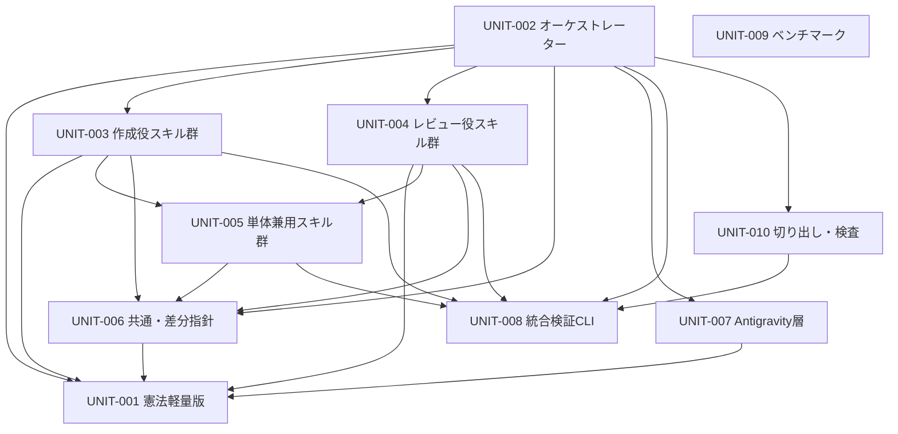
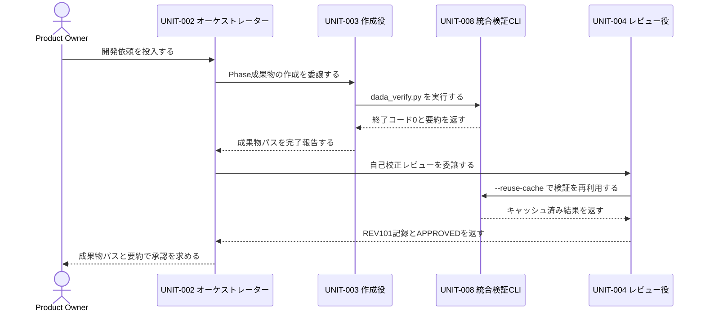

# SW205 ソフトウェアアーキテクチャ設計書（エージェント定義版）

- **文書ID**: SW205
- **開発対象**: エージェント定義
- **プロジェクト名**: DADAプロセス v7.0 省トークン・高速化改訂（feat/dada-v7-redesign）
- **版数**: 1.0
- **最終更新日**: 2026-11-24
- **承認状態**: 承認済

## 1. 概要

### 1.1 目的と位置づけ
本設計書は、DADAプロセス v7.0 の省トークン化および高速化改訂に向けたソフトウェアアーキテクチャを定義する。想定する読み手は、Product Owner（マサ）、本プロセスを運用する開発者、および Phase 4 を担当する AI エージェントである。本設計書は、承認済みの要求仕様書（`SW105`）および総合テスト仕様書・報告書（`SWP6`）を唯一の根拠とする。本書では自然言語レイヤーとプログラムレイヤーの責務境界、全機能ユニットの公開インターフェース、ACI 仕様、性能見積り、および技術選定根拠（ADR）を確定する。

### 1.2 適用範囲
本設計の対象は、本リポジトリ内のワークスペース憲法、スキル群、ガイドライン群、および `tools/` 配下の決定論的 CLI 群と `tests/` 配下の単体テスト群である。主対象の AI 実行製品は Antigravity App（CLI を含む）とする。移植対象には Antigravity IDE、Claude Code、Cursor、Codex、および GitHub Copilot を含める。`tools/office_io.py` の描画・パッチ機能の全面書き換え、ASDoQ 品質基準および `tools/asdoq_dictionary.json` の改変、ならびに Phase 5 の人間による動作評価の自動化は対象外とする。理由: これらは `SW105` の 1.2 節でスコープ外と定義済みであるため。

### 1.3 参照ドキュメント
- `docs/artifacts/SW105_ソフトウェア要求仕様書.md`（版数: 1.0、承認状態: 承認済）
- `docs/artifacts/SWP6_ソフトウェア総合テスト仕様書・報告書.md`（版数: 1.0、承認状態: 計画承認済）
- `docs/guidelines/agent_design_principles.md`（版数: 1.1）
- `docs/guidelines/asdoq_writing_rules.md`

### 1.4 用語定義
基本用語は `SW105` の 1.3 節（表1）に従う。本設計書で追加定義する技術用語を表1に示す。本文書全体において 1 概念 1 名称を厳守する。

**表1：追加技術用語定義一覧**
| 用語 | 定義 |
| :--- | :--- |
| frontmatter | `SKILL.md` 先頭の `---` で囲まれた YAML メタデータ領域であり、`name` と `description` を保持する |
| ACI | Agent-Computer Interface。AI エージェントが誤用なく操作できるスキル発動条件、入出力パス、CLI 引数、標準出力、および終了コードの契約 |
| 検証キャッシュ | `docs/process/.verify_cache.json` に保存される対象ファイルの SHA-256 ハッシュ、検証引数、および直前結果の記録 |
| 直交化 | 複数の個別スクリプトに重複していた曖昧語走査、長文検出、図表検査を単一パスへ統合し、同一箇所の重複指摘を排除する構造整理 |
| ポカヨケ | 誤操作や幻覚を構造的に防ぐための固定手順（思考過程の強制、ルート固定パス、二重出力の禁止、status コード制御、ラベル固定、ループ上限、禁止事項明示、チェックリスト化） |

## 2. システム構成

### 2.1 システム全体構成
DADAプロセス v7.0 は 4 領域で構成される。具体的には、常時注入されるワークスペース憲法、オンデマンド読込のポータブルコア層（スキル群およびガイドライン群）、環境別の Antigravity 最適化アダプター層、およびプログラムレイヤーである。Product Owner の指示を受けたオーケストレーターは、対象判定に基づき各作成役・レビュー役・単体兼用スキルへ制御を渡す。各スキルは統合機械検証 CLI により品質と整合性を確認する。

### 2.2 主たるソフトウェア要素
本システムを構成する主たるソフトウェア要素とレイヤー配置を表2に示す。各要素の詳細は 3.2 節の機能ユニット定義（`UNIT-001`〜`UNIT-010`）で定める。

**表2：主たるソフトウェア要素一覧**
| 要素 | レイヤー | 役割 |
| :--- | :--- | :--- |
| ワークスペース憲法（`.agents/AGENTS.md`） | 自然言語 | 4 原則、不変条件、ID 体系、承認定義、実行モード規則の最小定義 |
| オーケストレーター・工程制御スキル群 | 自然言語 | Phase 0 の 3 判定、サブエージェント起動、承認・自律ゲート遷移制御 |
| 作成役ペルソナスキル群 | 自然言語 | 要求・テスト・設計・実装・単体テスト・文書出力のワンパス作成実行 |
| レビュー役ペルソナスキル群 | 自然言語 | 検証キャッシュ再利用と反証観点による `REV101_*` / `BUG101` 記録 |
| 単体兼用スキル群・ASDoQ 専門定義 | 自然言語 | 日本語推敲、ASDoQ 6 特性レビュー、Office 文書入出力の単独・工程内実行 |
| エージェント定義差分・共通執筆ガイドライン群 | 自然言語 | エージェント定義用の追加手順、執筆ルール、チェックリストのオンデマンド提供 |
| Antigravity 最適化アダプター層 | 自然言語 | Plan/Execute モデル使い分け、軽量サブエージェント、並列実行と `/swarm` 指針 |
| 統合機械検証 CLI（`tools/dada_verify.py`） | プログラム | 既存 4 検証の一括直交実行、SHA-256 キャッシュ判定、終了コード制御 |
| 比較ベンチマークツール（`tools/dada_benchmark.py`） | プログラム | v6.1.0 基準値と現在構成の容量・読込量・CLI 回数の定量比較判定 |
| スキルセット切り出し・一貫性チェッカ | プログラム | 4 スキルセットの依存抽出および憲法 12,288 bytes 上限とキャッシュ除外の検査 |

## 3. ソフトウェア構成（静的構造）

### 3.1 ソフトウェア全体構成

#### 設計パターンの吟味
`agent_design_principles.md` 第 2.2 節および第 2.4 節に基づき、`SW105` の 2.5 節（表5）から転記・確定した 5 つの設計パターンの吟味結果を表3に示す。空欄は置かず、すべてに採用理由と適用箇所を明記した。

**表3：設計パターンの吟味一覧**
| パターン | 採用 / 不採用 | 適用箇所 | 理由 |
| :--- | :--- | :--- | :--- |
| Prompt Chaining（プロンプトチェーニング） | 採用 | `UNIT-002`、`UNIT-003`、`UNIT-004` | Phase 1 から Phase 5 への固定順工程において、承認済み文書を次工程の唯一の入力として直列連携するため |
| Routing（ルーティング） | 採用 | `UNIT-002`、`UNIT-005`、`UNIT-006` | Phase 0 の開発対象判定による従来型向け・エージェント定義向けの分岐、および単体スキル起動の振り分けを行うため |
| Parallelization（並列化） | 採用 | `UNIT-007`、`UNIT-002` | Antigravity App 環境で独立ユニットの並列実装、評価セット N 回試行、および明示指定時の `/swarm` 並列監査を実行するため |
| Orchestrator-Workers（オーケストレーター・ワーカー） | 採用 | `UNIT-002`（調整役）と `UNIT-003`/`UNIT-004`（ワーカー） | 独立コンテキストのサブエージェントへフェーズ作業を委譲し、履歴汚染の防止とループ上限の一元管理を実現するため |
| Evaluator-Optimizer（エバリュエーター・オプティマイザー） | 採用 | `UNIT-003`（生成役）、`UNIT-004`（評価役）、`UNIT-008`（検証 CLI） | 作成役と評価役を別ユニットへ分離し、自己採点バイアスを排除したうえで最大 2 周の自己校正ループを回すため |

#### 成果物のファイル構成
本設計により生成・更新する成果物ファイルの配置構成を以下に示す。各ファイルには、紐づく `UNIT-ID` をヘッダまたはコメントで記載する。

```text
.agents/
  AGENTS.md                                        # UNIT-001
  skills/
    dada-process/SKILL.md                          # UNIT-002
    context-reset/SKILL.md                         # UNIT-002
    dada-check/SKILL.md                            # UNIT-002
    requirements-engineer/SKILL.md                 # UNIT-003
    test-engineer/SKILL.md                         # UNIT-003
    architect/SKILL.md                             # UNIT-003
    programmer/SKILL.md                            # UNIT-003
    document-writer/SKILL.md                       # UNIT-003
    unit-test-generator/SKILL.md                   # UNIT-003
    requirements-reviewer/SKILL.md                 # UNIT-004
    test-reviewer/SKILL.md                         # UNIT-004
    architecture-reviewer/SKILL.md                 # UNIT-004
    code-reviewer/SKILL.md                         # UNIT-004
    JP-Humanizer/SKILL.md                          # UNIT-005
    asdoq-reviewer/SKILL.md                        # UNIT-005
    asdoq-reviewer/references/C1_purpose_reviewer.md         # UNIT-005
    asdoq-reviewer/references/C2_maintainability_reviewer.md # UNIT-005
    asdoq-reviewer/references/C3_consistency_reviewer.md     # UNIT-005
    asdoq-reviewer/references/C4_understandability_reviewer.md # UNIT-005
    asdoq-reviewer/references/C5_readability_reviewer.md     # UNIT-005
    asdoq-reviewer/references/C6_conformance_reviewer.md     # UNIT-005
    office-document/SKILL.md                       # UNIT-005
docs/guidelines/
  agent_def_phase_addon.md                         # UNIT-006
  agent_design_principles.md                       # UNIT-006
  asdoq_writing_rules.md                           # UNIT-006
  asdoq_checklist.md                               # UNIT-006
  dada_document_guidelines.md                      # UNIT-006
  antigravity_adapter.md                           # UNIT-007
tools/
  dada_verify.py                                   # UNIT-008
  dada_benchmark.py                                # UNIT-009
  export_skillset.py                               # UNIT-010
  agent_def_check.py                               # UNIT-010
tests/
  test_dada_verify.py                              # UNIT-008 単体テスト
  test_dada_benchmark.py                           # UNIT-009 単体テスト
  test_export_skillset.py                          # UNIT-010 単体テスト
  test_agent_def_check.py                          # UNIT-010 単体テスト
```

#### スキル分割方針
`SW105` の 2.3 節で定めた役割分割方針に基づき、全機能を 10 ユニットへ分割する。内訳は制御系（`UNIT-002`）・作成役（`UNIT-003`）・レビュー役（`UNIT-004`）・単体兼用（`UNIT-005`）・指針（`UNIT-006`）・最適化層（`UNIT-007`）・プログラム 3 群（`UNIT-008`〜`UNIT-010`）である。作成役とレビュー役は内部でフェーズ別の `SKILL.md` ファイル（1 役割 1 `SKILL.md`）に分かれており、Generator と Evaluator の分離を維持する。共通のワンパス執筆手順やキャッシュ再利用手順を持つスキル群は、役割グループ単位の `UNIT-ID` にまとめる。この構成により、依存図は 10 ノードの完全な非循環有向グラフ（DAG）を維持できる（詳細は 8.1 節の ADR-001 参照）。

各 `SKILL.md` の `frontmatter` における `description` は発動条件を先頭に配置し、他スキルとの重複を排除する。工程スキルでは「DADAプロセスの Phase N で〜するとき」という形式で発動条件を明記する。単体兼用スキルでは「単体タスクまたは〜の推敲／ASDoQレビュー／Office変換を求められた場面」という記述により、Routing における誤発動を防ぐ。

#### レイヤー間の依存方向
全 10 ユニット間の依存関係を図1に示す。矢印は「依存する側 --> 依存される側」を表し、循環依存は存在しない。`UNIT-009`（比較ベンチマークツール）は他ユニットの実行に依存せず独立して動作する。


**図1：レイヤー間の依存方向**

### 3.2 機能ユニットの定義

#### UNIT-001: ワークスペース憲法（軽量版）
- **責務**: 全フェーズで自動注入される DADA プロセスの不変条件、ID 体系、承認定義、および実行モード規則の正本を 12,288 bytes 以下で定義する。
- **レイヤー**: 自然言語
- **成果物パス**: `.agents/AGENTS.md`
- **対応要求**: REQ-001
- **公開インターフェース**: 発動条件=ワークスペース内の全チャット起動直後にシステムが自動注入する。入力=なし（最上位規則）。出力=応答内の原則遵守宣言。思考過程の出力=開始および完了の時点で「(1) 現在地 (2) 判断の根拠 (3) 次の一手」を出力し、DADA 実行中は末尾に `[DADA | Phase N: ...]` 1 行を出力する。出力形式=Markdown（不変条件表・ID 早見表・禁止事項リスト・参照先パス表のみを保持し、目標サイズ 8,000〜10,500 bytes、上限 12,288 bytes）。呼び出すツール=なし（参照先として `docs/guidelines/agent_def_phase_addon.md` へのポインタのみを記載する）。
- **依存先**: なし
- **検証条件**: UTF-8 ファイルサイズが 12,288 bytes 以下であること。`agent_def_check.py` が不変条件 4 原則の記載と参照リンク切れ 0 件で終了コード 0 を返すこと。評価セット `EV-001`・`EV-002` で 10 回中 9 回以上合格すること。
- **適用するポカヨケ**: 思考過程の強制／ルート固定パス／二重出力の禁止／ラベルの固定／禁止事項の明示

#### UNIT-002: オーケストレーター・工程制御スキル群
- **責務**: Phase 0 の 3 判定（開発対象・実行モード・変更スケール）、`context-reset` による文脈洗浄、および承認ゲートまたは自律ゲートの遷移を制御する。
- **レイヤー**: 自然言語
- **成果物パス**: `.agents/skills/dada-process/SKILL.md`, `.agents/skills/context-reset/SKILL.md`, `.agents/skills/dada-check/SKILL.md`
- **対応要求**: REQ-002, REQ-006
- **公開インターフェース**: 発動条件=ソフトウェア開発を依頼された場面（`dada-process`）、ゲート通過により次工程へ移行する場面（`context-reset`）、および機械検証を実行する場面（`dada-check`）。入力=Product Owner の指示、`docs/process/last_phase_summary.md`、承認済み文書群。出力=`docs/process/last_phase_summary.md`、`docs/process/autoloop_log.md`、各フェーズ担当者への委譲指示。思考過程の出力=Phase 0 判定結果と「(1) 現在地 (2) 判断の根拠 (3) 次の一手」および末尾進行表示 1 行を必ず出力する。出力形式=Markdown（ゲート報告定型文および遷移ログ 1 行）。呼び出すツール=UNIT-008（`python tools/dada_verify.py`）、UNIT-010（`python tools/agent_def_check.py`）。
- **依存先**: UNIT-001, UNIT-003, UNIT-004, UNIT-006, UNIT-007, UNIT-008, UNIT-010
- **検証条件**: 従来型プログラム指定では `agent_design_principles.md` を読み込まないこと。エージェント定義指定では `docs/guidelines/agent_def_phase_addon.md` を読み込むこと。曖昧入力や参照欠損で停止・確認でき、評価セット `EV-003`・`EV-004`・`EV-005` で 10 回中 9 回以上合格すること。
- **適用するポカヨケ**: 思考過程の強制／ルート固定パス／二重出力の禁止／status コード制御／ループ上限とエスカレーション／禁止事項の明示／完了条件のチェックリスト化

#### UNIT-003: 作成役ペルソナスキル群（ワンパス軽量版）
- **責務**: Phase 1 から Phase 4 までの各開発成果文書（`SW105`・`SWP6`・`SW205`・テスト結果）およびソースコード・単体テストを、ワンパス執筆手順により作成・修正する。
- **レイヤー**: 自然言語
- **成果物パス**: `.agents/skills/requirements-engineer/SKILL.md`, `.agents/skills/test-engineer/SKILL.md`, `.agents/skills/architect/SKILL.md`, `.agents/skills/programmer/SKILL.md`, `.agents/skills/document-writer/SKILL.md`, `.agents/skills/unit-test-generator/SKILL.md`
- **対応要求**: REQ-002, REQ-003
- **公開インターフェース**: 発動条件=Phase 1 から Phase 4 までの各作成工程を開始する場面（各 `SKILL.md` の `description` に担当 Phase と文書名を明記）。入力=`docs/process/last_phase_summary.md`、承認済み上流文書、テンプレート、`docs/guidelines/asdoq_writing_rules.md`。出力=`docs/artifacts/SW105_ソフトウェア要求仕様書.md`・`SWP6`・`SW205`・`docs/process/impl_progress.md`・`eval_report.md`・ソースコード・`tests/` 配下のテストコード。思考過程の出力=作業開始および完了の時点で「(1) 現在地 (2) 判断の根拠 (3) 次の一手」と末尾進行表示 1 行を出力する。出力形式=Markdown（標準目次・固定ラベル形式）およびチャット要約（ファイルパス・検証要約行のみ）。呼び出すツール=UNIT-008（`python tools/dada_verify.py`）、`python tools/style_check.py snapshot`、`python tools/style_check.py verify`。
- **依存先**: UNIT-001, UNIT-005, UNIT-006, UNIT-008
- **検証条件**: 初回執筆後の `dada_verify.py` 指摘が 0 件ならリライト往復を省略すること。指摘が 1 件以上なら該当行のみ局所修正して `style_check.py verify` の終了コード 0 を確認すること。2 回超過後は原文の意味を優先して停止でき、`EV-006`・`EV-007` で 10 回中 9 回以上合格すること。
- **適用するポカヨケ**: 思考過程の強制／ルート固定パス／二重出力の禁止／status コード制御／ラベルの固定／ループ上限とエスカレーション／禁止事項の明示／完了条件のチェックリスト化

#### UNIT-004: レビュー役ペルソナスキル群（再利用・省トークン版）
- **責務**: 各フェーズの成果文書およびソースコードを、直前の検証キャッシュ再利用と ASDoQ 反証観点により検査し、指摘を `REV101_*` または `BUG101` へ記録する。
- **レイヤー**: 自然言語
- **成果物パス**: `.agents/skills/requirements-reviewer/SKILL.md`, `.agents/skills/test-reviewer/SKILL.md`, `.agents/skills/architecture-reviewer/SKILL.md`, `.agents/skills/code-reviewer/SKILL.md`
- **対応要求**: REQ-002, REQ-008
- **公開インターフェース**: 発動条件=Phase 1 から Phase 4 の自己校正レビューを開始する場面（対象 Phase と記録先 `REV101_*`・`BUG101` を `description` に明記）。入力=レビュー対象文書またはソースコード、`docs/process/check_report.md`、`docs/process/.verify_cache.json`、`docs/guidelines/asdoq_checklist.md`。出力=`REV101_Requirements.md`、`REV101_Test.md`、`REV101_Design.md`、`BUG101_バグ管理表.md`、および判定行（`REVIEW: APPROVED` または `REVIEW: REJECTED`）。思考過程の出力=開始および完了の時点で「(1) 現在地 (2) 判断の根拠 (3) 次の一手」と末尾進行表示 1 行を出力する。出力形式=REV101/BUG101 表形式（`❌ Before` / `✅ After` と `[ASDoQ:特性-副特性]` 付き、合格特性には根拠箇所を 1 箇所以上引用）。呼び出すツール=UNIT-008（`python tools/dada_verify.py --reuse-cache`）。
- **依存先**: UNIT-001, UNIT-005, UNIT-006, UNIT-008
- **検証条件**: 未変更文書では `dada_verify.py --reuse-cache` により重複検査を省略し、編集後文書では再実行すること。2 周上限に到達後は残課題を報告でき、対象文書を直接書き換えないこと。評価セット `EV-012`・`EV-013` で 10 回中 9 回以上合格すること。
- **適用するポカヨケ**: 思考過程の強制／ルート固定パス／二重出力の禁止／status コード制御／ラベルの固定／ループ上限とエスカレーション／禁止事項の明示／完了条件のチェックリスト化

#### UNIT-005: 単体兼用スキル群・ASDoQ専門定義（軽量版）
- **責務**: 日本語推敲、ASDoQ 6 特性ハイブリッドレビュー、および Office 文書・PDF 入出力を、DADA プロセス内と単体タスクの双方で省トークンに実行する。
- **レイヤー**: 自然言語
- **成果物パス**: `.agents/skills/JP-Humanizer/SKILL.md`, `.agents/skills/asdoq-reviewer/SKILL.md`, `.agents/skills/office-document/SKILL.md`, `.agents/skills/asdoq-reviewer/references/C1_purpose_reviewer.md`, `.agents/skills/asdoq-reviewer/references/C2_maintainability_reviewer.md`, `.agents/skills/asdoq-reviewer/references/C3_consistency_reviewer.md`, `.agents/skills/asdoq-reviewer/references/C4_understandability_reviewer.md`, `.agents/skills/asdoq-reviewer/references/C5_readability_reviewer.md`, `.agents/skills/asdoq-reviewer/references/C6_conformance_reviewer.md`
- **対応要求**: REQ-003, REQ-005, REQ-008
- **公開インターフェース**: 発動条件=日本語推敲を依頼された場面（`JP-Humanizer`）、ASDoQ 品質レビューを依頼された場面（`asdoq-reviewer`）、Office・PDF 入出力を依頼された場面（`office-document`）。入力=対象文書パス（`.md`/`.docx`/`.xlsx`/`.pptx`/`.pdf`）、プロファイル指定、`--decision1` 指定（既定 `off`）。出力=推敲後文書、`❌ Before`/`✅ After` レビュー報告、または変換後ファイル。思考過程の出力=開始および完了の時点で「(1) 現在地 (2) 判断の根拠 (3) 次の一手」を出力する。ただし単体タスクでは `[DADA` 進行表示を出力しない。出力形式=単体では改善ポイントとサマリ行、工程内は REV101 形式。呼び出すツール=UNIT-008（`python tools/dada_verify.py`）、`python tools/style_check.py`、`python tools/asdoq_lint.py`、`python tools/office_io.py`。
- **依存先**: UNIT-006, UNIT-008
- **検証条件**: 単体指示で DADA 工程を起動せず完遂できること。未承認の `--decision1 on` や `/swarm` 強制を拒否し、`--decision1 off` で事前確認を求め、API キー文字列は出力しないこと。評価セット `EV-008`・`EV-009` で 10 回中 9 回以上合格すること。
- **適用するポカヨケ**: 思考過程の強制／ルート固定パス／二重出力の禁止／status コード制御／ループ上限とエスカレーション／禁止事項の明示／完了条件のチェックリスト化

#### UNIT-006: エージェント定義差分・共通執筆ガイドライン群
- **責務**: エージェント定義開発専用の差分手順を単一ファイルへ集約し、共通の設計原則・ASDoQ 執筆基準・文書構成基準をオンデマンド読込向けに軽量提供する。
- **レイヤー**: 自然言語
- **成果物パス**: `docs/guidelines/agent_def_phase_addon.md`, `docs/guidelines/agent_design_principles.md`, `docs/guidelines/asdoq_writing_rules.md`, `docs/guidelines/asdoq_checklist.md`, `docs/guidelines/dada_document_guidelines.md`
- **対応要求**: REQ-001, REQ-002
- **公開インターフェース**: 発動条件=エージェント定義開発では `agent_def_phase_addon.md` と `agent_design_principles.md` を参照し、執筆では `asdoq_writing_rules.md`、レビューでは `asdoq_checklist.md` をオンデマンドで読み込む。入力=各ペルソナスキルからの参照要求。出力=フェーズ別追加手順、レイヤー振り分け基準、ポカヨケ基準、ASDoQ 12 箇条。思考過程の出力=本ユニットは受動参照文書であり出力主体を持たず、参照元スキル側で思考過程を出力する。出力形式=Markdown（規則表・チェックリスト）。呼び出すツール=なし。
- **依存先**: UNIT-001
- **検証条件**: 従来型プログラム開発では `agent_def_phase_addon.md` と `agent_design_principles.md` が読み込まれないこと。エージェント定義開発では両ファイルが確実に読み込まれること。5 つのペルソナスキル（`dada-process`, `requirements-engineer`, `test-engineer`, `architect`, `programmer`）からエージェント定義用の重複手順が排除されていること。
- **適用するポカヨケ**: ルート固定パス／ラベルの固定／禁止事項の明示

#### UNIT-007: Antigravity最適化アダプター層
- **責務**: Antigravity App 環境における Plan/Execute モデル使い分け、軽量モデルサブエージェント、並列実行、および明示指定時の `/swarm` 運用方針をポータブルコア層から分離して定義する。
- **レイヤー**: 自然言語
- **成果物パス**: `docs/guidelines/antigravity_adapter.md`
- **対応要求**: REQ-006
- **公開インターフェース**: 発動条件=実行環境で `invoke_subagent`、`run_workflow`、または `/swarm` が利用可能な場面で、最適化方針の適用を求められたときに `dada-process`（`UNIT-002`）がオンデマンドで読み込む。入力=利用可能ツール一覧および Product Owner の実行指示。出力=モデル役割分担方針（計画・設計・レビュー用の高推論モデル、評価試行・探索・独立検証用の軽量モデル）、並列実行方針、または非対応環境での順次フォールバック方針。思考過程の出力=アダプター適用場面では「(1) 現在地（判定した実行環境） (2) 判断の根拠 (3) 次の一手」を出力する。出力形式=Markdown（環境別分岐表・フォールバック手順）。呼び出すツール=なし（環境提供の `invoke_subagent`、`run_workflow`、明示された場面での `/swarm` のみを適用対象とする）。
- **依存先**: UNIT-001
- **検証条件**: Antigravity App 環境を想定した `EV-010` でモデル使い分け・軽量モデル・並列方針が出力されること。非 Antigravity 環境を想定した `EV-011` でエラー停止せず順次実行または標準サブエージェント方式へ切り替えられ、5 回中 4 回以上合格すること。
- **適用するポカヨケ**: 思考過程の強制／禁止事項の明示（無断 `/swarm` 禁止、特定モデル世代名の固定禁止）

#### UNIT-008: 統合機械検証CLI
- **責務**: 文書トレーサビリティ、ASDoQ 辞書・図表検査、AI-Slop・意味保持検査、およびエージェント定義検査を単一プロセスで直交実行し、SHA-256 キャッシュ制御付きの統合レポートと終了コードを返す。
- **レイヤー**: プログラム
- **成果物パス**: `tools/dada_verify.py`
- **対応要求**: REQ-003, REQ-004, REQ-008
- **公開インターフェース**: コマンド行=`python tools/dada_verify.py [オプション]`（詳細引数は 5.1 節表7に定義）。引数=`--phase` (1/2/3/4/all)・`--input` (対象パス)・`--profile` (sw105/swp6/sw205/general)・`--decision1` (既定 `off`)。追加引数=`--reuse-cache` (SHA-256 照合)・`--summary`・`--no-report`・`--root`。標準出力=統合レポート全文または `DADA-VERIFY: <OK/WARN/NG>` の 1 行要約（`docs/process/check_report.md` へも保存）。終了コード=0（High なし）、1（High あり）、2（実行エラー）。
- **依存先**: なし
- **検証条件**: 1,000 行開発文書（`--decision1 off`）を単一プロセスかつ 3.0 秒以内で処理して終了コード 0 または 1 を返すこと。`--reuse-cache` 指定で未編集文書はキャッシュから返却し、編集済み文書は自動再実行すること。重複する曖昧語・長文指摘を正規化して排除すること。さらに不在ファイル・不正引数・API キー未設定での `--decision1 on` に対し終了コード 2 を返すこと（`TC-008`、`TC-009`、`TC-012`、`TC-013`、`TC-014`）。
- **適用するポカヨケ**: status コード制御／二重出力の禁止（詳細は `docs/process/check_report.md`、要約は 1 行）／ルート固定パス（`.verify_cache.json`）

#### UNIT-009: ベースライン比較ベンチマークツール
- **責務**: ベースライン（v6.1.0）実測値と現在リポジトリの憲法サイズ、フェーズ別読込バイト数、および標準ワークフロー CLI 実行回数を自動計測・比較し、目標達成の合否を判定する。
- **レイヤー**: プログラム
- **成果物パス**: `tools/dada_benchmark.py`
- **対応要求**: REQ-001, REQ-007
- **公開インターフェース**: コマンド行=`python tools/dada_benchmark.py [オプション]`（詳細引数は 5.2 節表8に定義）。引数=`--root` (計測対象ルート)・`--baseline` (既定 `v6.1.0` または JSON パス)・`--format` (`markdown` または `json`)・`--summary`。標準出力=ベースライン実測値・現在実測値・削減率・閾値・合否の対比表（または 1 行要約 `DADA-BENCHMARK: <PASS/FAIL>`）。終了コード=0（全指標達成）、1（1 項目以上未達）、2（計測エラー）。
- **依存先**: なし
- **検証条件**: 改訂版リポジトリで憲法 12,288 B 以下・読込削減率 50.0% 以上・CLI 回数 5 回以下により終了コード 0 を返すこと。境界未達ダミー（12,289 B・49.9% 削減・CLI 6 回）では未達項目名を標準出力へ明示し、終了コード 1 で終了すること。不在ルートや欠損ディレクトリに対し標準エラー出力へ欠落パスを表示し、終了コード 2 を返すこと（`TC-021`〜`TC-023`）。
- **適用するポカヨケ**: status コード制御／ラベルの固定（固定ベースライン定数表）／二重出力の禁止

#### UNIT-010: スキルセット切り出しおよび一貫性チェッカ更新
- **責務**: `tools/export_skillset.py` の 4 スキルセット定義へ v7.0 新規ファイルを組み込み、`tools/agent_def_check.py` に憲法サイズ上限（12,288 bytes）・不変条件検査・`.verify_cache.json` 除外を追加する。
- **レイヤー**: プログラム
- **成果物パス**: `tools/export_skillset.py`, `tools/agent_def_check.py`
- **対応要求**: REQ-001, REQ-005
- **公開インターフェース**: コマンド行=`python tools/export_skillset.py <list/export> ...` および `python tools/agent_def_check.py [all/skill/command/unit/eval] ...`（詳細引数は 5.3 節表9および 5.4 節表10に定義）。標準出力=一覧・切り出し件数・検査レポート（`docs/process/agent_def_check_report.md` へも保存）または 1 行要約。終了コード=0（正常・High なし）、1（欠損または High あり）、2（引数エラー・ルート不在）。
- **依存先**: UNIT-008
- **検証条件**: 4 種類のスキルセットすべてを切り出した先でリンク切れ 0 件かつ `agent_def_check.py` 終了コード 0 を満たすこと。切り出し元ファイル 1 件欠損の場面では終了コード 1 または 2 を返すこと。12,289 bytes 境界外ダミー憲法や不変条件欠落憲法に対し `agent_def_check.py` が終了コード 1 を返すこと（`TC-001`、`TC-002`、`TC-015`、`TC-016`）。
- **適用するポカヨケ**: status コード制御／ルート固定パス（`OUTPUT_PATH_PREFIXES` 管理）／二重出力の禁止

## 4. 制御方式（動的振る舞いとリソース割り当て）

### 4.1 メモリ構成とレイアウト
本システムでは、コンテキストウィンドウをメモリ資源とみなす。推論精度を保つため、コンテキスト管理方針を表4に定める。

**表4：コンテキスト管理方針一覧**
| 項目 | 方針 |
| :--- | :--- |
| 常時注入の制限 | `.agents/AGENTS.md` のみを全会話に注入し、UTF-8 サイズを 12,288 bytes 以下（予算 8,000〜10,500 bytes）に制限してシステム側の自動切り詰めを防ぐ |
| オンデマンド・ロード | `asdoq_writing_rules.md`（執筆工程）、`asdoq_checklist.md` と `C1`〜`C6` の重点 2〜4 特性（レビュー工程）、`agent_def_phase_addon.md` と `agent_design_principles.md`（エージェント定義開発のみ）、`antigravity_adapter.md`（Antigravity 環境かつ必要場面のみ）を実行直前にのみ読み込む |
| 1 タスクあたりの読込上限 | 従来型プログラム開発の 1 フェーズ参照指示書合計をベースライン比 50% 以上削減（Phase 1 執筆 63,437 bytes 以下、Phase 3 執筆 64,724 bytes 以下、Phase 4 執筆 58,716 bytes 以下）する |
| フェーズ間の引き継ぎ限定 | サブエージェント起動およびフェーズ移行の場面では、`docs/process/last_phase_summary.md` を唯一の引き継ぎファイルとする。承認済み最新文書パスのみを渡し、会話履歴の要約は渡さない |
| 状態の外部化 | Phase 4 の進捗は `docs/process/impl_progress.md`、自律遷移は `docs/process/autoloop_log.md`、評価試行は `docs/process/eval_report.md`、検証結果は `docs/process/check_report.md` と `.verify_cache.json` へ外部化する |

### 4.2 ソフトウェア制御方式
オーケストレーター（`UNIT-002`）が Phase 0 で 3 つの判定（開発対象・実行モード・変更スケール）を行い、各フェーズを独立コンテキストのサブエージェントへ委譲する。承認ゲート型では各フェーズ完了後に Product Owner の明示的承認を得てから `context-reset` により次フェーズへ遷移する。自律型では事前委譲に基づき自動遷移条件 6 項目を検証して遷移する。主要ユースケースの作成からワンパス検証、キャッシュ再利用レビュー、承認ゲートまでの制御シーケンスを図2に示す。


**図2：主要ユースケースのシーケンス図**

本システムに存在するすべての反復処理について、上限回数と打ち切り後の行き先を表5に定義する。上限のないループは設けない。

**表5：ループと停止条件一覧**
| ループ | 上限 | 打ち切り後の行き先 |
| :--- | :--- | :--- |
| 自己校正ループ（作成役とレビュー役の往復） | 2 周 | 3 周目に入らず、未解消の指摘を残課題として Product Owner へ報告し判断を仰ぐ |
| ワンパス局所推敲と `style_check.py verify` の修復 | 2 回 | 3 回目を実行せず、原文の意味（ID・数値・否定極性）を優先保持して Product Owner へ報告する |
| 同一ユニットテスト連続失敗時のデバッグ修正 | 5 回 | 実装を停止し、失敗ログと原因仮説を添えて Product Owner へ報告する |
| 機械チェック同一 High 指摘の解消試行 | 2 回 | 自律遷移を停止（HALT）し、`autoloop_log.md` へ記録して Product Owner へ報告する |
| 同一フェーズへの差し戻しループバック | 2 回 | 上流工程への再戻しを停止し、矛盾箇所を添えて Product Owner へ報告する |

### 4.3 性能見積り
`SW105` の 6.1 節（表7）で定めた定量目標に対する v7.0 設計上のファイル別バイト数予算、削減率、および CLI 実行回数見積りを表6に示す。自然言語指示ファイルから重複手順・記入例・冗長解説を分離することで、全指標において 60%〜75% の容量削減を達成する見積りである。

**表6：v7.0 性能・効率性見積り一覧**
| 評価指標 | v6.1.0 実測値 | v7.0 目標値 | v7.0 設計予算（想定内訳） | 削減率 / 見積り |
| :--- | :--- | :--- | :--- | :--- |
| `.agents/AGENTS.md` サイズ | 37,876 B | 12,288 B 以下 | 9,200 B（許容 8,000〜10,500 B） | 75.7% 削減 |
| Phase 1 執筆読込合計（従来型） | 126,875 B | 63,437 B 以下 | 40,410 B（憲法 9,200 + 制御 8,500 + 要求 5,500 + 雛形 5,010 + 書出 2,200 + 執筆則 5,500 + 推敲 4,500） | 68.1% 削減 |
| Phase 1 レビュー読込合計（従来型） | 119,264 B | 59,632 B 以下 | 40,500 B（憲法 9,200 + 監査 3,800 + チェック 5,500 + 統括 5,500 + 4 特性 12,000 + 推敲 4,500） | 66.0% 削減 |
| Phase 1 執筆読込合計（エージェント） | 174,335 B | 87,167 B 以下 | 69,373 B（Phase 1 執筆従来型 40,410 − 雛形 5,010 + 差分手順 3,500 + 原則軽量版 14,500 + 評価雛形 15,973） | 60.2% 削減 |
| Phase 3 執筆読込合計（従来型） | 129,449 B | 64,724 B 以下 | 41,749 B（憲法 9,200 + 制御 8,500 + 設計 5,800 + 雛形 6,049 + 書出 2,200 + 執筆則 5,500 + 推敲 4,500） | 67.7% 削減 |
| Phase 4 執筆読込合計（従来型） | 117,432 B | 58,716 B 以下 | 33,453 B（憲法 9,200 + 制御 8,500 + 実装 5,800 + 単体 2,500 + 規約 2,953 + 推敲 4,500） | 71.5% 削減 |
| 1 フェーズの CLI 検証回数 | 9〜11 回 | 5 回以下 | 作成 1 回（修正 +2 回）＋レビューキャッシュ 1 回＋ゲート確認 1 回 | 2〜5 回（55〜80% 削減） |
| 統合機械検証 CLI 実行時間 | 未計測 | 3.0 秒以内 | 1,000 行文書・`--decision1 off` で単一プロセス・直交 1 パス走査（目標 0.5〜1.5 秒） | 3.0 秒以内 |

## 5. 機能ユニット詳細（ACI仕様）

プログラムレイヤーに属する全 3 ユニット（計 4 スクリプト）の ACI 仕様を以下に定義する。使用例に記載するコマンド行および引数は、自然言語レイヤーの各 `SKILL.md` 手順へ記載するコマンド行と一字一句一致させる。

### 5.1 tools/dada_verify.py のACI仕様
統合機械検証 CLI（`UNIT-008`）のコマンド構文は `python tools/dada_verify.py [--phase <1|2|3|4|all>] [--input <path>] [--profile <sw105|swp6|sw205|general>] [--decision1 <off|on>] [--reuse-cache] [--summary] [--no-report] [--root <path>]` である。本ツールは既存 4 CLI（`dada_check.py`・`asdoq_lint.py`・`style_check.py`・`agent_def_check.py`）の検査関数を単一プロセス内で呼び出す。既存 4 CLI の個別コマンド・引数・終了コード（0/1/2）は廃止せず後方互換を維持する（`TC-013`）。ACI 仕様を表7に示す。

**表7：tools/dada_verify.py のACI仕様**
| 項目 | 内容 |
| :--- | :--- |
| 対応UNIT-ID | UNIT-008 |
| コマンド行 | `python tools/dada_verify.py` に `--phase` / `--input` / `--profile` / `--decision1` / `--reuse-cache` / `--summary` / `--no-report` / `--root` を指定して実行する |
| 引数 | `--phase` (`1`, `2`, `3`, `4`, `all` / 既定 `all`)、`--input` (`.md` パス / 任意)、`--profile` (`sw105`, `swp6`, `sw205`, `general` / 既定 `general`)、`--decision1` (`off`, `on` / 既定 `off`)、`--reuse-cache` (bool / SHA-256 キャッシュ再利用)、`--summary` (bool / 1 行要約)、`--no-report` (bool / 保存抑止)、`--root` (ルートパス) |
| 標準出力 | `--summary` 出力は `DADA-VERIFY: <OK/WARN/NG>` 形式の 1 行要約（scope・指摘件数・cache HIT/MISS・decision1・elapsed を含む）。通常出力は統合レポート全文と末尾要約 1 行 |
| レポート出力先 | `docs/process/check_report.md`（および検証キャッシュ `docs/process/.verify_cache.json`） |
| 終了コード | 0=High 指摘なし（合格） / 1=High 指摘 1 件以上あり（要修正） / 2=入力ファイル不在・不正オプション・`--decision1 on` かつ `GEMINI_API_KEY` 未設定による実行エラー |
| 想定エラーと復旧 | 終了コード 2 を受け取った場合、エージェントは外部通信や推測補完を行わず、標準エラー出力で原因を確認する。その後、パス・引数を修正して再実行するか、作業を停止して Product Owner へ報告する。Python 実行不能環境では `asdoq_writing_rules.md` 記載の手動走査手順へ切り替え、未実行の事実を報告する |
| 使用例 | `python tools/dada_verify.py --input docs/artifacts/SW205_ソフトウェアアーキテクチャ設計書.md --profile sw205 --decision1 off` |

### 5.2 tools/dada_benchmark.py のACI仕様
ベースライン比較ベンチマークツール（`UNIT-009`）のコマンド構文は `python tools/dada_benchmark.py [--root <path>] [--baseline <v6.1.0|path>] [--format <markdown|json>] [--summary]` である。ACI 仕様を表8に示す。

**表8：tools/dada_benchmark.py のACI仕様**
| 項目 | 内容 |
| :--- | :--- |
| 対応UNIT-ID | UNIT-009 |
| コマンド行 | `python tools/dada_benchmark.py` に `--root` / `--baseline` / `--format` / `--summary` を指定して実行する |
| 引数 | `--root` (計測対象ルート / 既定はリポジトリルート)、`--baseline` (基準名 `v6.1.0` または JSON パス / 既定 `v6.1.0`)、`--format` (`markdown` または `json` / 既定 `markdown`)、`--summary` (bool / 1 行要約出力)。CLI 回数は対象ルート内の `requirements-engineer`・`requirements-reviewer` 手順節に記載された検証コマンド行を走査して計数する |
| 標準出力 | `--summary` 出力は `DADA-BENCHMARK: <PASS/FAIL>` 形式の 1 行要約（憲法バイト数・削減率範囲・CLI 回数を含む）。通常出力は全 7 定量指標の比較表または JSON |
| レポート出力先 | なし（標準出力のみ） |
| 終了コード | 0=全指標が目標達成（憲法 12,288 B 以下・各フェーズ読込 50.0% 以上削減・CLI 5 回以下） / 1=1 項目以上目標未達（未達項目名と実測値を標準出力へ明示） / 2=指定ルート不在または必須計測ファイル欠損（欠落パス一覧を標準エラー出力へ表示） |
| 想定エラーと復旧 | 終了コード 2 を受け取った場合、指定した `--root` の妥当性と欠落ファイル一覧を確認して再実行する。終了コード 1 の場合は未達となったファイル群のバイト数を確認し、該当ファイルを分割・圧縮する |
| 使用例 | `python tools/dada_benchmark.py --root . --format markdown` |

### 5.3 tools/export_skillset.py のACI仕様
スキルセット切り出しツール（`UNIT-010`）のコマンド構文は `python tools/export_skillset.py <list|export> [--set <dada-core|office-suite|jp-humanizer|asdoq-reviewer|all>] [--out <dir>] [--summary]` である。ACI 仕様を表9に示す。

**表9：tools/export_skillset.py のACI仕様**
| 項目 | 内容 |
| :--- | :--- |
| 対応UNIT-ID | UNIT-010 |
| コマンド行 | `python tools/export_skillset.py` に `list` または `export` と `--set` / `--out` / `--summary` を指定して実行する |
| 引数 | `subcommand` (`list` または `export` / 必須)、`--set` (`dada-core`, `office-suite`, `jp-humanizer`, `asdoq-reviewer`, `all` / `export` では必須)、`--out` (出力先ディレクトリ / `export` では必須)、`--summary` (bool / 1 行要約出力) |
| 標準出力 | `list` 出力は利用可能スキルセット一覧、`export` 出力はコピー項目一覧または `EXPORT-SKILLSET: OK` 形式の 1 行要約 |
| レポート出力先 | `<out>/README.md`（切り出し先バンドルの利用ガイドを生成） |
| 終了コード | 0=正常終了 / 1=切り出し対象ソースファイルの欠損 / 2=引数構文エラー |
| 想定エラーと復旧 | 終了コード 1 を受け取った場合、標準エラー出力に示された欠損ファイルの配置を修復してから再実行する |
| 使用例 | `python tools/export_skillset.py export --set dada-core --out ../DADA-Core-Out --summary` |

### 5.4 tools/agent_def_check.py のACI仕様
エージェント定義一貫性チェッカ（`UNIT-010`）のコマンド構文は `python tools/agent_def_check.py [all|skill|command|unit|eval] [--root <path>] [--scan <dir>] [--summary] [--no-report]` である。ACI 仕様を表10に示す。

**表10：tools/agent_def_check.py のACI仕様**
| 項目 | 内容 |
| :--- | :--- |
| 対応UNIT-ID | UNIT-010 |
| コマンド行 | `python tools/agent_def_check.py` にサブコマンド（`all`, `skill`, `command`, `unit`, `eval`）と `--root` / `--scan` / `--summary` / `--no-report` を指定して実行する |
| 引数 | `command` (`all`, `skill`, `command`, `unit`, `eval` / 既定 `all`)、`--root` (リポジトリルート)、`--scan` (走査ディレクトリ / 既定 `.agents`)、`--summary` (bool / 1 行要約)、`--no-report` (bool / 保存抑止) |
| 標準出力 | 5 カテゴリ（frontmatter と参照パス・憲法上限検査、コマンド整合、成果物パス、評価記録、ポカヨケ）のレポートおよび `AGENT-DEF-CHECK` 形式の 1 行要約 |
| レポート出力先 | `docs/process/agent_def_check_report.md` |
| 終了コード | 0=High 指摘なし / 1=High 指摘あり（憲法 12,288 B 超過・不変条件欠落・死リンク・引数不一致を含む） / 2=ルート不在または引数エラー |
| 想定エラーと復旧 | 終了コード 1 の場合は指摘箇所の参照パス・引数・憲法サイズを修正して再実行する。終了コード 2 の場合は `--root` 指定を確認する |
| 使用例 | `python tools/agent_def_check.py all --summary` |

## 6. システムで扱うデータ

本システムが読み書きする開発成果文書、プロセス状態ファイル、キャッシュ、および設定ファイルの一覧と読み書き主体を表11に示す。

**表11：システムで扱うデータファイル一覧**
| ファイル | 書式 | 書く主体 | 読む主体 |
| :--- | :--- | :--- | :--- |
| `.agents/AGENTS.md` | Markdown | UNIT-001（実装更新） | UNIT-002, UNIT-003, UNIT-004, UNIT-009, UNIT-010 |
| `docs/artifacts/SW105_ソフトウェア要求仕様書.md` | Markdown（REQ-ID 形式） | UNIT-003 | UNIT-002, UNIT-003, UNIT-004, UNIT-008 |
| `docs/artifacts/SWP6_ソフトウェア総合テスト仕様書・報告書.md` | Markdown（TC-ID / EV-ID 表） | UNIT-003 | UNIT-002, UNIT-003, UNIT-004, UNIT-008, UNIT-010 |
| `docs/artifacts/SW205_ソフトウェアアーキテクチャ設計書.md` | Markdown（UNIT-ID / ADR 形式） | UNIT-003 | UNIT-002, UNIT-003, UNIT-004, UNIT-008, UNIT-010 |
| `docs/artifacts/REV101_*.md` / `BUG101_バグ管理表.md` | Markdown 表 | UNIT-003, UNIT-004 | UNIT-002, UNIT-003, UNIT-004, UNIT-008 |
| `docs/process/last_phase_summary.md` | Markdown | UNIT-002 | UNIT-002, UNIT-003, UNIT-004 |
| `docs/process/check_report.md` | Markdown | UNIT-008 | UNIT-002, UNIT-003, UNIT-004 |
| `docs/process/.verify_cache.json` | JSON（SHA-256 ハッシュ・引数・要約） | UNIT-008 | UNIT-004, UNIT-008 |
| `docs/process/agent_def_check_report.md` | Markdown | UNIT-010 | UNIT-002, UNIT-004, UNIT-008 |
| `docs/process/autoloop_log.md` | Markdown 表 | UNIT-002 | Product Owner, UNIT-002 |
| `docs/process/eval_report.md` | Markdown 表（EV-ID 集計） | UNIT-003 | UNIT-002, UNIT-004, UNIT-010 |
| `docs/process/impl_progress.md` | Markdown 表（UNIT-ID 進捗） | UNIT-003 | UNIT-002, UNIT-003 |
| `docs/process/.style_snapshots/*.json` | JSON（意味シグネチャ） | `tools/style_check.py` / UNIT-008 | `tools/style_check.py` / UNIT-008 |
| `tools/asdoq_dictionary.json` | JSON（拡張違反例辞書 86 件） | 読取専用（既存資産） | UNIT-008 |
| `.env.local` / `.env` | KEY=VALUE 形式（`GEMINI_API_KEY`） | ユーザー（環境設定） | UNIT-008（`--decision1 on` 指定の場面のみ） |

## 7. 例外・異常処理一覧

`SW105` の 4.2 節（`REQ-001`〜`REQ-008`）で定義されたすべての異常系、および自然言語レイヤー固有の異常（幻覚・逸脱・指示漏れ・参照ファイル欠損）に対応する検知方法とリカバリ手順を表12に定義する。

**表12：例外・異常処理一覧**
| # | 異常ケース | 検知方法 | リカバリ手順 | 対応要求 |
| :--- | :--- | :--- | :--- | :--- |
| 1 | 憲法サイズ超過（12,288 bytes 超）、不変条件欠落、または参照先パス不在 | `agent_def_check.py` / `dada_verify.py` の終了コード 1 | 重複手順や記入例をオンデマンド文書へ移設し、欠落した不変条件やリンク先を修復して再検証する | REQ-001 |
| 2 | Phase 0 で開発対象が曖昧、またはスキル内の参照ファイルが欠損している | `UNIT-002` の冒頭条件判定および実在確認（存在しないパス検出） | 曖昧な場合は安全側の「従来型プログラム」を仮置きし、Product Owner へ確認を求める。参照欠損では即座に停止して欠損パスを報告する | REQ-002 |
| 3 | ワンパス局所推敲で ID・数値・否定極性が変化、または修復が 2 回を超過 | `style_check.py verify` / `dada_verify.py` の終了コード 1 および試行回数カウント | 元の意味へ復元する。2 回超過後は 3 回目へ進まず、原文の意味（ID・数値・否定極性）を優先保持して Product Owner へ報告する | REQ-003 |
| 4 | 対象ファイル不在、不正オプション、または `GEMINI_API_KEY` 未設定で `--decision1 on` 指定 | `dada_verify.py` の事前検証による標準エラー出力および終了コード 2 | 外部通信や推測補完を行わず、エラー原因を修正して再実行する。修正不能な場面では停止して Product Owner へ報告する | REQ-004 |
| 5 | 未承認の `--decision1 on` 強制、未指示 `/swarm` 強制、または切り出し元ファイル欠損 | `UNIT-005` の承認ゲート判定および `export_skillset.py` の終了コード 1/2 | 外部 API 実行と `/swarm` 自動起動を拒否し、`--decision1 off` と単一セッション維持のうえ事前確認を求める。キー文字列は出力しない。欠損発生では配置修復後に再実行する | REQ-005 |
| 6 | 非 Antigravity 環境（`/swarm` や `run_workflow` 非対応）での並列実行指示 | `UNIT-002` / `UNIT-007` の利用可能ツール判定 | エラー停止せず、順次実行または該当環境の標準サブエージェント方式へ切り替え、切替事実と思考過程を報告する | REQ-006 |
| 7 | ベンチマーク比較での目標未達（12,289 B）またはルートパス・必須ファイル欠損 | `dada_benchmark.py` の終了コード 1（目標未達）または 2（計測エラー） | 終了コード 1 では未達項目を確認し、対象ファイルの圧縮へ進む。終了コード 2 では欠落パス一覧を確認し、配置を修復する | REQ-007 |
| 8 | レビューにおける検証後編集検知、自己校正 2 周超過、または幻覚・文書直接書換の誘発 | `.verify_cache.json` の SHA-256 不一致、周回数カウント（2 周）、および禁止事項ガード | キャッシュ不一致では `dada_verify.py` を再実行する。2 周超過後は 3 周目に入らず残課題として報告する。対象文書の直接書換や無根拠合格を拒否して停止する | REQ-008 |

## 8. その他・特記事項

### 8.1 アーキテクチャ決定記録（ADR）

#### ADR-001: 統合機械検証CLIの単一プロセス直交化・キャッシュ再利用、および単体テストフレームワークの選定
- **背景**: 従来は 1 フェーズ内で `dada_check.py`、`asdoq_lint.py`、`style_check.py`、`agent_def_check.py` を作成工程とレビュー工程で重複実行しており、CLI 呼び出しが 9〜11 回に達していた。さらに `SWP6` 表1 で単体テストフレームワークと統合検証 CLI コマンドが未確定（Phase 3 で確定する項目）であった。
- **決定**: 統合機械検証 CLI として `tools/dada_verify.py`（`UNIT-008`）を新設し、単一プロセス内で既存 4 検証を直交実行する（重複走査の 1 パス統合と重複指摘の排除）。既存の個別 4 CLI は廃止せず、既存サブコマンド・引数・終了コード（0/1/2）の後方互換を維持する。あわせて `docs/process/.verify_cache.json` に SHA-256 ハッシュと検証引数を保存する。`--reuse-cache` 指定で未編集文書はキャッシュから応答し、編集された文書は自動で再実行する。単体テストフレームワークは Python 標準ライブラリ `unittest` を採用し、`tests/` 配下へ配置する。
- **理由**: Python 標準ライブラリのみで動作させることで `SW105` 3.1 節のランタイム制約（追加パッケージ不要）を満たす。`tests/` 配置により `dada_check.py code` が「自動」区分 TC を自動検出できる。また単一プロセス化とキャッシュ再利用により、1,000 行規模で 3.0 秒以内かつ CLI 回数 2〜5 回を達成できる。なお、役割別ファイル群を 10 ユニットへ集約した設計は、`SW105` 2.3 節の役割単位に沿いつつ図1を 10 ノードの完全 DAG に保つために採用した。
- **捨てた選択肢**: シェルスクリプトによる既存 4 CLI の逐次ラッパー、および `pytest` の必須化。理由: ラッパーはプロセス起動負荷と重複走査を解消できず Windows PowerShell 互換性も劣るため。`pytest` は外部パッケージ未導入環境で自動テストが停止する懸念があるため。

#### ADR-002: エージェント定義追加手順の `docs/guidelines/agent_def_phase_addon.md` への単一情報源集約
- **背景**: 従来は `dada-process`、`requirements-engineer`、`test-engineer`、`architect`、`programmer` の 5 スキルすべてにエージェント定義用の追加手順が重複記述されていた。この重複により、従来型プログラム開発のフェーズでも不要なバイト数が読み込まれていた。
- **決定**: エージェント定義専用の差分手順を `docs/guidelines/agent_def_phase_addon.md`（`UNIT-006`）の単一ファイルへ抽出し、各スキルからは 1〜2 行の条件付き参照ポインタのみを置く。さらに `docs/guidelines/agent_design_principles.md` の重複例示を圧縮して軽量化する。
- **理由**: 単一情報源の原則を守りながら、従来型プログラム開発での Phase 1・3・4 読込バイト数をベースライン比 67%〜71% 削減できるため。またエージェント定義開発の場面でも参照先が 1 箇所に定まり保守性が向上する。
- **捨てた選択肢**: 各スキル内部に長い条件分岐を残す案、および別系統の専用スキルセット（`agent-architect` や `agent-programmer`）を新設する案。理由: 長い条件分岐を残すと、読込削減率 50% 以上の目標を達成できないため。専用スキル新設はスキル数倍増により Routing の誤発動リスクが高まるため。

#### ADR-003: Antigravity最適化アダプター層の分離による移植性確保
- **背景**: `SW105` の 1.2 節および `REQ-006` では、Antigravity App の固有機能（Plan/Execute モデル使い分け・軽量サブエージェント・並列実行・`run_workflow`・明示時の `/swarm`）の活用が求められている。あわせて Antigravity IDE や互換ツール（Claude Code・Cursor・Codex・GitHub Copilot）への移植性も必要である。
- **決定**: 固有機能に関する指針をポータブルコア層（`UNIT-001`〜`UNIT-006`）から分離し、独立ファイル `docs/guidelines/antigravity_adapter.md`（`UNIT-007`）として配置する。ポータブルコア側は利用可能ツールに応じたフォールバック分岐のみを保持する。
- **理由**: コアスキルが特定ベンダー固有ツールに強く結合すると他環境への移植の場面で停止・誤動作を招くため。アダプター層を分離することで、非対応環境でもエラー停止せず標準順次実行または標準サブエージェントへ切り替えられる。
- **捨てた選択肢**: `dada-process/SKILL.md` 本体に Antigravity App 固有の呼び出し規則を埋め込む案。理由: 他ツール環境での指示汚染と読込バイト数の増大を招くため。

#### ADR-004: `tools/dada_benchmark.py` の v6.1.0 ベースライン定義とフェーズ読込ファイルセット計測方式
- **背景**: `SW105` 表7 のベースライン値と比較するため、計測の再現性とファイルセット定義における透明性を確保する必要がある（`SW105` 表9 項目4）。
- **決定**: `tools/dada_benchmark.py`（`UNIT-009`）は、`SW105` 表7 と一致する v6.1.0 実測値を標準定数辞書として内蔵し、各フェーズの規定読込ファイルリストから UTF-8 実バイト数を合算する。各フェーズの対象ファイルは次の通り定める。(1) Phase 1 執筆（従来型、基準 126,875 B）の構成要素は憲法・`dada-process`・`requirements-engineer`・`SW105_skeleton`・`document-writer`・`asdoq_writing_rules`・`JP-Humanizer` である。(2) Phase 1 レビュー（従来型、基準 119,264 B）の構成要素は憲法・`requirements-reviewer`・`asdoq_checklist`・`asdoq-reviewer`・重点 4 特性（C1〜C5）・`JP-Humanizer` である。(3) Phase 1 執筆（エージェント、基準 174,335 B）は従来型から `SW105_skeleton` を除き、`phase1_agent_requirements_template`、`agent_def_phase_addon`、および `agent_design_principles` を加えた構成とする。(4) Phase 3 執筆（従来型、基準 129,449 B）の構成要素は憲法・`dada-process`・`architect`・`SW205_skeleton`・`document-writer`・`asdoq_writing_rules`・`JP-Humanizer` である。(5) Phase 4 執筆（従来型、基準 117,432 B）の構成要素は憲法・`dada-process`・`programmer`・`unit-test-generator`・`coding_guidelines`・`JP-Humanizer` である。標準 CLI 検証回数は、対象ルート内の作成・レビュー手順ファイル（`requirements-engineer`・`requirements-reviewer`）を対象に計測する。具体的には、1 フェーズ標準手順上の Python 検証コマンド行を正規表現で走査・計数する（`TC-022` のダミー検証でも同一計数式を用いる）。
- **理由**: 外部の `git show` 依存を排し、単体ディレクトリやテスト用ダミーディレクトリでも決定論的にベンチマークを実行できるため（`TC-022`・`TC-023` の要件充足）。外部 JSON 基準値へ差し替える場面では `--baseline <json_path>` オプションで上書きできる構造にする。
- **捨てた選択肢**: 実行のたびに `git show main:...` を実行する方式。理由: 切り出し済み単体スキルセットや `.git` 非存在環境、およびダミーディレクトリテストで実行エラーになるため。

### 8.2 SWP6のTBD解消およびSW105引き継ぎ事項の確定
`SWP6` 表1 の TBD 項目および `SW105` 表9 の引き継ぎ事項に対する確定内容を表13に示す。`SWP6` の 5〜6 章にある Phase 4 実行結果・判定の TBD は計画通り Phase 4 実施の段階で確定する。

**表13：SWP6のTBD解消およびSW105引き継ぎ事項確定一覧**
| 対象項目 | 確定内容 |
| :--- | :--- |
| `SWP6` 表1: 単体テストフレームワーク | Python 標準ライブラリ `unittest` を採用する（テストコードは `tests/` 配下へ配置。ADR-001） |
| `SWP6` 表1: 統合機械検証CLI対象コマンド | `python tools/dada_verify.py` を採用する（引数・出力・終了コード仕様は 5.1 節および ADR-001 に確定） |
| `SW105` 表9 #1: 統合機械検証CLIと分割方式 | `tools/dada_verify.py`（`UNIT-008`）として新設し、単一プロセス直交実行＋`docs/process/.verify_cache.json` キャッシュ方式を確定した（5.1 節、ADR-001） |
| `SW105` 表9 #2: エージェント定義差分・指針配置 | `docs/guidelines/agent_def_phase_addon.md` へ差分手順を集約し、`UNIT-006` の 5 ファイル構成と予算を確定した（3.1 節、ADR-002） |
| `SW105` 表9 #3: Antigravity最適化アダプター配置 | リファレンス型の独立文書 `docs/guidelines/antigravity_adapter.md`（`UNIT-007`）として分離し、Plan/Execute と軽量モデル基準を確定した（3.2 節、ADR-003） |
| `SW105` 表9 #4: ベンチマーク読込セットと出力形式 | フェーズ別規定ファイルリストと `markdown`/`json` 出力および終了コード 0/1/2 を確定した（5.2 節、ADR-004） |

### 8.3 トレーサビリティ表（REQ-IDとUNIT-IDの対応）
`SW105` の全 8 件の要求（`REQ-001`〜`REQ-008`）と本設計書の全 10 ユニット（`UNIT-001`〜`UNIT-010`）の対応を表14に示す。未対応の要求および要求に紐づかないユニットは 0 件である。

**表14：要求IDと設計ユニットIDの対応表**
| 要求ID (SW105) | レイヤー | 対応設計ユニットID |
| :--- | :--- | :--- |
| REQ-001 | 両方（自然言語 / プログラム） | UNIT-001, UNIT-006, UNIT-009, UNIT-010 |
| REQ-002 | 自然言語 | UNIT-002, UNIT-003, UNIT-004, UNIT-006 |
| REQ-003 | 両方（自然言語 / プログラム） | UNIT-003, UNIT-005, UNIT-008 |
| REQ-004 | プログラム | UNIT-008 |
| REQ-005 | 両方（自然言語 / プログラム） | UNIT-005, UNIT-010 |
| REQ-006 | 自然言語 | UNIT-002, UNIT-007 |
| REQ-007 | プログラム | UNIT-009 |
| REQ-008 | 自然言語 | UNIT-004, UNIT-005, UNIT-008 |

### 8.4 ポカヨケ適用状況
`agent_design_principles.md` 第 5 章の 8 つのポカヨケ基準について、各ユニットへの適用状況を表15に示す。

**表15：ポカヨケ適用状況一覧**
| # | ポカヨケ基準 | 適用したユニット | 適用なしの理由 |
| :--- | :--- | :--- | :--- |
| 1 | 思考過程の強制 | UNIT-001, UNIT-002, UNIT-003, UNIT-004, UNIT-005, UNIT-007 | UNIT-006 は受動参照文書であり、UNIT-008〜010 は決定論的 CLI のため |
| 2 | ルート固定パス | UNIT-001, UNIT-002, UNIT-003, UNIT-004, UNIT-005, UNIT-006, UNIT-008, UNIT-010 | UNIT-007 は実行環境判定指針であり、UNIT-009 は `--root` 引数で対象を受けるため |
| 3 | 二重出力の禁止 | UNIT-001, UNIT-002, UNIT-003, UNIT-004, UNIT-005, UNIT-008, UNIT-009, UNIT-010 | UNIT-006 と UNIT-007 は出力主体を持たない参照用ガイドラインであるため |
| 4 | status コード制御 | UNIT-002, UNIT-003, UNIT-004, UNIT-005, UNIT-008, UNIT-009, UNIT-010 | UNIT-001、UNIT-006、UNIT-007 は外部コマンドを呼び出さない規則・指針文書であるため |
| 5 | ラベルの固定 | UNIT-001, UNIT-003, UNIT-004, UNIT-006, UNIT-009 | UNIT-002, 005, 007, 008, 010 は固定仕様ラベルではなく CLI 引数または実行手順が契約となるため |
| 6 | ループ上限とエスカレーション | UNIT-002, UNIT-003, UNIT-004, UNIT-005 | UNIT-001, 006, 007 は非反復規則であり、UNIT-008〜010 は単発実行 CLI であるため |
| 7 | 禁止事項の明示 | UNIT-001, UNIT-002, UNIT-003, UNIT-004, UNIT-005, UNIT-006, UNIT-007 | UNIT-008〜010 は禁止事項をプログラム上の入力検証エラー（終了コード 2）として実装するため |
| 8 | 完了条件のチェックリスト化 | UNIT-002, UNIT-003, UNIT-004, UNIT-005 | UNIT-001, 006, 007 は受動参照規則であり、UNIT-008〜010 は単体テストで合否確定するため |
