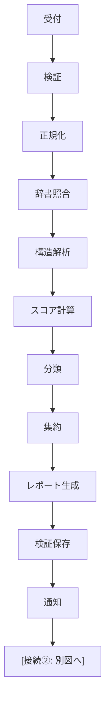

# 構成仕様（図表テストサンプル）

## 1. 全体フロー

図1に全体の処理フローを示し、表1に設定パラメータをまとめる。

**図1：全体フロー**

## 2. パラメータ

| パラメータ名 | 既定値 | 説明 |
| :--- | :--- | :--- |
| threshold | 0.30 | 疑義判定スコアの閾値 |
| max_nodes | 10 | 1図あたりのノード上限 |

**表1：パラメータ**
